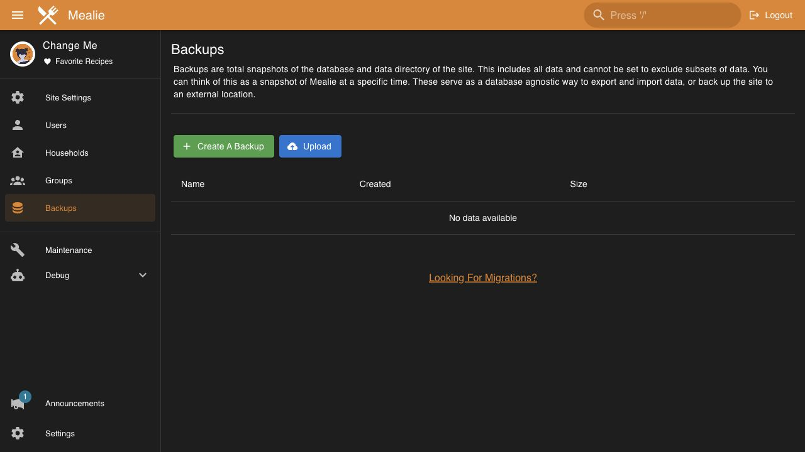
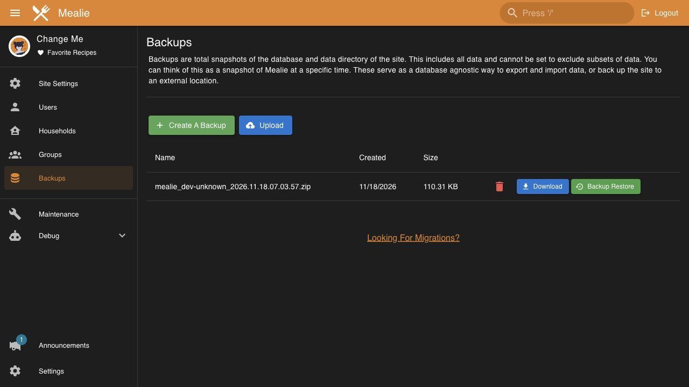
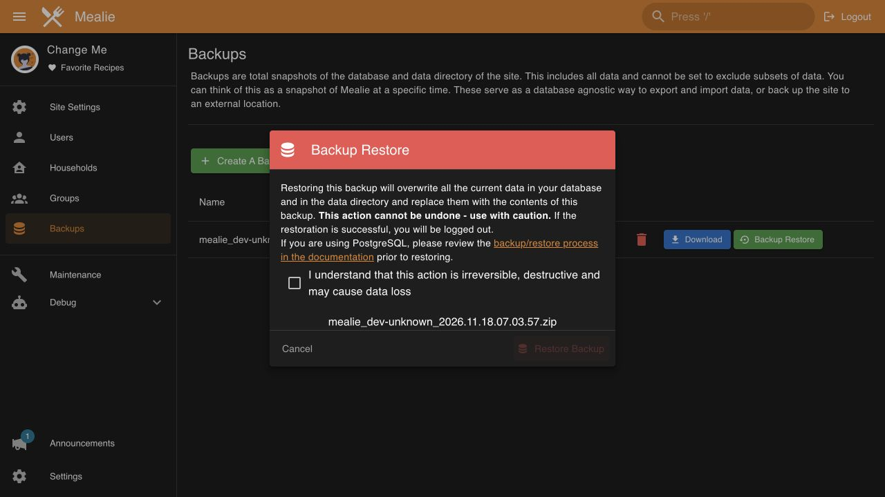
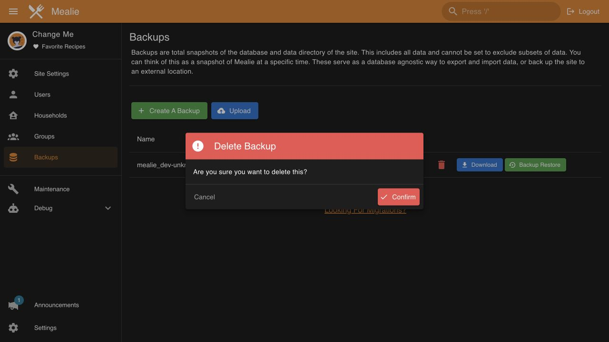

# Backup administration

Route: `/admin/backups`. Source: [backups.vue](../../frontend/app/pages/admin/backups.vue). Access: [admin wrapper](admin.md); admin layout.

## Functions to preserve

- Explain that backups snapshot the entire database and data directory; subsets cannot be excluded.
- Fetch backups on mount. Show imported/available archives with Name, localized Created date, Size, Delete, Download, and Backup Restore. Show all rows with no footer/pagination.
- Create A Backup displays loading, calls create, and on `error === false` refreshes and shows success; otherwise show the error-creating-backup toast. Reset loading afterwards.
- Upload accepts one `.zip` archive and posts multipart field `archive` to `/api/admin/backups/upload`, refreshing the list on uploaded event. Preserve file-chooser cancellation, loading, and upload errors from [AppButtonUpload](../../frontend/app/components/global/AppButtonUpload.vue).
- An empty list displays the table's no-data state. Although a search state is bound, no search field exists in this page.
- Download uses the shared file-token download behavior with `api/admin/backups/{fileName}`. Ensure relative URL resolution remains correct in the new control.
- Looking For Migrations links to `/group/migrations`.

## Delete and restore

- Delete stops row navigation, remembers the archive name, and opens a destructive bottom-sheet confirmation. Confirm calls delete; absence of a truthy returned error shows success and refreshes. Cancel preserves the file.
- Backup Restore selects an archive and opens a separate destructive bottom sheet. Explain overwrite of all database/data-directory contents, irreversibility, post-restore logout, and the PostgreSQL documentation note/link. Display selected filename.
- Require the explicit irreversible-action acknowledgement before enabling Restore Backup; disable it while restoring. During restore show indeterminate progress.
- On restore error, close the dialog, reset running state, and show failure. On success show success and reload the window after 500ms.
- The source does not reset the acknowledgement on dialog close; verify a fresh review requires an intentional acknowledgement during redesign.
- The table's generic row callback expects a record-shaped argument, while Vuetify row events may supply event plus item. The dedicated Restore button passes the item directly and was used for captures; verify row selection independently.
- No restore or deletion was executed for catalog screenshots. Created backup contains only isolated synthetic catalog data.

## Redesign (implemented)

| Before | Now |
| --- | --- |
| Section title, Create and Upload in a toolbar, backups in a data table with delete, download and restore buttons per row. | Heading with Upload and "Create a backup"; backups as rows (file name, date and size) with download, delete and an outline Restore button; an empty state. |
| Restore dialog as a bottom sheet with a red checkbox and a progress bar. | The standard dialog shows the file name, the warning and documentation link, and the acknowledgement in a red-bordered box; Restore is a red button and a spinner line shows while it runs. |
| Delete confirmation without the file name. | Delete confirmation shows the file name. |

## Screenshots

### Empty state and created backup

### Restore acknowledgement and deletion review

## Migration validation and optional evidence

These additional cases remain for replacement validation. See the [handoff evidence decisions](../HANDOFF.md#evidence-decisions) for shared references, preview fixtures, and unexecuted branches.

- [ ] Capture upload error/success, mobile list/dialog, and download behavior using synthetic archives.
- [ ] Verify row-selection callback and fresh acknowledgement on reopen. Validate actual restore only in an explicitly disposable recovery workflow.

## Shadcn Vue replacement checklist

- [ ] Use DataTable, file Input/Button, Alert, Checkbox, Dialog/Sheet, and loading/progress feedback.
- [ ] Preserve archive names, localized dates, upload/download endpoints, full-snapshot warning, destructive review, and restore reload.
- [ ] Keep backup deletion distinct from restore and recipe migration; provide named icon controls and accessible feedback.
