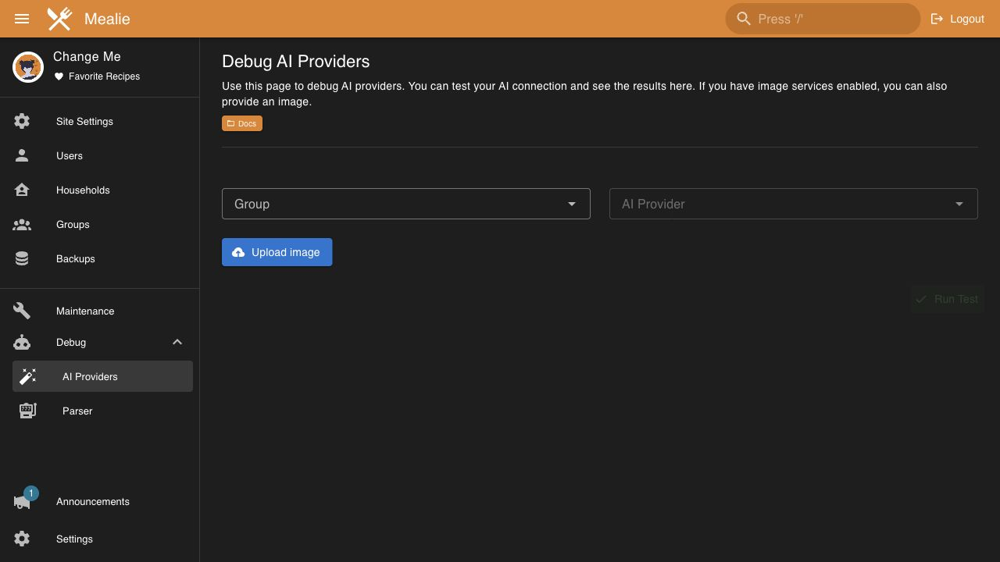
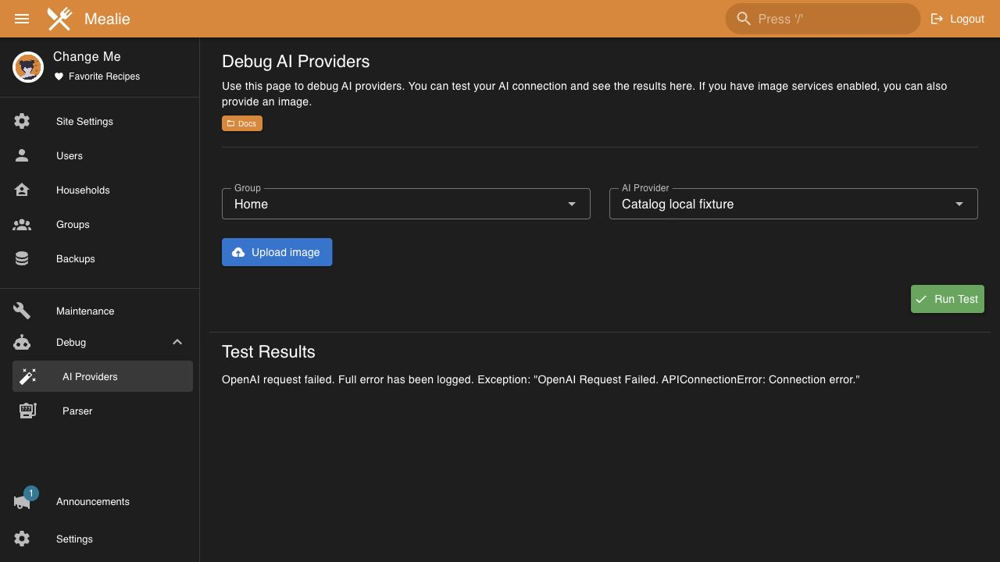
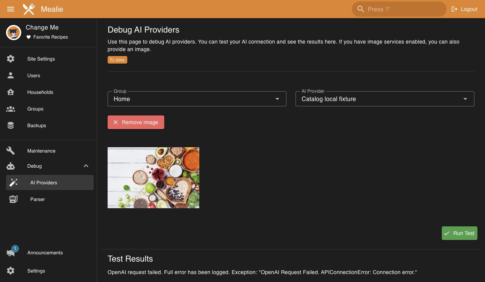

# AI provider debugger

Route: `/admin/debug/ai-providers`. Source: [ai-providers.vue](../../frontend/app/pages/admin/debug/ai-providers.vue). Access: [admin wrapper](admin.md); admin layout.

## Functions to preserve

- Explain provider testing and optional image services; link to AI provider installation docs.
- Load all groups. Group selector is clearable; provider selector is clearable and disabled without a group.
- Changing group clears provider selection/list, then uses that group's configured provider summaries. Keep provider identity scoped to the selected group.
- Run Test is disabled without a provider; its handler also guards absence with a toast.
- Upload Image accepts a single image through [AppButtonUpload](../../frontend/app/components/global/AppButtonUpload.vue) in `post=false` mode. File remains a local draft until Run Test; keep object-URL preview and Remove Image, which clears image/name/preview state.
- Selected image preview is bounded to 25% width in the current template. Keep a usable responsive preview rather than losing visibility at narrow widths.
- Run Test clears old response, sets loading, and calls admin debug with provider ID and optional image. Reset loading after response.
- No response produces Unable to Test AI Services toast. Data displays its response text, otherwise Test Successful/Test Failed fallback according to success. Keep a separate Test Results section and divider only when response is nonempty.
- Changing image/group does not currently clear the previous test result; do not imply an old result tested newly selected inputs. The image-preview screenshot retains the prior text-only failure and is captioned accordingly.
- Object URLs are created but not explicitly revoked by this component; preserve preview while cleaning resources safely during implementation.
- All captured tests use the local closed-port fixture; no external AI service received data.

## Redesign (implemented)

| Before | Now |
| --- | --- |
| Outlined compact selects in a grid; Upload / Remove image buttons; results as card text. | Labelled group and provider selects side by side, an image picker that shows a thumbnail with Remove, Run Test in the footer; results in a monospace block. |

## Screenshots

### Initial group/provider prerequisites

### Local fixture diagnostic failure

### Repository image preview and Remove Image

The preview uses an existing repository test image. The visible result belongs to the preceding text-only test; no image test was submitted.

## Migration validation and optional evidence

These additional cases remain for replacement validation. See the [handoff evidence decisions](../HANDOFF.md#evidence-decisions) for shared references, preview fixtures, and unexecuted branches.

- [ ] Capture successful text/image local-fixture responses, provider-empty group, and mobile layout.
- [ ] Verify upload cancellation, stale-result labeling, resource cleanup, and test failure recovery.

## Shadcn Vue replacement checklist

- [ ] Use Select/Combobox, file Input/Button, preview, Separator, status output, and loading/toast feedback.
- [ ] Preserve group reset behavior, optional image payload, provider guard, result fallbacks, and admin access.
