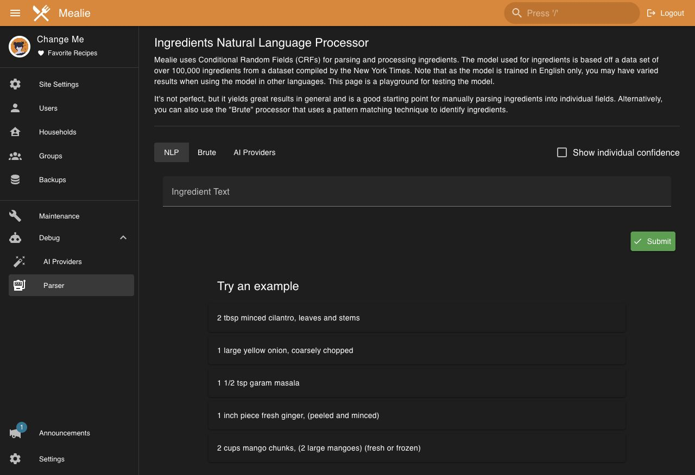
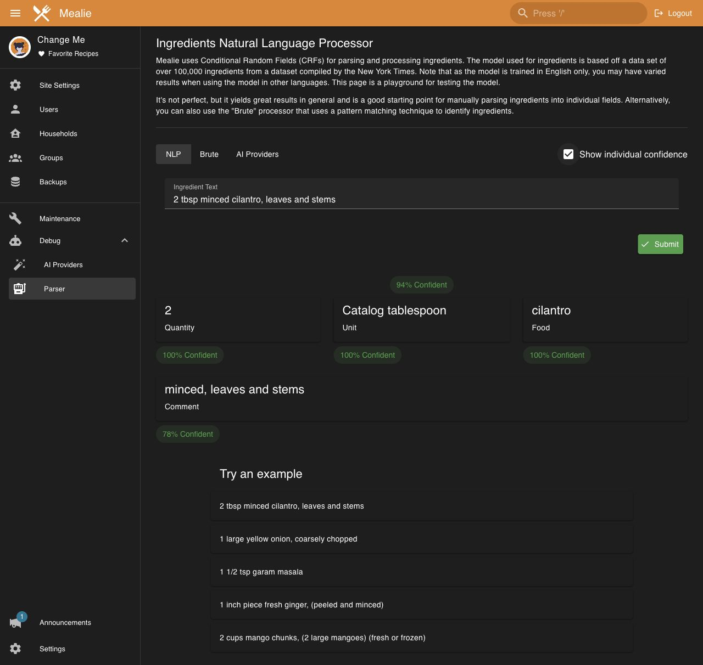
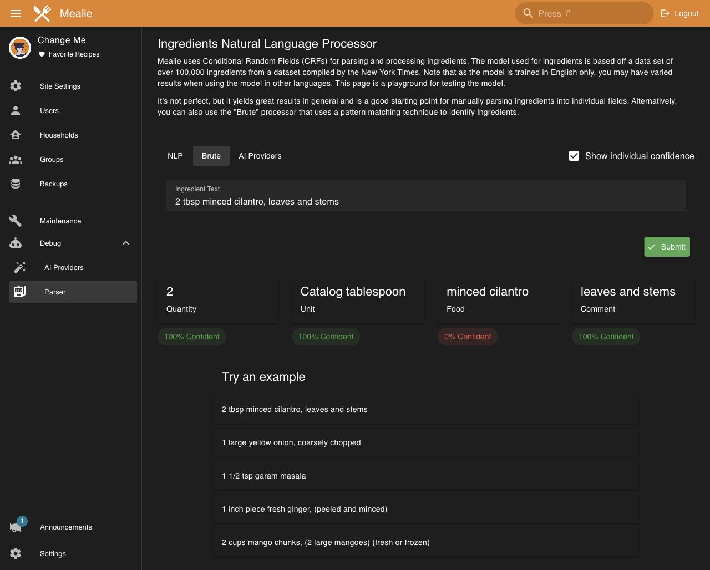
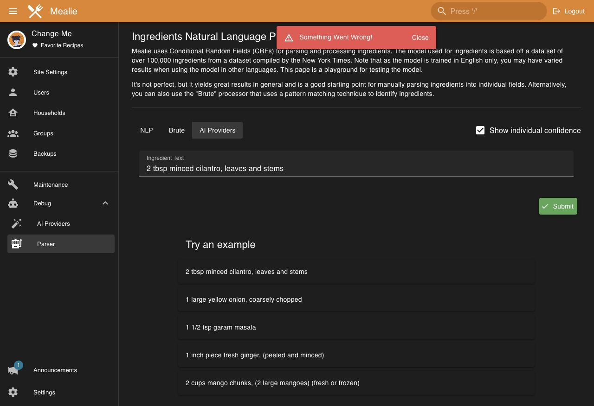

# Ingredient parser playground

Route: `/admin/debug/parser`. Source: [parser.vue](../../frontend/app/pages/admin/debug/parser.vue). Access: [admin wrapper](admin.md); admin layout.

## Functions to preserve

- Explain the English-trained NLP ingredient model and the alternate pattern-matching Brute parser.
- Choose one mandatory parser: NLP (`nlp`, initial), Brute (`brute`), or AI Providers (`ai-providers`). The mode control binds a change handler; Submit explicitly runs the currently selected parser.
- Enter Ingredient Text and Submit. An exactly empty string returns without a request; the current handler does not trim whitespace or validate other content.
- Five clickable example cards set the input and immediately parse: cilantro, onion, garam masala, ginger, and mango examples shown in the initial capture.
- Parse through the recipe ingredient API and display returned Quantity, Unit name, Food name, and Comment/note. Hide cards with falsy values, including zero quantity under the current implementation.
- Display average confidence only when present and parser is not Brute. Show individual confidence chips when the checkbox is checked and a field's confidence exists.
- Format confidence as a rounded integer percent. Color strictly greater than 75 green, greater than 60 warning, otherwise error. Keep percentage text so color is not the only signal.
- State tracks loading but the template does not bind it to a spinner or disabled controls. Do not claim a verified loading indicator.
- On a response without data, hide results and show Something Went Wrong toast. AI error capture uses the closed-port local provider fixture; no external AI request.
- When new responses omit confidence or individual values, the source can retain previous confidence metadata. Treat that as a stale-state limitation to improve, rather than an intended requirement.
- This playground parses text; it does not save a recipe. Preserve parser choice, examples, confidence detail toggle, and failure recovery when changing components.

## Screenshots

### Initial form and all examples

### NLP with average and per-field confidence

The synthetic unit's `tbsp` abbreviation resolves to Catalog tablespoon, demonstrating that parsing can resolve existing organizer data.

### Brute parser and local AI failure

## Migration validation and optional evidence

These additional cases remain for replacement validation. See the [handoff evidence decisions](../HANDOFF.md#evidence-decisions) for shared references, preview fixtures, and unexecuted branches.

- [ ] Capture mobile wrapping, confidence toggle off after success, and a successful synthetic AI response.
- [ ] Verify whether changing modes automatically reparses in the current Vuetify version; explicit Submit was used for comparison captures.

## Shadcn Vue replacement checklist

- [ ] Use ToggleGroup/RadioGroup, Checkbox, Input, Button, Card, Badge, and toast feedback.
- [ ] Preserve all examples, parser values, result fields, confidence thresholds, and alternate/failure states.
- [ ] Avoid stale confidence display and show accurate loading/error feedback without changing parser payloads.
