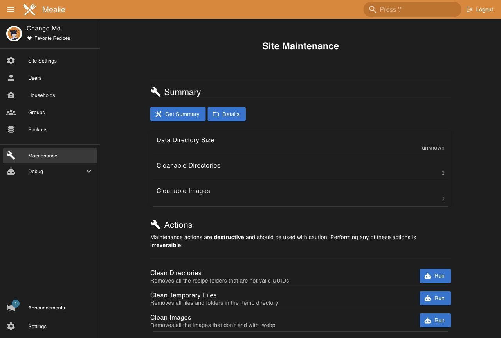
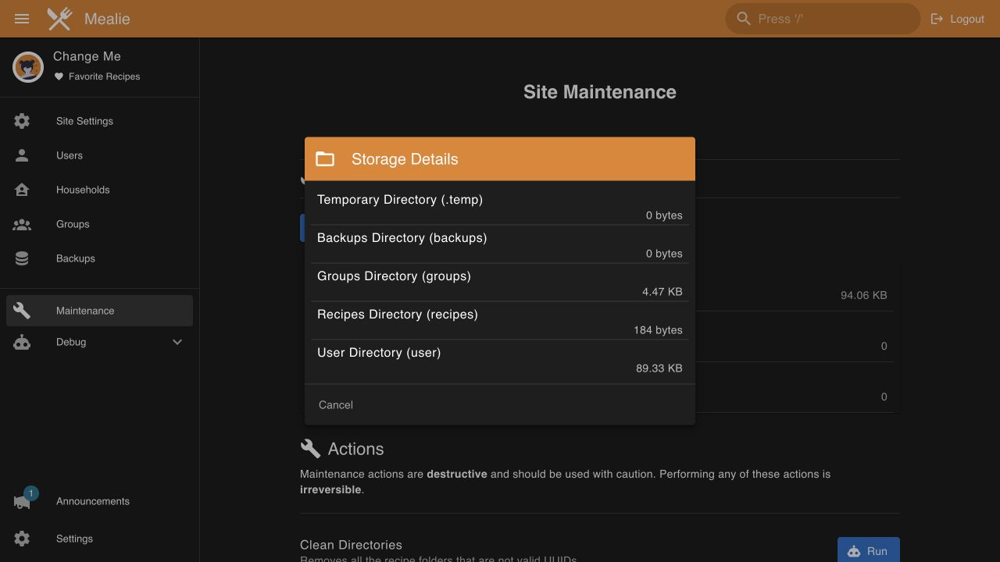
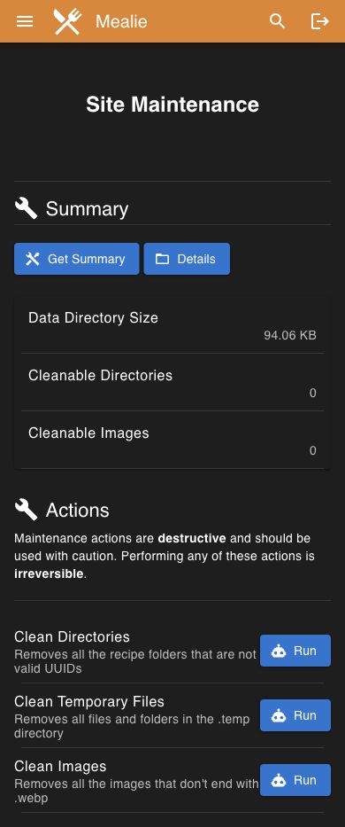

# Site maintenance

Route: `/admin/maintenance`. Source: [index.vue](../../frontend/app/pages/admin/maintenance/index.vue). Access: [admin wrapper](admin.md); admin layout.

## Functions to preserve

- Present Summary and Actions sections with the destructive/irreversible warning visibly emphasized.
- Initially show unknown Data Directory Size, zero Cleanable Directories, and zero Cleanable Images. Do not automatically run summary on entry.
- Get Summary fetches maintenance information with card loading feedback. Replace all three values from the response; on absent data return to unknown/zero defaults. Reset fetching state afterwards.
- Details opens a bottom-sheet dialog immediately, fetches directory sizes, and shows Temporary, Backups, Groups, Recipes, and User directories. Unknown keys use the localized unknown label.
- The source sets `storageDetailsLoading` true before and after fetching and does not bind it into the dialog. It can therefore show a blank/stale detail body during a request; do not present that as a working loading indicator.
- Keep Cancel/Escape/close behavior and focus return for storage details.

## Maintenance actions

- Three independently labeled Run actions invoke Clean Directories, Clean Temporary Files, and Clean Images APIs.
- Explanations identify their scope: recipe folders without valid UUIDs, all temporary files/folders, and images not ending in `.webp` respectively.
- Current Run buttons call their handlers directly without a second confirmation. A shared actionLoading flag drives the action card's loading display, and resets after the awaited call.
- The handlers do not automatically refetch Summary or Details and do not render a dedicated result panel. Preserve observable API error feedback; do not claim a nonexistent completion dialog.
- Screenshots cover controls and read-only diagnostics. Destructive cleanup was not run merely to obtain a screenshot.

## Screenshots

### Initial summary and available actions

### Fetched summary and directory details

### Mobile layout

## Migration validation and optional evidence

These additional cases remain for replacement validation. See the [handoff evidence decisions](../HANDOFF.md#evidence-decisions) for shared references, preview fixtures, and unexecuted branches.

- [ ] Verify summary/details failures and keyboard focus return with safe fixtures.
- [ ] During implementation validation, exercise cleanup only in explicitly disposable fixtures and check loading/error behavior; no invented cleanup-result screenshot is required for a panel that does not exist.

## Shadcn Vue replacement checklist

- [ ] Compose Card, Alert, Button, Dialog/Sheet, semantic description lists, Separator, and accurate loading feedback.
- [ ] Preserve every API action, warning, directory label, summary default, and manual refresh path.
- [ ] Keep destructive action targets distinguishable to keyboard and screen-reader users.
