# Administrative group detail

Route: `/admin/manage/groups/:id`. Source: [[id].vue](../../frontend/app/pages/admin/manage/groups/[id].vue). Access: [admin wrapper](admin.md); admin layout.

## Functions to preserve

- Watch the route group ID and fetch that group lazily. Render title/illustration, Back, ID, group form, and independent prompt editor only when data exists.
- A 404 sets an error flag and shows the current User Not Found toast; it does not render a dedicated group-not-found panel. Give accurate feedback during redesign while preserving failure handling.
- Group Name has no explicit field validator here. Group form includes the full [shared group preferences/provider contract](../shared-group-settings.md), including every nested dialog and prompt mode.
- Update submits the group object to admin group update. Require a valid loaded group; current form validation call is not awaited, so preserve validation intent while correcting Promise handling if changed.
- HTTP 200 with returned data replaces the group and shows Settings Updated. If its slug changed, reload the window so navigation URLs update. Failure shows Settings Update Failed.
- Provider Create/Update/Delete call target-group admin APIs, refresh the group on success, and show operation-specific success/failure toasts. These do not wait for the enclosing Update.
- AI Prompts receives the explicit loaded group ID and saves independently through target-group admin prompt endpoints. Preserve target isolation and each save boundary.

## Screenshots

### Full group preferences, provider choices, and task list

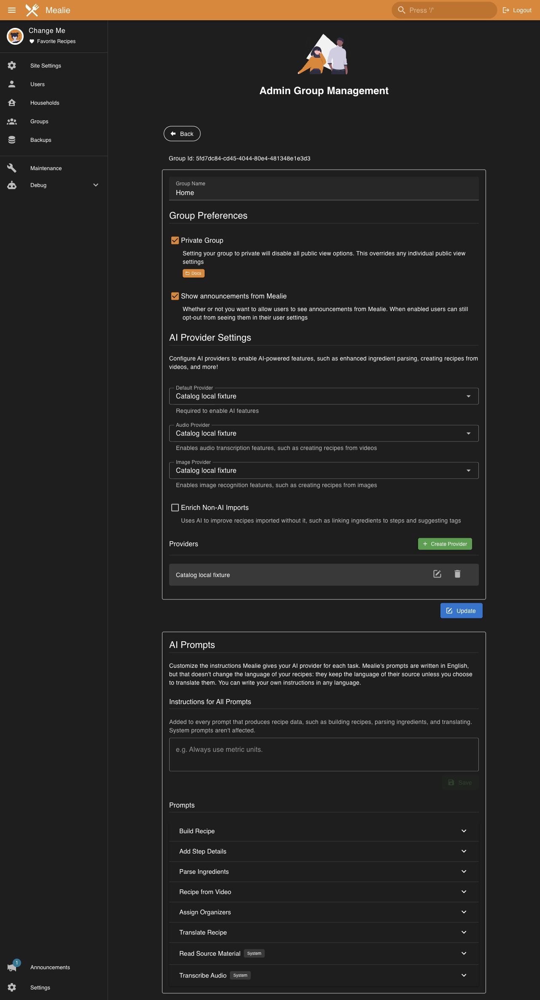

### Create provider and advanced request maps

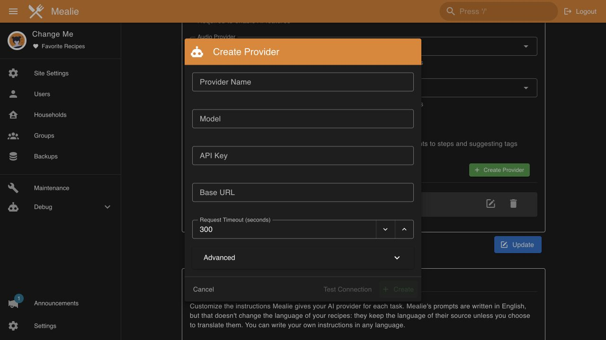
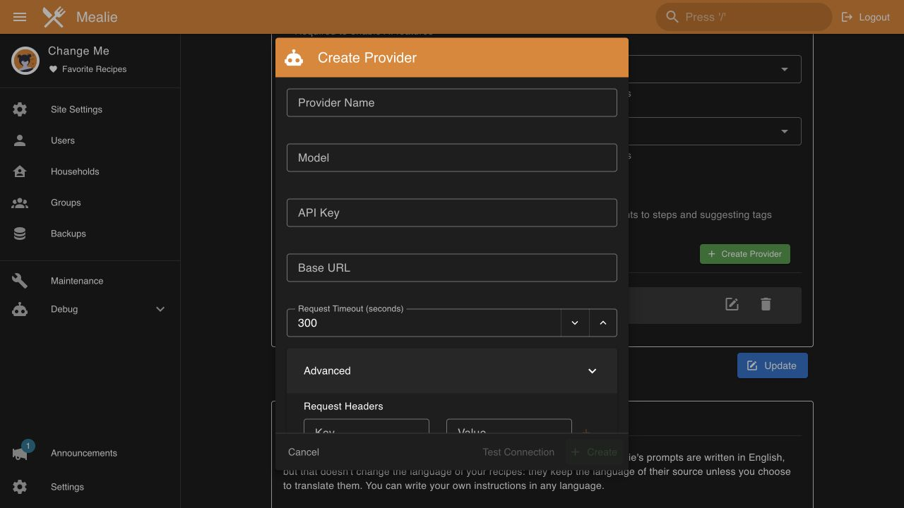
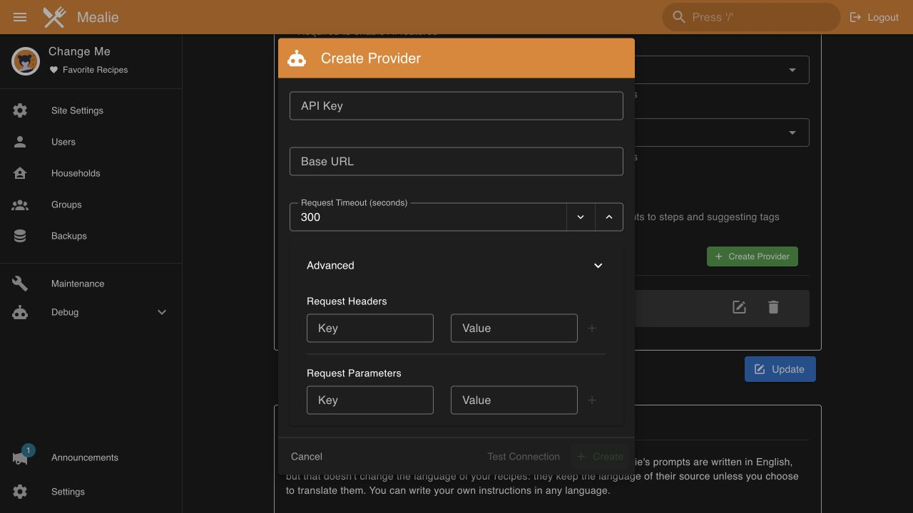

### Stored provider, connection failure, and endpoint-change guard

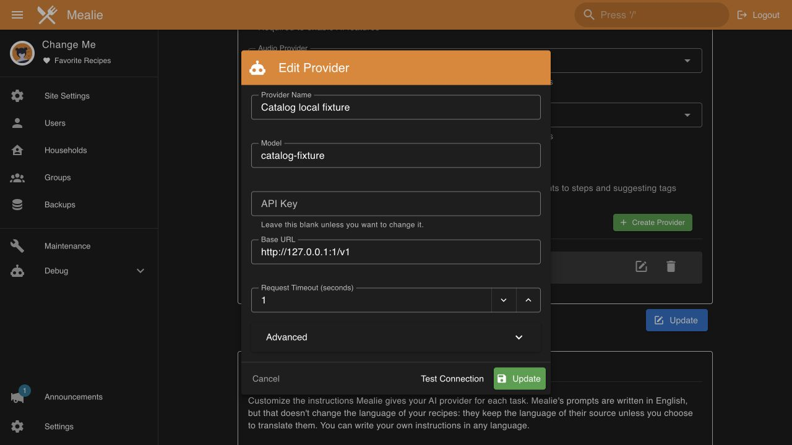
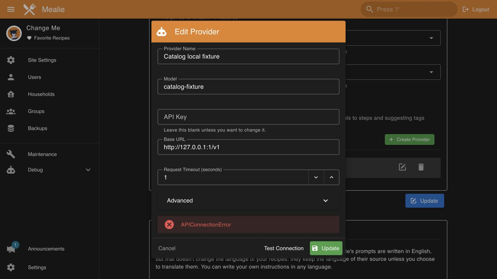
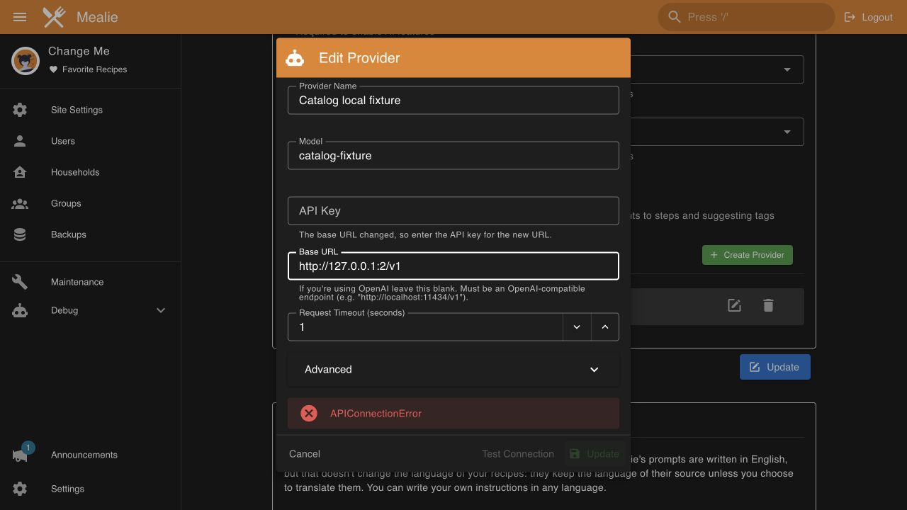

The connection fixture points at a closed local port. The changed URL was a discarded draft; no key was entered or endpoint saved.

### Built-in prompt, append, override, and system warning

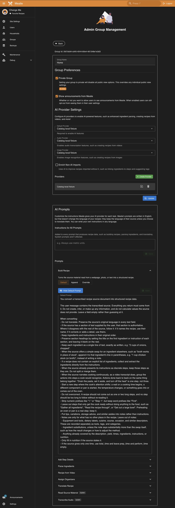
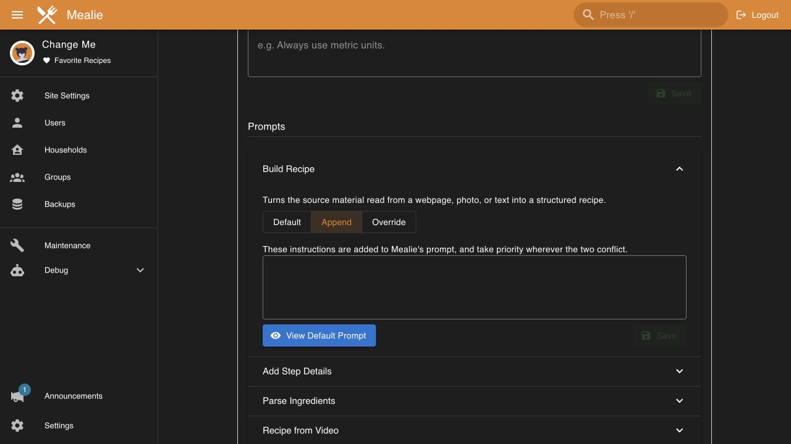
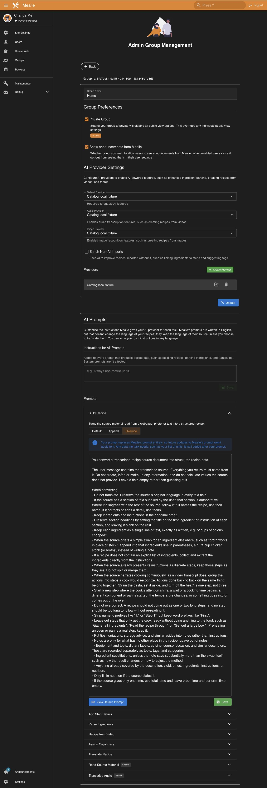
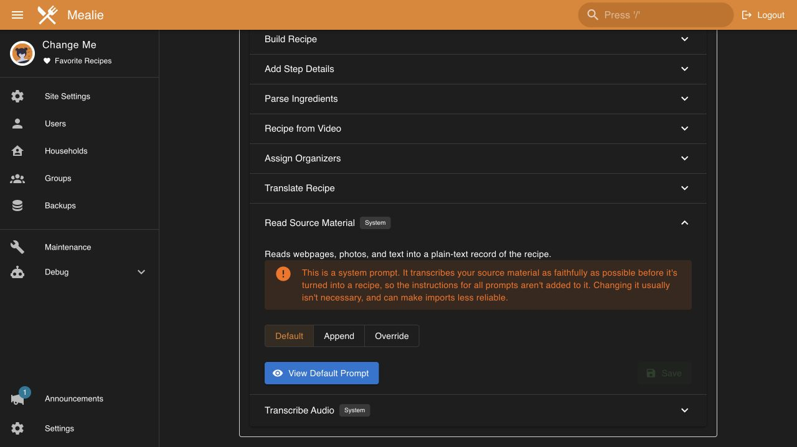

Prompt-mode changes shown here were unsaved drafts.

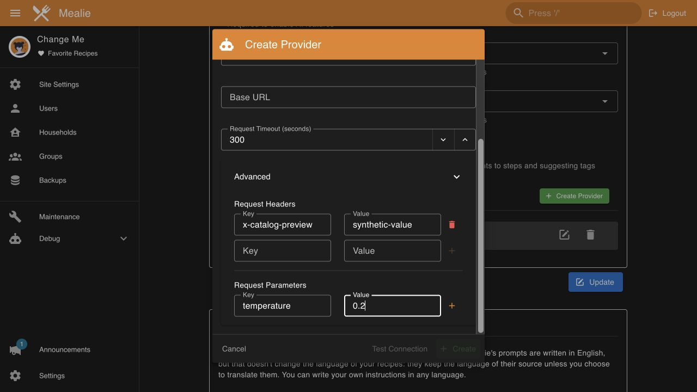
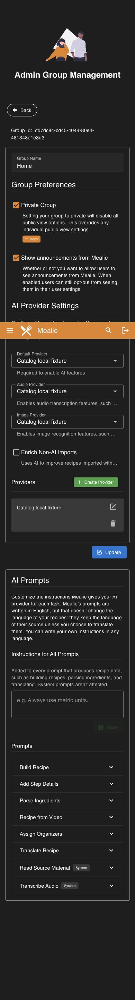

The request map values are nonsensitive draft examples; Cancel discarded them. No provider was created or tested for this capture.

## Migration validation and optional evidence

These additional cases remain for replacement validation. See the [handoff evidence decisions](../HANDOFF.md#evidence-decisions) for shared references, preview fixtures, and unexecuted branches.

- [ ] Verify no-default-provider warning, hidden-value reentry, successful local provider capability results, and changed-default prompt warning; mobile and map-row references are captured above.
- [ ] Capture all task descriptions in the expanded task list and verify saving one task preserves another draft.
- [ ] Verify cross-group provider fetch/test routing, missing-group feedback, save success/failure, and slug reload using safe fixtures.

## Shadcn Vue replacement checklist

- [ ] Apply every shared group-settings task and preserve separate saves, ID/Back navigation, and admin target scope.
- [ ] Verify all provider, preference, and prompt operations before removing their Vuetify components.
