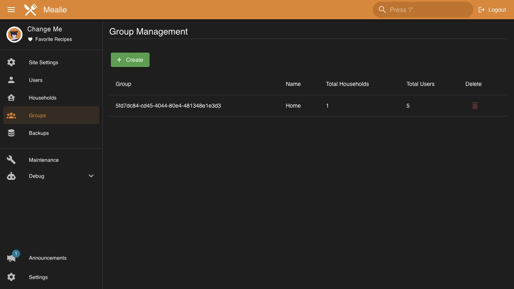
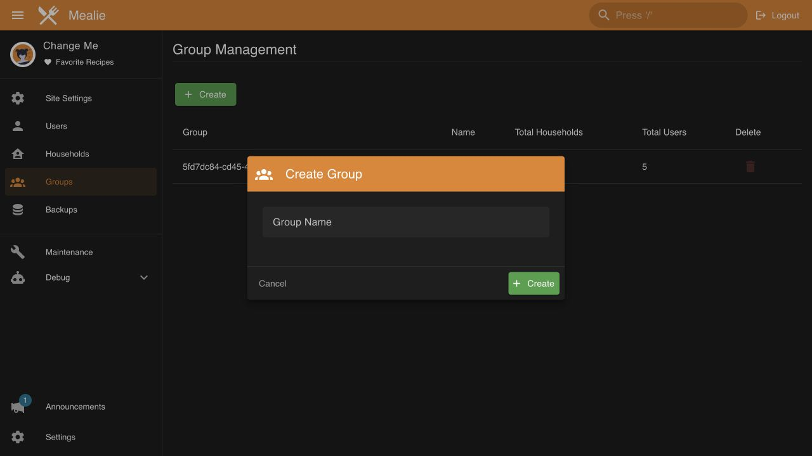

# Administrative group list

Route: `/admin/manage/groups`. Source: [index.vue](../../frontend/app/pages/admin/manage/groups/index.vue). Access: [admin wrapper](admin.md); admin layout.

## Functions to preserve

- Fetch all groups ordered by name ascending through [useGroups](../../frontend/app/composables/use-groups.ts).
- Show Group ID, Name, Total Households, Total Users, and Delete. Counts use related-array lengths. Render all rows without pagination or footer.
- Row click navigates to `/admin/manage/groups/{id}`. Deletion control stops propagation so it does not open the detail page.
- Delete is disabled for any group with households or users. A tooltip explains this restriction even around the disabled button. Do not rely on color or a disabled icon alone to communicate eligibility.
- Eligible Delete opens a destructive bottom-sheet confirmation; Confirm deletes the captured ID then refetches all groups. Cancel leaves it intact.
- Create clears the name draft and opens a bottom-sheet AutoForm with required Group Name. Submit calls create; append successful returned data to the current list.
- Preserve the form validation rules and shared dialog behavior. The current page does not explicitly await a form validator before the group-create call; do not replace validation with a truthy Promise check.
- Although the table binds an internal search string, there is no visible search input on this page. Do not describe search as an existing user control.
- Creation of the synthetic Catalog Empty Group also produced its default Family household; consequently it remains ineligible for group deletion despite zero users.

## Screenshots

### List with occupied group and disabled deletion

### Group-name creation form

## Migration validation and optional evidence

These additional cases remain for replacement validation. See the [handoff evidence decisions](../HANDOFF.md#evidence-decisions) for shared references, preview fixtures, and unexecuted branches.

- [ ] Capture blocked-delete tooltip, an eligible empty group's confirmation using a safe fixture, and mobile table/form.
- [ ] Verify row navigation and required-name validation behavior.

## Shadcn Vue replacement checklist

- [ ] Use DataTable, Dialog/Sheet, Input, Button, and Tooltip while preserving all-row display and count fields.
- [ ] Preserve deletion eligibility, click propagation, create reset, API refresh, and admin access.
- [ ] Provide named deletion controls and keyboard equivalents for row navigation.
