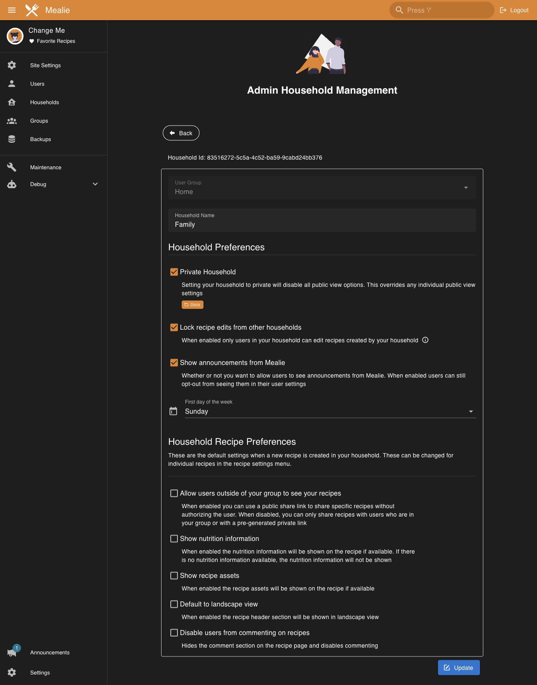
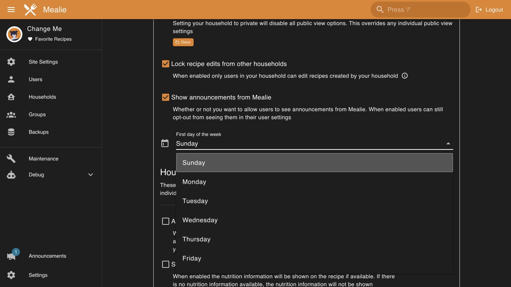
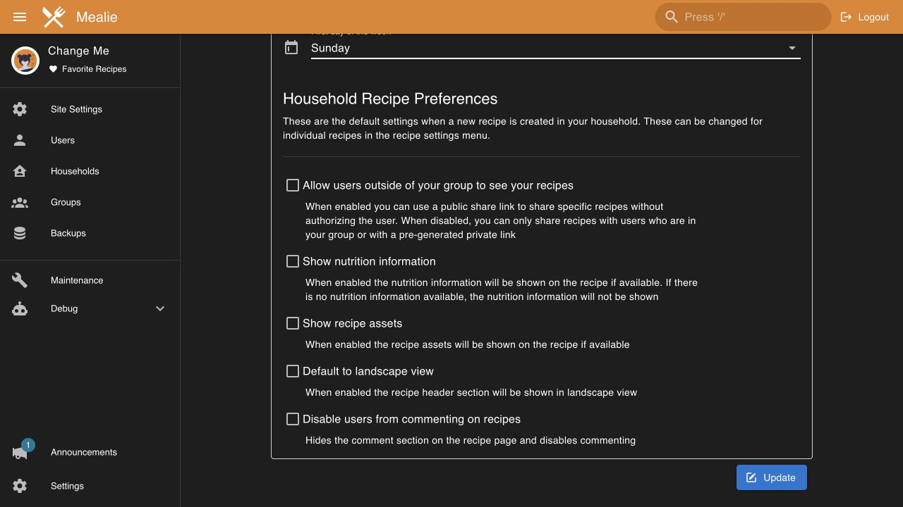

# Administrative household detail

Route: `/admin/manage/households/:id`. Source: [[id].vue](../../frontend/app/pages/admin/manage/households/[id].vue). Access: [admin wrapper](admin.md); admin layout.

## Functions to preserve

- Fetch the household for the watched route ID and all group choices. Show illustration/title, Back, and Household ID only after data exists.
- Group selector is disabled: the household's group cannot be changed through this form. Keep the displayed group name and persisted ID distinct.
- Edit required Household Name and the entire [shared household preference contract](../shared-household-preferences.md), including privacy, cross-household edits, announcements, day-of-week, and all new-recipe defaults.
- Update calls the admin household endpoint with the full household object. On HTTP 200/data replace the model and show Settings Updated; otherwise Settings Update Failed.
- The current validator call is not awaited. Preserve required-field intent and validate the actual result when replacing form controls.
- Missing household 404 shows the current User Not Found toast and hides the form via error flag; no dedicated missing-household panel exists.
- Preference edits are drafts until Update; the nested editor does not persist itself. Preserve response synchronization.

## Screenshots

### Complete household form

### Day-of-week choices and readable recipe defaults

## Migration validation and optional evidence

These additional cases remain for replacement validation. See the [handoff evidence decisions](../HANDOFF.md#evidence-decisions) for shared references, preview fixtures, and unexecuted branches.

- [ ] Capture administrator-exception tooltip, mobile form, empty-name validation, save feedback, and missing-household state.
- [ ] Verify planner refresh after saving a different first day of the week.

## Shadcn Vue replacement checklist

- [ ] Apply all household-preference tasks using Checkbox, Select, Input, Tooltip, Button, and accessible headings.
- [ ] Preserve disabled group reassignment, watched ID, required name, update feedback, draft persistence, and Back navigation.
