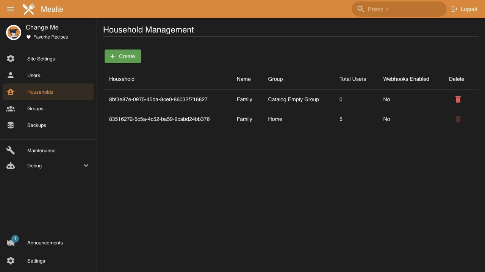
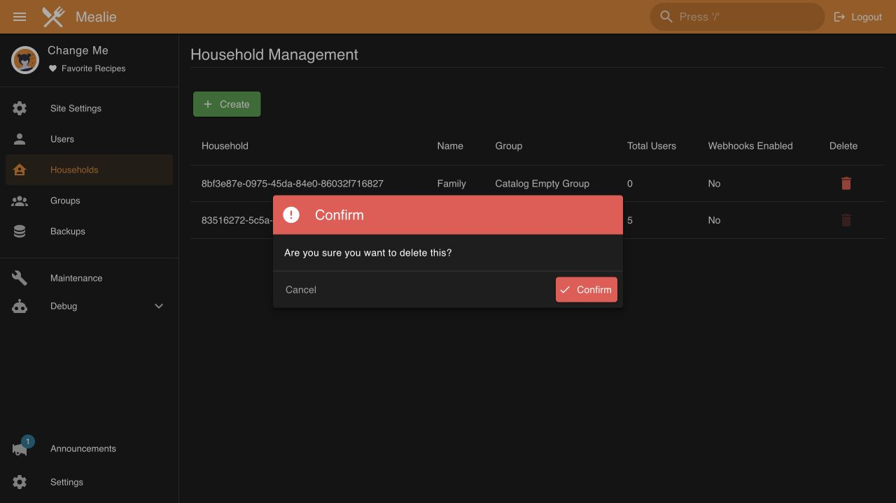
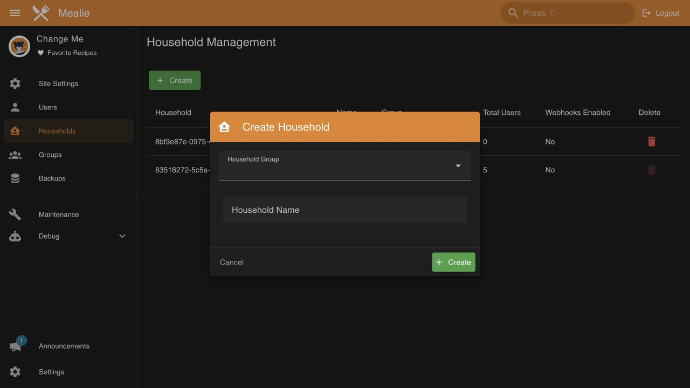
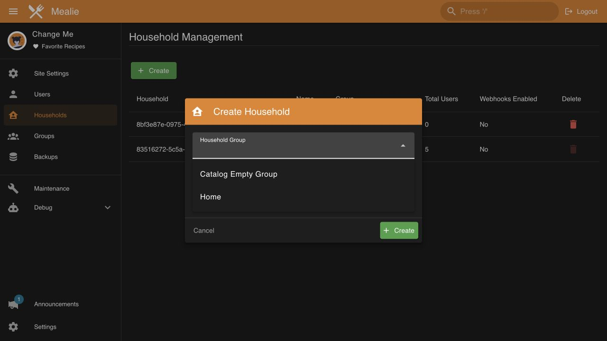

# Administrative household list

Route: `/admin/manage/households`. Source: [index.vue](../../frontend/app/pages/admin/manage/households/index.vue). Access: [admin wrapper](admin.md); admin layout.

## Functions to preserve

- Fetch all households ordered by name then group name ascending through [useAdminHouseholds](../../frontend/app/composables/use-households.ts); fetch group choices separately.
- Show Household ID, Name, Group, Total Users, Webhooks Enabled, and Delete. User count is the related-array length; Webhooks Enabled is localized Yes when the webhook array is nonempty, otherwise No.
- Render every row without pagination/footer. There is an internal search binding but no visible search input.
- Row click navigates to `/admin/manage/households/{id}`. Delete stops row navigation and is disabled while any users remain; a wrapping tooltip explains the restriction.
- Eligible deletion opens a destructive bottom-sheet confirmation with generic text. Confirm deletes the captured household ID and refetches; Cancel makes no change. The current review does not display the target name, an opportunity for clearer redesign feedback.
- Create resets both Household Group and Household Name, opens a bottom sheet, and requires both fields. The group Select uses names for display and IDs for persistence.
- A custom Create button and Enter within the form call the same handler, which closes the dialog then awaits create. Successful returned data appends to the list.
- Current validation is invoked without awaiting Vuetify's result. Preserve field requirements while fixing Promise truthiness if form control behavior changes; do not treat the source guard as proven validation.
- Keep API errors visible and preserve admin-only access.

## Redesign (implemented)

| Before | Now |
| --- | --- |
| Toolbar Create button and a data table; delete disabled with a tooltip when not empty. | Heading with a create button; each household is a linked row with its counts, and a trash button that stays dimmed with the reason as its title when it can't be deleted. |
| Create dialog as a bottom sheet. | The standard dialog with a Create button. |

## Screenshots

### Occupied and zero-user households

### Deletion review, cancelled after capture

### Required creation fields and group choices

## Migration validation and optional evidence

These additional cases remain for replacement validation. See the [handoff evidence decisions](../HANDOFF.md#evidence-decisions) for shared references, preview fixtures, and unexecuted branches.

- [ ] Capture occupied-household deletion tooltip, name/group validation errors, and mobile table/dialog.
- [ ] Verify row navigation and both Enter/button validation paths.

## Shadcn Vue replacement checklist

- [ ] Compose DataTable, Select, Input, Dialog/Sheet, Button, Tooltip, and validation feedback.
- [ ] Preserve group identity, related-user deletion guard, webhook status, all-row display, and create/reset/refresh behavior.
- [ ] Name icon controls and provide keyboard-accessible row detail navigation.
