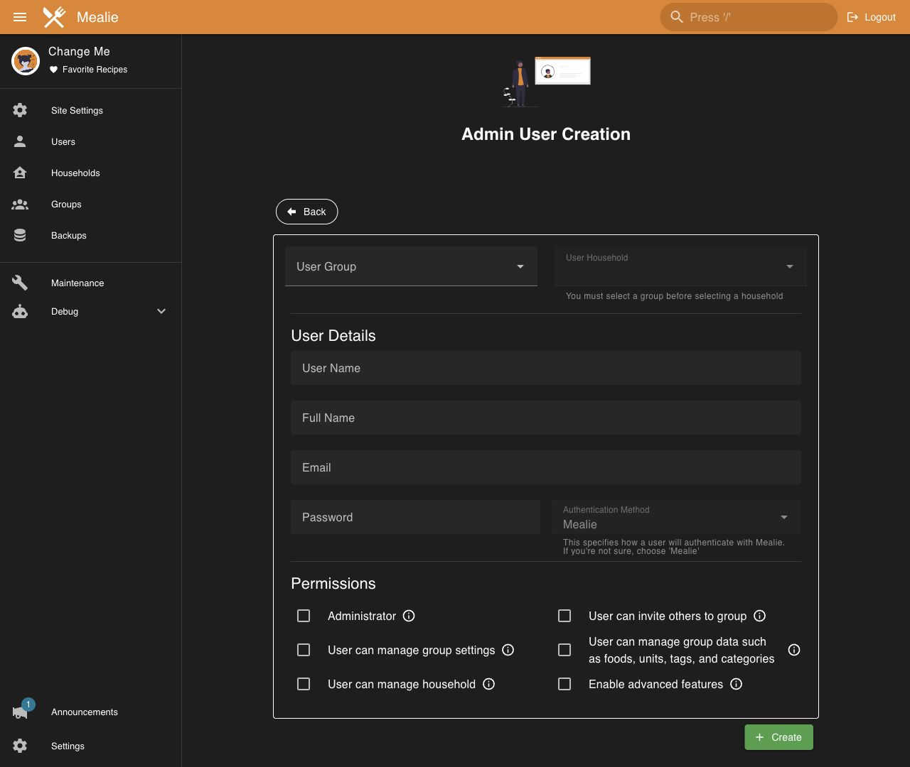
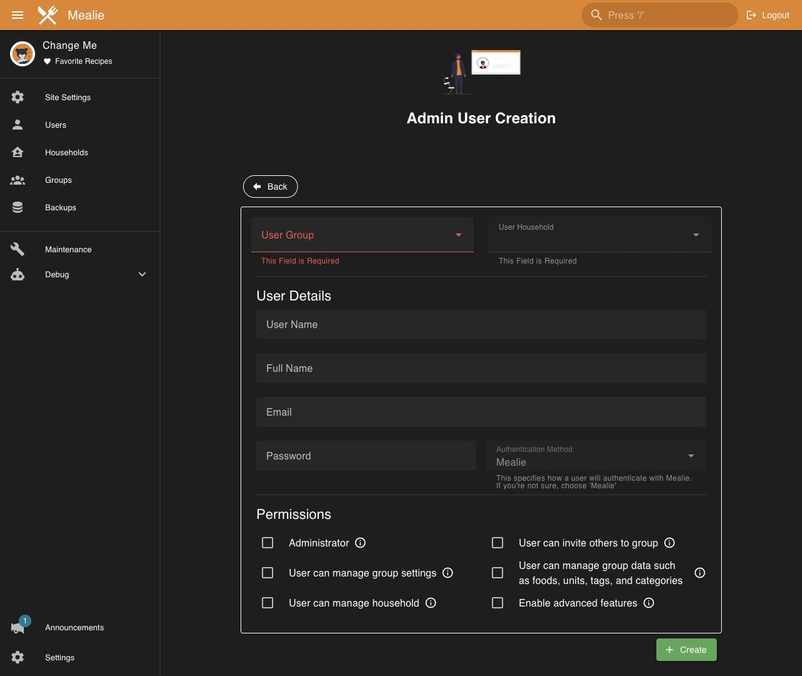
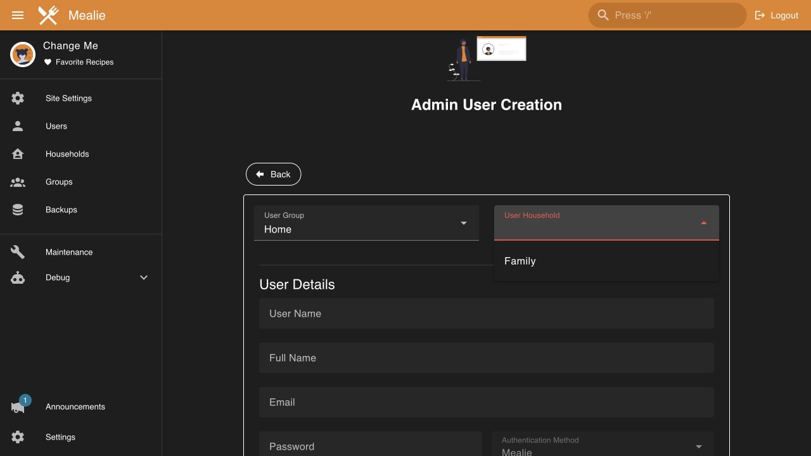
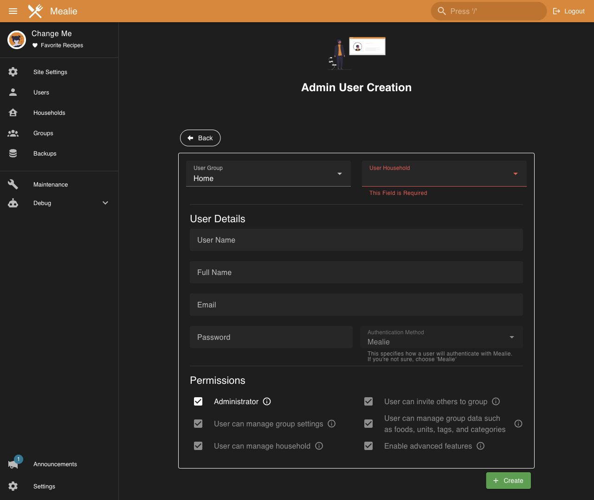

# Administrative user creation

Route: `/admin/manage/users/create`. Source: [create.vue](../../frontend/app/pages/admin/manage/users/create.vue). Access: [admin wrapper](admin.md); admin layout.

## Functions to preserve

- Show title/illustration, Back, group/household selectors, shared user fields, permissions, and Create.
- Fetch all groups; selecting one retains its full object and supplies its nested households. Persist group name in the user body, household name in the household field.
- Household selector is disabled until a group is selected, with an explanatory hint. Both group and household have required rules.
- Preserve every field and permission dependency in [shared admin user form](../shared-admin-user-form.md). Creation keeps Authentication Method fixed to Mealie and allows the password field.
- Submit awaits `validate()` and checks its `valid` property. Only a valid result calls admin user create. HTTP 201 navigates to `/admin/manage/users`; otherwise remain for correction/error feedback.
- The source does not explicitly clear an already selected household when the group changes; verify valid group/household pairing during migration.
- Captured validation shows the group/household errors. AutoForm renders its own form structure, so separately verify all shared field rules participate in the outer submit validation; do not assume the screenshot proves every rule fires.
- No account was submitted, and no new password was entered during cataloging. The Administrator screenshot shows draft control dependencies only.

## Redesign (implemented)

| Before | Now |
| --- | --- |
| Illustration title, back toolbar, filled group/household selects. | Back link and title; one panel with labelled group and household selects (household waits for a group), the form and a "New user" button. |

## Screenshots

### Empty form and validation

### Group-scoped household options and administrator draft

## Migration validation and optional evidence

These additional cases remain for replacement validation. See the [handoff evidence decisions](../HANDOFF.md#evidence-decisions) for shared references, preview fixtures, and unexecuted branches.

- [ ] Capture mobile layout, permission help tooltips, and all shared-field validation using empty/invalid noncredential drafts.
- [ ] Verify group-switch resets or rejects stale households, nested form validation, API error feedback, and successful redirect in a disposable account-creation workflow.

## Shadcn Vue replacement checklist

- [ ] Apply every shared admin-user-form task.
- [ ] Preserve group/household dependency, exact payload names, awaited validation, failure recovery, Back, and successful list navigation.
