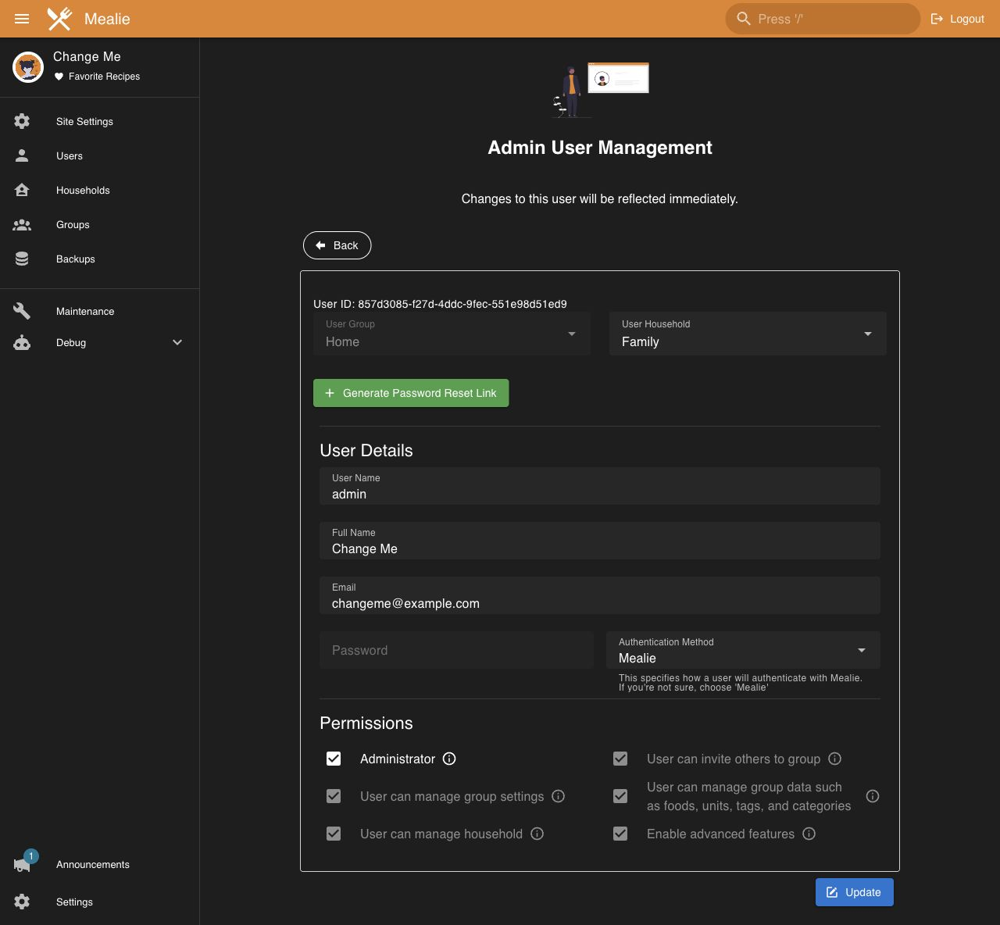
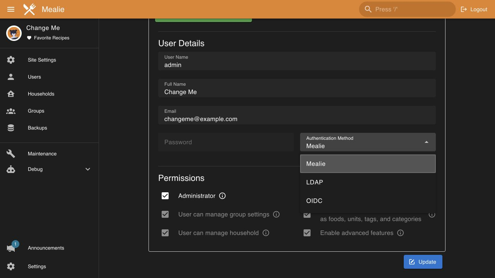
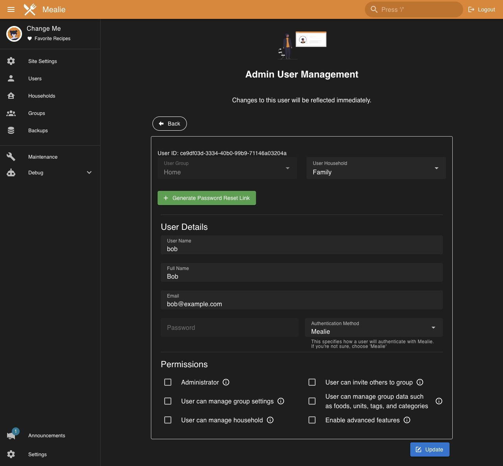
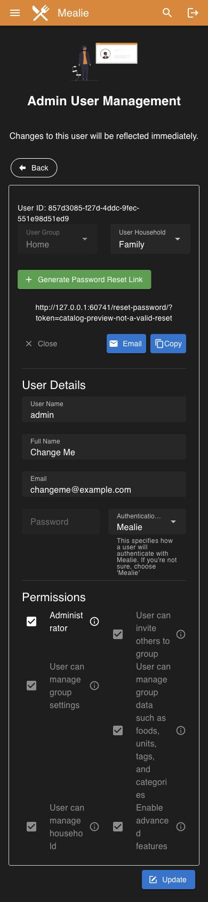
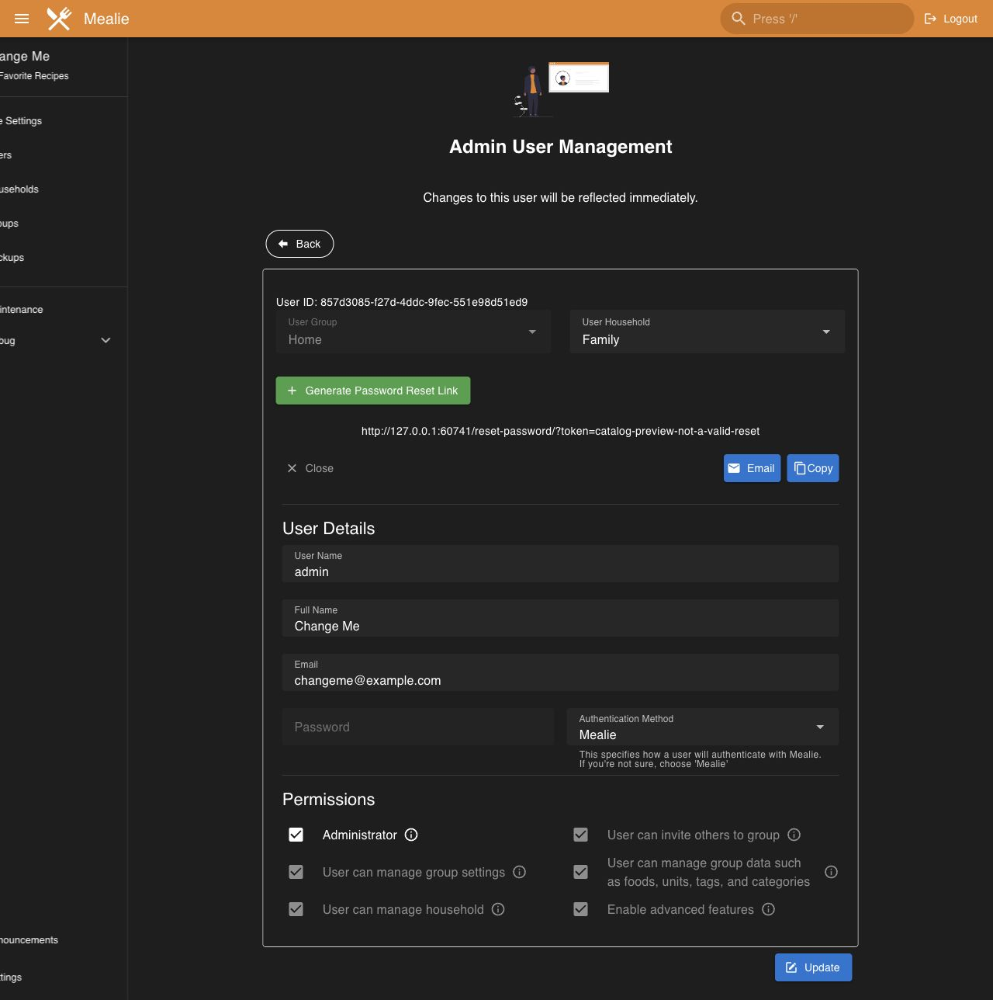

# Administrative user detail

Route: `/admin/manage/users/:id`. Source: [[id].vue](../../frontend/app/pages/admin/manage/users/[id].vue). Access: [admin wrapper](admin.md); admin layout.

## Functions to preserve

- On mount fetch the route's user ID. Show title/illustration, immediate-effect explanation, Back, User ID, and edit form after data arrives.
- User Group is disabled because group moves are not supported here. User Household is editable, restricted to households in that user's group, and uses household names in the payload.
- Apply the full [shared admin-user-form contract](../shared-admin-user-form.md), including disabled Password, editable Authentication Method, Administrator constraints, and dependent permissions.
- Update submits the full user object; HTTP 200/data replaces the model. No page-specific success toast is emitted by this handler. Preserve shared API failure feedback and the entered draft.
- Form validation is currently called without awaiting its result; migration must preserve required rules while checking actual validity.
- A 404 sets the error flag and shows User Not Found. Because the outer container requires user data, the result can be an otherwise blank content area rather than a dedicated failure panel.
- The current code reads route ID once and fetches on mount, unlike group/household detail's watched IDs. Verify navigation between two user IDs refreshes the record rather than showing stale data.

## Password reset tools

- Generate Password Reset Link calls the admin token endpoint for the loaded email, with loading state. HTTP 201 builds `{origin}/reset-password/?token={token}` and reveals it.
- Result has Close (clears the displayed URL), Copy, and Email when the user has an email address. Copy uses shared clipboard behavior.
- Email calls the ordinary forgot-password mail endpoint for the user's email and displays success/failure toast; it does not simply email the displayed URL value.
- Password-reset links are credentials. Capture the control, and use invalid/revoked-token fixtures for any future result screenshot; do not store active reset tokens in planning artifacts.

## Screenshots

### Existing administrator with implied permissions

### Supported authentication methods

### Ordinary user with individually editable permissions

These result views use an explicitly invalid initializer in the isolated checkout, restored with [the preview helper](../scripts/link-preview-fixture.mjs). No reset token was generated and Email was not sent.

## Migration validation and optional evidence

These additional cases remain for replacement validation. See the [handoff evidence decisions](../HANDOFF.md#evidence-decisions) for shared references, preview fixtures, and unexecuted branches.

- [ ] Verify household options and permission tooltips; mobile form and invalid result references are captured above.
- [ ] Verify missing-user feedback and the non-Mealie administrator restriction; invalid reset-result controls are previewed above.
- [ ] Verify user-to-user route navigation, update validation, and API error recovery.

## Shadcn Vue replacement checklist

- [ ] Apply all shared user-form tasks and preserve disabled group/password fields, household scope, and current-user refresh behavior.
- [ ] Preserve reset-link generation, clear/copy/email controls, loading, and feedback without exposing active credentials.
