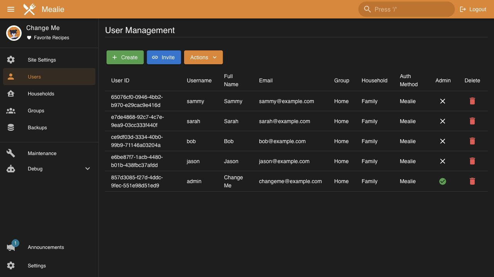
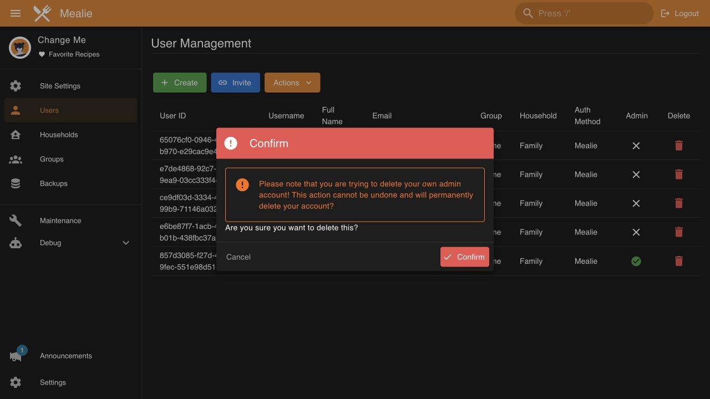
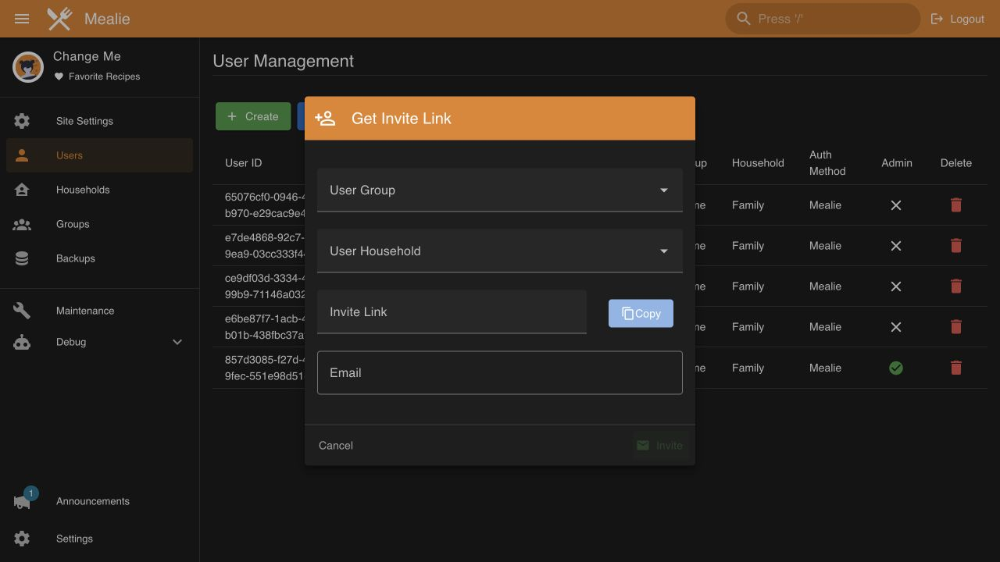
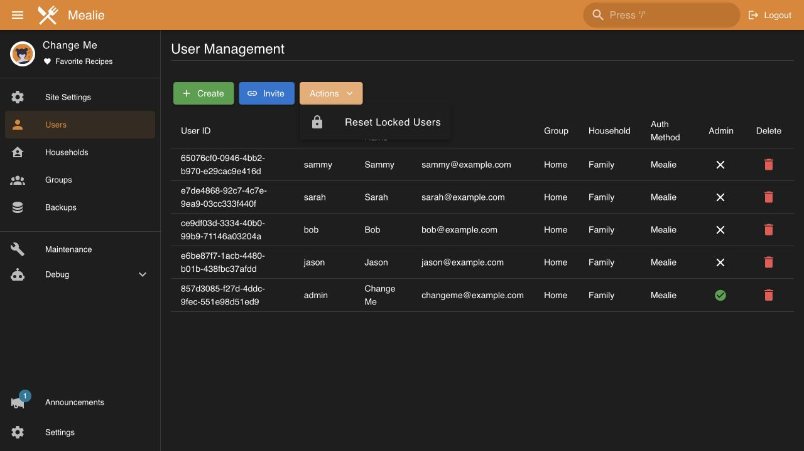

# Administrative user list

Route: `/admin/manage/users`. Source: [index.vue](../../frontend/app/pages/admin/manage/users/index.vue). Access: [admin wrapper](admin.md); admin layout.

## Functions to preserve

- Fetch all users and show User ID, Username, Full Name, Email, Group, Household, Auth Method, Admin status, and Delete. Admin is an icon with positive/negative state; give it accessible text.
- Render all rows without pagination/footer. An internal search string exists but there is no visible search field.
- Row click opens `/admin/manage/users/{id}`. Create links to `/admin/manage/users/create`.
- Delete stops row navigation and opens a destructive confirmation for the captured ID. Deleting one's own account adds the prominent own-admin-account warning.
- Current disabled condition is numeric coercion `+item.id == 1`, a legacy rule that does not disable ordinary UUID identifiers. Do not assume the default UUID admin is protected by this UI check; the captured own-account warning is real.
- Confirm invokes the user deletion composable and refreshes the user list; own-account deletion also triggers session refresh. Cancel performs no deletion. Do not execute deletion to obtain a confirmation screenshot.
- Actions includes Reset Locked Users. It calls the unlock-all endpoint with true, shows returned unlocked count (zero fallback) in a success toast, and refreshes users. This is an administrative state change, separate from ordinary list browsing.

## Invitation dialog

Source: [UserInviteDialog.vue](../../frontend/app/components/Domain/User/UserInviteDialog.vue).

- Show Invite only when password login is allowed. The dialog includes User Group, User Household, read-only Invite Link, Copy, Email, Cancel, and Invite send action.
- Administrators load all groups/households; household options filter to the chosen group. Selectors persist IDs while displaying names and require values.
- Selecting a household with a selected group creates a one-use invitation for that group/household. Non-admin consumers of this same component generate a default one-use invitation on opening.
- Link is `{currentOrigin}/register?token={token}`. Copy is disabled until text exists and uses shared clipboard feedback.
- Email must be nonempty and validator must return boolean true. Invite displays loading and sends email/token, then shows success/error toast and closes. Enter in Email also invokes send.
- If send starts without a token, the current code calls signup-link generation without awaiting it before sending. Changing group also does not explicitly clear household/token. Record these as current race/stale-selection risks; verify and correct during migration rather than preserving an incorrect recipient context.
- Opening the captured admin dialog leaves both selectors empty and creates no invitation. No active invitation token or sent email appears in these screenshots.

## Screenshots

### Synthetic user table

### Own-admin-account deletion warning

### Invitation draft and unlock action menu

## Migration validation and optional evidence

These additional cases remain for replacement validation. See the [handoff evidence decisions](../HANDOFF.md#evidence-decisions) for shared references, preview fixtures, and unexecuted branches.

- [ ] Capture a normal user-delete review, hidden Invite with password login disabled, and mobile table/dialog.
- [ ] Use fake/revoked invitation result fixtures for link/copy/email states; never include an active credential in planning artifacts.
- [ ] Verify invitation group-switch behavior and awaited token generation during implementation.

## Shadcn Vue replacement checklist

- [ ] Use DataTable, DropdownMenu, Dialog/Sheet, Input, Select, Button, Alert, status labels, and toast feedback.
- [ ] Preserve complete user identity/status fields, own-account warning, session/list refresh, and permission boundaries.
- [ ] Preserve one-use invitation scope, household filtering, email validation, and copy feedback while preventing stale token context.
