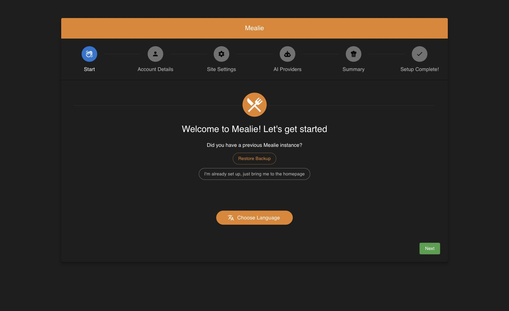
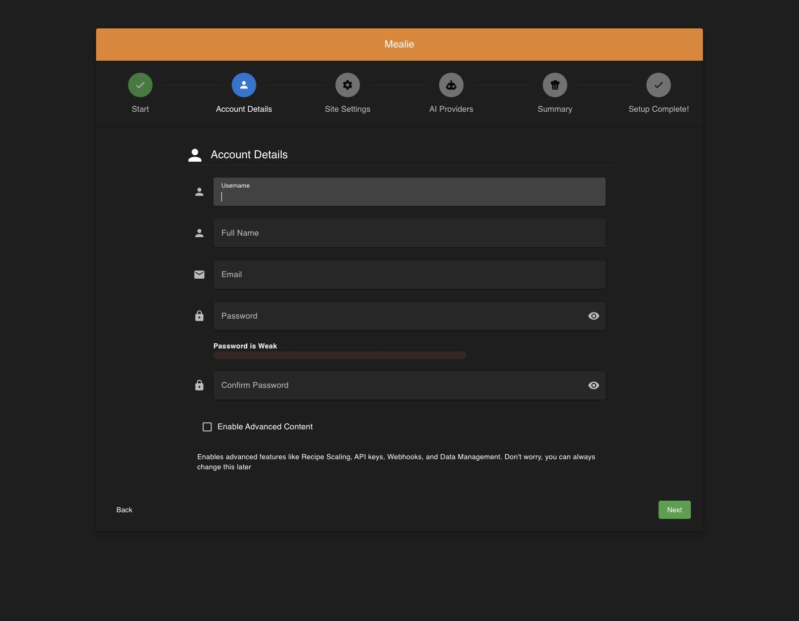
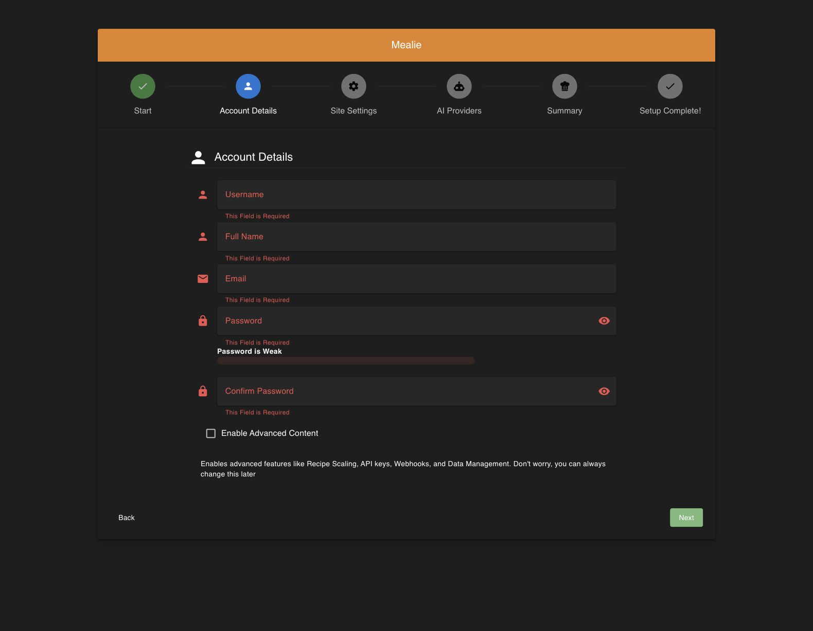
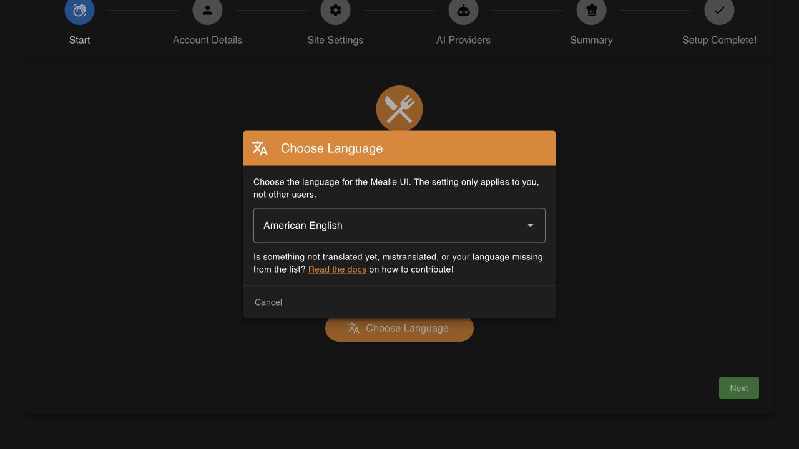
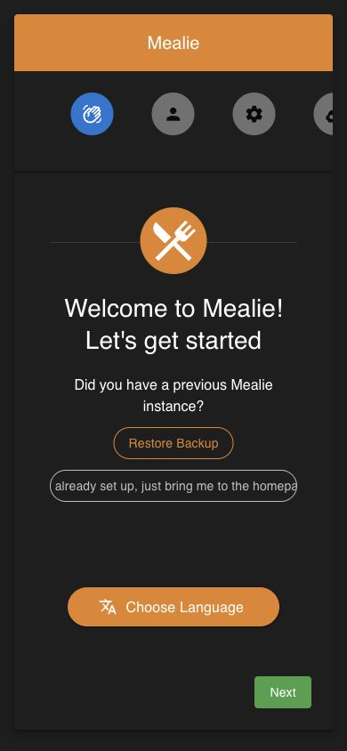
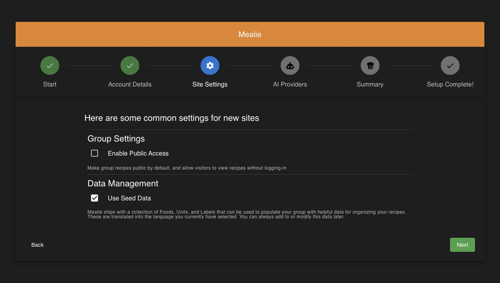
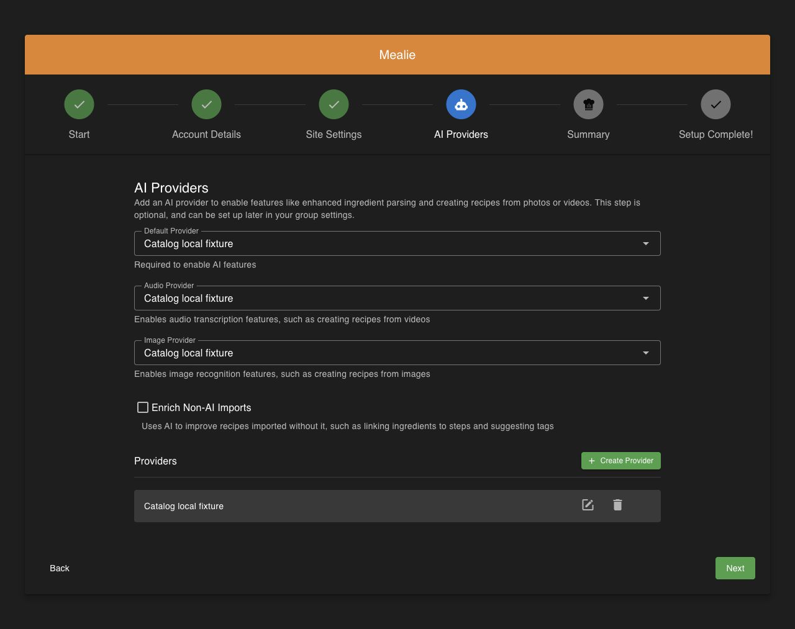
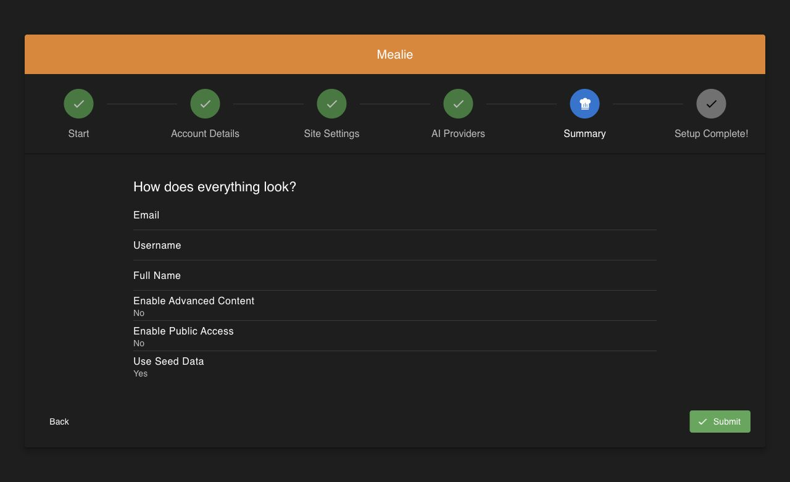
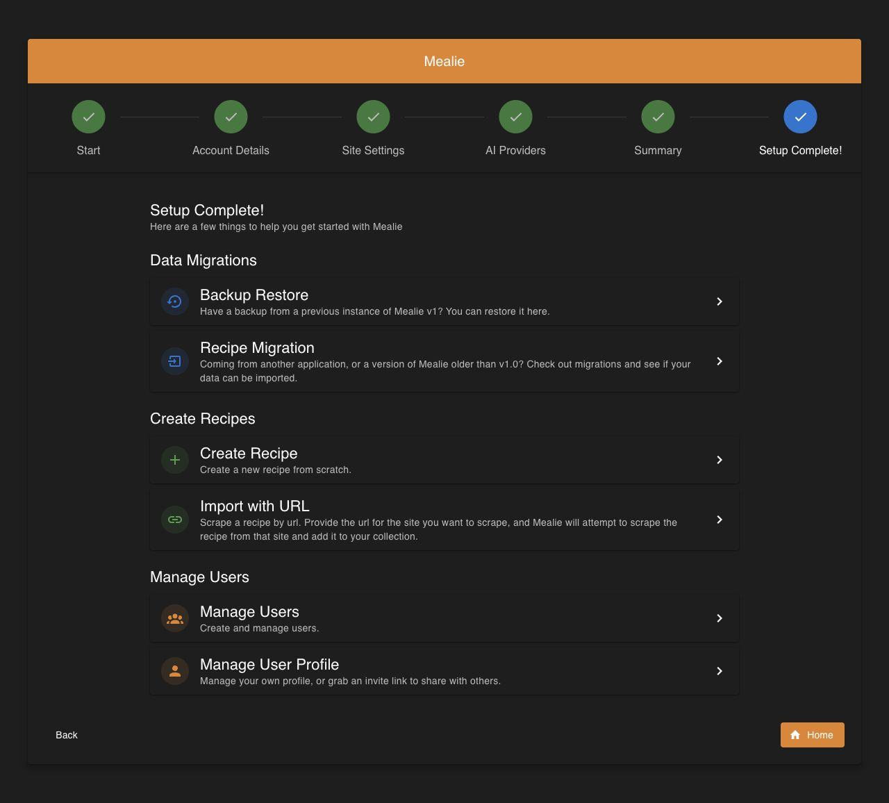

# First-time setup

Route: `/admin/setup`. Source: [setup.vue](../../frontend/app/pages/admin/setup.vue).
Access: administrator, with `admin-only` and the parent admin route's authentication gate.
Layout: blank. Status: source reviewed; all six steps have capture references; later steps use explicit preview fixtures.

## Wizard controls

- Show six steps: Start, Account Details, Site Settings, AI Providers, Summary, and Setup Complete.
- Show the current step, completed steps, and future steps with different indicator colors.
- Use the mobile stepper presentation at the `sm` breakpoint.
- Advance with Next and return with Back where available.
- Validate account details before leaving that step.
- Block repeated navigation or submission while `isSubmitting` is true.
- Show a progress bar while the Summary submission runs.
- Keep this wizard separate from the regular administrator navigation layout.

## Step functions

| Step | Functions |
| --- | --- |
| Start | Welcome, Restore Backup → `/admin/backups`, skip to current group home, Choose Language, Next. |
| Account Details | Username, full name, email, password/confirmation, async availability checks, password strength and visibility, advanced-content choice. |
| Site Settings | Enable Public Access, default false; Use Seed Data, default true; explanations and Back/Next. |
| AI Providers | Manage providers and group AI settings through the shared provider editor; Back/Next. |
| Summary | Review email, username, full name, advanced content, public access, and seed-data choice; Back or Submit. |
| Setup Complete | Show the shared end-page content; return Back or use Home to enter the current group. |

Account fields use [UserRegistrationForm.vue](../../frontend/app/components/Domain/User/UserRegistrationForm.vue).
See [Registration](register--index.md) for the shared account field and validation contract.
The common settings form comes from [common-settings-form.ts](../../frontend/app/composables/use-setup/common-settings-form.ts).
The last step uses [EndPageContent.vue](../../frontend/app/components/Domain/Admin/Setup/EndPageContent.vue).

The final step also links to Backup Restore, Recipe Migration, manual recipe creation, URL recipe import, Manage Users, and the profile/invitation page.

## Submission contract

- Change the default password first, using the current default password.
- Reauthenticate with the old email and new password before other authenticated requests.
- Update account details after reauthentication and refresh the session.
- Preserve the order. A parallel account/password request can invalidate the other requests' session.
- Update group privacy from Enable Public Access.
- Update household privacy and the default recipe-public setting from the same choice.
- When seed data is selected, seed foods and units in the chosen locale.
- Submit common settings and group AI settings after the account step finishes.
- Show errors from failed account, preference, seed, and AI operations.
- Advance to the final step after the submission handler completes.

## AI-provider editor contract

- Create, update, and delete providers through `useAIProviders`.
- Refresh the group and show operation-specific success or failure feedback after each provider operation.
- Retain group-level AI settings and prompt configuration exposed by the shared editor.
- Provider changes have their own API calls before the final wizard Submit.
- Read the provider-editor source before replacing this step; its controls do not fit in a single wizard screenshot.

Source: [GroupAIProviderSettingsEditor.vue](../../frontend/app/components/Domain/Group/GroupAIProviderSettingsEditor.vue).
The [shared provider and prompt contract](../shared-group-settings.md) covers every field, validation rule, test result, secret sentinel, and independent save.

## Screenshots

### Welcome, backup restore, skip link, locale, and step navigation

### Complete account step

### Validation after Next with empty account details

### Language, mobile, and later-step previews

The last four images preview the existing step content in the isolated checkout.
The [preview helper](../scripts/setup-preview-fixture.mjs) changes only the initial step through an explicit query parameter.
No new password enters the form. No setup submission, seed operation, privacy change, or credential change runs.
The Summary account fields remain empty. The final screen previews content; it does not prove successful setup.
The helper restores the original initializer after capture.

## Migration validation

- [ ] Verify submission progress, account/session continuity, and completed setup with an explicit disposable credential workflow.
- [x] Audit the full provider-editor child component; see the shared contract.
- [ ] Verify the full success path and session continuity with disposable fixture data.

## Shadcn Vue replacement checklist

- [ ] Replace stepper, card, toolbar, forms, progress, lists, buttons, and transitions.
- [ ] Preserve step validation, Back history, active/completed status, and submit guards.
- [ ] Retain the backup restore and skip-setup exits.
- [ ] Preserve the ordered password/session/account operations.
- [ ] Preserve group and household privacy, locale-specific seed choices, and independent provider CRUD.
- [ ] Verify all six steps and the first-login entry from Login and `/`.
