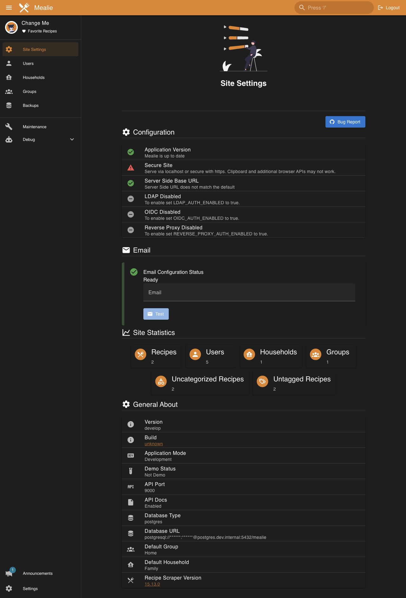
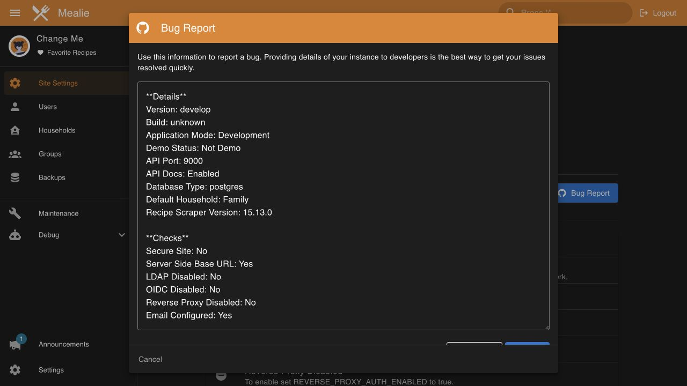
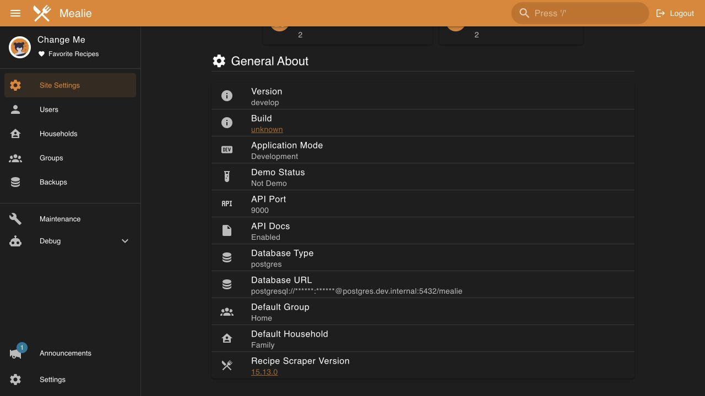
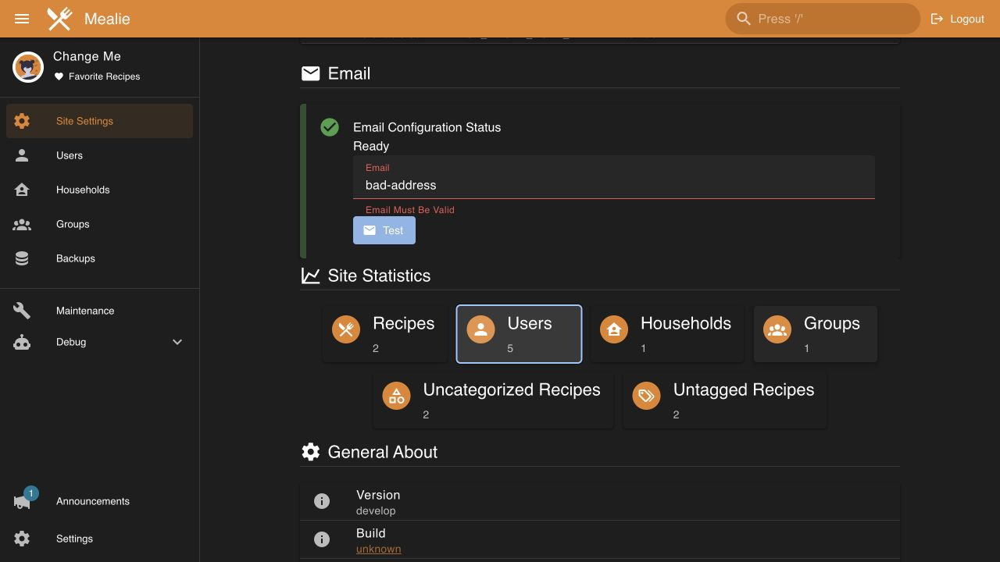
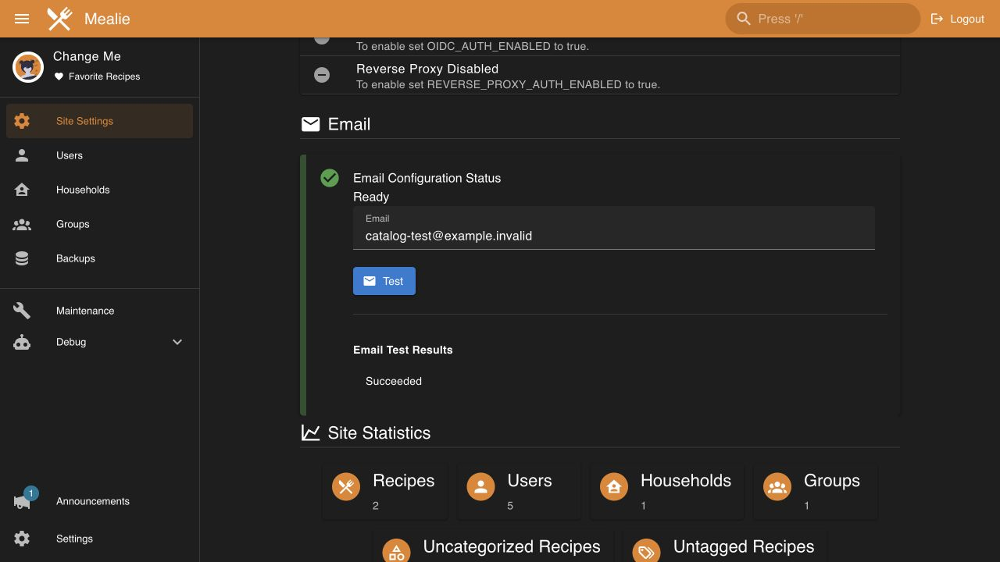
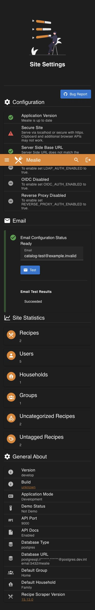

# Site settings and diagnostics

Route: `/admin/site-settings`. Source: [site-settings.vue](../../frontend/app/pages/admin/site-settings.vue). Access: [admin wrapper](admin.md). Uses the admin layout, explicitly reapplying it on mount.

## Functions: configuration checks

- Display site illustration/title, configuration checks, email tester, site statistics, and General About. These are diagnostics; the page does not edit the application's environment configuration.
- Fetch configuration checks and statistics on mount and app information asynchronously. Show the loader until About information exists.
- Show Application Version as up-to-date or a warning including current/latest versions.
- Secure Site is true only for hostname exactly `localhost` or HTTPS. The capture origin `127.0.0.1` therefore displays a warning despite being a local capture environment. Preserve accurate browser-capability guidance; do not treat this fixture result as production misconfiguration.
- Show Server Side Base URL status from the API.
- LDAP, OIDC, and Reverse Proxy each have three presentation states: disabled (neutral, with enabling environment variable), ready (success), or enabled but incomplete (warning). Preserve icon, text, and color distinctions with accessible status text.
- Enabling-variable hints are LDAP_AUTH_ENABLED, OIDC_AUTH_ENABLED, and REVERSE_PROXY_AUTH_ENABLED.

## Email test

- Display Email Configuration Status as Ready/Not Ready with corresponding color and icon.
- Enter Email with validation; disable Test for an unready mail configuration, empty address, or validator result other than boolean true. Validation may return a string message; truthiness alone is insufficient.
- Test sends the address to the email-test API, sets loading, clears the previous tested indicator, then shows Succeeded or Failed after completion.
- The current handler records an error string but does not render it. If the API returns no data, it also retains the previous success boolean; redesigning error feedback should avoid presenting stale success as a new result.
- The successful capture used `catalog-test@example.invalid` and the isolated local Mailpit service; no external email was sent.

## Statistics and application information

- Show Recipes, Users, Households, Groups, Uncategorized Recipes, and Untagged Recipes counts.
- Only Users, Households, and Groups cards link to their respective `/admin/manage/...` pages. Preserve nonlinked cards as statistics rather than misleading buttons.
- Cards wrap and fill the width at the smallest breakpoint.
- About fields: Version, Build, Application Mode, Demo Status, API Port, API Docs, Database Type, masked Database URL, Default Group, Default Household, and Recipe Scraper Version.
- Release versions link to the Mealie release; develop/nightly remain plain. Build links to its Mealie commit. Scraper version links to its upstream release. Open those links in a new tab.
- Preserve backend masking of database credentials. The capture shows `******` in both credential positions.

## Bug report preview

- Bug Report opens an 800px bottom-sheet dialog with explanatory text, an 18-row read-only generated report, Tracker external link, Copy, and Cancel.
- Generate Details from About while excluding Database URL and Default Group. Default Household remains included under the current contract.
- Generate Checks excluding Application Version, with localized Yes/No from each status; append Email Configured. Disabled authentication providers have false ready status, so the present report reads e.g. LDAP Disabled: No; distinguish this presentation quirk from enabled/not-ready semantics.
- Tracker links to GitHub's new-issue chooser in a new tab. Opening the preview does not submit a report. Keep copying separate from publishing.
- Copy uses the shared copy control and its feedback; preserve plain report text and newlines.

## Screenshots

### Entire diagnostic page

### Bug report preview and readable About section

### Email validation and completed local test

### Narrow screen with full-width statistic cards

## Migration validation and optional evidence

These additional cases remain for replacement validation. See the [handoff evidence decisions](../HANDOFF.md#evidence-decisions) for shared references, preview fixtures, and unexecuted branches.

- [ ] Capture enabled-ready and enabled-incomplete auth-provider diagnostics using safe local fixtures.
- [ ] Capture unready email configuration, test failure, copy feedback, and the loading state if it can be observed reliably.
- [ ] Verify keyboard access, dialog focus return, and statistics links.

## Shadcn Vue replacement checklist

- [ ] Compose semantic status lists, Alert, Card links, Input, Button, Dialog/Sheet, Textarea, Skeleton, and accessible copy feedback.
- [ ] Preserve all diagnostic branches, report exclusions, version links, mail validation, and disabled-provider neutrality.
- [ ] Keep administrative access checks, responsive card wrapping, credential masking, and accurate asynchronous feedback.
