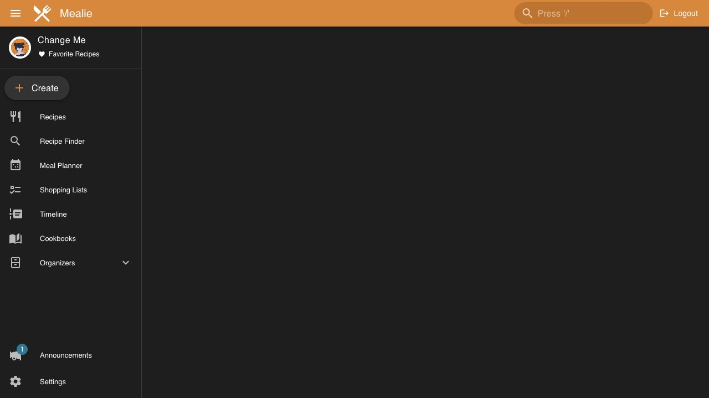

# Admin route wrapper

Route: `/admin` and nested pages. Source: [admin.vue](../../frontend/app/pages/admin.vue). Middleware: [admin-only.ts](../../frontend/app/middleware/admin-only.ts).

## Functions to preserve

- Apply authentication and administrator-only middleware to the nested route family. Non-admin users redirect to `/`.
- Render the matched child using NuxtPage. This file has no dashboard, forms, buttons, or data fetches of its own.
- Visiting `/admin` directly currently produces the inherited default shell with an empty main area. It does not automatically redirect to an admin child. The admin layout used by specific children is cataloged in [shared shell](../shared-shell.md).
- Preserve route hierarchy and child-specific layouts while replacing components; do not move privileged operations into an unguarded route.

## Screenshots

### Direct wrapper route with inherited shell

## Migration validation and optional evidence

These additional cases remain for replacement validation. See the [handoff evidence decisions](../HANDOFF.md#evidence-decisions) for shared references, preview fixtures, and unexecuted branches.

- [ ] Verify unauthenticated and non-admin redirects using a separate non-admin fixture session.

## Shadcn Vue replacement checklist

- [ ] Preserve the NuxtPage outlet and both middleware checks.
- [ ] Audit each admin child separately; this wrapper screenshot does not cover those controls.
