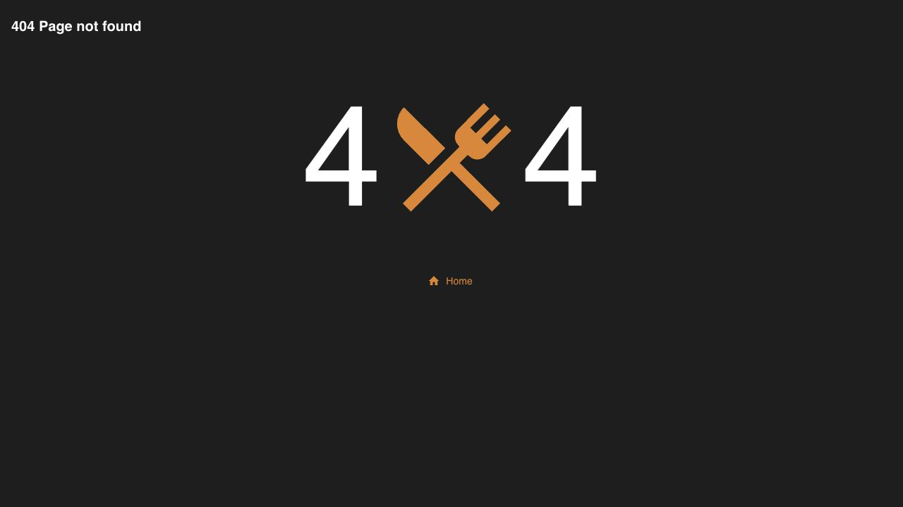

# Application error and legacy-route recovery

Source: [frontend/app/error.vue](../../frontend/app/error.vue). This Nuxt error boundary is additional to the 66 files under `pages/`.

## Functions to preserve

- Render only after error recovery logic has resolved. Use a standalone app surface with localized error title, a large decorative 4–Mealie icon–4 composition, and Home.
- Home calls `clearError({redirect: '/'})`, clearing Nuxt's error state as well as navigating. A normal link alone is not necessarily equivalent.
- Browser/SEO title distinguishes 404 Not Found from An Error Occurred. The current visual body always says 404 Page not found, even for other status codes; record this as a present limitation rather than a requirement to mislabel server failures.
- The default content and action regions are slots with fallback title and Home action.

## Legacy URL recovery

- For 404s, normalize a trailing slash and redirect old `/group/mealplan`, `/group/members`, `/group/notifiers`, and `/group/webhooks` paths (including nested suffixes) into `/household/...`, clearing the error.
- Otherwise, if authenticated with a group slug, replace the first `/recipe/` segment with `/r/` and prepend `/g/{groupSlug}` when the path is not already group-prefixed (case-insensitive check of the first segment).
- Resolve the transformed path before redirecting. An unknown path must remain an error instead of landing on an empty group wrapper.
- Preserve the full route/query where the transformation uses `fullPath`. If no recoverable route or authenticated group exists, show the error surface.
- Do not expose error stack traces or raw internal messages as part of the redesign.

## Screenshots

### Unknown route and Home recovery action

## Migration validation and optional evidence

These additional cases remain for replacement validation. See the [handoff evidence decisions](../HANDOFF.md#evidence-decisions) for shared references, preview fixtures, and unexecuted branches.

- [ ] Capture narrow-screen layout and a controlled non-404 error state.
- [ ] Verify Home clears error state and test each legacy redirect family, including query preservation and unknown transformed paths.

## Shadcn Vue replacement checklist

- [ ] Replace Vuetify app/title/actions/icon/button with semantic heading, layout, decorative artwork, and Button.
- [ ] Preserve asynchronous readiness, clearError behavior, SEO title, slots, and every legacy-route recovery branch.
- [ ] Give non-404 failures an accurate visual message while retaining recovery.
