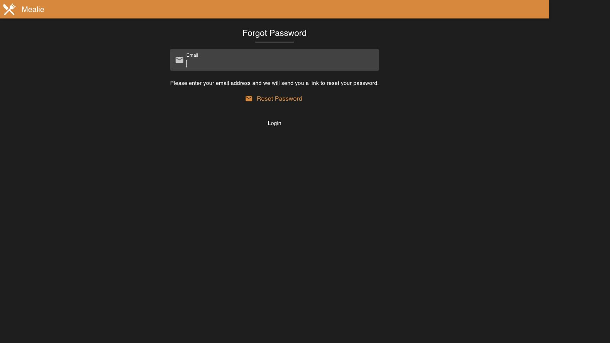
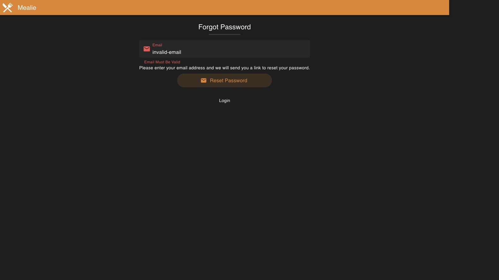
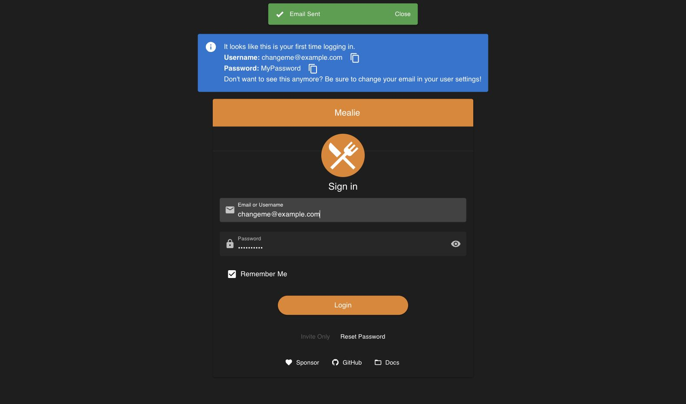
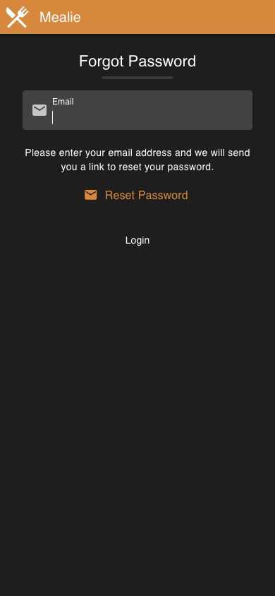

# Forgot password

Route: `/forgot-password`. Source: [forgot-password.vue](../../frontend/app/pages/forgot-password.vue).
Layout: [basic.vue](../../frontend/app/layouts/basic.vue), including the header's home link and global toasts.
Status: source contract and visual references reviewed; runtime validation remains in the checklists below.

## Functions to preserve

- Enter an email address in an autofocus field.
- Explain that Mealie sends a password-reset link to that email address.
- Validate email format before a request. Keep invalid input and show the field error.
- Submit by button or Enter. Display progress on the submit button.
- Call `api.email.sendForgotPassword({ email })` only after successful form validation.
- On HTTP `200`, show Email Sent and navigate to `/login`.
- On another response, stay on the page and show the email-delivery error toast.
- Restore the non-loading state after the response.
- Link back to Login and retain the header home link.
- Retain light/dark themes, narrow-screen form access, and translated labels.

## State screenshots

### Complete form

### Invalid email and field-level validation

### Successful request, toast, and destination

The isolated local Mailpit server receives the message. The screenshot shows the resulting Login page and success toast.

## Migration validation and optional evidence

These additional cases remain for replacement validation. See the [handoff evidence decisions](../HANDOFF.md#evidence-decisions) for shared references, preview fixtures, and unexecuted branches.

- [ ] Capture a local SMTP failure and confirm the form remains available.
- [ ] Verify narrow-screen usability against the reference above.

## Shadcn Vue replacement checklist

- [ ] Replace Container, Card, card sections, Form, TextField, Button, Icon, and BaseDivider.
- [ ] Use Card, Input, Label, Button, Separator, inline validation, and the shared toast service.
- [ ] Preserve the validation-before-request rule and success/error destinations.
- [ ] Preserve Enter submission, autofocus, loading announcements, and focus on errors.
- [ ] Verify a successful local email request and an invalid email without a network request.
