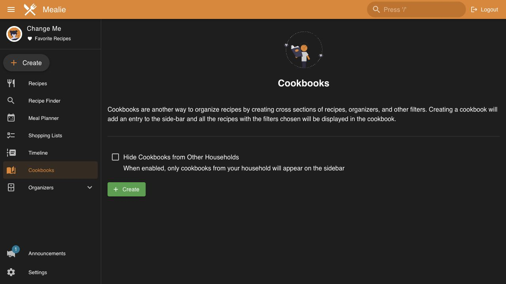
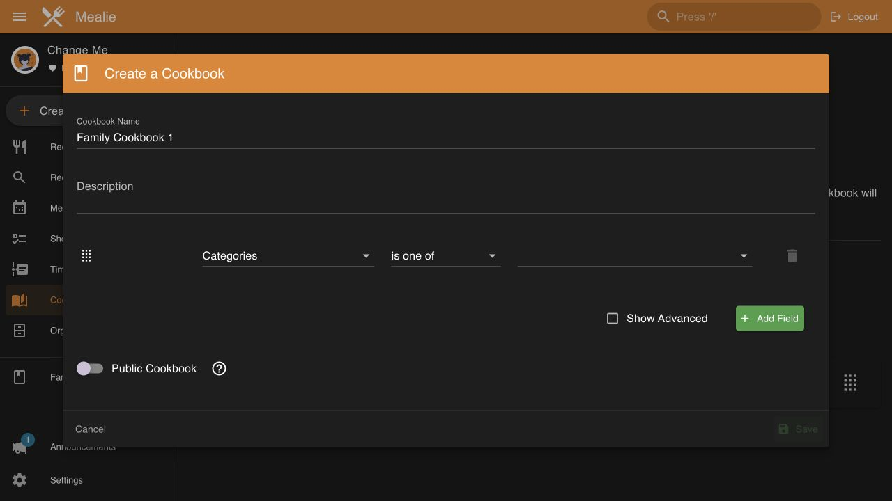
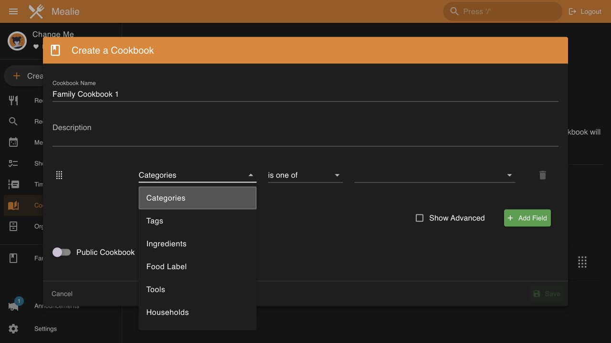
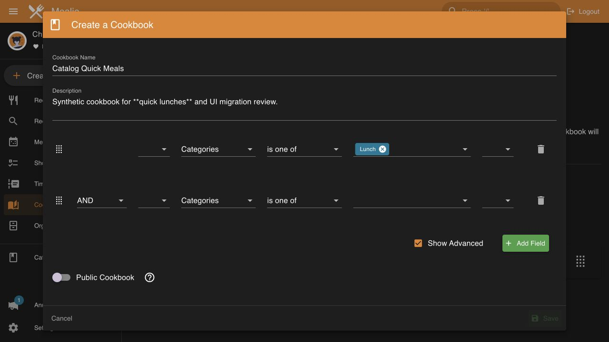
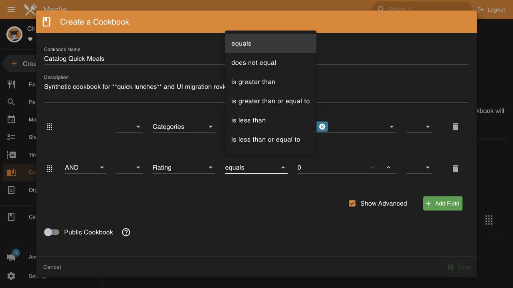
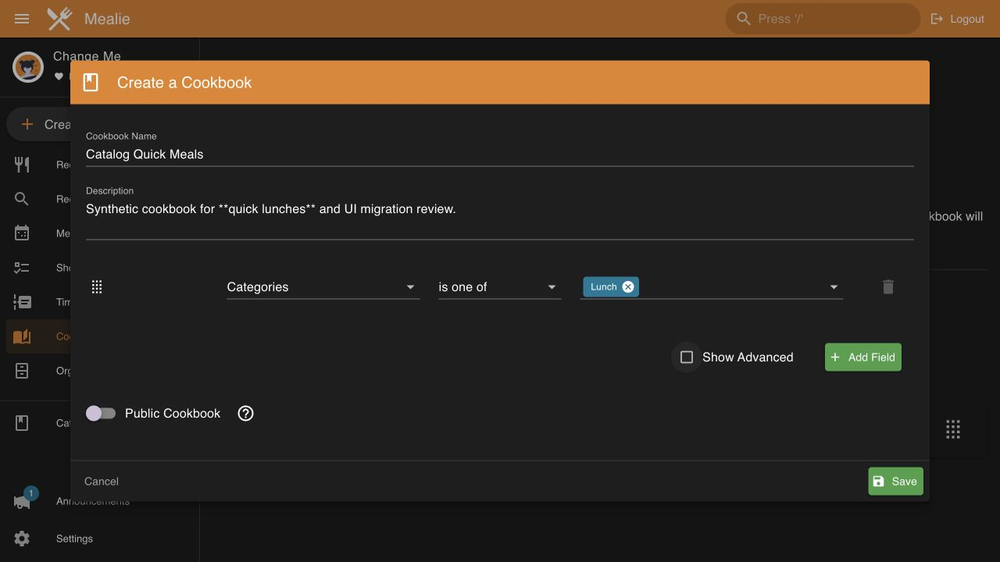
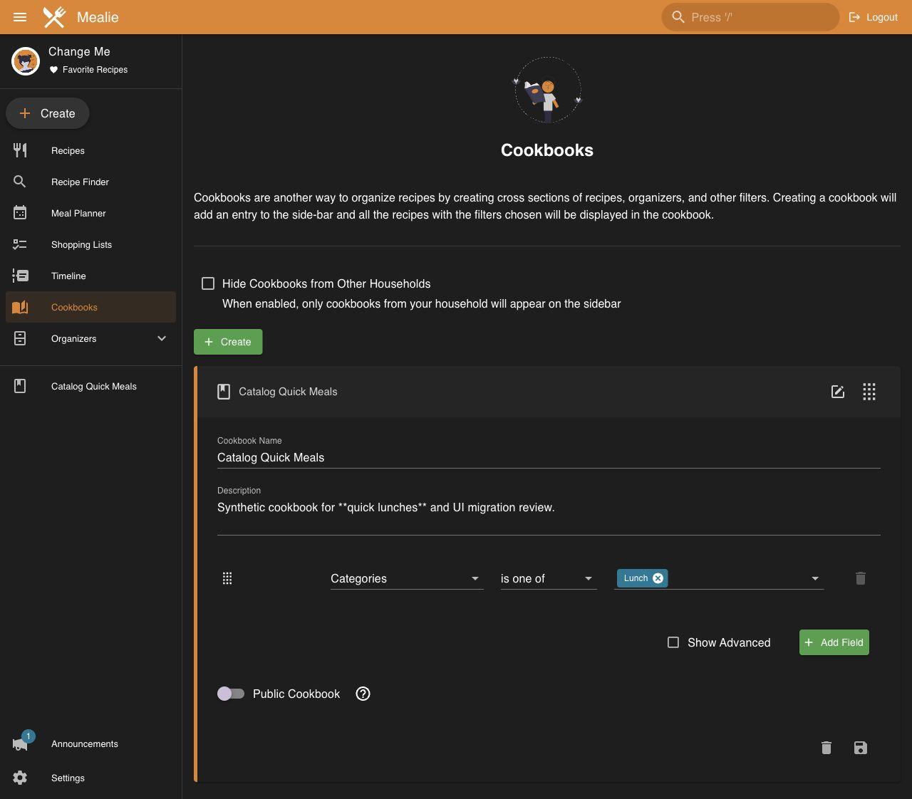
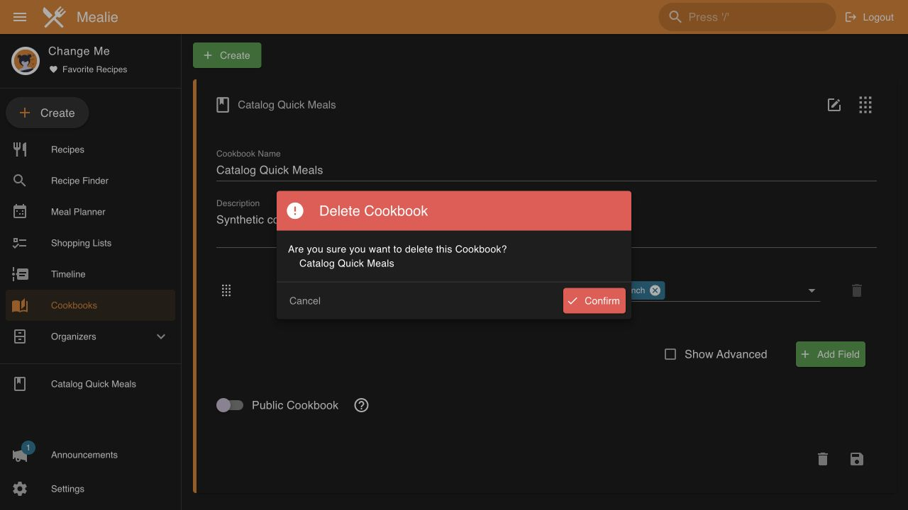

# Cookbook management

Route: `/g/:groupSlug/cookbooks`. Sources: [page](../../frontend/app/pages/g/[groupSlug]/cookbooks/index.vue), [editor](../../frontend/app/components/Domain/Cookbook/CookbookEditor.vue).

## Functions

- Require authentication and the current group. Explain that cookbooks provide saved cross-sections of recipes and sidebar links.
- List only the current household's cookbooks. The Hide Cookbooks from Other Households preference controls sidebar entries, not this management list.
- Expand a row to edit its name, multiline description, query, and Public Cookbook switch. The help popover explains public visibility.
- Preserve every [query-builder function](../shared-query-filter-builder.md): field selection, comparisons, values, AND/OR, row order, advanced parentheses, validation, and typed controls.
- Drag each row by its handle. Touch requires a 250ms delay. Update all positions and save the collection after a drop.
- The current comparator returns a boolean for positions. Check correct numerical ordering during migration.
- Create immediately stores a cookbook with a household-based default name and opens its editor. It does not wait for Save to create the record.
- Save requires a nonempty generated query. Enter does not submit. Save updates the record and sidebar slug/name.
- Cancel deletes the newly created draft. Route exit and before-unload also delete a draft with an ID and empty query.
- Preserve draft cleanup without deleting a configured cookbook. Treat cleanup failure as an explicit recovery case.
- Existing rows have separate Delete and Save actions. Delete shows the cookbook name in a bottom-sheet confirmation. Cancel retains the record.
- Confirm deletes the record and removes it from the store, local rows, and sidebar. No deletion was confirmed for these captures.

## Screenshots

## Migration validation and optional evidence

These additional cases remain for replacement validation. See the [handoff evidence decisions](../HANDOFF.md#evidence-decisions) for shared references, preview fixtures, and unexecuted branches.

- [ ] Verify reorder persistence with multiple cookbooks and draft cleanup after a failed request.
- [ ] Verify keyboard and touch access to row order controls during replacement.

## Shadcn Vue replacement checklist

- [ ] Use Accordion, Dialog/Sheet, Input, Textarea, Switch, Popover, Button, and accessible sortable rows.
- [ ] Preserve household scope, sidebar preference, create-before-edit behavior, draft cleanup, and query validation.
- [ ] Preserve public visibility help, save/update feedback, deletion review, and sidebar refresh.
