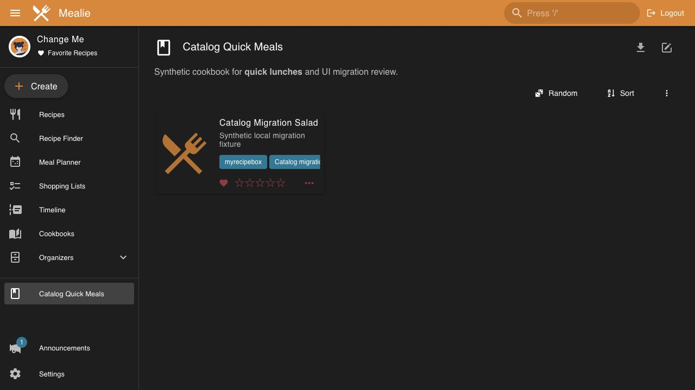
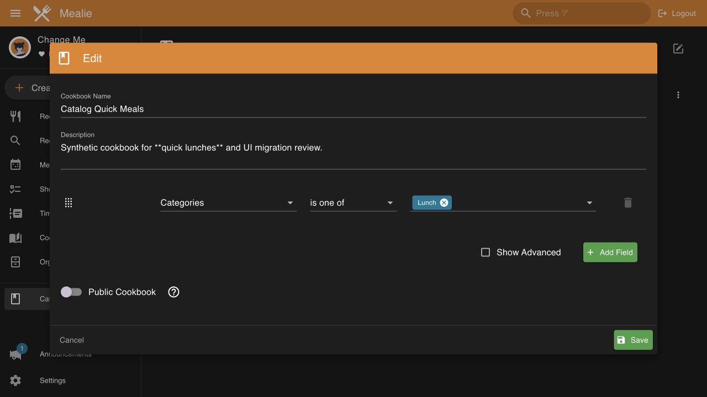
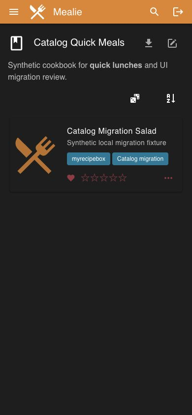

# Cookbook recipes

Route: `/g/:groupSlug/cookbooks/:slug`. Sources: [route](../../frontend/app/pages/g/[groupSlug]/cookbooks/[slug].vue), [CookbookPage](../../frontend/app/components/Domain/Cookbook/CookbookPage.vue).

## Functions

- Fetch the cookbook by route slug. Use the user API for the current group and the public explore API for another group.
- Show cookbook name and sanitized Markdown description. Pass its slug into the recipe query.
- Preserve [recipe cards](../shared-recipe-cards.md) and their [nested actions](../shared-recipe-actions.md), including sort, random order, view preference, pagination, favorites, ratings, and navigation.
- Show Edit only for the current group and current household. Other households' cookbooks remain read-only here.
- Show Download PDF only in the current group. Prevent duplicate downloads, show Preparing PDF, request the PDF URL, download with the cookbook slug, and clear loading in finally.
- Edit opens the same name, description, [query builder](../shared-query-filter-builder.md), and public visibility controls as cookbook management.
- Disable Save for an empty query. Enter does not submit. Cancel closes the editor.
- The source assigns the existing object to the draft without a deep copy. Cancel can leave unsaved local mutations visible; verify draft isolation during replacement.
- Save updates the store. Navigate to the new slug when the slug changes; otherwise reload the page. Close and clear the edit target.
- Public browsing hides both Edit and PDF download controls.

## Screenshots

Use the management-page screenshots for the complete query editor and advanced comparison menus.

## Migration validation and optional evidence

These additional cases remain for replacement validation. See the [handoff evidence decisions](../HANDOFF.md#evidence-decisions) for shared references, preview fixtures, and unexecuted branches.

- [ ] Verify PDF success/failure and public or other-household visibility.
- [ ] Verify slug-change navigation and Cancel draft isolation during replacement.

## Shadcn Vue replacement checklist

- [ ] Use semantic page header, Buttons, Dialog, shared query editor, recipe cards, and download feedback.
- [ ] Preserve recipe filter scope, read-only/public permissions, responsive controls, and Markdown description.
- [ ] Preserve draft validation, slug navigation, and PDF progress cleanup.
