# Recipe explorer

Route: `/g/:groupSlug`. Source: [index.vue](../../frontend/app/pages/g/[groupSlug]/index.vue), [RecipeExplorerPage](../../frontend/app/components/Domain/Recipe/RecipeExplorerPage/RecipeExplorerPage.vue), [search](../../frontend/app/components/Domain/Recipe/RecipeExplorerPage/RecipeExplorerPageParts/RecipeExplorerPageSearch.vue), [filters](../../frontend/app/components/Domain/Recipe/RecipeExplorerPage/RecipeExplorerPageParts/RecipeExplorerPageSearchFilters.vue), [search state](../../frontend/app/composables/use-recipe-explorer-search.ts).

## Functions: search and filter controls

- Render clearable recipe Search; Enter submits and blurs input to hide a mobile keyboard. Default Auto Search debounces relevant changes by 500ms; when disabled show a full-width manual Search button.
- Categories, Tags, Tools, and Foods each open searchable multi-select filter menus. Selection counts appear on trigger badges. Each offers Has All/Has Any, Clear Selection, and a virtualized 300px list of checkbox choices.
- Household filter appears only with more than one available household, uses a single radio choice, and can clear the selected radio. A sole household clears any household filter automatically.
- Filter-option search ranks normalized exact, prefix, word-prefix, substring, then fuzzy matches over name/plural/abbreviations/aliases; no matches shows an information alert. Clear Selection clears both chosen items and option search.
- Keep menus open while selecting. Preserve selected-ID sets and counts without losing checkbox state during filtering/virtualization.
- Sort offers Alphabetical, Created, Last Made, Rating, Total Time, Updated, Random, plus a direction toggle. Last Made is own-group only; public views fall back from inherited Last Made to Created.
- Settings offers Auto Search and Reset. Reset clears search, all organizer/household selections, Has All flags, and returns Created descending sort. Auto mode itself is not reset by this handler.
- Card chip events apply their matching category/tag/tool selection through the search component. In this explorer, card-section Sort is disabled because the search toolbar owns it.

## Query, session, and data behavior

- Use authenticated stores/API for own-group access; use public group stores/API otherwise. There is no route-level auth-only middleware in this page, so retain anonymous/public group browsing and backend visibility rules.
- Hydrate URL search, repeated category/tag/tool/food/household IDs, `auto`, and require-all flags. Hydration waits for organizer stores with a bounded timeout and settles individual failures.
- Sorting comes from user preferences; changes synchronize back. Save the last search query in session and restore it only when arriving without an explicit query. Malformed stored JSON resets safely.
- Emit search only when calculated query changes. Push nondefault URL query fields, omitting unfiltered/all household selection and false/default flags. ID arrays are sorted for stable comparisons.
- Pass random/search seeds to the card list to support seeded random pagination. Random choice refreshes the seed; verify selecting Random repeatedly triggers a reshuffle, since the auto-search watch does not directly include randomSeed.
- Search-state instances are memoized per group, then cleared when the search component unmounts so revisiting rehydrates fresh state.
- Watch empty route query to reset; verify nonempty browser Back/Forward query changes rehydrate selected controls correctly, since the current route watcher only handles the empty-query case.
- Preserve every [shared card-list function](../shared-recipe-cards.md), including infinite paging, random navigation, compact/mobile view, favorites, read-only ratings, tag chips, context menu, and scroll restoration.
- Preserve all nested [recipe actions/dialogs](../shared-recipe-actions.md), particularly meal-plan dates/type and ingredient selection for shopping lists.

## Redesign (implemented)

| Before | Now |
| --- | --- |
| Centered search box; blue filter buttons with corner badges; a "Recipes" section header with its own toolbar below a divider. | Page title, full-width search, then one row of filter chips (count shown inside the chip) with Sort and search settings at the end of the row; Random and the grid/list toggle above the results. |
| Filter menus: Vuetify list with radio/checkbox items. | Popover with option search, Has all / Has any segmented control, Clear Selection, and a virtualised list (40px rows, 300px). Second click on the selected household radio clears it, as before. |
| Search settings menu with a switch and Reset. | Same controls in a popover. Manual search still shows a full-width Search button when Auto Search is off. |
| — | New: "Today" strip for members, listing today's meal-plan entries (recipe or note) with links to the recipes (scale carried in the query) and to the meal planner. Hidden when nothing is planned. |

Search/session/URL hydration, sorting rules and public-group restrictions are unchanged (use-recipe-explorer-search.ts was not modified).

## Screenshots

### Full explorer, category filter, and selected results

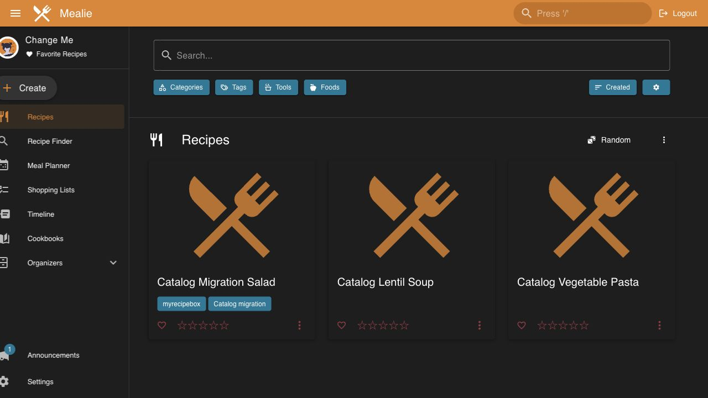
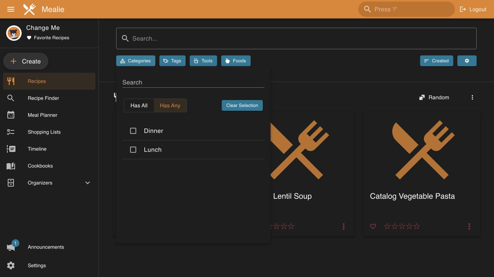
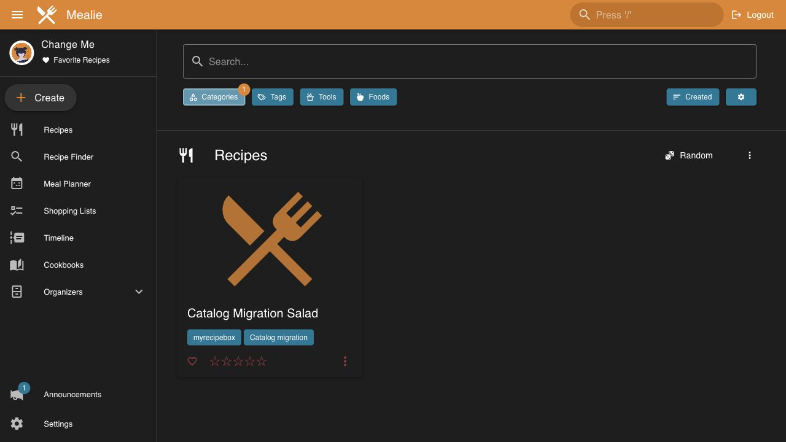

### Sort, auto-search settings, and manual search

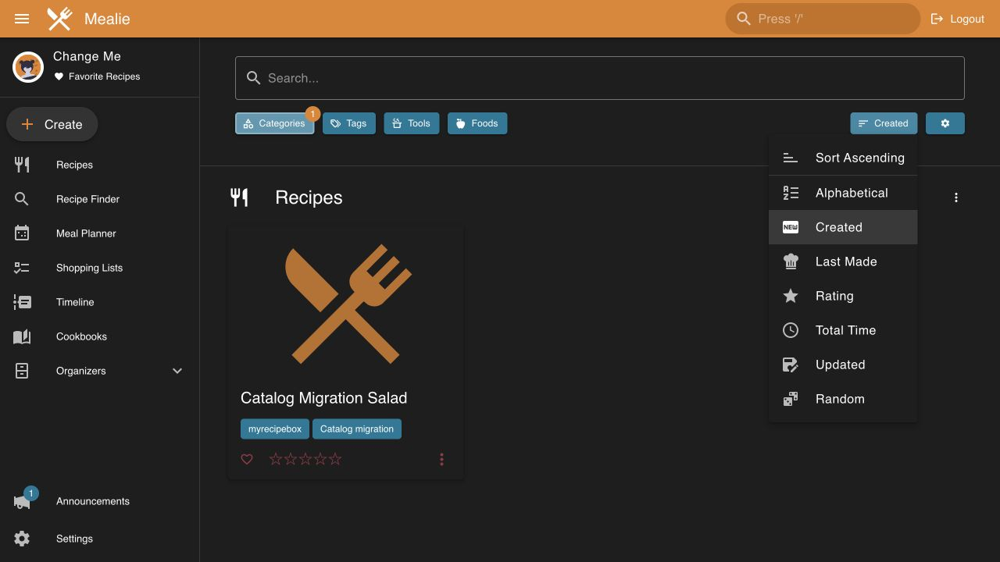
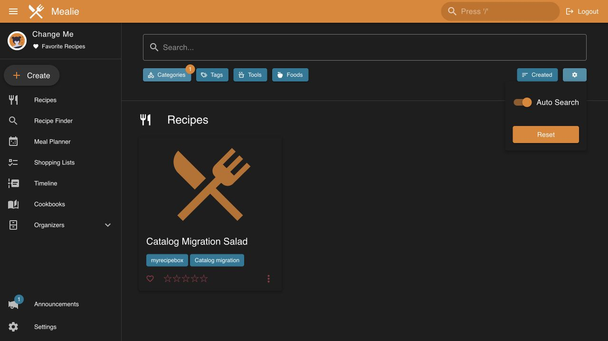
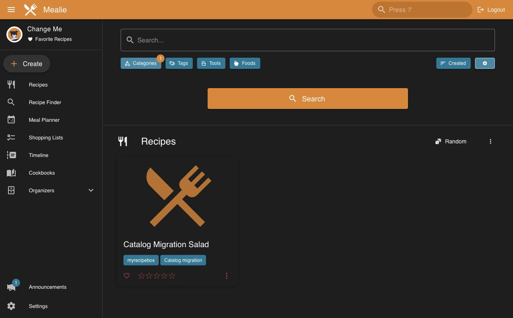

### Card menu and meal-plan controls

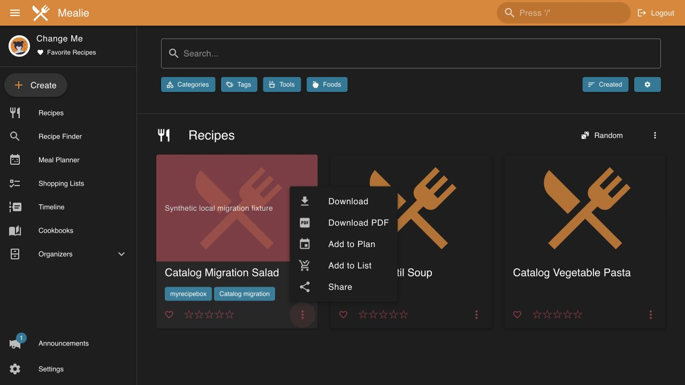
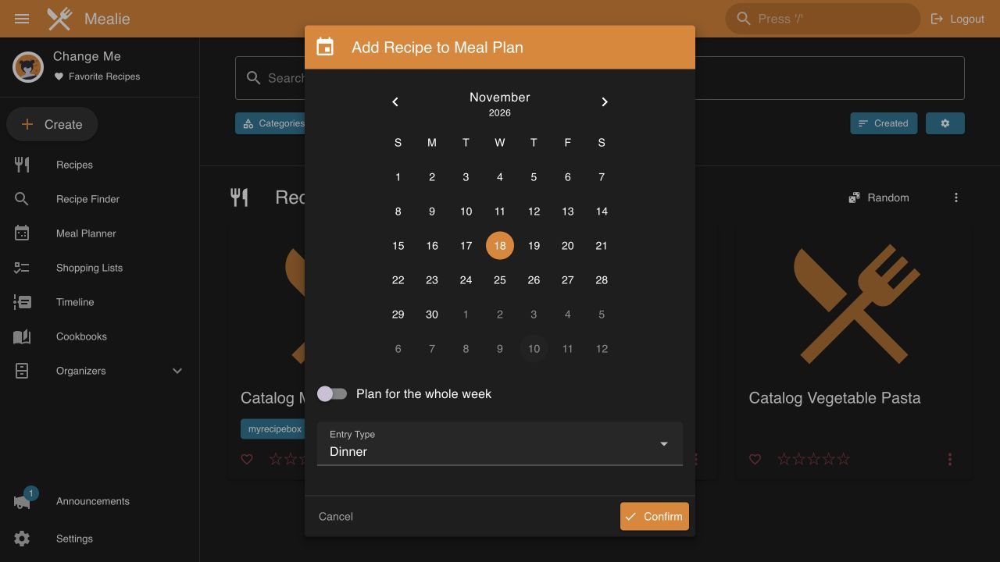
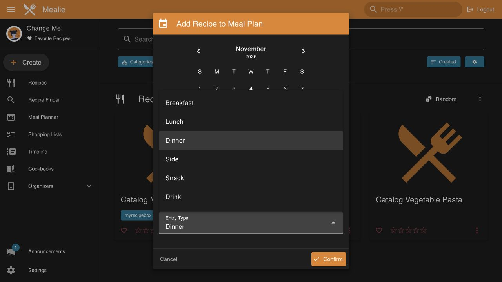

### Shopping-list destination, inline creation, and ingredient choice

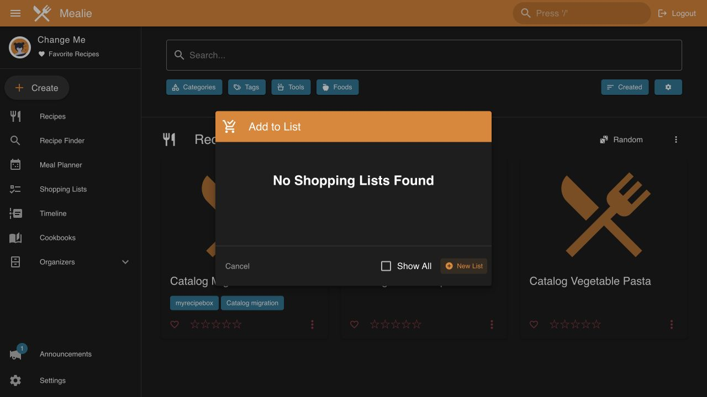
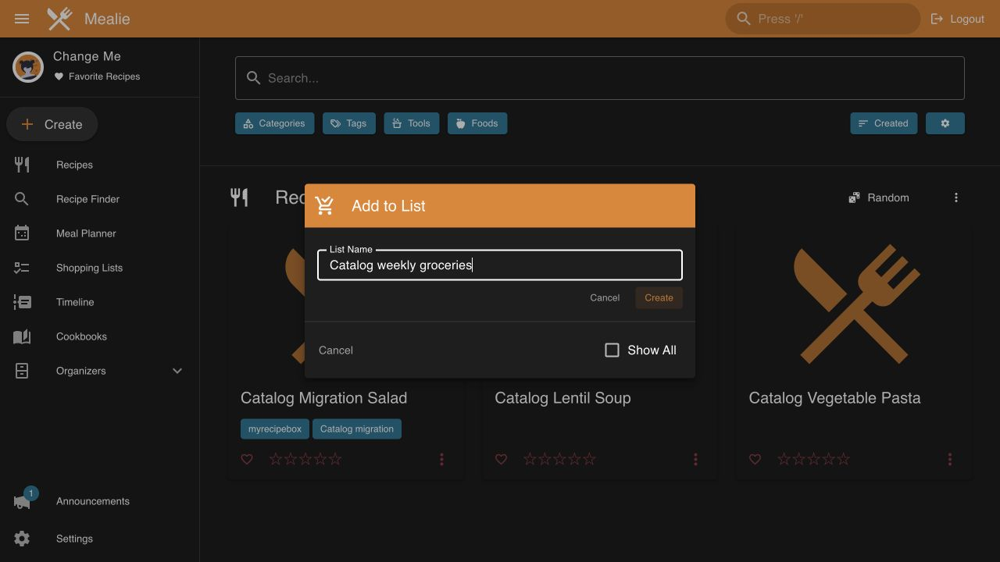
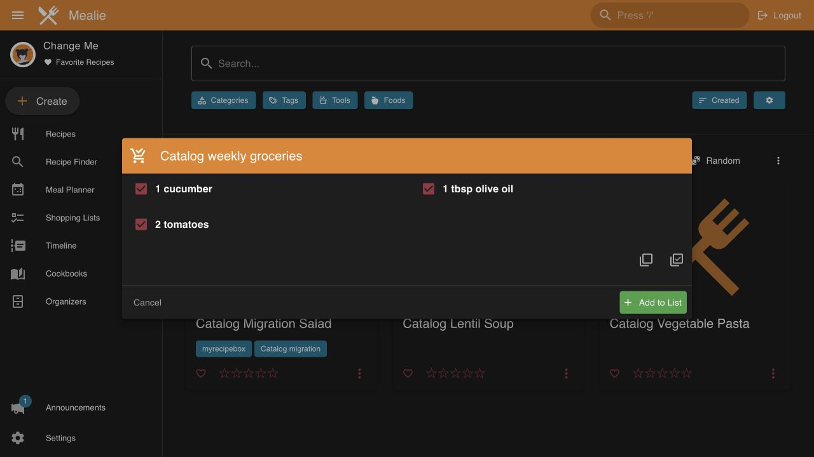

The synthetic list Catalog weekly groceries was created and the selected salad ingredients were added successfully. A transient success toast expired before capture; no duplicate grid image is labeled as that result.

### Compact card layout

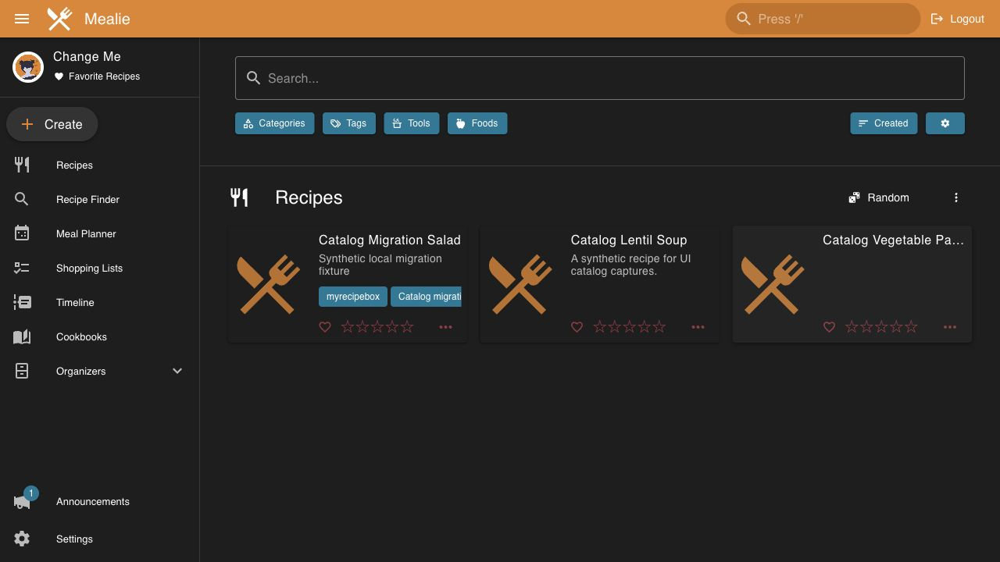

### Empty search and narrow-screen layout

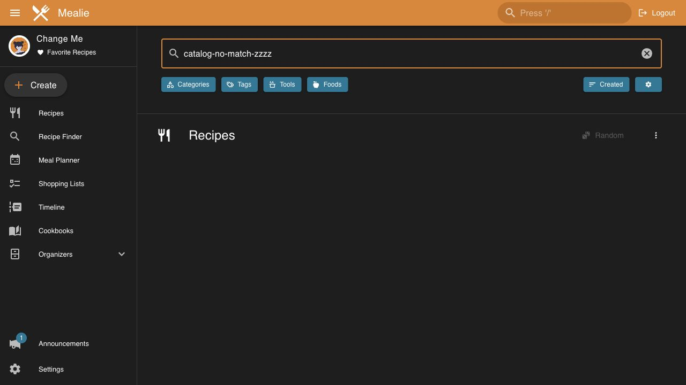
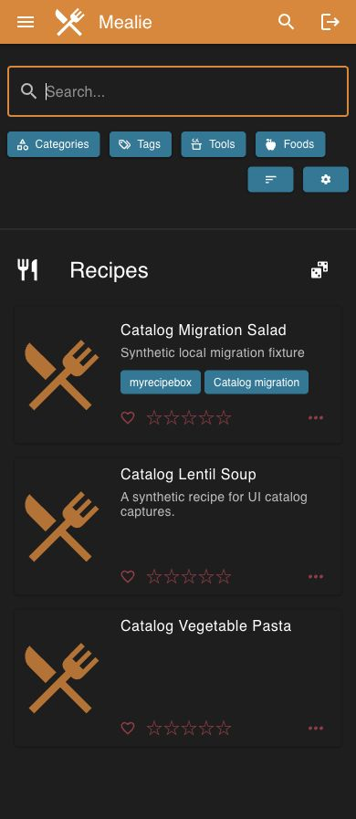

## Migration validation and optional evidence

These additional cases remain for replacement validation. See the [handoff evidence decisions](../HANDOFF.md#evidence-decisions) for shared references, preview fixtures, and unexecuted branches.

- [ ] Capture public-group view, multi-household radio, and filter-option no-match states.
- [ ] Verify repeated Random, browser query navigation, scroll restore, and paging against enough fixture recipes.
- [ ] Capture sharing and download outcomes in the shared recipe action audit.

## Shadcn Vue replacement checklist

- [x] Compose Input, Popover/DropdownMenu, searchable checkbox/radio lists, ToggleGroup, Badge, Switch, Button, and shared cards/dialogs.
- [x] Preserve URL/session hydration, all filter types/combinators, manual/automatic search, sort preferences, and public-group restrictions.
- [ ] Preserve query seeds, nested action workflows, compact preference, and keyboard/focus behavior.
