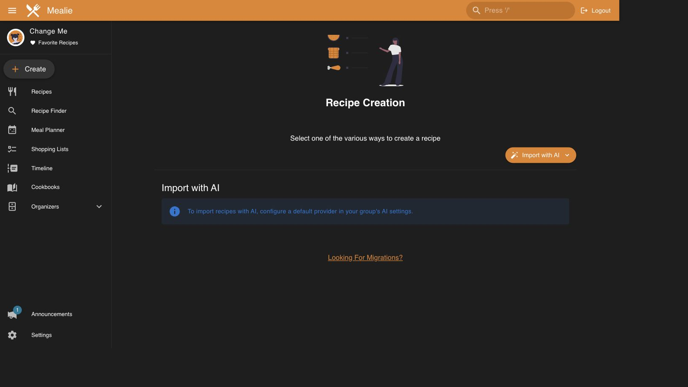
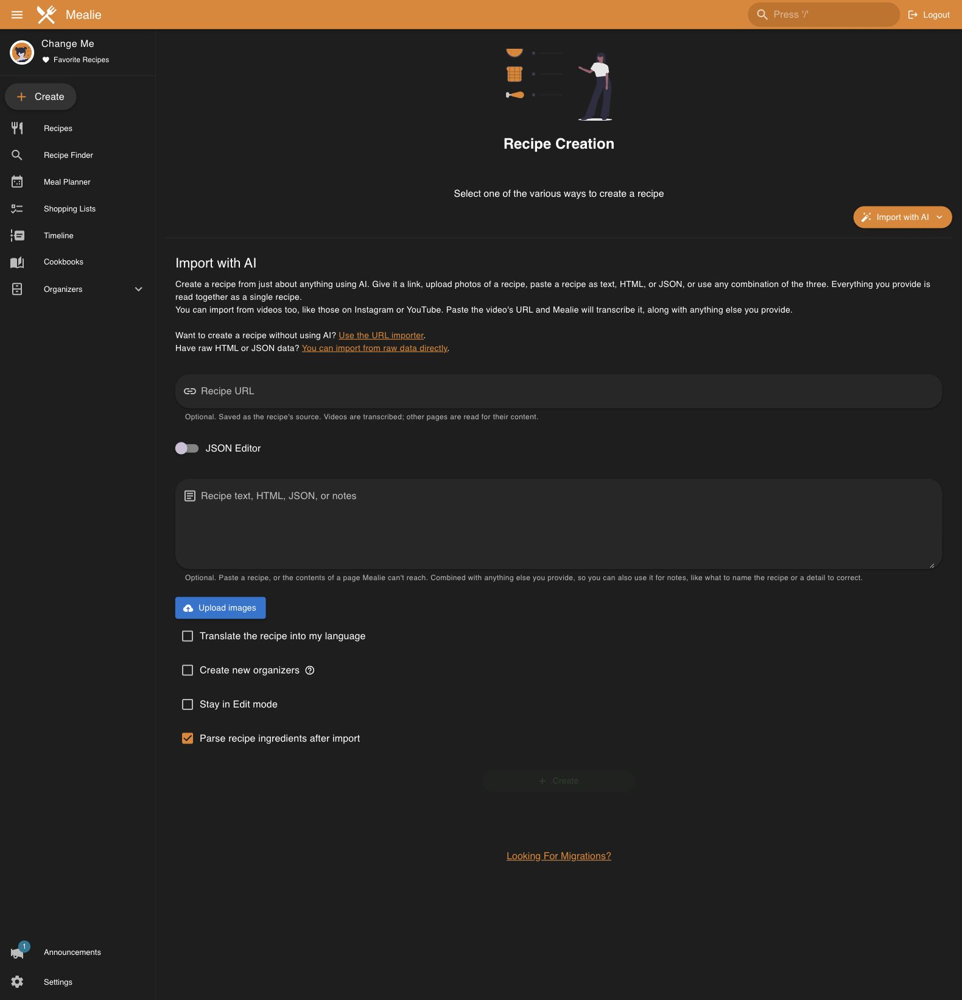
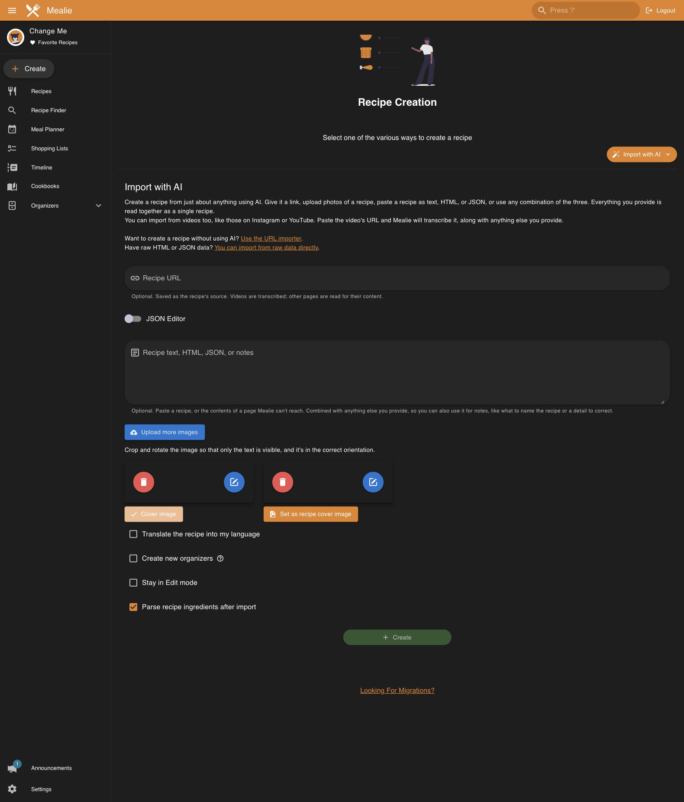
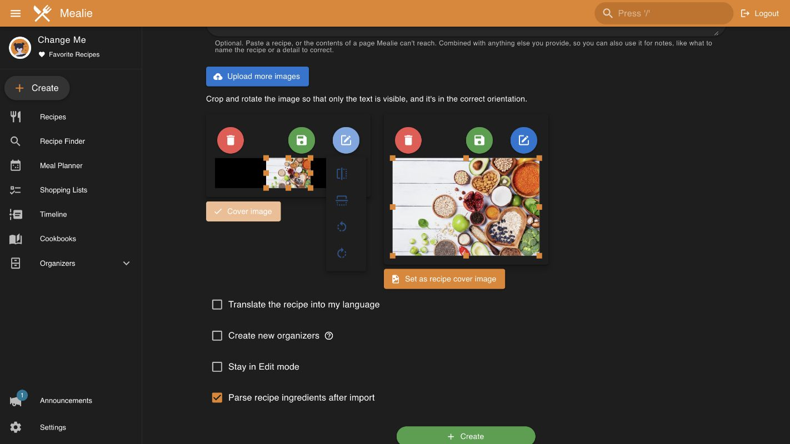
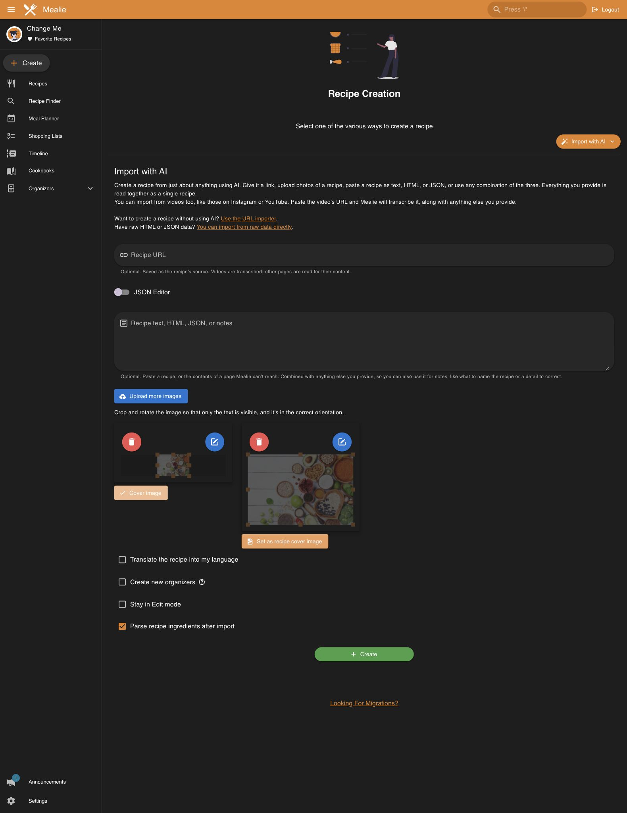
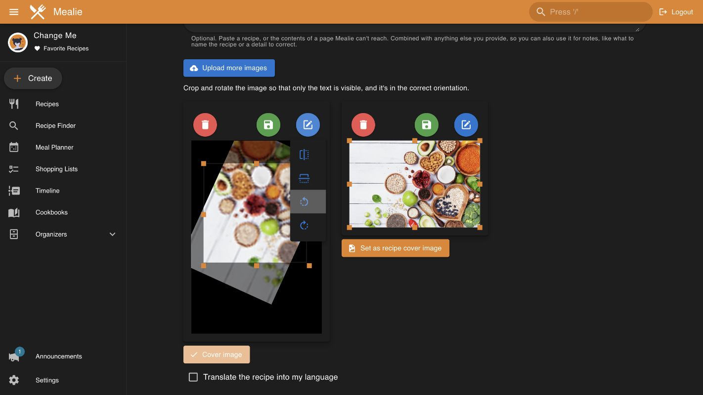
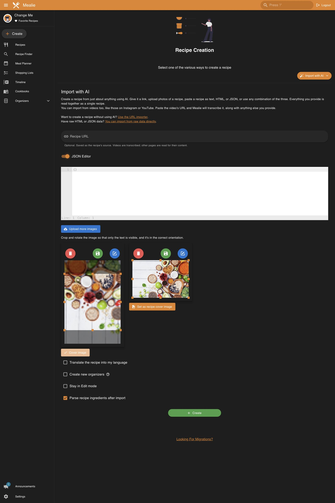
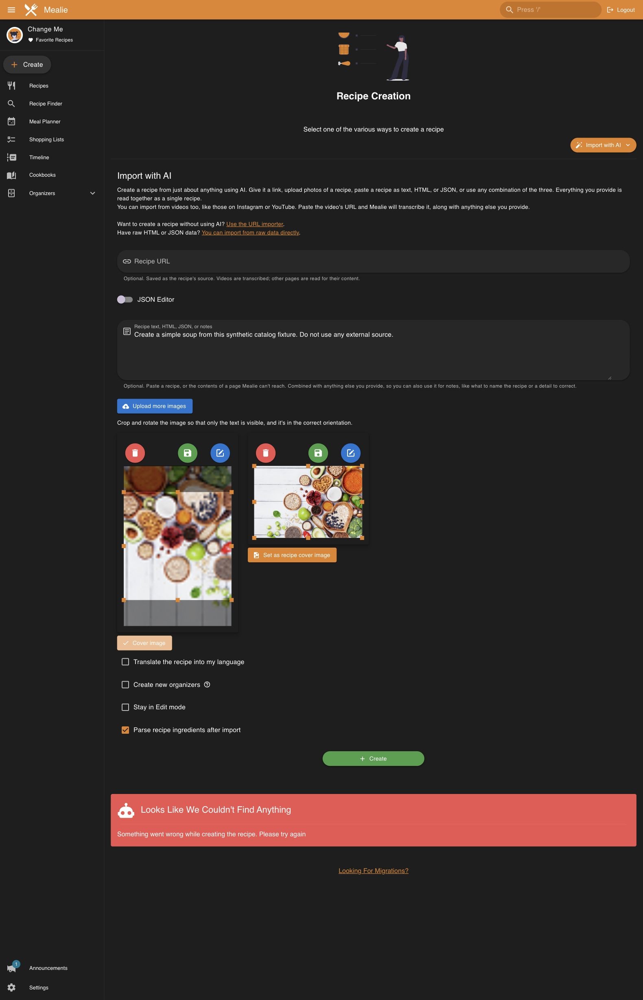
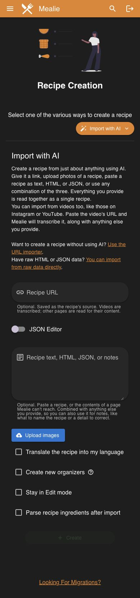

# AI recipe import

Route: `/g/:groupSlug/r/create/ai`.
Source: [ai.vue](../../frontend/app/pages/g/[groupSlug]/r/create/ai.vue).
Access and shared controls: [creation parent](g--groupSlug--r--create.md).
Status: source contract and visual references reviewed; runtime validation remains in the checklists below.

## Functions: provider and source choices

- Without a default AI provider, show the provider-configuration notice and hide the import fields and Create action.
- With a default provider, accept an optional URL, pasted text/HTML/JSON/notes, images, or any combination.
- Explain that all supplied content forms one recipe.
- When an audio provider exists, explain video transcription from a pasted video URL.
- Link to URL import and raw HTML/JSON import as alternatives.
- Validate the optional source URL and save it as the recipe source.
- Support the plain-text and JSON-editor modes, including the same text/object conversion rules as raw import.
- Enable Create when URL, serialized content, or at least one image exists.
- If image support is unavailable, show the image-provider requirement notice instead of image upload.

## Image workflow

Sources: [RecipeImportImages.vue](../../frontend/app/components/Domain/Recipe/RecipeImportImages.vue),
[ImageCropper.vue](../../frontend/app/components/global/ImageCropper.vue),
[AppButtonUpload.vue](../../frontend/app/components/global/AppButtonUpload.vue).

- Select multiple `image/*` files and append them to the existing image array.
- Change Upload images to Upload more images after the first selection.
- Show a preview/cropper for every image in a responsive grid.
- Drag or resize the crop selection; flip horizontally/vertically or rotate left/right by 90 degrees.
- Update the cropper aspect ratio after quarter turns so the whole rotated image remains accessible.
- Save a changed crop as a Blob and update its preview.
- Delete one image without removing the others.
- For multiple images, mark the first image as Cover image and disable its cover action.
- Set another image as cover by swapping both the image and preview arrays; the backend uses the first image as cover.
- Keep image controls unavailable during submission.
- Revoke preview object URLs on deletion and component cleanup.
- Do not replace image editing with a file-only field that loses crop, flip, rotation, save, or cover order.

## Options, submission, and results

- Preserve remembered Translate into my language, Create new organizers, Stay in Edit mode, and Parse ingredients choices.
- Keep the organizer-creation help tooltip and its explanation.
- Send the active UI locale as `translateLanguage` only when translation is selected.
- Send content, optional URL, ordered image files, and `createNewOrganizers` through the AI-import client.
- Await form validation before submission.
- Reset the previous error, show loading and streamed status, and clear status afterward.
- Disable the URL field, mode switch, plaintext field, image controls, and option checkboxes during the request.
- On failure, show the returned error message or the generic AI failure detail and restore controls.
- On success, refresh tags when organizer creation is enabled and use the shared edit/parse destination helper.

Current-source note: the specialized JSON editor has no explicit disabled/read-only binding during submission.
Do not mistake the disabled mode switch for a lock on that editor.

## Capture fixture

Enabled-state captures use a synthetic provider at local closed port `127.0.0.1:1`.
Its key is a non-secret placeholder. No external provider receives data or incurs a charge.
The images come from the repository's existing test fixtures.
The provider error screenshot demonstrates the failure path, not actual AI extraction quality.

## Redesign (implemented)

| Before | Now |
| --- | --- |
| Each method was a flat card: title, paragraphs with cross-links, a rounded filled field, checkboxes stacked down the page and a centred pill Submit with the status text under it. | Each method is one panel: title and one-line explanation, labelled field, options in two columns, and a footer with the status on the left and a named action ("Import recipe", "Create recipe", "Debug") on the right. Links to the other methods sit under the panel. |
| Create-new-organizers explained in a hover tooltip. | The explanation is the checkbox hint, so it reads on phones. |
| Provider-required notices as Vuetify info alerts. | Sage note panels. |

## Screenshots

### Default provider required

### Enabled form and all import options

### Multiple image croppers

### Visible crop/flip/rotation menu

### Cover-image order and rotation preview

### JSON mode with retained images

### Local provider failure and retained inputs

## Migration validation and optional evidence

These additional cases remain for replacement validation. See the [handoff evidence decisions](../HANDOFF.md#evidence-decisions) for shared references, preview fixtures, and unexecuted branches.

- [ ] Capture the image-provider-disabled branch, option tooltip, narrow form, and local delayed progress.
- [ ] Verify crop-save/delete behavior and a successful AI-result response with a deterministic local fixture.
- [ ] Verify translation/organizer payloads and the edit/parse result destination with fixture responses.

## Shadcn Vue replacement checklist

- [ ] Replace form fields, switches, checkboxes, notices, buttons, crop menus, and tooltips.
- [ ] Preserve all source combinations, provider gates, remembered options, and streamed feedback.
- [ ] Retain the specialized cropper behavior and first-image cover contract.
- [ ] Give every icon-only image action an accessible name.
- [ ] Preserve JSON editing, serialization, image order, locale handling, and error recovery.
