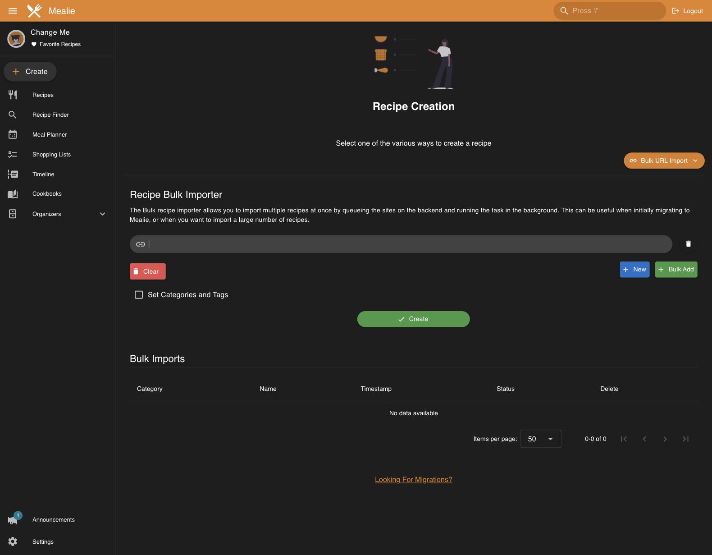
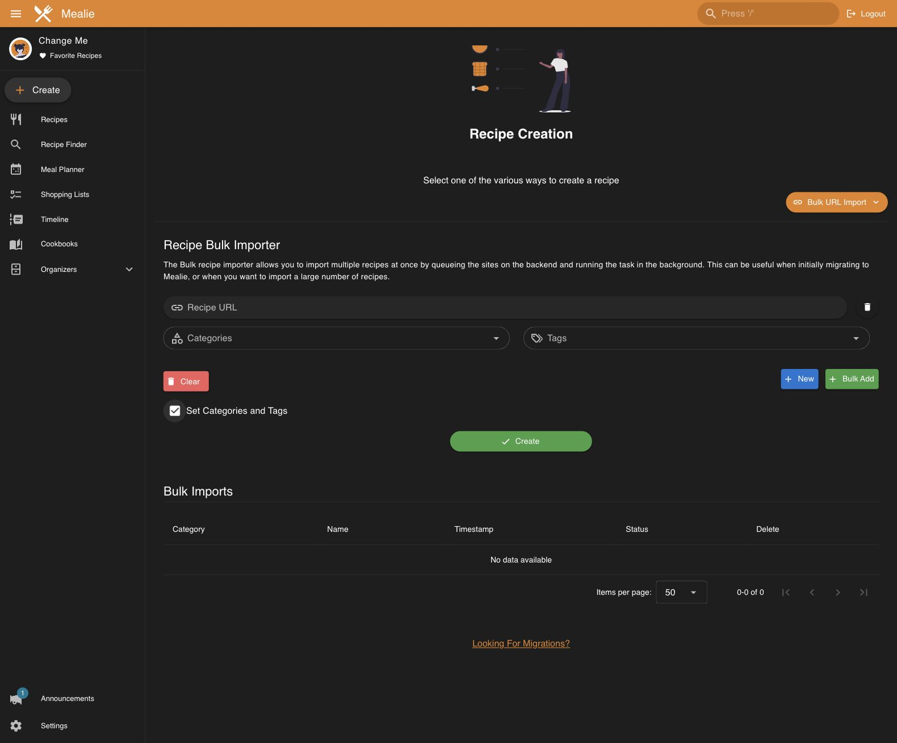
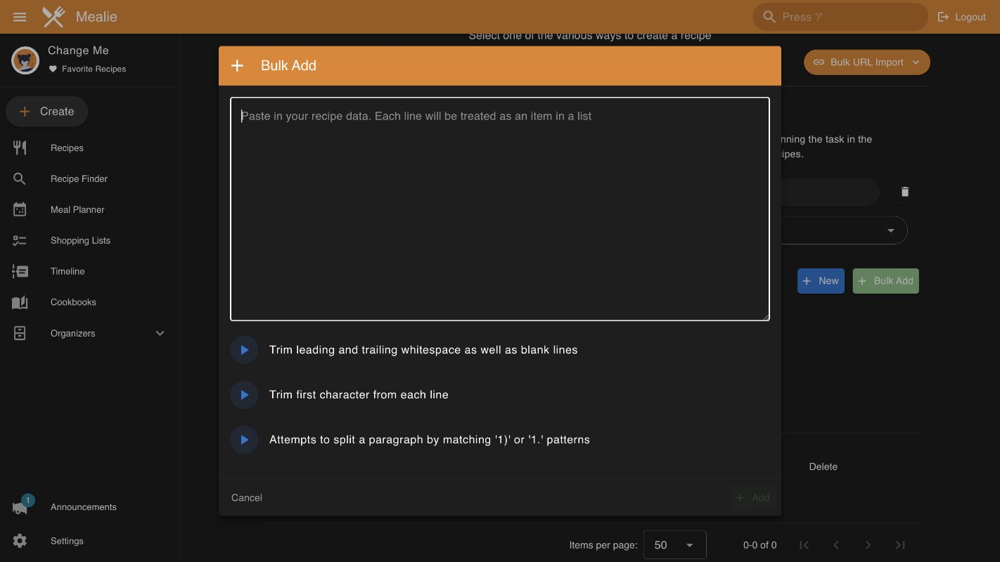
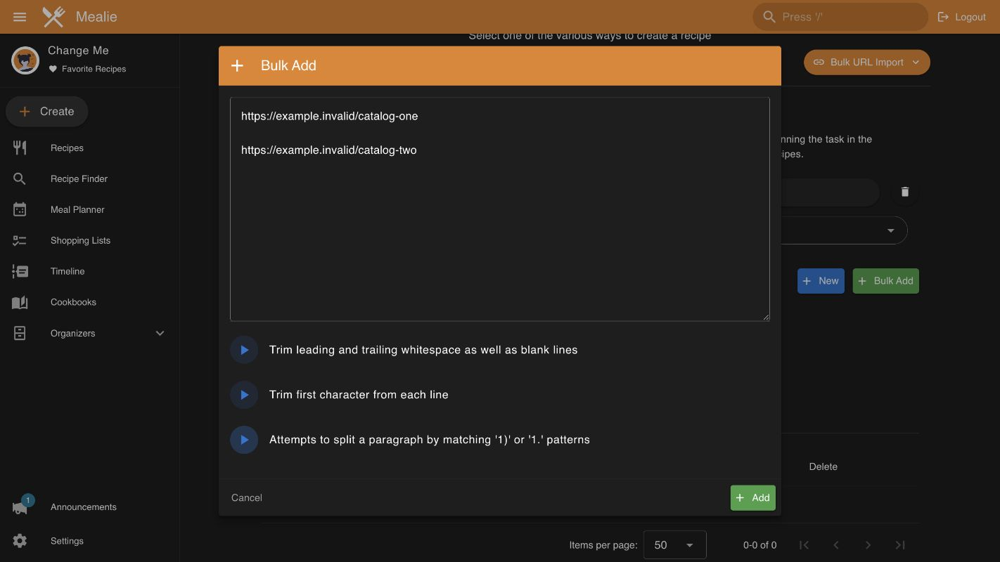
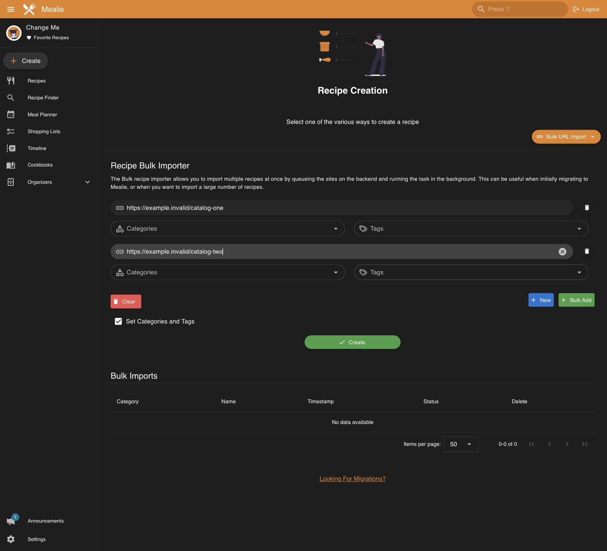
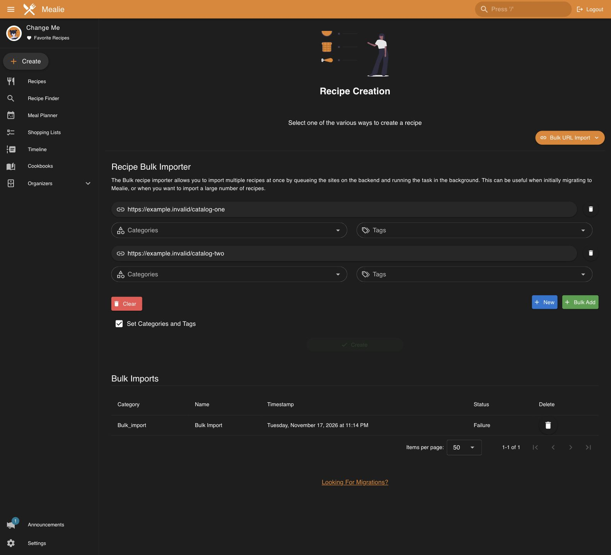
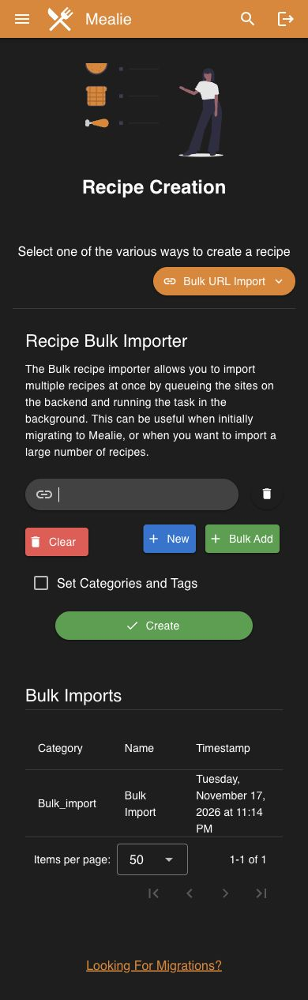

# Bulk URL recipe import

Route: `/g/:groupSlug/r/create/bulk`.
Source: [bulk.vue](../../frontend/app/pages/g/[groupSlug]/r/create/bulk.vue).
Access and shared controls: [creation parent](g--groupSlug--r--create.md) and [application shell](../shared-shell.md).
Status: source contract and visual references reviewed; runtime validation remains in the checklists below.

## Functions to preserve

- Start with one editable URL row. Each row has a clearable URL field and a separate remove-row action.
- New adds an empty URL row with empty category and tag selections.
- Clear removes all rows and resets the import lock.
- Set Categories and Tags reveals separate multi-select category and tag controls for each row.
- Preserve each row's organizer selections when those controls hide; the toggle changes presentation, not the stored row payload.
- Organizer selectors support normalized search, removable chips, existing records, and inline creation of new organizers.
- Bulk Add opens the shared multiline-text dialog.
- Add in that dialog replaces the URL rows with one row per nonblank line and empty organizer arrays.
- Disable Create when no rows exist or the import is locked.
- Submit `{ imports: bulkUrls }` through `createManyByUrl`.
- HTTP `202` shows the started message and locks Create. Other results show the failed-start message.
- Fetch bulk-import reports after each request and on page entry.
- Do not navigate away when a background import starts.

Current-source notes: row inputs do not attach URL rules. A row's existence can enable Create even if its URL is empty.
The page has no request spinner or report-poll loop. Report refresh occurs on entry or after a submission.

## Bulk Add dialog

Source: [RecipeDialogBulkAdd.vue](../../frontend/app/components/Domain/Recipe/RecipeDialogBulkAdd.vue).

- Paste multiple lines into an autofocus textarea.
- Ignore blank or whitespace-only lines when constructing the output list.
- Disable Add when no nonblank lines exist.
- Enter inserts text; it must not submit the dialog.
- Run the whitespace utility to trim each line and remove blank lines.
- Run the prefix utility to remove the first character from every nonblank line.
- Run the numbered-paragraph utility to split at numeric prefixes such as `1) `, `1. `, or `1: `.
- Add returns the processed strings and closes the dialog. Cancel closes without replacing the rows.

## Reports

Source: [ReportTable.vue](../../frontend/app/components/global/ReportTable.vue).

- Show Category, Name, localized Timestamp, Status, and Delete.
- Capitalize the category and status display strings.
- Preserve page-size selection, pagination, and the default 50 rows per page.
- Open a completed report by clicking its row; do not open an `in-progress` report.
- The per-row delete action stops row navigation and requests report deletion.
- On HTTP `200`, refresh reports. Otherwise show report-deletion failure.
- Keep the [report-detail page](group--reports--id.md), including exception expansion.

## Screenshots

### Initial form and reports area

### Per-row category and tag controls

### Multiline entry and text utilities

### Prepared rows and accepted background request

The fixture uses reserved `.invalid` URLs. The accepted request produces a failed report without importing external content.

## Migration validation and optional evidence

These additional cases remain for replacement validation. See the [handoff evidence decisions](../HANDOFF.md#evidence-decisions) for shared references, preview fixtures, and unexecuted branches.

- [ ] Verify selected organizer chips, inline organizer creation, and empty rows after Clear; a narrow layout is captured above.
- [ ] Capture an in-progress report row with a local delayed fixture and a successful report entry.

## Shadcn Vue replacement checklist

- [ ] Preserve editable rows, remove/New/Clear, the bulk-text utilities, and per-row organizer arrays.
- [ ] Replace fields, checkboxes, buttons, dialog, multi-selects, and report table.
- [ ] Keep the accepted-job lock and distinguish start failure from individual import failures.
- [ ] Preserve report navigation, in-progress gating, per-row deletion, and refresh behavior.
- [ ] Verify keyboard entry, multiline Enter handling, and row identity after removal.
