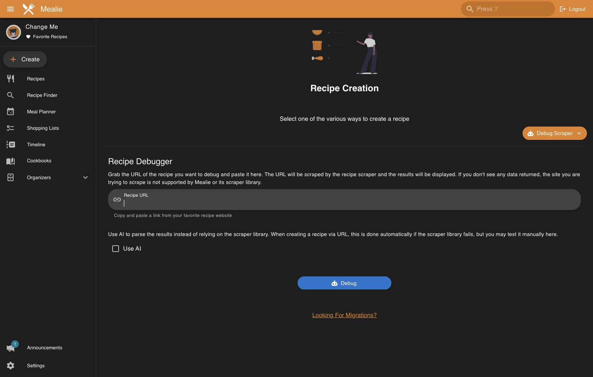
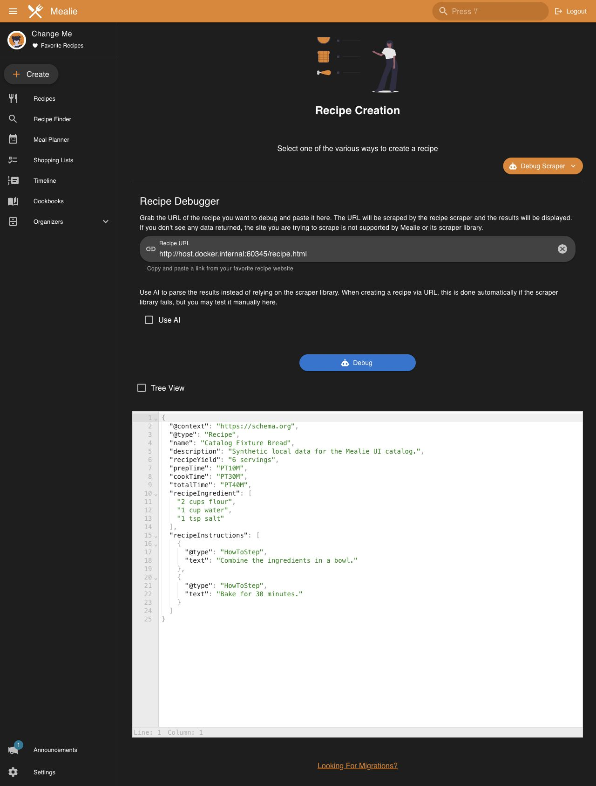
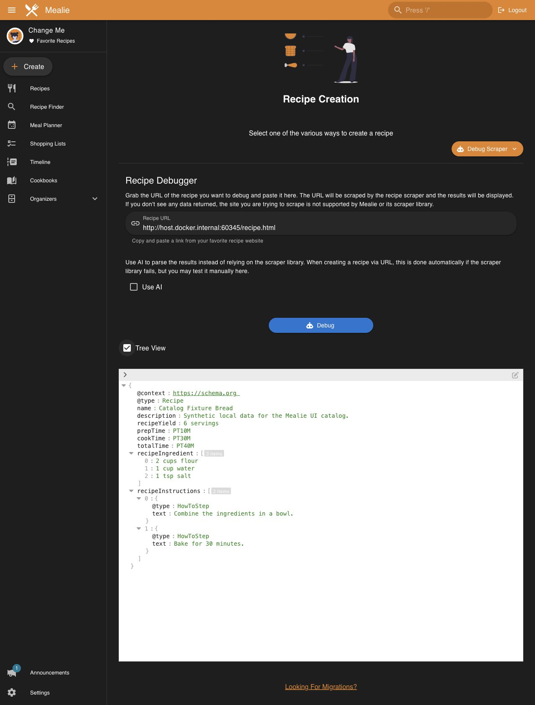
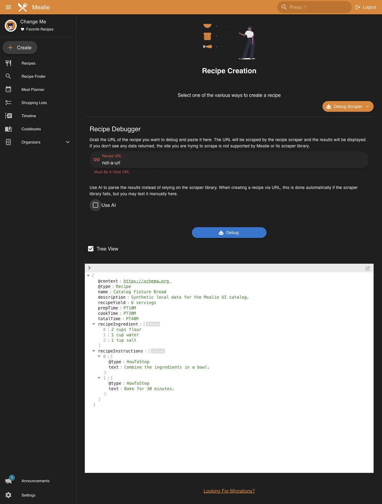

# Recipe scraper debugger

Route: `/g/:groupSlug/r/create/debug`.
Source: [debug.vue](../../frontend/app/pages/g/[groupSlug]/r/create/debug.vue).
Access and shared controls: [creation parent](g--groupSlug--r--create.md).
Status: source contract and visual references reviewed; runtime validation remains in the checklists below.

## Functions to preserve

- Explain that this scrapes a URL for diagnostic output rather than creating a recipe.
- Show an autofocus, clearable Recipe URL field with the URL rule and persistent hint.
- Trim entered URL text and store it in `recipe_import_url`, while retaining other query parameters.
- Read a prefilled URL from that query parameter.
- Submit with Debug or the form's Enter action and show request loading on the button.
- When group AI is enabled, show the Use AI checkbox and its diagnostic explanation.
- Send the URL and AI choice through `testCreateOneUrl`.
- Display returned diagnostic data without creating a stored recipe.
- Show Tree View only after result data exists.
- Switch the 700-pixel result editor between text and tree modes.
- Keep the result read-only and suppress the main editor menu bar.
- Retain tree expansion/collapse, nested-array inspection, selected-path navigation, text selection/copy, and the editor's URL-open interaction.
- Clear the request loading state after the response and replace the result with the returned data.
- Keep shared API failure feedback; this page has no separate custom error panel.

Current-source notes:

- The handler does not call the form validator before the request; the field's blur validation is not a submit guard.
- The disabled condition checks `recipeUrl === null`; an absent query can resolve to `undefined` instead.
- Do not confuse this group recipe debugger with the separate administrator ingredient-parser tool.
- Preserve the server's local-resource protections. The capture fixture allows only its known internal host in the separate catalog AppHost.

Source: [RecipeJsonEditor.vue](../../frontend/app/components/global/RecipeJsonEditor.vue).
The backend debugger can return an object or a diagnostic string; retain a useful read-only presentation for both.

## Redesign (implemented)

| Before | Now |
| --- | --- |
| Each method was a flat card: title, paragraphs with cross-links, a rounded filled field, checkboxes stacked down the page and a centred pill Submit with the status text under it. | Each method is one panel: title and one-line explanation, labelled field, options in two columns, and a footer with the status on the left and a named action ("Import recipe", "Create recipe", "Debug") on the right. Links to the other methods sit under the panel. |
| Tree-view as a checkbox above the JSON viewer. | A "Tree view" switch above the viewer; the AI option explains itself in its hint. |

## Screenshots

### Input and conditional AI option

### Raw structured-data result from a local recipe fixture

### Tree view with nested ingredient and instruction arrays

### Invalid URL field feedback

The previous successful diagnostic result remains visible while the user edits the URL.

## Migration validation and optional evidence

These additional cases remain for replacement validation. See the [handoff evidence decisions](../HANDOFF.md#evidence-decisions) for shared references, preview fixtures, and unexecuted branches.

- [ ] Capture request progress, a diagnostic string, an AI-result fixture, and the narrow layout.
- [ ] Capture the API error toast with a stable local failure fixture.

## Shadcn Vue replacement checklist

- [ ] Replace the form, URL input, conditional checkbox, button, and status presentation.
- [ ] Preserve query-prefill/edit behavior, ordinary/AI debug selection, and no-create semantics.
- [ ] Keep read-only text and tree inspection rather than reducing the result to static unstructured text.
- [ ] Preserve the editor's keyboard, copy, selected-path, URL-open, and expansion operations.
- [ ] Verify successful, unsupported, invalid, timeout, and failed-source cases without relaxing server protections.
