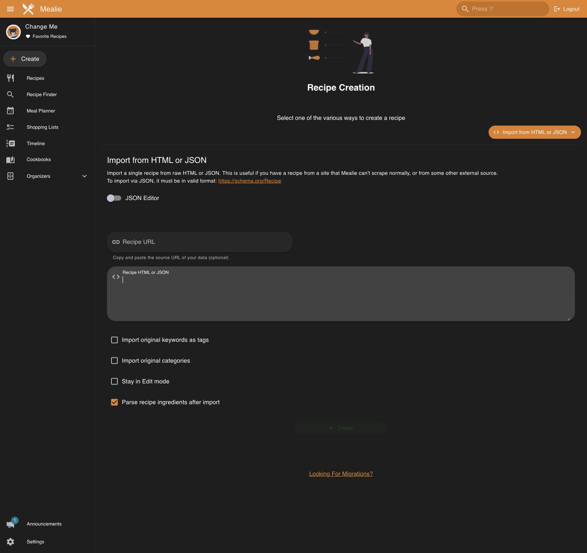
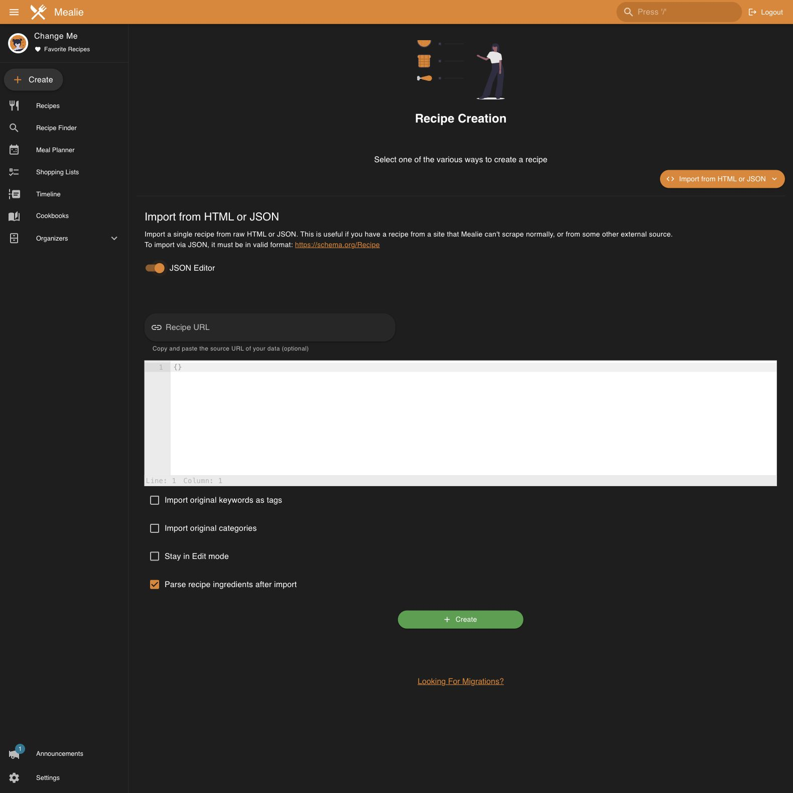
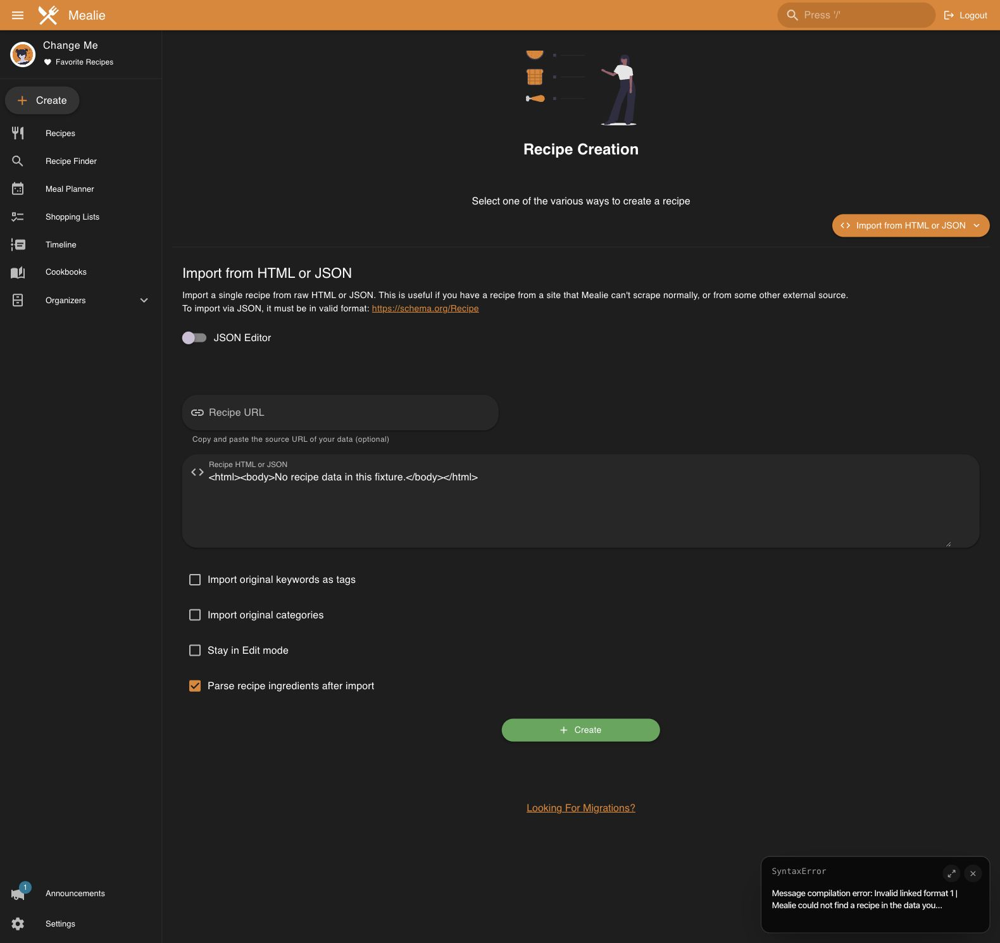
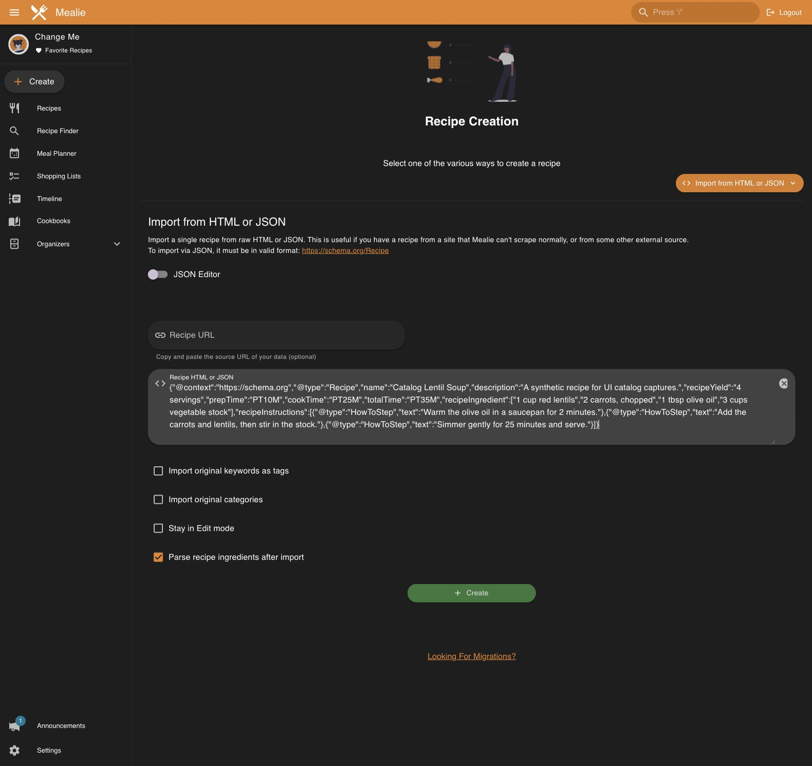
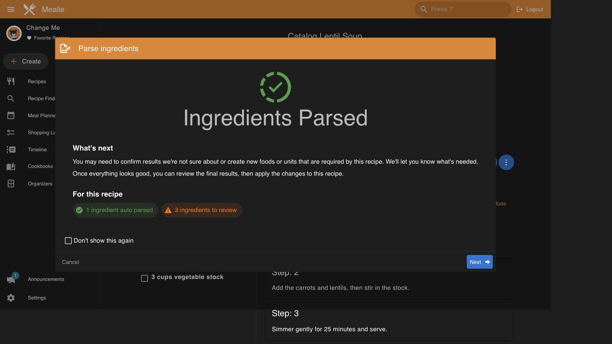
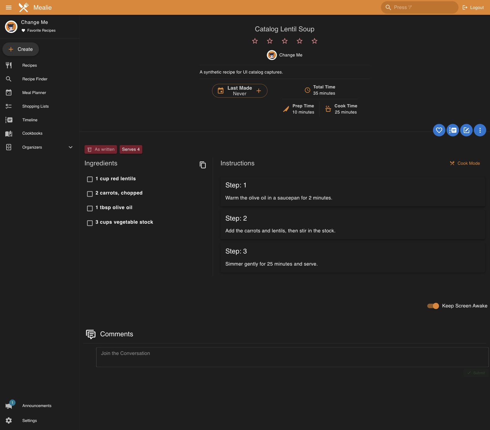

# Raw HTML or JSON recipe import

Route: `/g/:groupSlug/r/create/html`.
Source: [html.vue](../../frontend/app/pages/g/[groupSlug]/r/create/html.vue).
Access and shared controls: [creation parent](g--groupSlug--r--create.md).
Status: source contract and visual references reviewed; runtime validation remains in the checklists below.

## Functions to preserve

- Explain raw HTML/JSON import and link to the schema.org Recipe format.
- Show the alternative AI-import link only when group AI is enabled.
- Accept an optional, clearable source URL and validate it with the optional-URL rule.
- Enter raw content in the autofocus, clearable Recipe HTML or JSON textarea.
- Switch to the 250-pixel JSON code editor without the main menu bar.
- When entering JSON mode, parse valid text as JSON; wrap unparseable text in `{ data: text }`; use an empty object for empty content.
- When leaving JSON mode, stringify a nonempty object or reset empty content to null.
- Preserve the four remembered choices: original keywords as tags, original categories, stay in edit mode, and parse ingredients.
- Disable Create without content. Support form submission and await form validation before a request.
- Serialize object input as JSON and send string input unchanged.
- Send the content, keyword/category options, optional source URL, and streamed-status callback through the import client.
- Reset the previous error before a new request, show loading/status, and clear status afterward.
- On HTTP `201`, optionally refresh tags and navigate to the returned recipe using the shared edit/parse options.
- Preserve history replacement so Back does not repeat an import.

Sources: [RecipeJsonEditor.vue](../../frontend/app/components/global/RecipeJsonEditor.vue),
[new-recipe options](../../frontend/app/composables/use-new-recipe-options.ts).
The JSON wrapper parses editor JSON/text events and retains the previous value after an unparseable change.

## Failure contract and baseline defect

- Keep the form available after an import failure.
- Show the failure title and a specific returned error when available.
- For `BAD_RECIPE_DATA`, `NO_RECIPE_DATA`, `CONNECTION_ERROR`, or the generic client fallback, use the page's generic HTML/JSON guidance.
- Keep the structured-data documentation, GitHub Issues, and recipe-specification links.
- Retain ordinary API error toasts as well as the page-level recovery area.

The current English generic guidance contains unescaped `@context` and `@type` text.
The capture reproduced an i18n compilation error instead of the intended generic failure panel.
This is a baseline defect, not required design behavior. Preserve the recovery information and correct its rendering during implementation.
The screenshot below labels the actual observed overlay; it does not claim the intended alert rendered successfully.

## Screenshots

### Paste mode and all options

### JSON code-editor mode

### Observed localization defect after invalid synthetic content

### Valid synthetic schema.org recipe input

### Imported recipe with the parse-ingredients option

### Imported recipe after dismissing the parser

## Migration validation and optional evidence

These additional cases remain for replacement validation. See the [handoff evidence decisions](../HANDOFF.md#evidence-decisions) for shared references, preview fixtures, and unexecuted branches.

- [ ] Capture the intended failure guidance after an explicit fixture-only localization correction.
- [ ] Capture source-URL validation, text/object conversion with content, and narrow layout.
- [ ] Capture request progress with a delayed local fixture.

## Shadcn Vue replacement checklist

- [ ] Replace fields, mode switch, options, buttons, status, and recovery Alert.
- [ ] Retain the specialized JSON editor or replace it with equivalent code/text behavior.
- [ ] Preserve serialization, optional URL validation, remembered options, and response navigation.
- [ ] Fix the recorded localization defect without dropping its recovery instructions.
- [ ] Verify structured HTML, schema.org JSON, malformed input, and both edit/parse destination flags.
