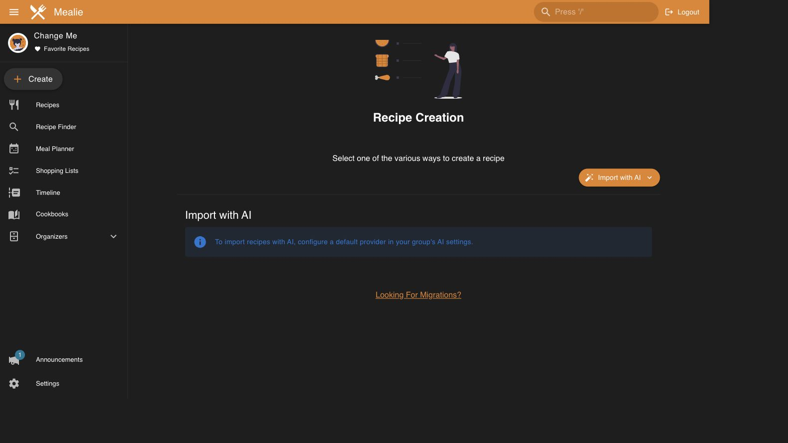

# Legacy image-import redirect

Route: `/g/:groupSlug/r/create/image`.
Source: [image.vue](../../frontend/app/pages/g/[groupSlug]/r/create/image.vue).
Parent access: authenticated users in their own group.
Status: source contract and visual references reviewed; runtime validation remains in the checklists below.

## Functions to preserve

- Keep the old image-import URL available for bookmarks and existing links.
- Render no independent controls.
- On mount, derive the group slug from the route or authenticated session.
- Replace the current history entry with `/g/{groupSlug}/r/create/ai`.
- Keep images in the combined AI importer rather than restoring a separate image-only workflow.
- Preserve the parent authentication and own-group gates.
- The current plain-string redirect does not copy query parameters.

## Destination screenshot

The capture entered the legacy image route and reached the AI provider-required view.
The [AI-import document](g--groupSlug--r--create--ai.md) contains the enabled image/crop workflow and its additional screenshots.

## Shadcn Vue replacement checklist

- [ ] Retain the legacy entry URL, group fallback, and history replacement.
- [ ] Preserve the destination's combined URL/text/image workflow and provider requirements.
- [ ] Verify a bookmark still reaches AI Import after the redesign.
