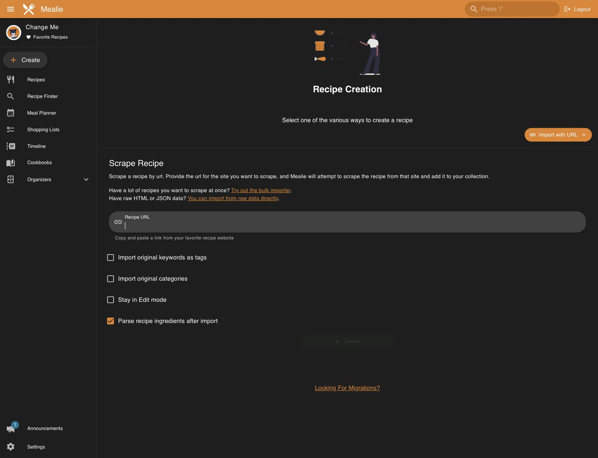

# Recipe creation entry redirect

Route: `/g/:groupSlug/r/create`.
Source: [create/index.vue](../../frontend/app/pages/g/[groupSlug]/r/create/index.vue).
Parent: [recipe creation](g--groupSlug--r--create.md).
Status: source contract and visual references reviewed; runtime validation remains in the checklists below.

## Functions to preserve

- Render no independent page controls.
- On mount, resolve group slug from the route or the authenticated user's group.
- Replace the current history entry with `/g/{groupSlug}/r/create/url`.
- Keep the parent's authentication and own-group gates.
- Preserve this entry URL for bookmarks and navigation links.

The current redirect builds a plain destination string and does not copy query parameters.
Do not confuse it with the parent method selector, which does preserve query parameters.
Record any query-preservation change as an explicit behavior improvement.

## Destination screenshot

The capture session entered the parent URL and reached this URL-import form.

## Shadcn Vue replacement checklist

- [ ] Retain the redirect and history-replace behavior.
- [ ] Verify route and session group-slug fallback.
- [ ] Preserve the URL importer's functions through its [page contract](g--groupSlug--r--create--url.md).
