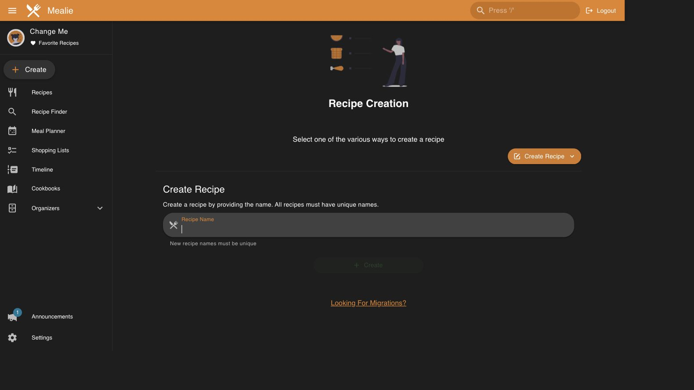
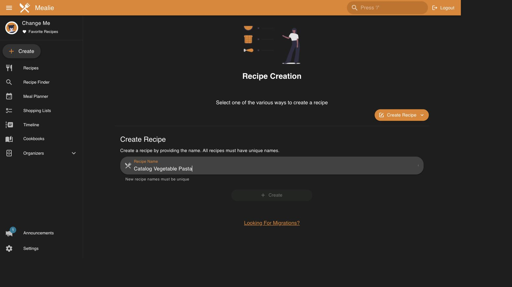
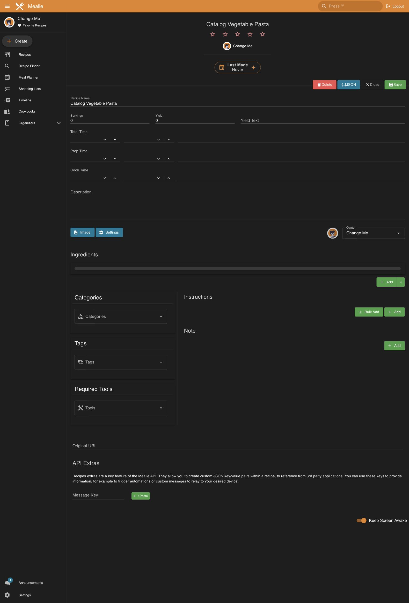

# Manual recipe creation

Route: `/g/:groupSlug/r/create/new`.
Source: [new.vue](../../frontend/app/pages/g/[groupSlug]/r/create/new.vue).
Parent controls and access: [recipe creation](g--groupSlug--r--create.md).
Status: source contract and visual references reviewed; runtime validation remains in the checklists below.

## Functions to preserve

- Explain that a recipe starts with a name and names must be unique.
- Autofocus the clearable Recipe Name field.
- Show the persistent unique-name hint and required-field rule.
- Disable the Create button for a blank or whitespace-only value.
- Support creation with the button and Enter from the name field.
- Create through `api.recipes.createOne({ name })`.
- Resolve group context from the route, then the authenticated user.
- On HTTP `201`, route to the returned recipe slug with `?edit=true`.
- On another response, keep the form available and set the page error state.
- Retain API error feedback from the shared interceptor.

Current-source audit notes:

- The source calls `validate()` without awaiting its result.
- The loading ref binds to the button, but this create handler does not set it to true.
- The error flag has no independent error panel in this template.
- The capture observed HTTP `201` and a created recipe. A direct visit captured the resulting editor.
- Recheck automatic post-create navigation as a separate acceptance check; do not infer it from the editor screenshot.

## Redesign (implemented)

| Before | Now |
| --- | --- |
| Each method was a flat card: title, paragraphs with cross-links, a rounded filled field, checkboxes stacked down the page and a centred pill Submit with the status text under it. | Each method is one panel: title and one-line explanation, labelled field, options in two columns, and a footer with the status on the left and a named action ("Import recipe", "Create recipe", "Debug") on the right. Links to the other methods sit under the panel. |

## Screenshots

### Empty form and disabled Create

### Name entered, clear control, and enabled Create

### The created recipe in edit mode

This is the destination UI, not an additional step in the name form.

## Shadcn Vue replacement checklist

- [ ] Replace card sections, form, clearable text field, hint, and Create button.
- [ ] Preserve button and Enter creation, group context, required name, and uniqueness feedback.
- [ ] Preserve the editor destination and `edit=true` query.
- [ ] Verify duplicate names, whitespace-only input, API failures, and repeated clicks.
- [ ] Capture duplicate-name feedback and the narrow layout.
