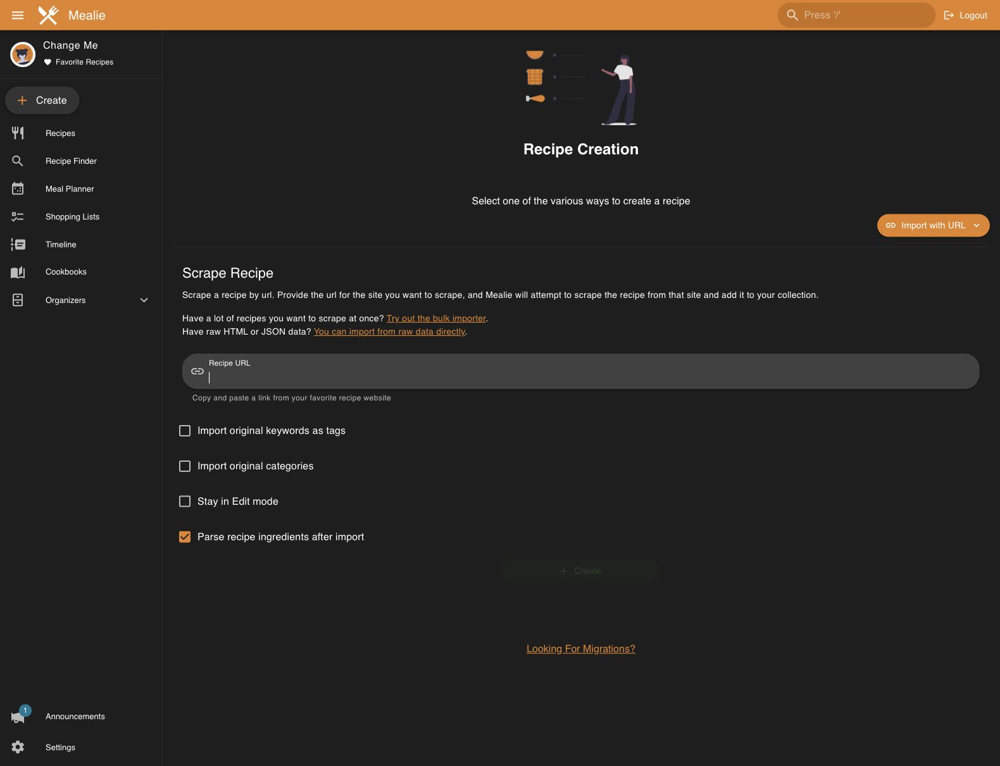
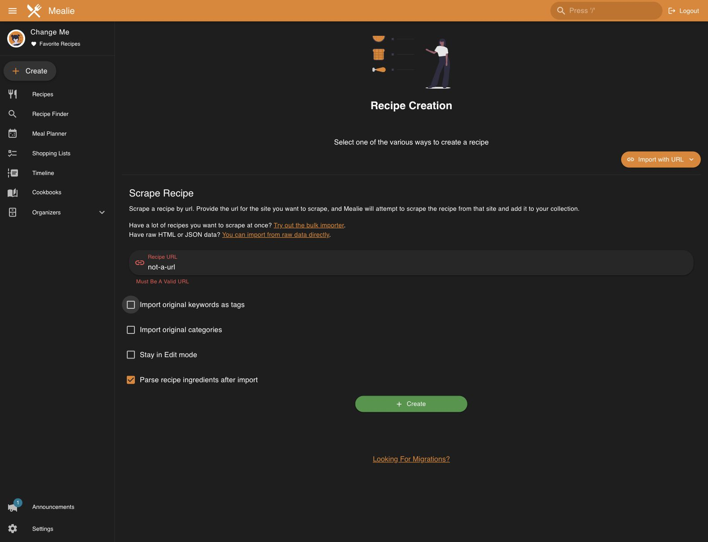
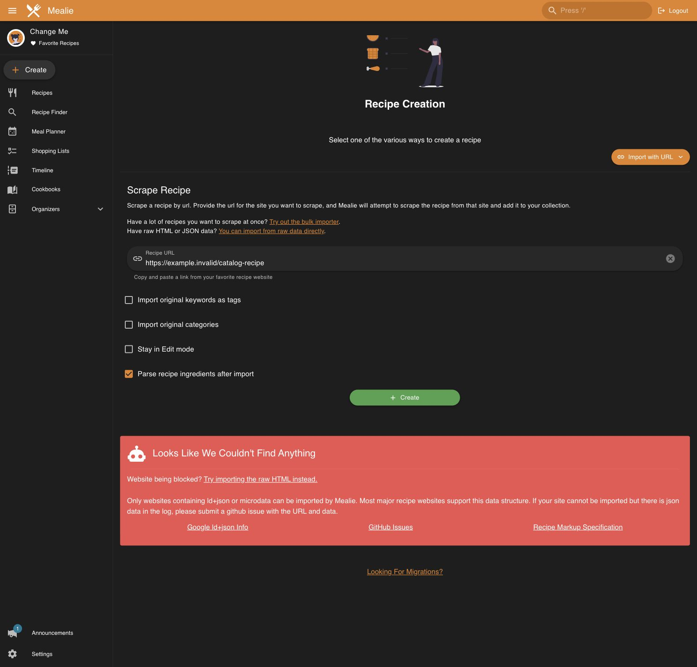
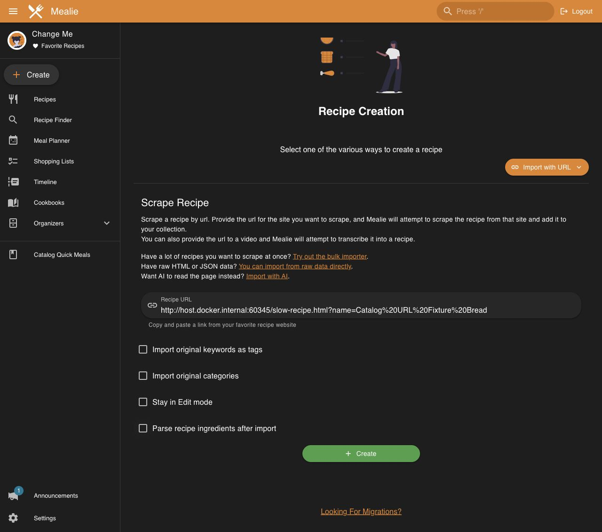
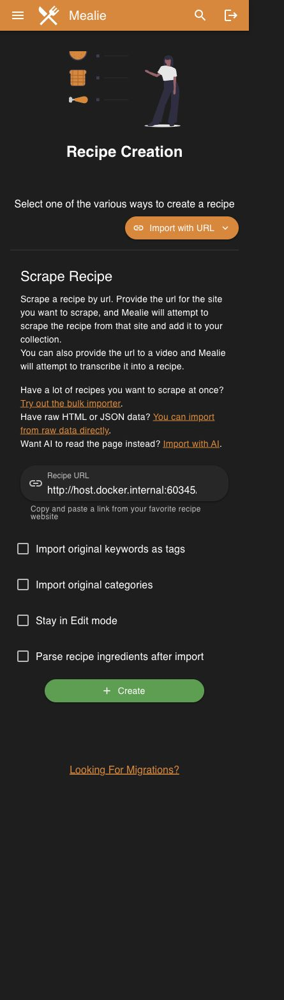
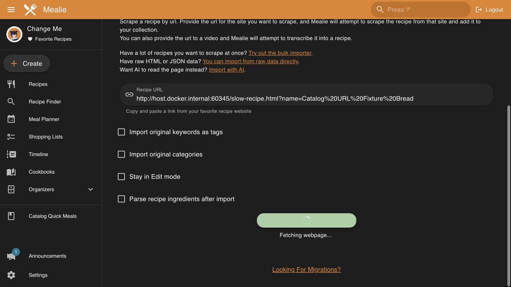
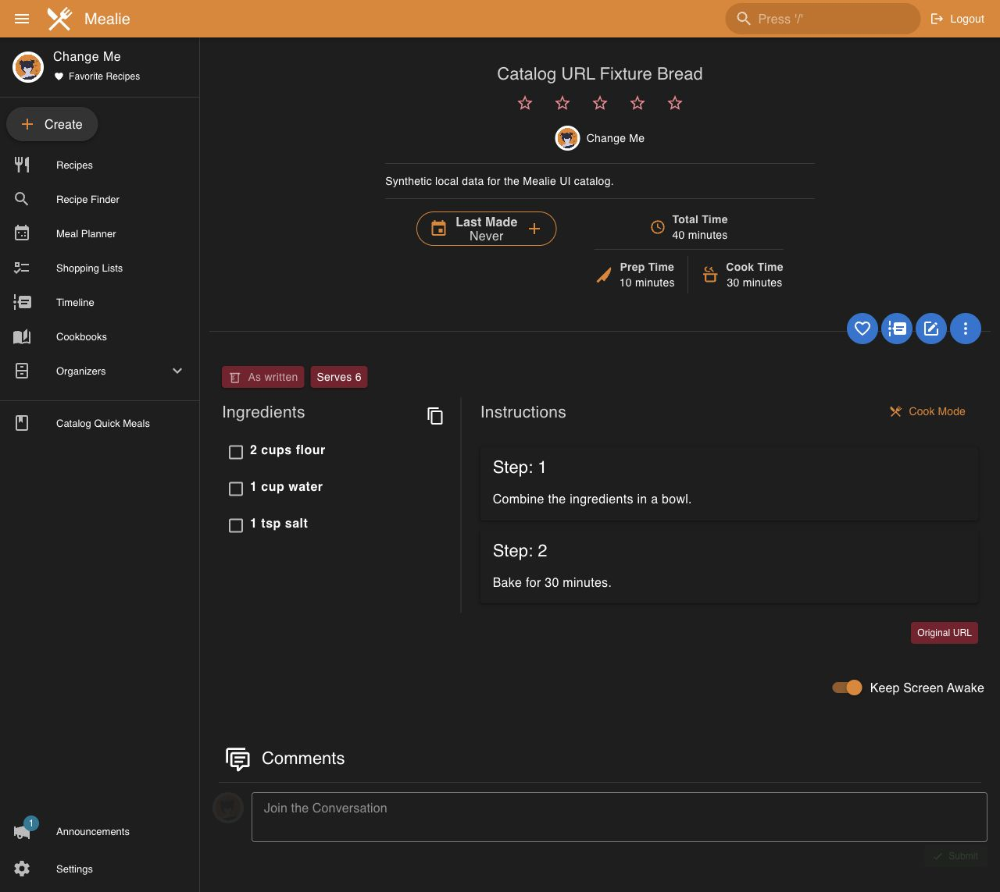

# URL recipe import

Route: `/g/:groupSlug/r/create/url`.
Source: [url.vue](../../frontend/app/pages/g/[groupSlug]/r/create/url.vue).
Parent controls and access: [recipe creation](g--groupSlug--r--create.md).
Status: source contract and visual references reviewed; runtime validation remains in the checklists below.

## Input, links, and stored options

- Autofocus the clearable Recipe URL field and show the URL-format rule and persistent hint.
- Trim edited URL text and update `recipe_import_url` without dropping other query parameters.
- Prefill from `recipe_import_url` when present.
- Otherwise accept `recipe_import_text` only if it parses as an HTTP or HTTPS URL.
- Do not auto-submit a prefilled share target or bookmarklet URL.
- Provide links to Bulk URL Import and raw HTML/JSON import.
- Show the AI-import alternative only when the group enables AI.
- Show the audio-transcription explanation only when the group enables an audio provider.
- Preserve four remembered options: original keywords as tags, original categories, stay in edit mode, and parse ingredients after import.
- Store these choices through the shared recipe-create preferences, not only in page-local state.
- Support legacy `use_keywords=1|0` and `edit=1|0` query overrides when a URL is prefilled.

## Import and navigation

- Submit with Create or Enter.
- Disable Create when the URL model is null.
- Send the URL, keyword-import choice, and category-import choice through the URL-import API client.
- Show request progress and streamed status text beside the creation action.
- Clear the status text when the request ends.
- Refresh the tag store after a successful import when keyword import is enabled.
- Use the returned recipe slug for navigation.
- Add `edit=true` and/or `parse=true` according to the saved options.
- Replace the importer history entry before opening the recipe, so Back does not repeat the import.
- Remove import query parameters when leaving the URL page.

Source: [use-new-recipe-options.ts](../../frontend/app/composables/use-new-recipe-options.ts).

## Failure and recovery

- Keep the form available after a failed import.
- Show the expanded failure alert with its title and explanation.
- Link to raw HTML import as a blocked-site recovery option.
- Also offer AI import when AI is enabled.
- Link to structured-recipe documentation, GitHub Issues, and the recipe markup specification in separate tabs.
- Preserve the shared API error toasts in addition to the page's recovery panel.

Current-source audit note: the handler calls `validate()` without awaiting it.
Do not claim that the visible field rule prevents every invalid network request.
Record stronger submit-time validation as a deliberate improvement.

## Redesign (implemented)

| Before | Now |
| --- | --- |
| Each method was a flat card: title, paragraphs with cross-links, a rounded filled field, checkboxes stacked down the page and a centred pill Submit with the status text under it. | Each method is one panel: title and one-line explanation, labelled field, options in two columns, and a footer with the status on the left and a named action ("Import recipe", "Create recipe", "Debug") on the right. Links to the other methods sit under the panel. |
| The failure message was a red alert with white text and a row of links. | A red-bordered panel with the robot icon, the suggestions (raw HTML, AI), and the reference links. |

## Screenshots

### Complete importer, remembered options, and alternative-method links

### Invalid URL field feedback

### Failed synthetic URL and recovery panel

The reserved `.invalid` hostname provides a failure fixture without importing third-party content.

### AI-enabled, mobile, live progress, and local success

The delayed local fixture serves schema.org Recipe data. Parse and Stay in Edit mode are off for this success capture.
The destination shows the imported recipe. No external recipe site or AI provider receives a request.

## Migration validation

- [ ] Verify PWA/bookmarklet prefill and legacy query overrides during replacement.
- [ ] Verify each edit/parse option destination and Back history during replacement.

## Shadcn Vue replacement checklist

- [ ] Replace the form, clearable Input, Checkbox controls, Button, status area, Alert, and dividers.
- [ ] Preserve PWA share fields, legacy parameters, remembered choices, and explicit user submission.
- [ ] Preserve streamed status messages and all failure recovery links.
- [ ] Preserve tag refresh, edit/parse destination flags, and import-history cleanup.
- [ ] Verify Back after import does not submit again.
