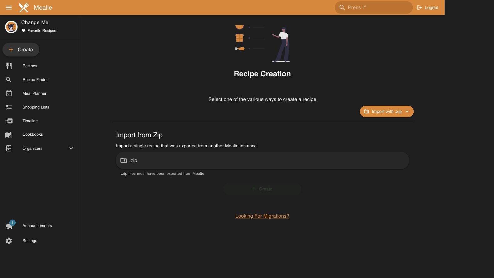
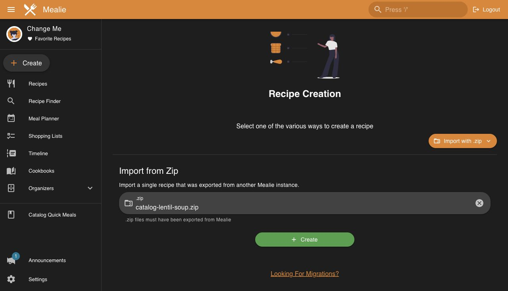
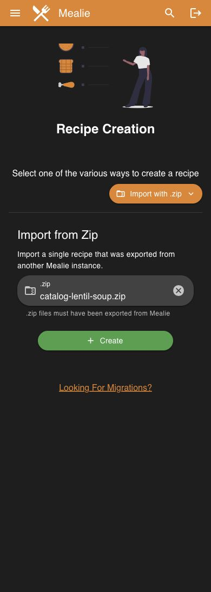
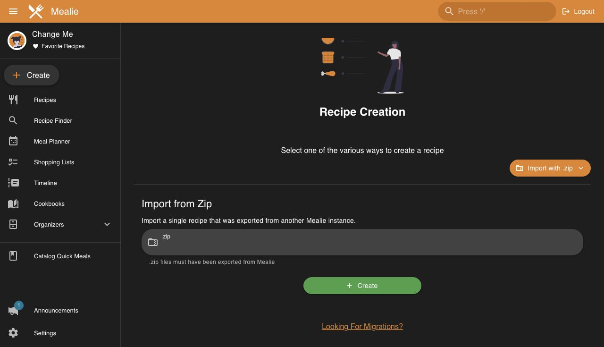
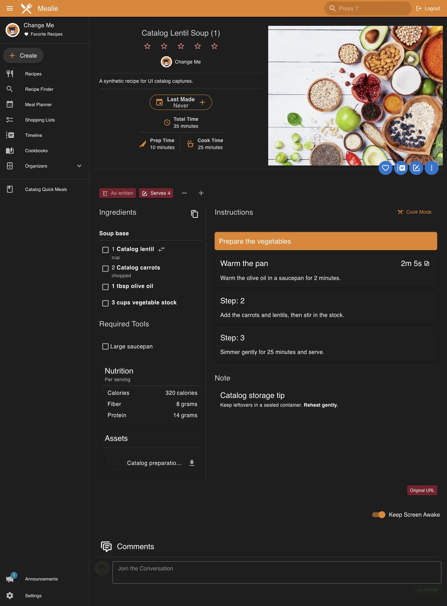

# Mealie ZIP recipe import

Route: `/g/:groupSlug/r/create/zip`.
Source: [zip.vue](../../frontend/app/pages/g/[groupSlug]/r/create/zip.vue).
Parent controls and access: [recipe creation](g--groupSlug--r--create.md).
Status: source contract and visual references reviewed; runtime validation remains in the checklists below.

## Functions to preserve

- Explain that this imports one recipe exported from another Mealie instance.
- Offer a clearable file field restricted to `.zip` selection.
- Show the selected filename and preserve long-filename handling.
- Keep the hint that ZIP files must come from a Mealie export.
- Disable Create when no file is selected.
- Upload the file as multipart field `archive` to `/api/recipes/create/zip`.
- Require HTTP `201` for success.
- Navigate to the returned recipe slug in the current route/session group.
- On upload or import failure, log the error and show the generic error toast.
- Clear the local loading state in `finally`.
- Retain the parent method menu and advanced-content migration link.

Current-source audit note: the button binds a loading ref, but this handler never sets it to true.
Do not assume the current UI prevents repeated upload requests while a request is active.

## Screenshot

## Expanded file states

The selected archive comes from the isolated catalog's synthetic soup recipe.
The importer creates Catalog Lentil Soup (1) and opens its recipe route.

## Migration validation

- [ ] Verify genuine single-recipe import, duplicate-name handling, and invalid archive feedback.
- [ ] Verify duplicate-submit protection and loading feedback; the baseline handler never sets loading true.

## Shadcn Vue replacement checklist

- [ ] Replace the FileInput, form layout, card sections, hint, icon, and Create button.
- [ ] Preserve `.zip` acceptance, filename display, clearing, and no-file gating.
- [ ] Preserve multipart field name, endpoint, success code, group route, and error toast.
- [ ] Test a genuine single-recipe Mealie export and an invalid archive.
