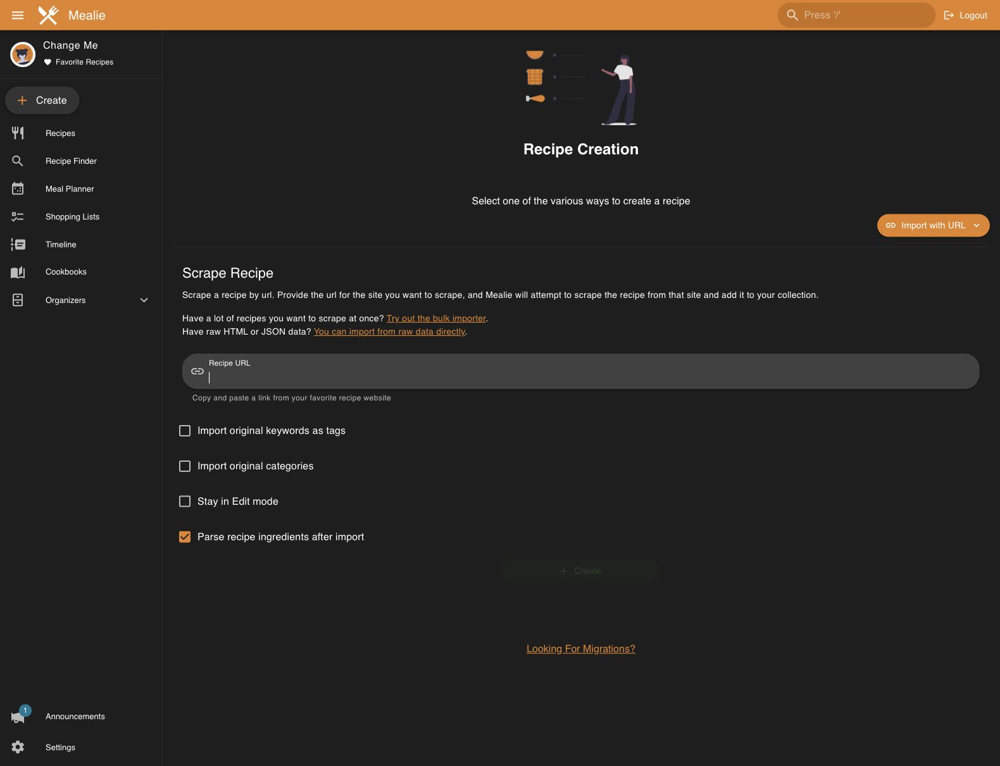
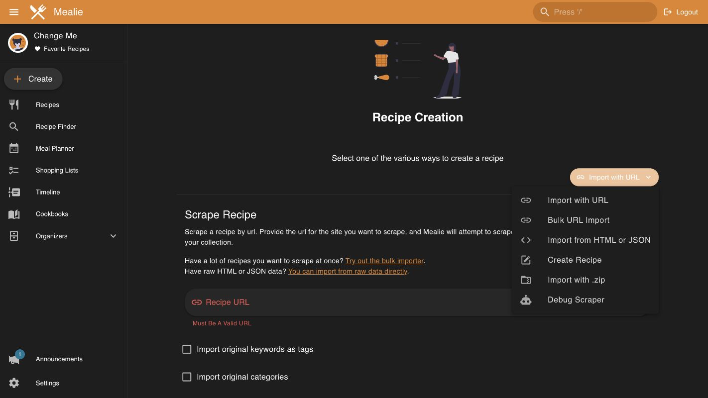
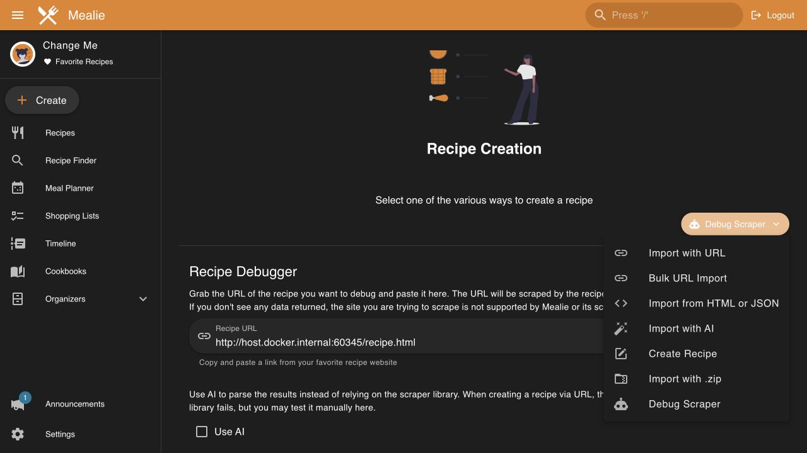

# Recipe creation parent

Route family: `/g/:groupSlug/r/create/*`.
Source: [create.vue](../../frontend/app/pages/g/[groupSlug]/r/create.vue).
Access: authenticated users in their own group, through `auth` and `group-only` middleware.
Layout: [shared shell](../shared-shell.md).
Status: source contract and visual references reviewed; runtime validation remains in the checklists below.

## Functions to preserve

- Show the recipe-creation illustration, title, explanation, and current-method selector.
- Render the selected creation page below the parent header.
- Derive the selected method from the last route-path segment.
- Derive group context from the route, then the authenticated user's group.
- On method selection, navigate to that group's creation subroute and preserve the current query parameters.
- Hide AI Import in the method menu unless the group enables AI.
- Show Looking For Migrations? only for users with advanced content enabled.
- Keep this group's permission gate around every child method.

| Method | Route suffix | Child document |
| --- | --- | --- |
| URL | `url` | [URL import](g--groupSlug--r--create--url.md) |
| Bulk URL | `bulk` | [Bulk URL import](g--groupSlug--r--create--bulk.md) |
| HTML or JSON | `html` | [Raw import](g--groupSlug--r--create--html.md) |
| AI | `ai` | [AI import](g--groupSlug--r--create--ai.md) |
| Manual | `new` | [Manual creation](g--groupSlug--r--create--new.md) |
| Mealie ZIP | `zip` | [ZIP import](g--groupSlug--r--create--zip.md) |
| Debug Scraper | `debug` | [Scraper debugger](g--groupSlug--r--create--debug.md) |

The parent selector does not replace the child forms. Preserve each child's full function checklist.
The old `image` route redirects to AI Import; it is not a separate current import method.

## Redesign (implemented)

| Before | Now |
| --- | --- |
| Illustration title with a rounded overflow button to pick the method. | Heading and explanation, then one tab per method (with icons) that scrolls sideways on phones; AI only shows when it is enabled. |

## Screenshots

### Parent header with its default URL-import child

### Method selector expanded

AI is absent in this fixture because the group has no AI provider enabled.

### Method selector with AI enabled in the local fixture

## Shadcn Vue replacement checklist

- [ ] Replace the page title, illustration layout, method menu, and advanced-content link styling.
- [ ] Preserve the selected method, group scope, query parameters, and parent route guards.
- [ ] Keep every method listed above, including Debug Scraper and ZIP import.
- [ ] Verify method changes from both the parent selector and the global Create menu.
- [ ] Capture limited-permission visibility.
