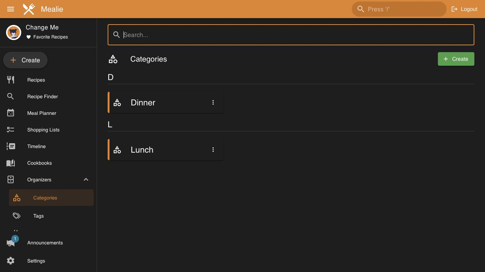
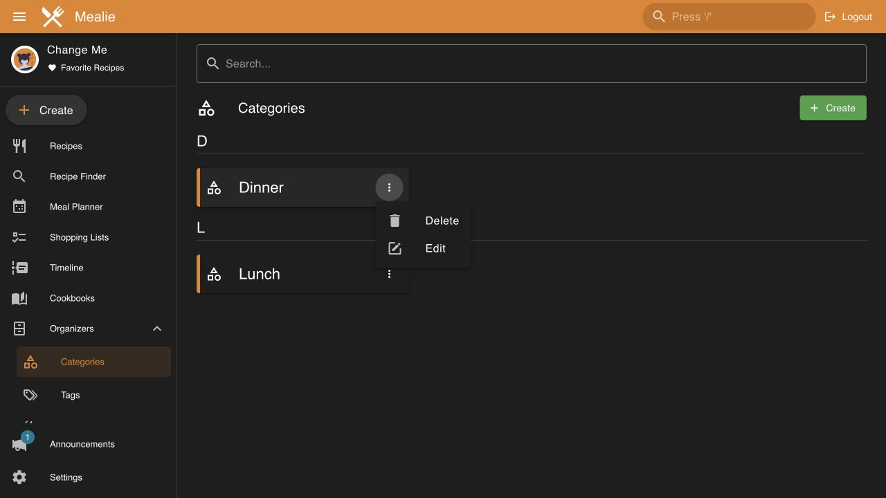
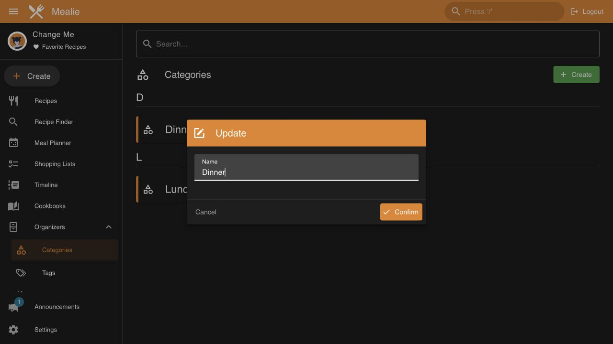
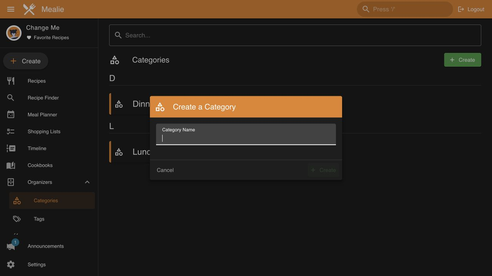
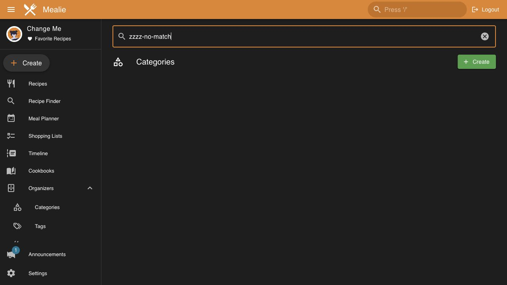
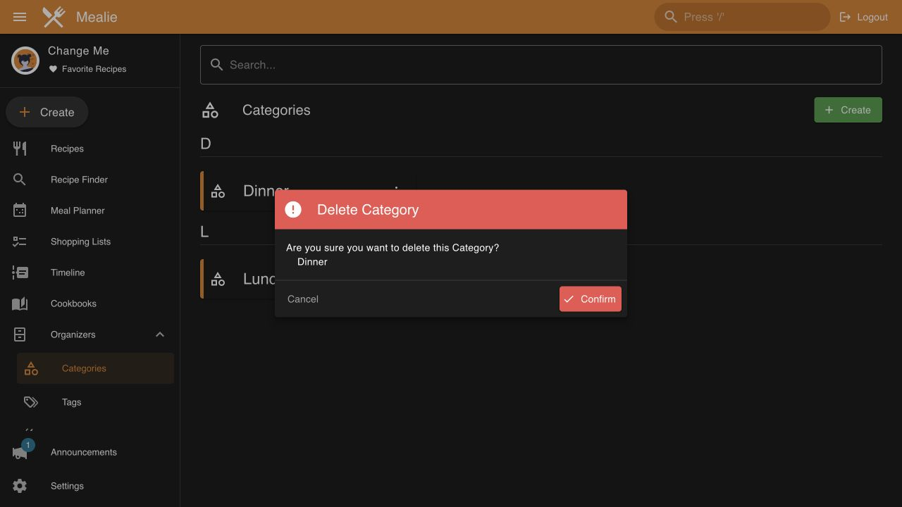
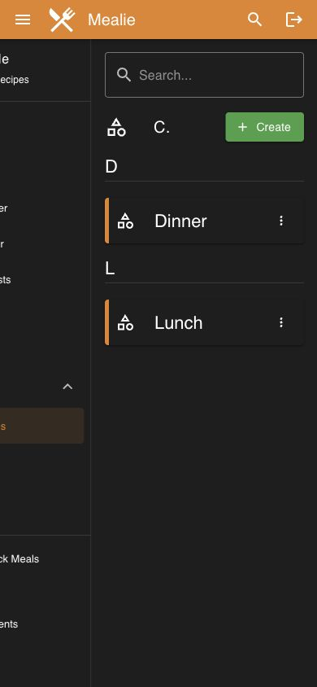
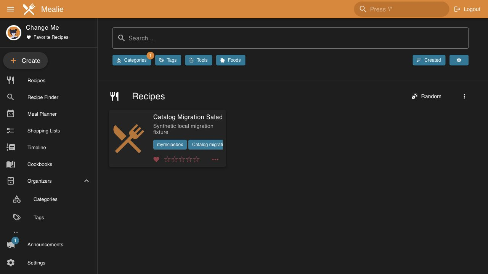

# Category browser

Route: `/g/:groupSlug/recipes/categories`. Source: [index.vue](../../frontend/app/pages/g/[groupSlug]/recipes/categories/index.vue).

## Functions to preserve

- Require authentication and own-group membership; set the localized Categories page title and icon.
- Render the category store using the entire [shared organizer browser contract](../shared-organizer-browser.md): URL-backed fuzzy search, clear, alphabetical grouping, responsive cards, recipe-filter links, Create, context Edit, and reviewed Delete.
- Delegate update/delete to category store actions. Create uses the category store from the shared dialog. Refresh and error feedback must remain visible.
- Category links use `categories={id}` on the group recipe explorer. Category create requires Category Name; update uses a copied Name draft.

## Screenshots

### Full category browser and card context menu

### Edit and create dialogs

### No-match search with URL query

### Category review, mobile, and recipe destination

## Migration validation

- [ ] Verify keyboard navigation and focus return after the nested menu/dialog.

## Shadcn Vue replacement checklist

- [ ] Apply every shared organizer-browser replacement task.
- [ ] Preserve category-specific fields, icon, store calls, title, and explorer query key.
