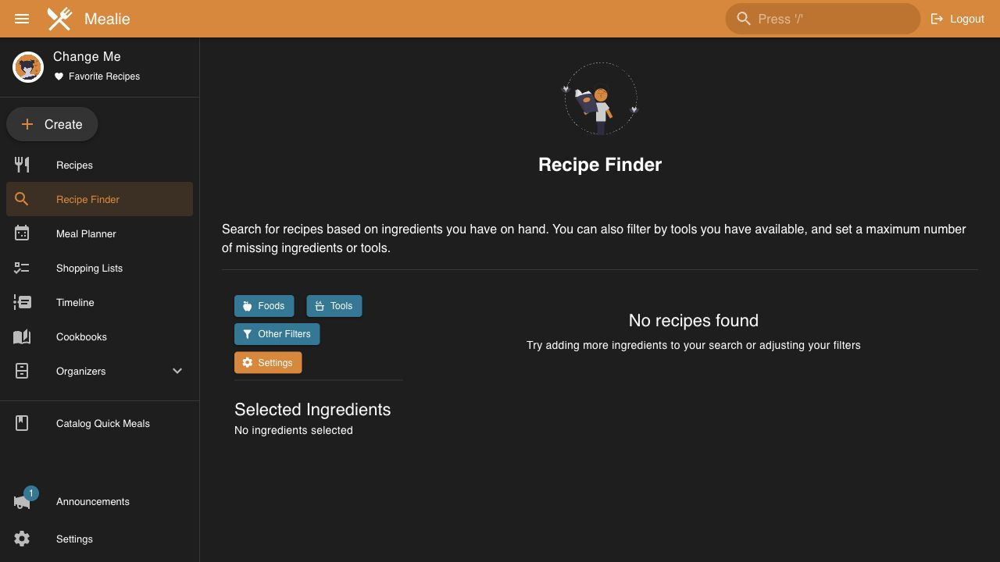
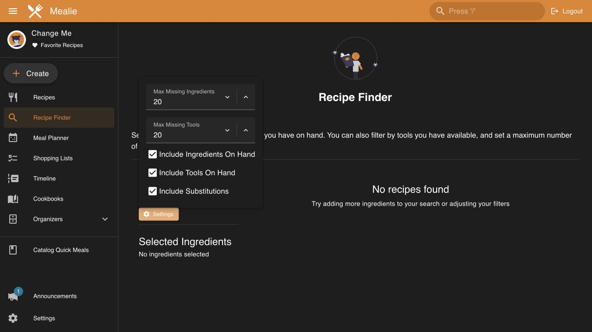
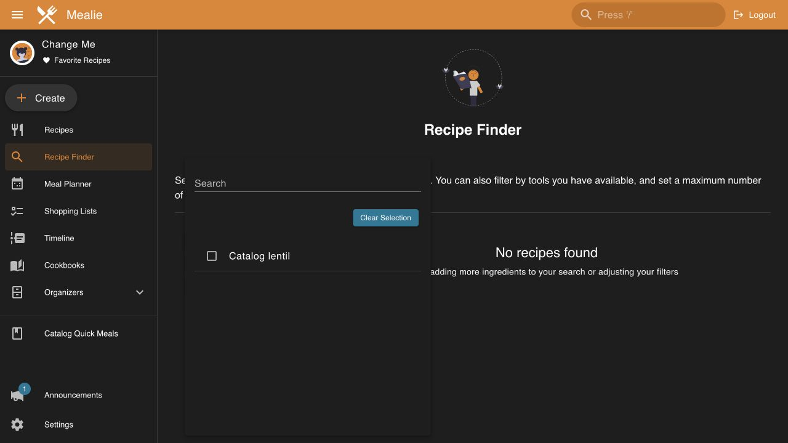
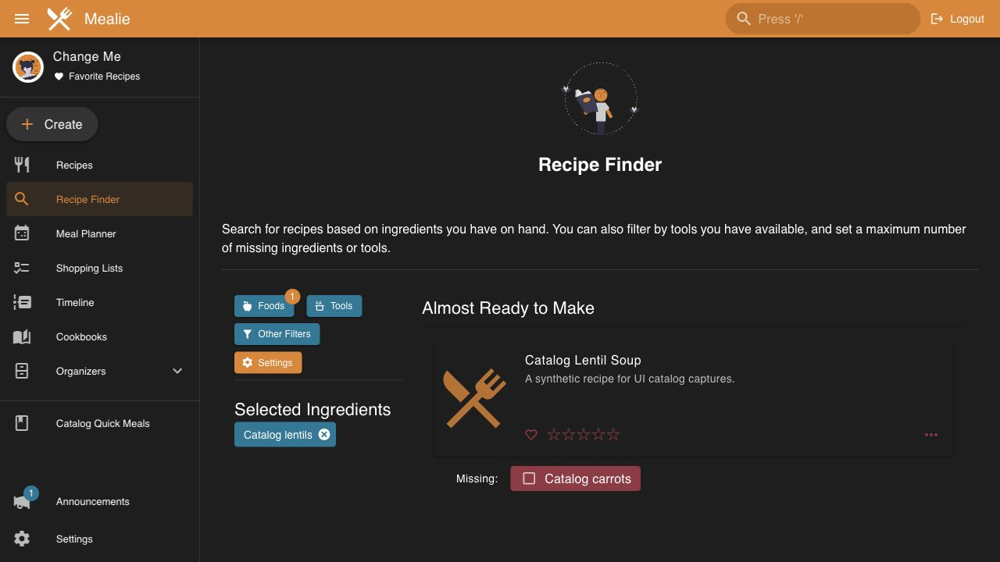
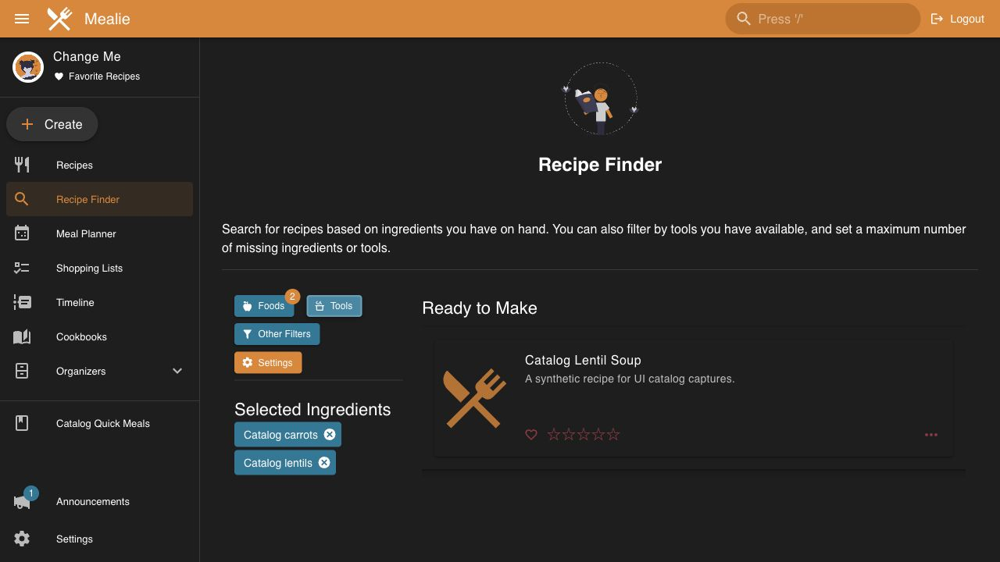
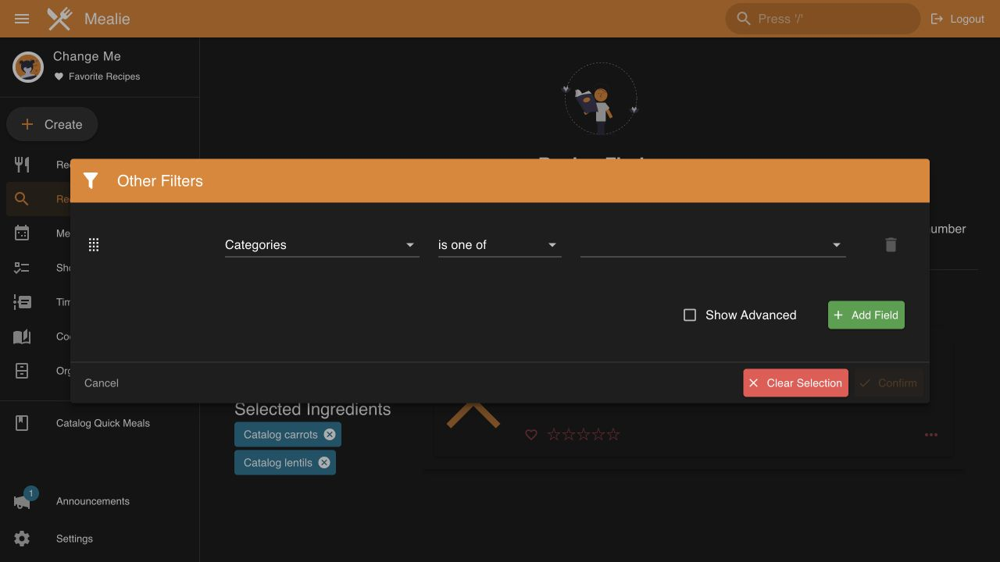
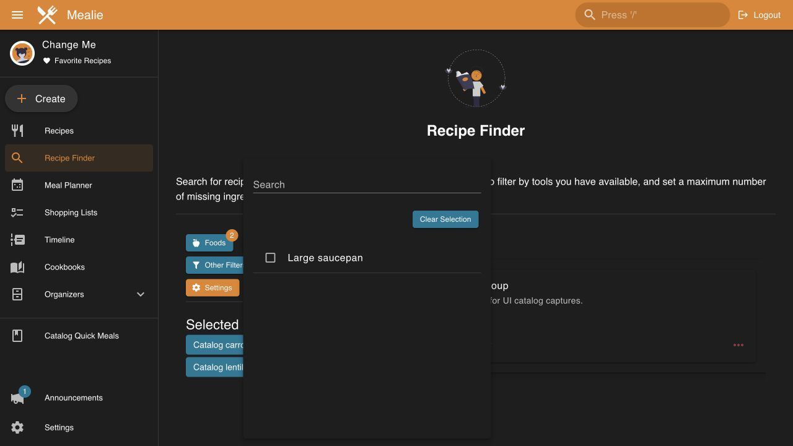
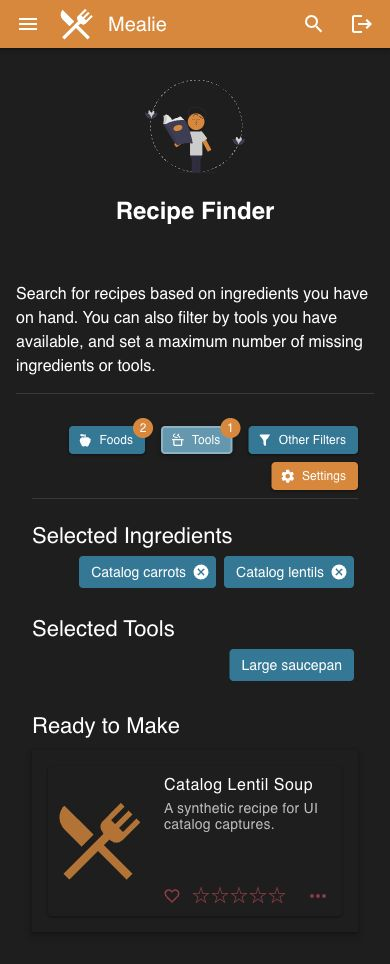

# Recipe finder

Route: `/g/:groupSlug/recipes/finder`. Sources: [page](../../frontend/app/pages/g/[groupSlug]/recipes/finder/index.vue), [RecipeSuggestion](../../frontend/app/components/Domain/Recipe/RecipeSuggestion.vue), [limit normalization](../../frontend/app/lib/recipe/recipe-finder.ts).

## Functions: selections and scope

- Use the current-group user API or another group's public explore API. Select matching food and tool stores.
- Foods and Tools each open a searchable multiselect with Clear Selection and a count badge. Preserve [SearchFilter behavior](../shared-recipe-cards.md).
- Show selected foods by plural name when present, otherwise name. Sort them alphabetically. Show selected tools only when nonempty and sort by name.
- Remove each selection with its chip control. Store selected IDs in user preferences and hydrate existing IDs against refreshed stores.
- Hydrate both selections before the initial ready state. Ignore IDs that no longer exist.
- Settings contains nonnegative Max Missing Ingredients and Max Missing Tools number inputs, Include Ingredients On Hand, Include Tools On Hand, and Include Substitutions.
- Convert null or undefined limits to zero and clamp negative values to zero. The number inputs do not restrict precision.
- Hide on-hand options outside the current group and force their values false. Preserve all settings in preferences.
- Other Filters opens the [shared query builder](../shared-query-filter-builder.md) with every recipe field except Tools. The separate tool selector owns tool matching.
- Keep query edits separate until Confirm. Disable Confirm for an empty generated query. Cancel closes without applying.
- Clear Selection resets both query string and JSON, clears the editor, closes the dialog, and increments its key.
- Badge counts query parts. Preserve persisted query string and JSON across visits.

## Functions: suggestions and result actions

- Debounce food, tool, and settings changes by 500ms. Request up to 20 suggestions with selected IDs and all options.
- If no foods, tools, or query remain, clear results and show the empty state without a request.
- Show an initial loader until ready. On missing response data, keep the preceding results. Clear the request loading state.
- Split results into Ready to Make when both missing arrays are empty, and Almost Ready to Make otherwise.
- Each result uses a compact recipe card with [shared card behavior](../shared-recipe-cards.md) and [nested actions](../shared-recipe-actions.md).
- Show missing food and tool chips with checkboxes. Add or remove that item from the selected search and request new suggestions.
- Ignore missing-item checkbox events while the request loads. The source guards the handler rather than disabling the native checkbox.
- Show substitutions as read-only chips: substitute food for requested food. Prefer plural food labels. Do not add another checkbox.
- Lazy-render result cards. Empty results explain that the user can add ingredients or adjust filters.
- Desktop uses a three-column-width control panel and nine-column-width results with separate vertical scroll areas. Small screens stack controls and results.
- Mobile selected chips wrap and align right. The mobile tool chip uses a misspelled closeable attribute; preserve removal capability in the replacement.
- Source assigns store arrays to plain constants before asynchronous refresh. A cold visit can retain stale empty choices; verify reactive store bindings during replacement.
- Backend matches linked food IDs, not ingredient note text. Capture fixtures link lentils and carrots explicitly to the soup.

## Screenshots

## Migration validation and optional evidence

These additional cases remain for replacement validation. See the [handoff evidence decisions](../HANDOFF.md#evidence-decisions) for shared references, preview fixtures, and unexecuted branches.

- [ ] Capture missing tools and substitutions.
- [ ] Verify cold-load organizer choices, stale responses, persisted selection, and public option restrictions during replacement.

## Shadcn Vue replacement checklist

- [ ] Use Popover/Command multiselects, Badge, removable chips, numeric Input controls, Checkbox, Dialog, and shared recipe cards.
- [ ] Preserve query-draft isolation, food/tool match options, debounce, result groups, missing-item actions, and substitution display.
- [ ] Preserve responsive scroll regions, persisted preferences, public scope, initial loading, and empty/error recovery.
