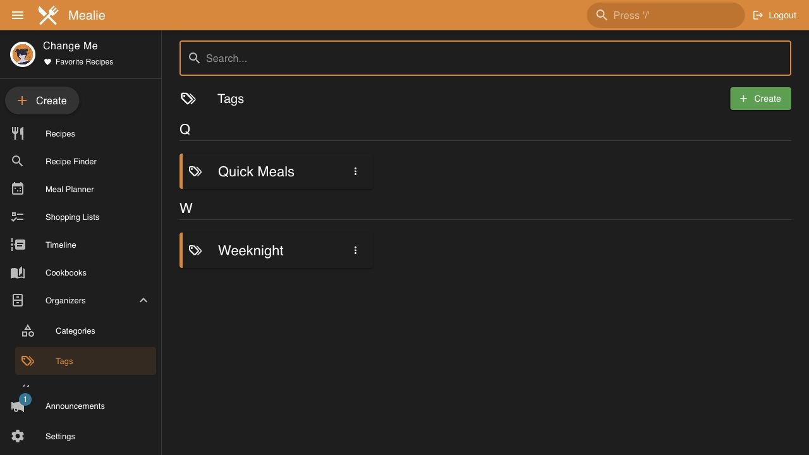
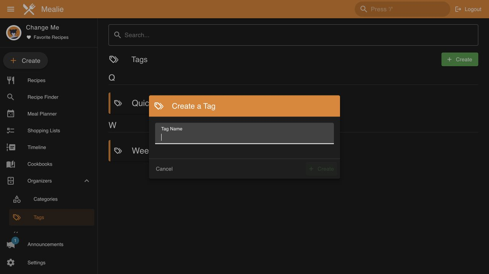
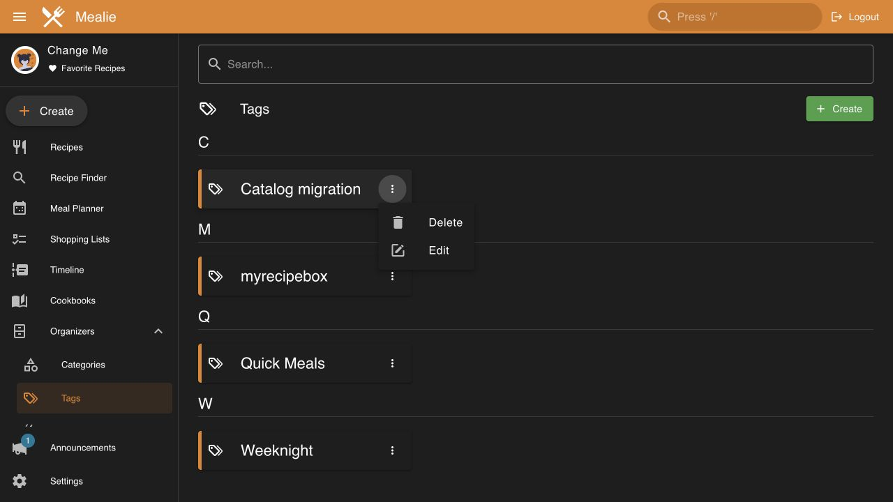
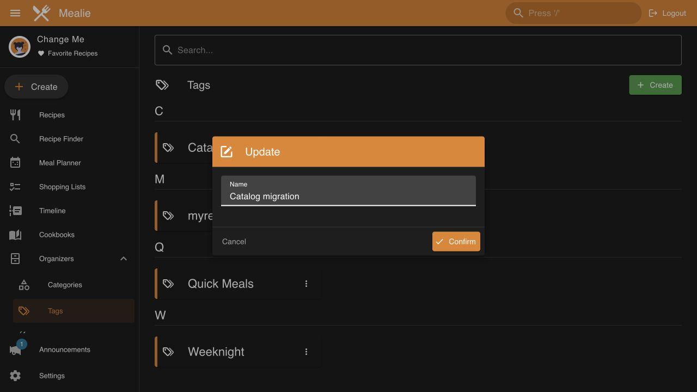
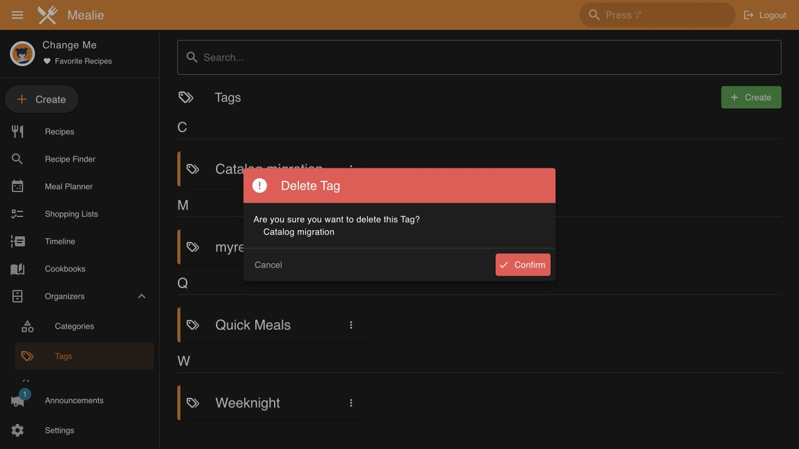
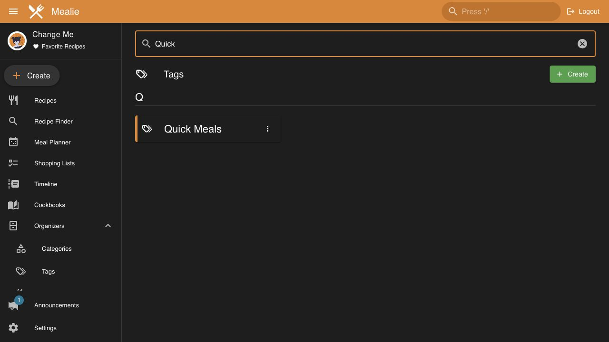
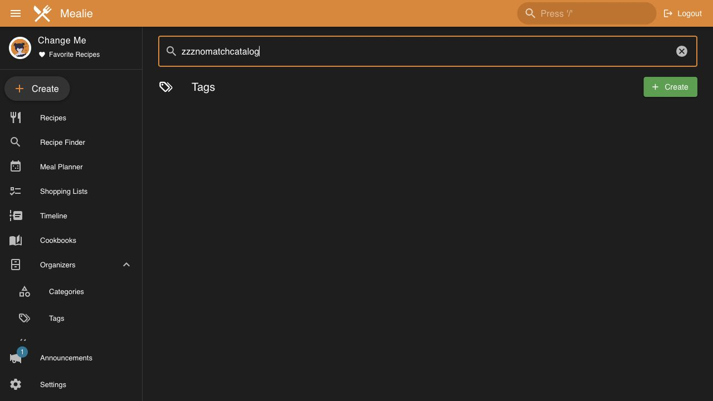
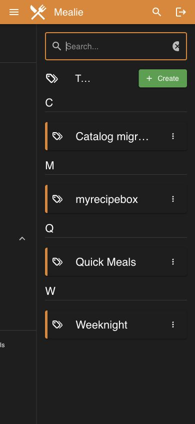
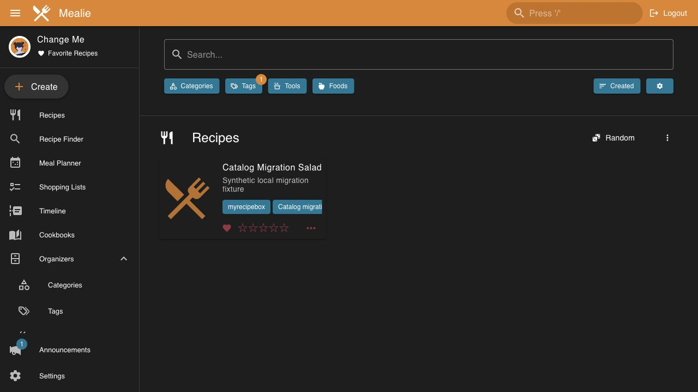

# Tag browser

Route: `/g/:groupSlug/recipes/tags`. Source: [index.vue](../../frontend/app/pages/g/[groupSlug]/recipes/tags/index.vue).

## Functions to preserve

- Require authentication and the current user's group; set the localized Tags page title and icon.
- Apply the complete [shared organizer browser contract](../shared-organizer-browser.md), including URL `q`, fuzzy search, clearing, letter grouping, responsive cards, nested creation, copied edit draft, and deletion review.
- Bind to the tag store; update and delete use tag store actions, while shared Create chooses the tag store.
- Card destinations filter the recipe explorer with `tags={id}`. Create requires Tag Name; edit exposes Name.
- Keep store error feedback and refresh after each mutation.

## Screenshots

### Tag browser and required-name creation

The shared menu, copied-name editor, and no-match layout are additionally illustrated in the [category browser](g--groupSlug--recipes--categories--index.md); page-specific follow-ups remain explicit below.

### Tag-specific actions, search, and mobile

## Migration validation

- [ ] Verify keyboard focus return, tag query hydration, and update/delete failure recovery during replacement.

## Shadcn Vue replacement checklist

- [ ] Apply all shared organizer-browser tasks and verify tag-specific store calls/query keys.
- [ ] Verify creation, cancellation, edit persistence, and deletion review without navigating the underlying card.
