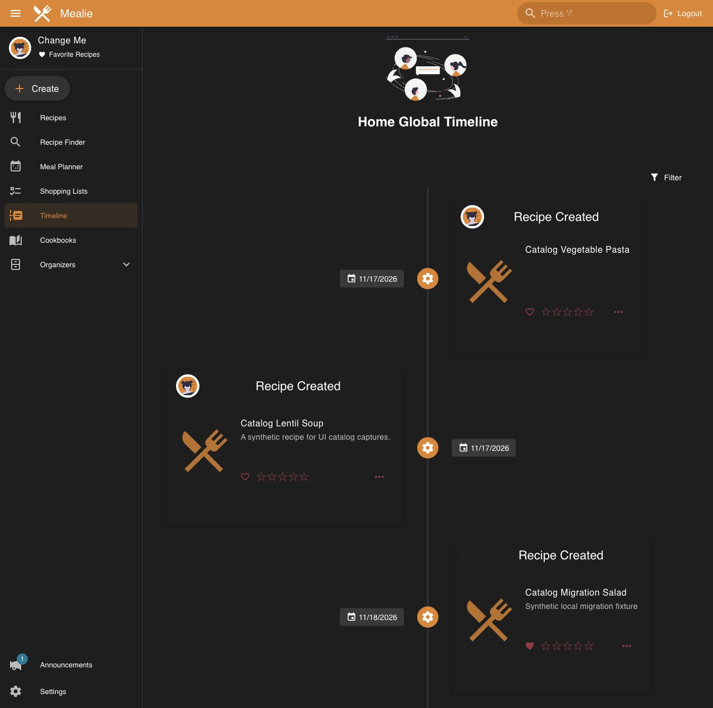
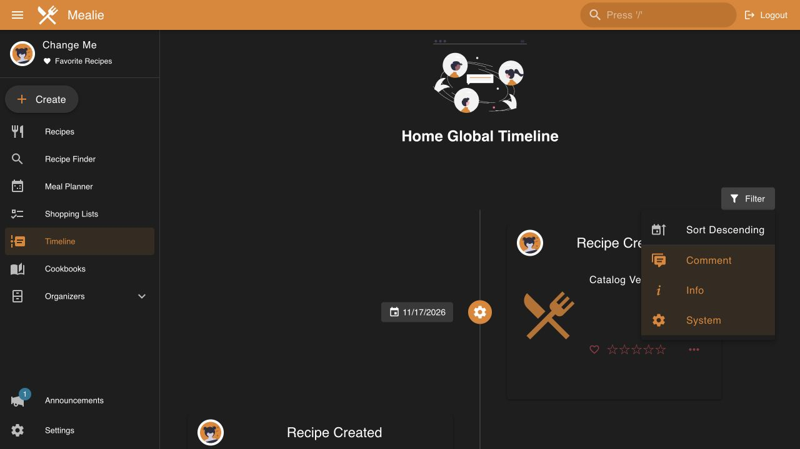
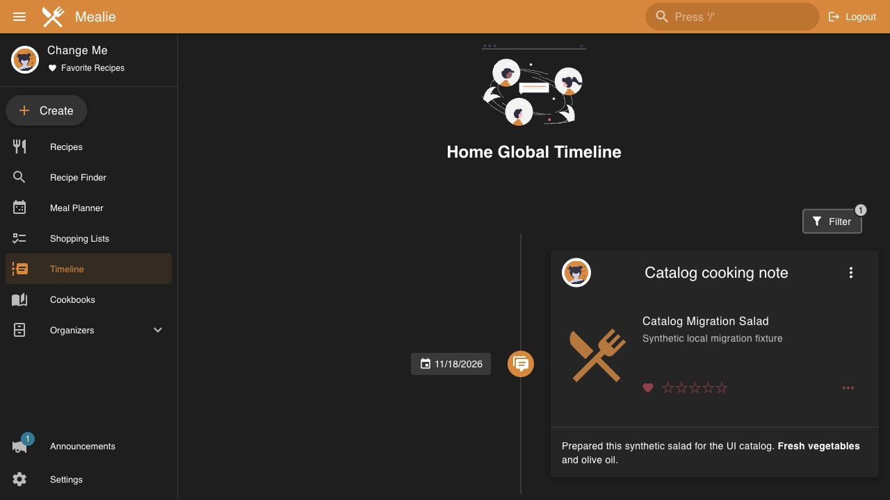
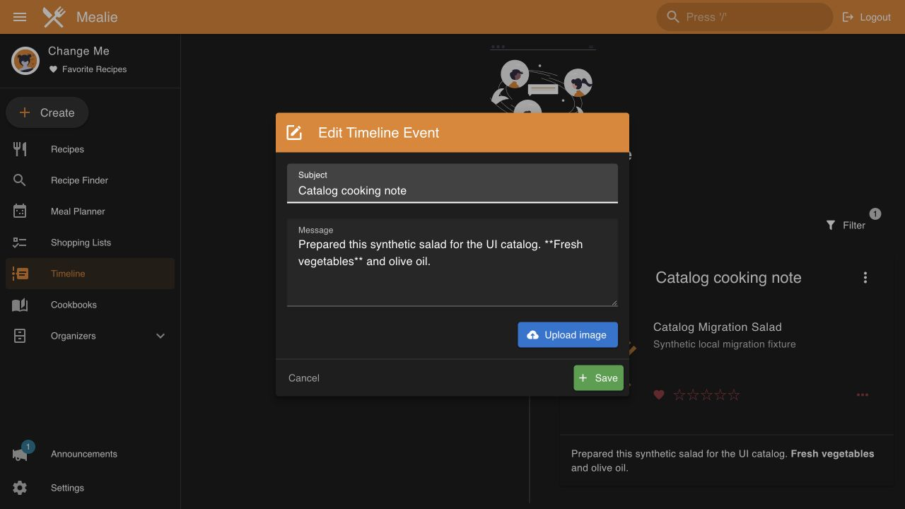
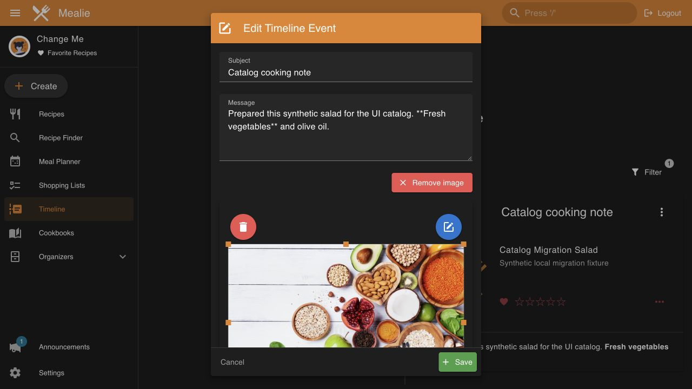
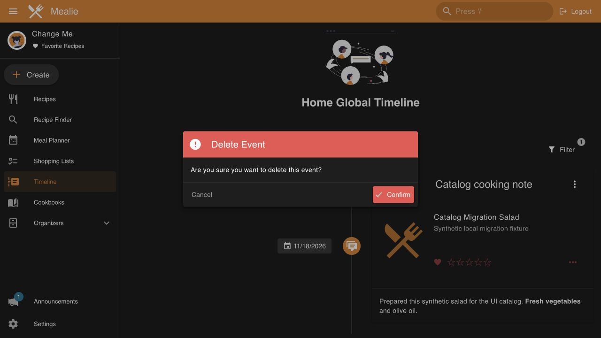
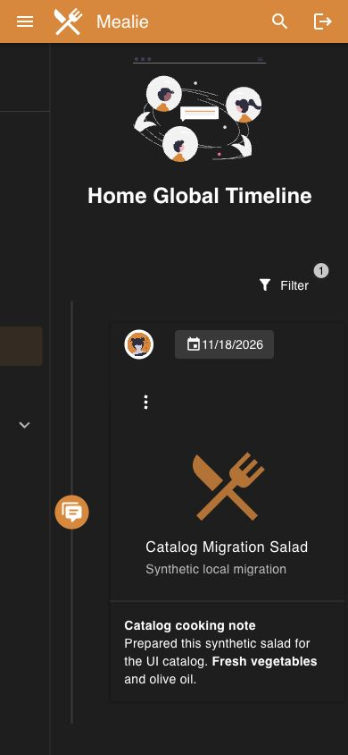
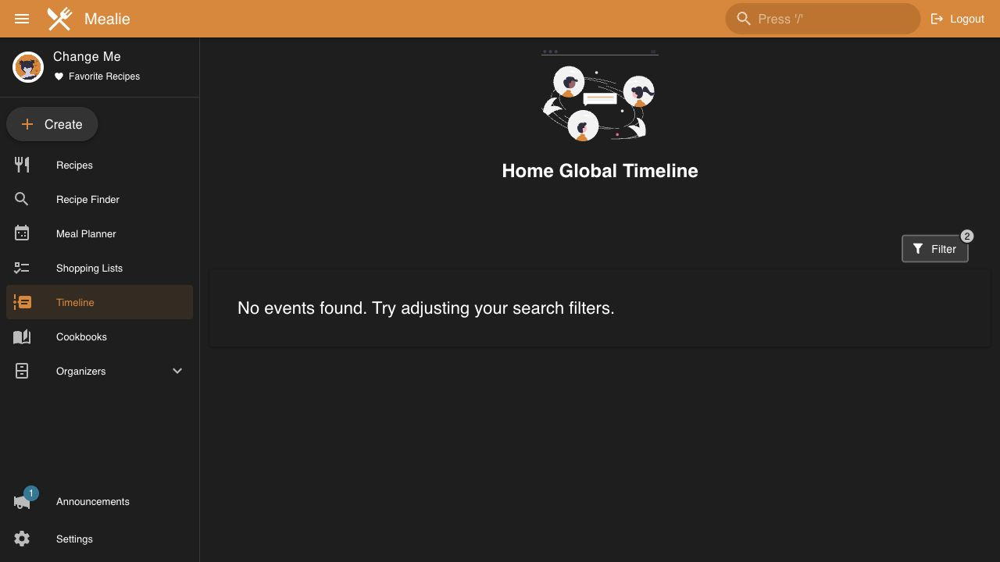

# Group recipe timeline

Route: `/g/:groupSlug/recipes/timeline`. Sources: [timeline.vue](../../frontend/app/pages/g/[groupSlug]/recipes/timeline.vue), [RecipeTimeline](../../frontend/app/components/Domain/Recipe/RecipeTimeline.vue), [timeline item](../../frontend/app/components/Domain/Recipe/RecipeTimelineItem.vue), [event menu/editor](../../frontend/app/components/Domain/Recipe/RecipeTimelineContextMenu.vue).

## Functions: timeline scope, filtering, and loading

- Require authentication and own-group route. Fetch current household to derive the actual group ID/name, then title the page `{groupName} Global Timeline`.
- Query events by recipe group ID and enabled event types. Show recipe cards, unlike smaller embedded timelines where the caller can hide them.
- Filter menu toggles Comment, Info, and System independently and reverses chronological direction. Persist type selection and direction; badge counts excluded types, not visible event count. Keep menu open during selection.
- Refuse filter/sort changes while loading; reinitialize pagination/events on each accepted change.
- Fetch 32 events per page ordered by timestamp. Cache associated recipe summaries by ID to avoid repeated requests; fetch missing summaries before rendering new event cards.
- Throttle additional loads 500ms, stop on a short result, and show Loading Events. Scroll detection starts within four viewport heights of bottom; account for embedded scrollable timelines when changing the event listener.
- No events shows a recovery message to adjust filters. Preserve initialized/ready behavior and the parent readiness signal.
- The current implementation assigns document.onscroll and does not explicitly bind an inner scroll listener in this template; verify embedded-scroll behavior and listener cleanup during migration.

## Event presentation and permissions

- Render event-type marker icon, localized date, user avatar, subject, optional image, and sanitized Markdown message. Unknown types use an information icon.
- Desktop places dates opposite the event; small screens move date into the header, subject into the body, use smaller avatar, and compact/comfortable timeline density. Long messages wrap.
- Recipe card includes normal [shared recipe-card features](../shared-recipe-cards.md), including favorite/rating/context actions; card and event navigate to the linked recipe when a recipe exists and the item is not selected.
- Event menu is visible only when current user owns it and its type is not System. Other users' events and system creation events are read-only here.
- Event images use recipe/event IDs plus a refresh key; reset image-error state when event changes. Image height limits differ for desktop and mobile.

## Edit and delete event

- Event menu offers Edit and Delete, independently of its recipe card's menu. Keep named/focusable triggers and prevention of surrounding link navigation.
- Edit starts a fresh copied event draft, resetting image draft/removal state. Fields: Subject, Message textarea, Upload Image or Remove Image, optional existing-image preview or new-image cropper, Cancel, Save. Enter does not submit.
- Upload holds file/name/object URL locally; crop updates Blob and preview. Removing clears new image state and marks existing image for removal. Save emits updated event plus optional image payload and closes the editor.
- Update first saves subject/message/image sentinel; on HTTP 200, optionally upload the image separately. If image upload fails, retain the successfully updated event metadata locally and show error; do not falsely roll back the completed first request.
- Successful update replaces the event in-place and shows Event Updated. Failed metadata update shows generic error.
- Delete opens an explicit irreversible event review. Confirm calls delete; only HTTP 200 removes its local row and shows Event Deleted. Cancel keeps it.
- No event was deleted; image edits were cancelled. The synthetic comment fixture has a Markdown message and is owned by the catalog account.

## Screenshots

### System-created events and filter menu

### Editable comment, form, image draft, and deletion review

### Mobile layout and filtered empty state

## Migration validation and optional evidence

These additional cases remain for replacement validation. See the [handoff evidence decisions](../HANDOFF.md#evidence-decisions) for shared references, preview fixtures, and unexecuted branches.

- [ ] Verify multiple-page loading, listener cleanup, update/image partial failures, and another user's read-only event.
- [ ] Capture an existing event image if it adds information beyond the draft crop reference.

## Shadcn Vue replacement checklist

- [ ] Compose semantic chronological list/timeline, DropdownMenu, Badge, Avatar, Card, Dialog/Sheet, Input/Textarea, file input/cropper, and feedback.
- [ ] Preserve event scope, type filters, chronological direction, cache/pagination, ownership checks, and responsive date/subject placement.
- [ ] Preserve separate event/recipe menus, draft reset, image removal/crop/upload, partial-update recovery, and delete review.
