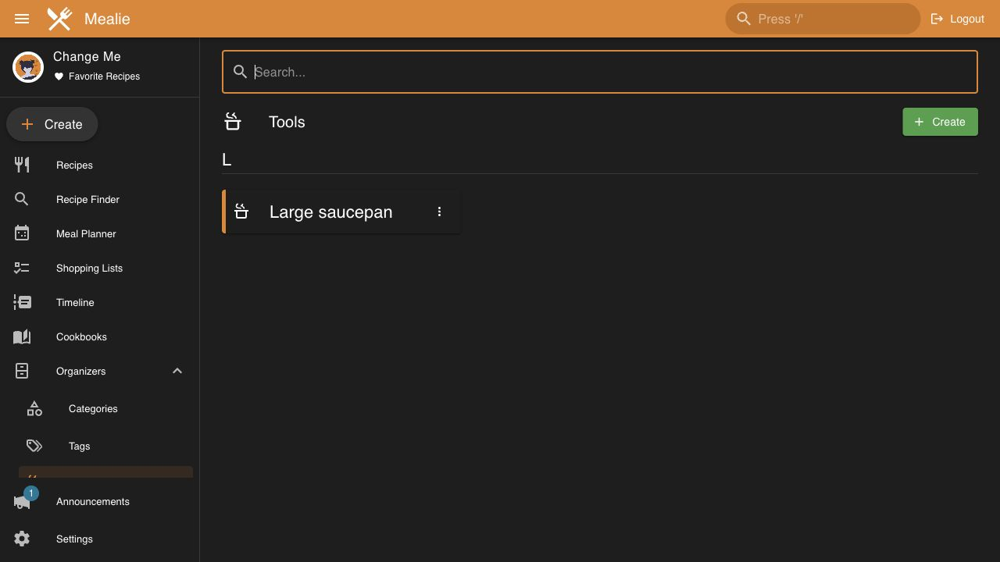
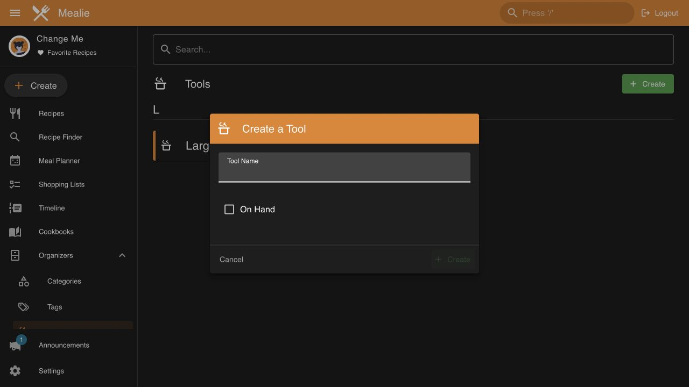
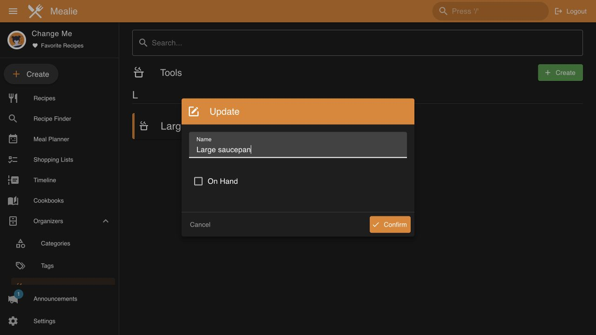
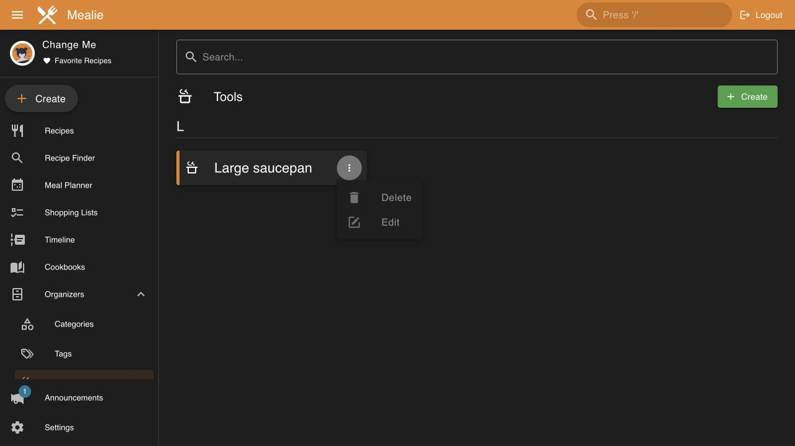
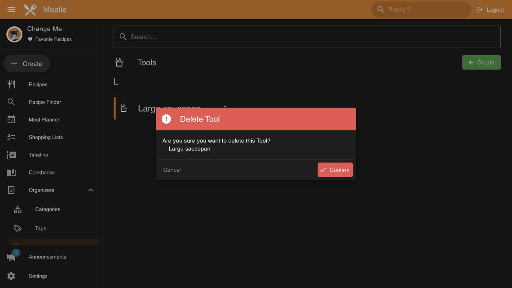
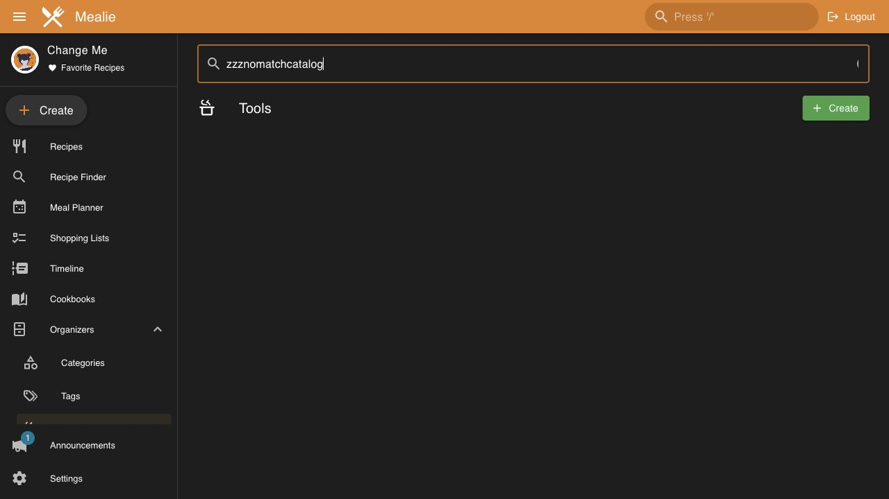
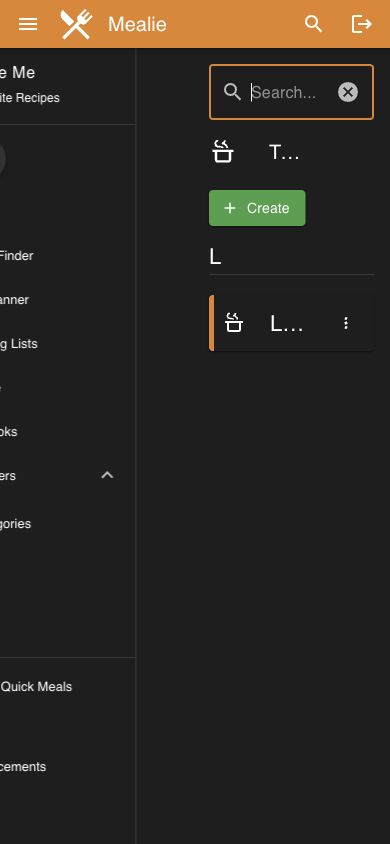
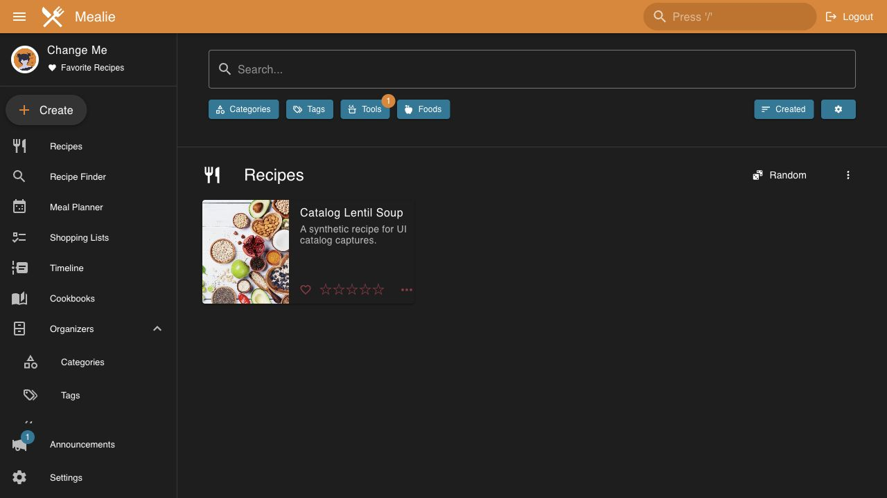

# Tool browser

Route: `/g/:groupSlug/recipes/tools`. Source: [index.vue](../../frontend/app/pages/g/[groupSlug]/recipes/tools/index.vue).

## Functions to preserve

- Require authentication and own-group slug; set localized Tools title and pot icon.
- Apply the entire [shared organizer browser contract](../shared-organizer-browser.md): fuzzy URL-backed search/clear, alphabetic grouping, responsive linked cards, Create, context Edit, and reviewed Delete.
- Derive each tool's On Hand from the current household slug's membership in `householdsWithTool`. Group tool identity remains shared while availability belongs to households.
- Edit deep-copies the tool and exposes Name plus On Hand. When updating, append the current household slug if newly on hand, or remove only that slug when unchecked; preserve other households. If no household slug exists, leave membership untouched.
- Persist through tool store update; delete passes the tool ID to the store. Card links filter recipes with `tools={id}`.
- Create uses the shared Tool Name and On Hand form and submits name/onHand to the tool store. Verify backend availability handling for this create path separately from the explicit membership handling in edit.
- Keep mutation errors and store refresh feedback.

## Screenshots

### Tool cards and creation

### Copied edit draft with household availability

### Tool menus, search, and mobile

## Migration validation

- [ ] Verify search/clear hydration, mobile dialog focus, and keyboard menu access during replacement.
- [ ] Verify household preservation on edit and the create path's On Hand payload handling.

## Shadcn Vue replacement checklist

- [ ] Apply all shared organizer-browser tasks.
- [ ] Preserve household availability logic, tools explorer query key, and named/focusable menu controls.
