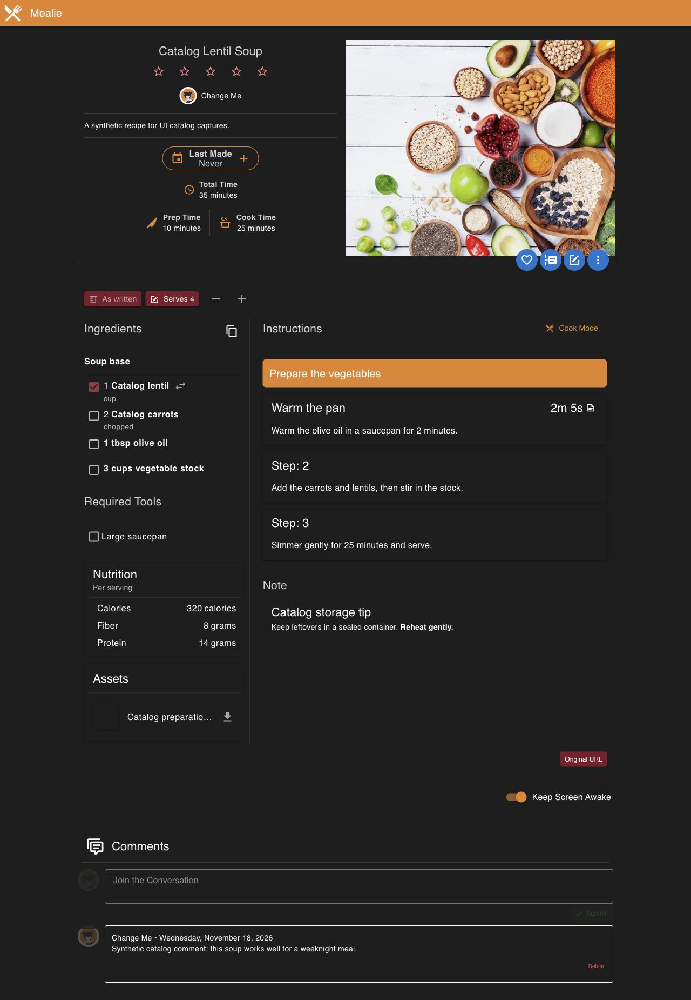
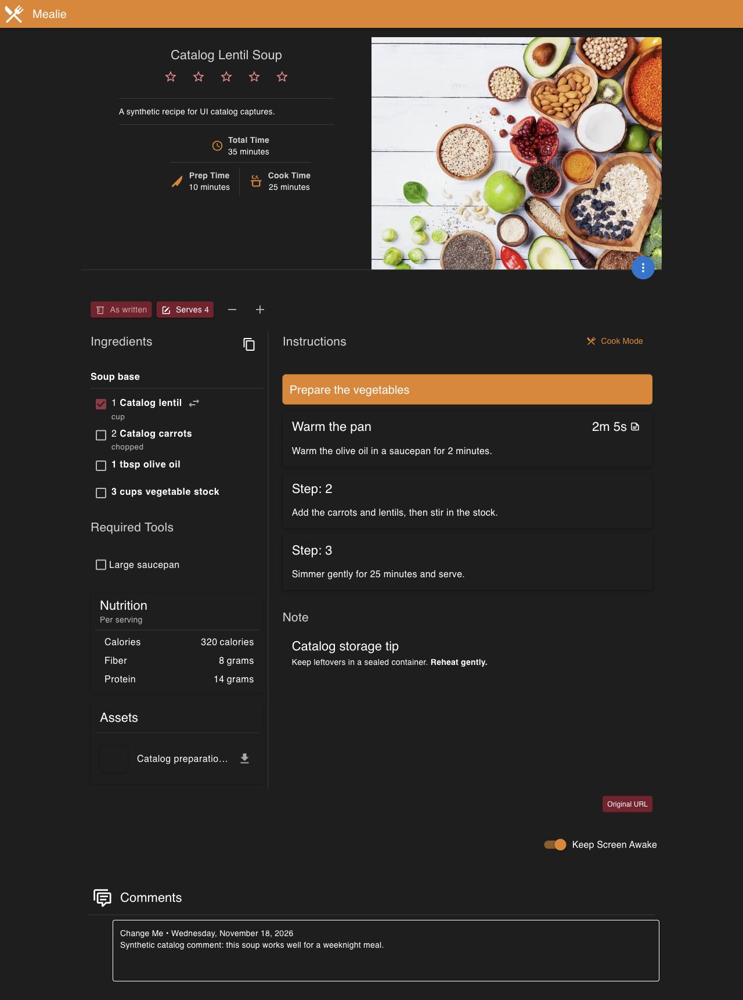
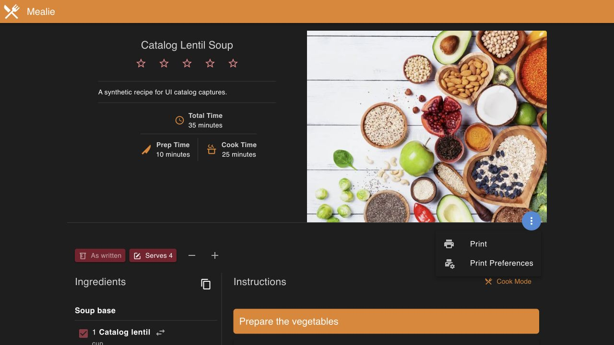
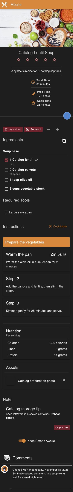
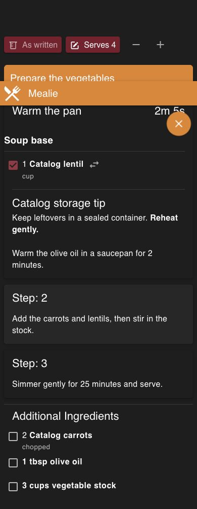

# Shared recipe link

Route: `/g/:groupSlug/shared/r/:id`. Source: [shared route](../../frontend/app/pages/g/[groupSlug]/shared/r/[id].vue).

## Functions

- Use the basic layout with a Mealie link. Omit the ordinary application sidebar and account toolbar.
- Fetch the recipe through the public shared API using the route ID as the share token. Update browser title from the returned recipe name.
- Render RecipePage inside client-only after data exists. An invalid or expired token redirects to the group's explorer.
- Preserve the complete [recipe reader contract](../shared-recipe-page.md): Markdown, image/gallery, rating display, yield/times, ingredients, substitutions, unit system, scale, tools, linked instructions/notes, nutrition, assets, source URL, comments, and Cook mode.
- Anonymous visitors receive read-only rating and no owner identity, Last Made, favorite, timeline, or Edit controls.
- Anonymous action menu contains Print and Print Preferences. Preserve print options and recipe-specific checked state.
- Anonymous ingredient and step checks remain local UI state. Tool checks do not write household data without a current-group user.
- Existing comments can appear, but anonymous users have no comment form or delete controls.
- Cook mode preserves scale, linked content, additional ingredients, and cook=true navigation. Support mobile layout and Close.
- A signed-in user in the same group retains authenticated recipe controls even on this basic-layout route. Do not infer read-only access from layout alone.
- The shared route has an id parameter and no slug parameter. Verify edit-save behavior for signed-in users because RecipePage save reads route.params.slug.
- Preserve token expiry and server access checks. Do not replace token access with an ordinary public recipe URL.
- Screenshots use a one-hour token for synthetic catalog data. Revoke that fixture after capture review; do not place real share links in documentation.

## Screenshots

Use the [ordinary recipe captures](g--groupSlug--r--slug--index.md) for shared reader dialogs and print controls.

## Migration validation and optional evidence

These additional cases remain for replacement validation. See the [handoff evidence decisions](../HANDOFF.md#evidence-decisions) for shared references, preview fixtures, and unexecuted branches.

- [ ] Verify expired/revoked token redirect and group fallback during replacement.
- [ ] Verify signed-in shared-route edit permission/save behavior, read-only ratings, anonymous tool checks, and nested asset access.

## Shadcn Vue replacement checklist

- [ ] Replace the basic shell and shared recipe reader using the same accessible reader components as ordinary recipes.
- [ ] Preserve anonymous/authenticated differences, token access, client rendering, print, local check state, and Cook navigation.
- [ ] Preserve every nested reader control and the responsive content shown across these captures.
