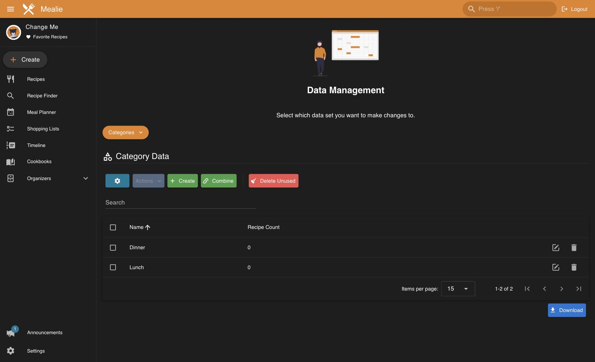
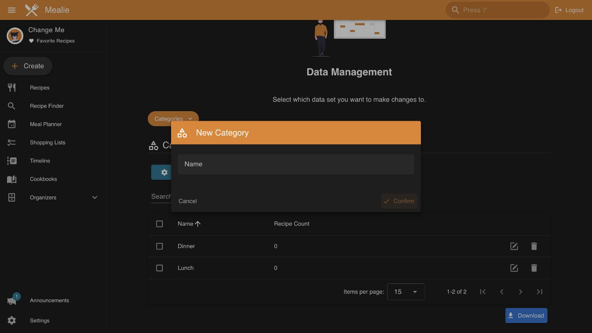
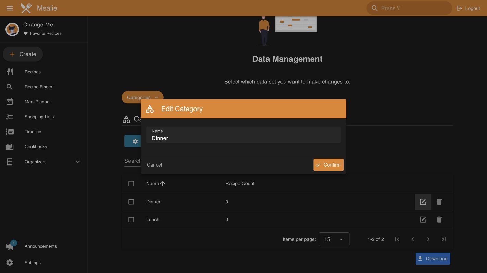
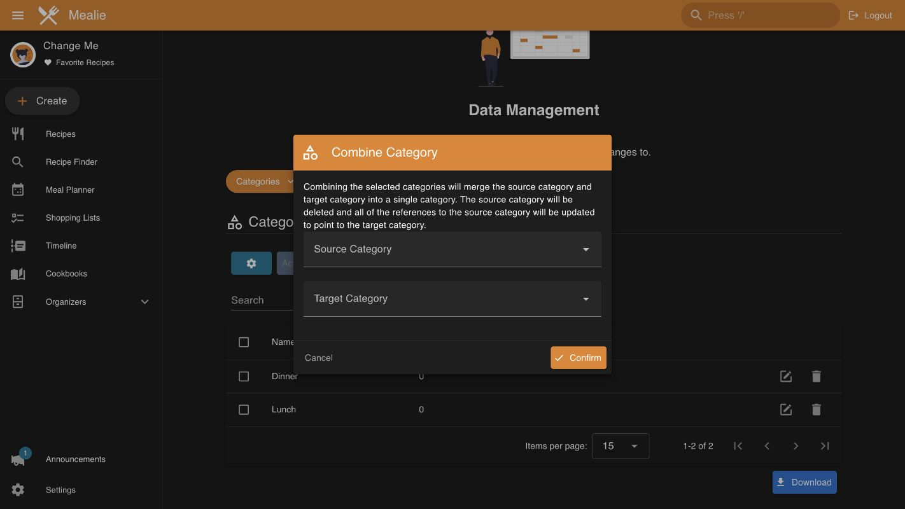
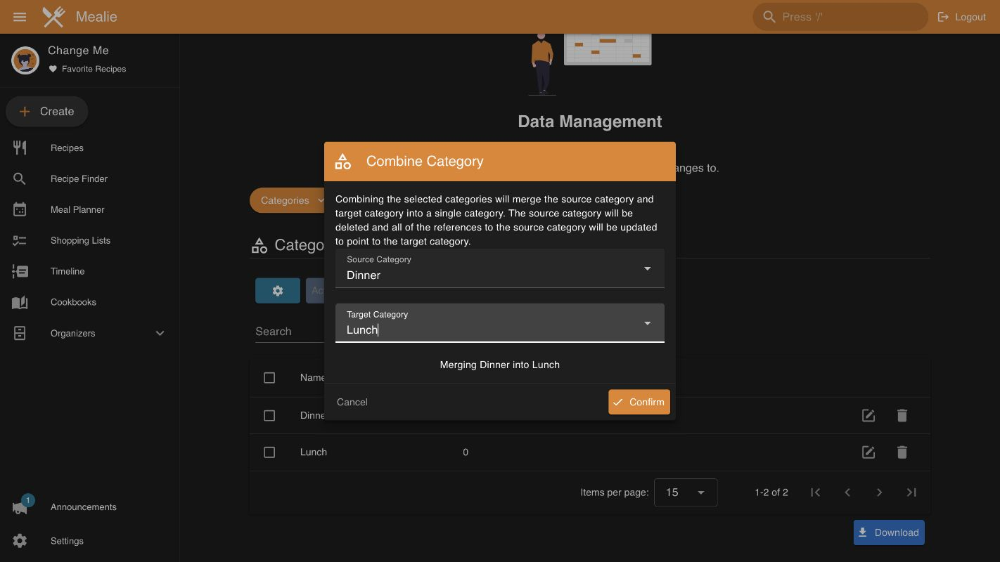
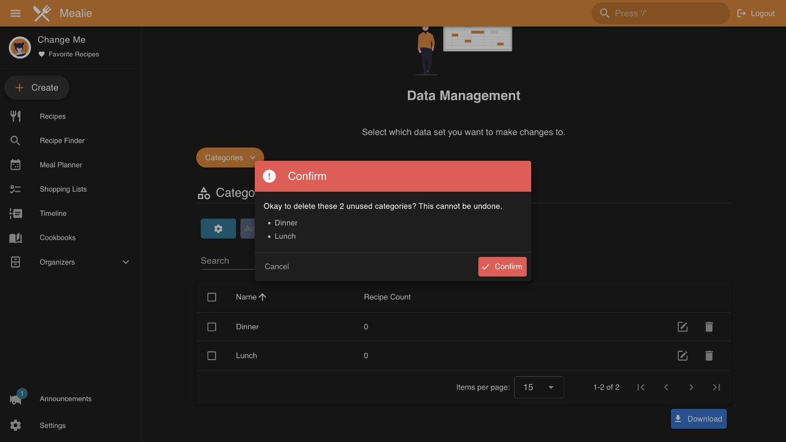
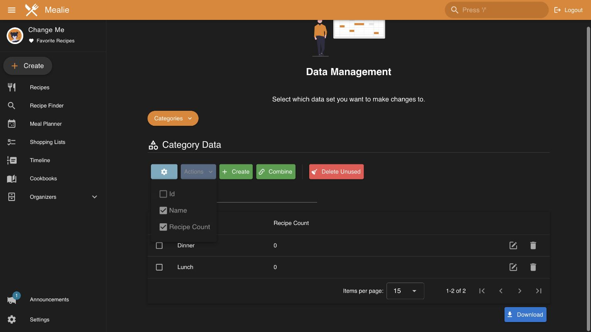
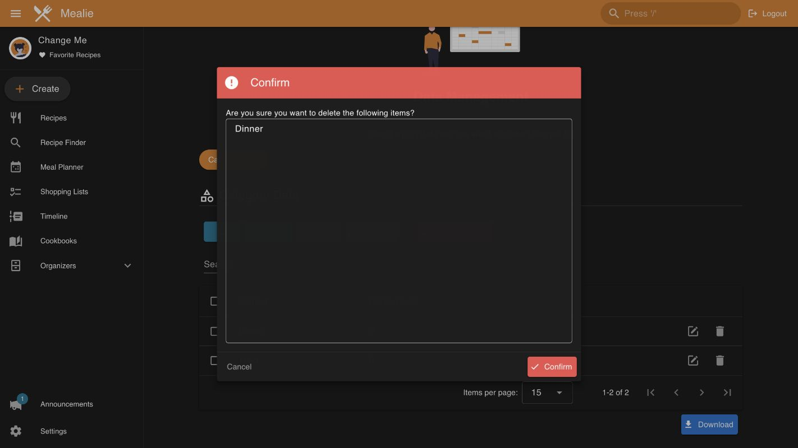
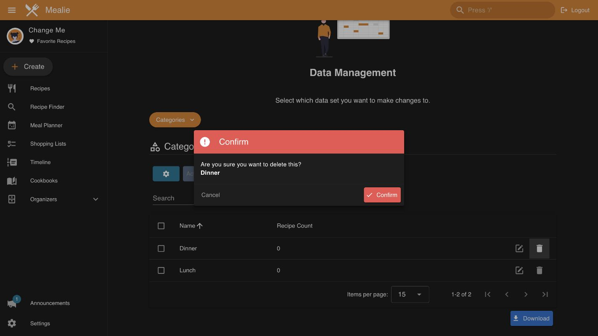
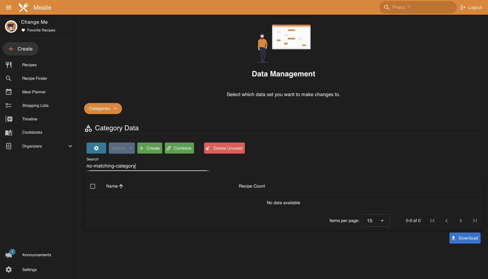

# Category data

Route: `/group/data/categories`. Source: [categories.vue](../../frontend/app/pages/group/data/categories.vue).
Access and navigation: [data-management parent](group--data.md).
Required shared behavior: [data tables and dialogs](../shared-data-management.md).
Status: source contract and visual references reviewed; runtime validation remains in the checklists below.

## Functions to preserve

- Load and refresh the group category store on page entry.
- Show Name and Recipe Count, with ID available as a hidden column.
- Sort Name and Recipe Count; retain Search, page size, pagination, row selection, bulk Actions, and Download.
- Link a positive recipe count to `/g/{groupSlug}?categories={id}`.
- Show zero as plain text when no recipe uses the category.
- Create a category with a required Name. Clear the create-name value after the create operation.
- Edit a category's Name and reset the edit object after update.
- Delete one category through the shared target confirmation.
- Delete selected categories through the shared bulk review list and selected ID payload.
- Preserve all store refreshes and API error feedback.

## Combine categories

- Open Combine Category with source and target autocomplete fields.
- Search both lists with normalized filtering and display category names.
- Explain that merge deletes the source and moves its references to the target.
- Require two different record IDs before the merge handler sends a request.
- Show a source-to-target example when both selections form a valid pair.
- On success, clear both selections and refresh categories.
- Reset both selections when the dialog closes.
- Cancel closes without a merge request.

Current-source audit note: the dialog's Confirm button does not bind `canMerge` as its disabled state.
The handler rejects invalid or identical selections. Preserve that safety rule even if the new UI improves the button state.

## Delete unused

- Fetch unused categories when the user opens Delete Unused and show action progress.
- When none exist, show the no-unused-categories information toast without opening a confirmation.
- Otherwise show the count, an irreversible-action warning, and up to ten category names.
- If more than ten exist, show the remaining count.
- Confirm deletes only the captured unused category IDs. Clear the local unused list afterward.
- Cancel leaves all records unchanged.

## Screenshots

### Table, actions, recipe counts, selection, and pagination

### Create and edit

### Combine controls and a selected source-to-target preview

### Delete-unused review

### Column menu

### Bulk and single-record deletion review

These captures stop before the deletion action.

### Search with no matches

## Migration validation and optional evidence

These additional cases remain for replacement validation. See the [handoff evidence decisions](../HANDOFF.md#evidence-decisions) for shared references, preview fixtures, and unexecuted branches.

- [ ] Capture a category with a positive recipe count and its filtered recipe destination.
- [ ] Capture mobile dialogs and a multi-page table.
- [ ] Capture the no-unused result and a preview with more than ten unused categories.

## Shadcn Vue replacement checklist

- [ ] Apply every shared table, form, dialog, and keyboard requirement.
- [ ] Preserve required Name, recipe-count links, selected-ID deletion, and store updates.
- [ ] Use Combobox controls for source/target selection and retain the distinct-ID guard.
- [ ] Preserve merge reference semantics and the unused-record preview/count.
- [ ] Verify referenced categories survive Delete Unused and the current group remains the data boundary.
