# Food data

Route: `/group/data/foods`. Source: [foods.vue](../../frontend/app/pages/group/data/foods.vue).
Access: [data-management parent](group--data.md). Required shared behavior: [tables and dialogs](../shared-data-management.md).
Status: source contract and visual references reviewed; runtime validation remains in the checklists below.

## Functions to preserve

- Refresh the group food store on entry. Display Name, Plural Name, Description, Recipe Count, Label, On Hand, and Substitutions; ID and localized Date Added start hidden.
- Retain search, sortable columns, column selection, row/select-all selection, Actions, pagination, page size, JSON Download, and create/edit/delete review.
- Sort labels by name with empty fallback and substitutions by array length. Name, plural name, recipe count, availability, and date support sorting.
- Render colored labels, positive/negative availability icons, and substitution counts. Link positive recipe counts to `/g/{groupSlug}?foods={foodId}`; zero is plain text.
- Create/edit fields: required Name, optional Plural Name and Description, Food Label selector, and On Hand checkbox with the shopping-list explanation.
- On Hand is membership of the current household slug in `householdsWithIngredientFood`. Creating an available food includes that slug; editing adds/removes only the current household's membership and preserves other households.
- Reset create to empty Name, false On Hand and empty membership; clear edit data after update.
- Alias editing follows the [unit alias contract](group--data--units.md): nested draft copy, add/remove, exact duplicate/name filtering, nested Confirm then outer Confirm to persist.

## Substitution management

Sources: [manager](../../frontend/app/components/Domain/Recipe/RecipeDataSubstitutionManagerDialog.vue), [row editor](../../frontend/app/components/Domain/Recipe/RecipeIngredientSubstitutionEditor.vue).

- Open Manage Substitutions inside Edit Food. Copy saved rows each time; create one blank row if none exist. Add/remove rows, choose a searchable/clearable substitute food, and enter a note. A row can contain a food, note, or both.
- Exclude the current food from choices. Keep the dropdown above the nested dialog, with a bounded menu height. On smaller displays the food selector wraps onto its own line while note and delete remain together.
- For a selected food, show a readable per-row reverse-substitution checkbox naming both foods. Default its state from whether that food already substitutes back to the current one.
- Changing a row's food resets its explicit reverse choice. The checkbox can add or remove the reverse relation.
- Confirm trims notes to nonempty text or null; drops completely empty rows, self references, and duplicate food IDs; note-only rows remain valid.
- Nested Confirm updates the edit draft and stages only reverse changes that differ from current state. Cancel discards that nested draft.
- Persist ordinary substitutions with the outer food update. Then apply staged reverse changes only if they belong to that food ID, preventing a cancelled edit's changes leaking into another food.
- Rebuild each affected other food's substitution list from the current store, removing the edited food reference and optionally adding it back; preserve unrelated substitutions. Update only when the resulting list length differs, then refresh the food store if anything changed.
- Keep errors observable across the main update and the additional reverse writes; these are separate API operations.

## Deletion and cleanup

- Before single or selected deletion, search affected recipes using the food IDs and a five-recipe page size. Show a warning with total affected count, up to five linked recipe names, and an all-results link when there are more.
- Recipe links go to `/g/{groupSlug}/r/{slug}`; all-results includes every selected food ID as a repeated `foods` query parameter.
- Bulk deletion submits selected IDs and clears affected-recipe state afterwards.
- Delete Unused fetches unused foods with a loading indicator. An empty result shows an information toast and no review dialog.
- Otherwise review the count, first ten food names, and remaining-name count. Confirm deletes the captured IDs and clears the unused list; Cancel keeps the foods.

## Combine, seed, and bulk labels

- Combine provides normalized-search Source Food and Target Food selectors, a destructive merge explanation, and a selected-pair example. Guard missing or equal IDs before requesting; refresh on returned data. Closing resets both selections.
- Seed initializes language from the current locale, filters to enabled locales, and shows translation percentages. Explain that the common-food dataset also creates organizing labels; warn about existing same-name records.
- Successful seeding refreshes both food and label stores.
- Bulk Assign Label reviews the selected target names in a 400px virtual list and warns it overwrites existing labels. Choose a searchable, clearable label; missing label is a guarded no-op rather than removing labels.
- Confirm updates each selected food sequentially, clears targets/label selection, and refreshes. Maintain the distinction between group food identity and household availability.

## Screenshots

### Empty table, create form, edit form, and populated table

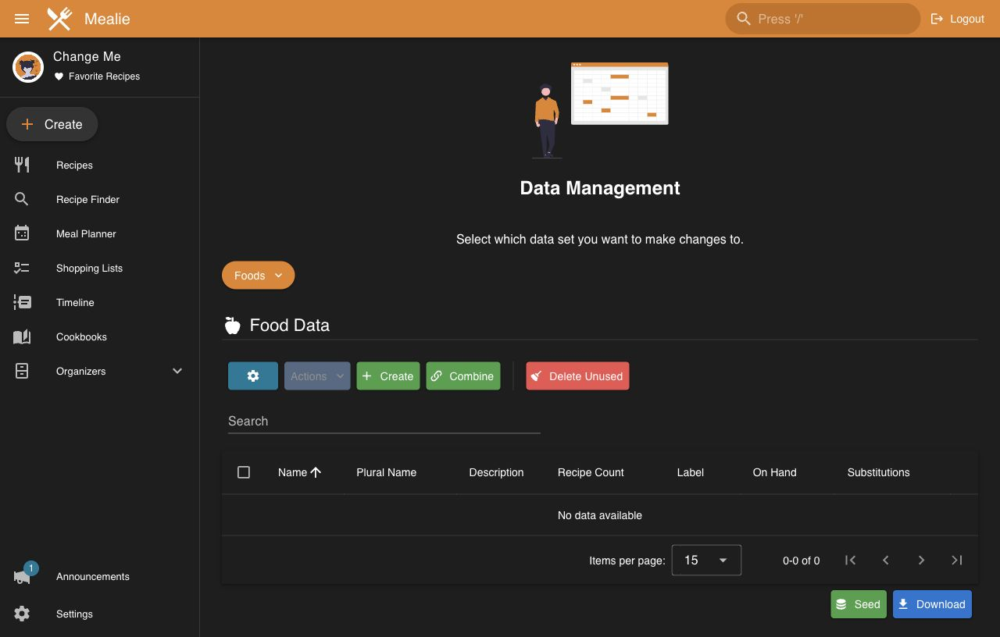
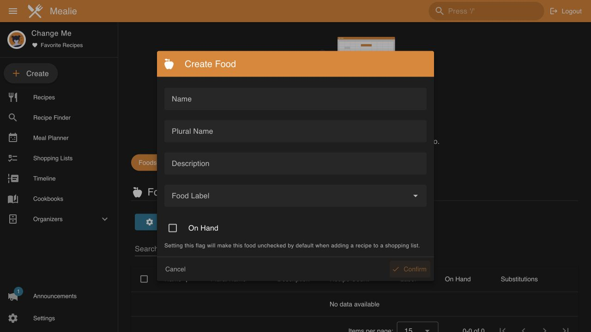
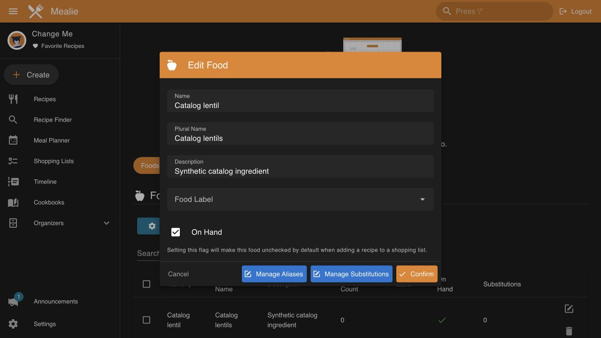
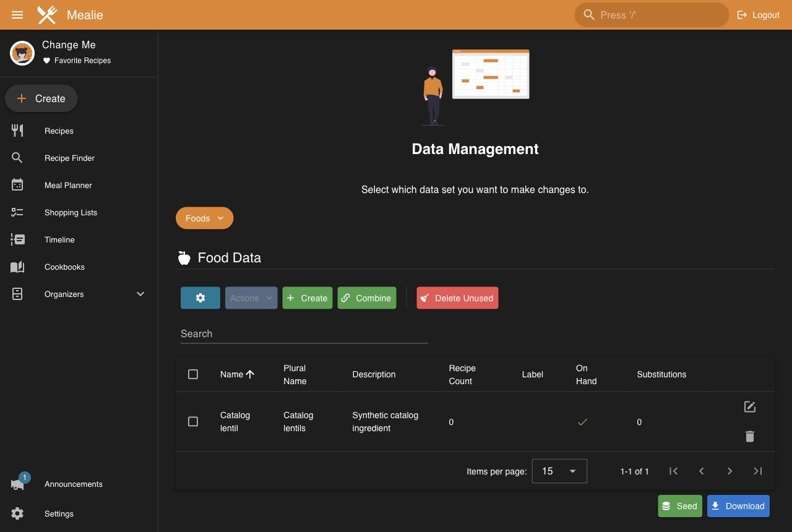

### Substitution rows inside the food editor

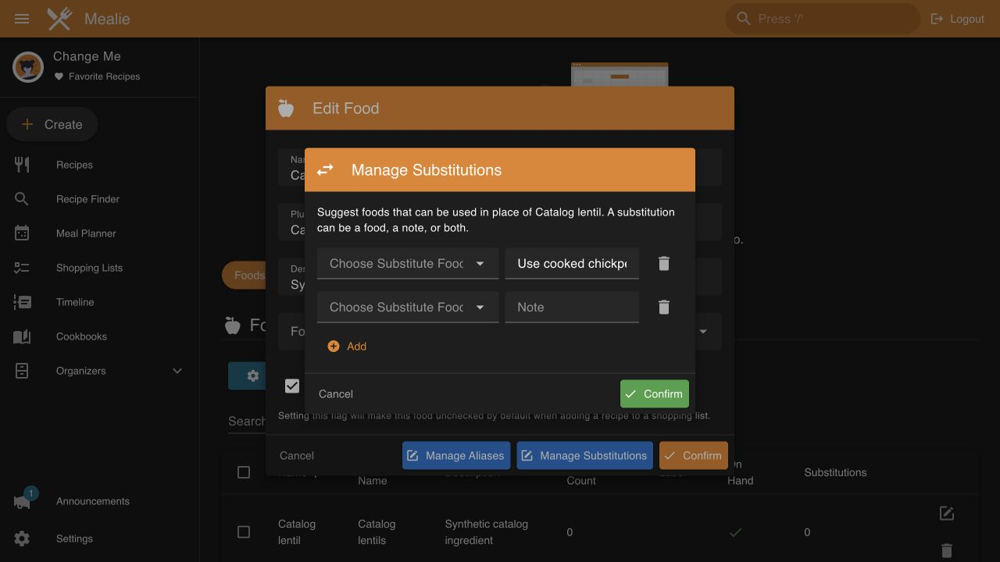

This capture uses a note-only draft. The expanded captures below show a selected substitute and reverse-relation control.

### Cleanup, bulk label overwrite, merge, and seed reviews

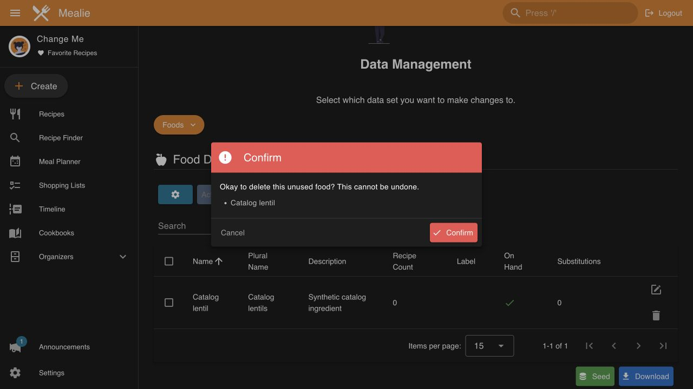
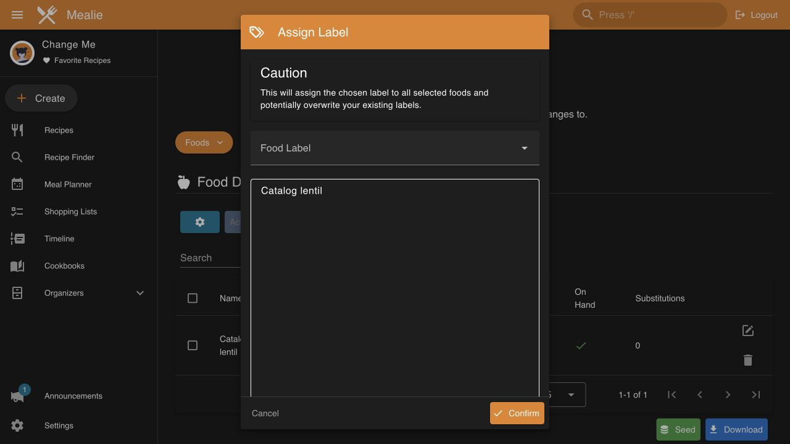
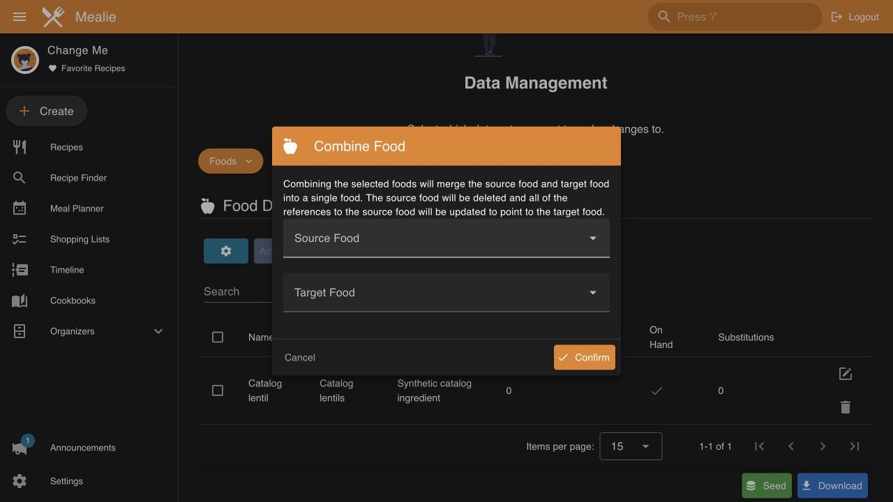
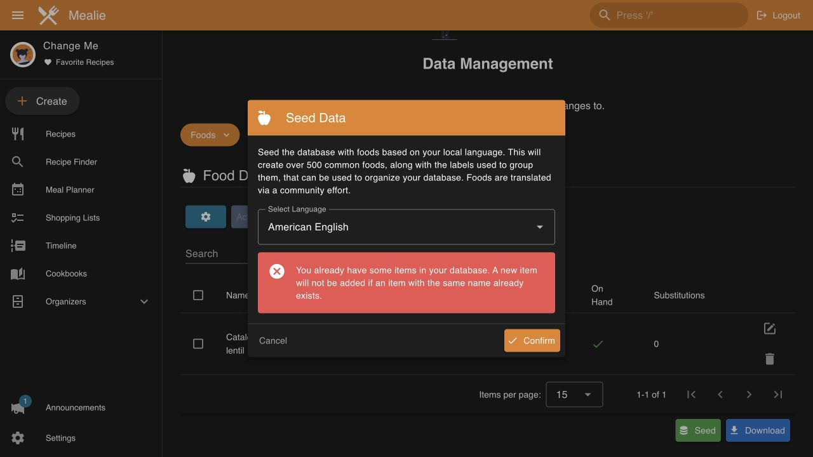

### Counts, nested drafts, and affected-recipe warning

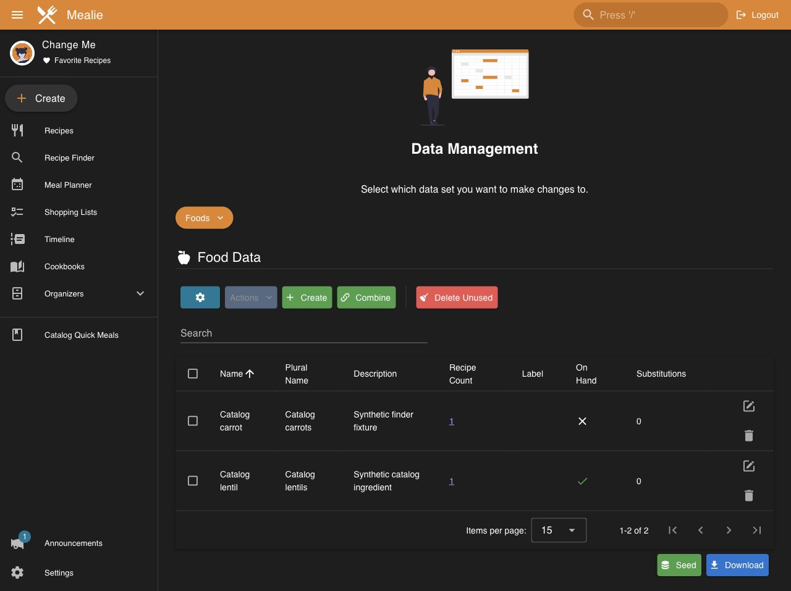
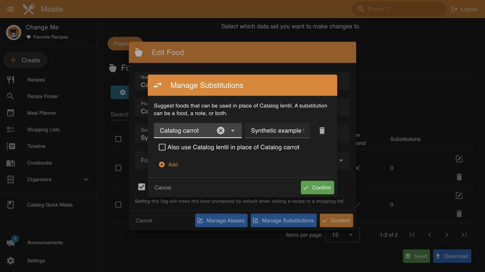
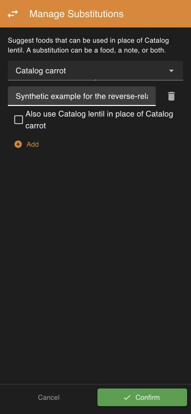
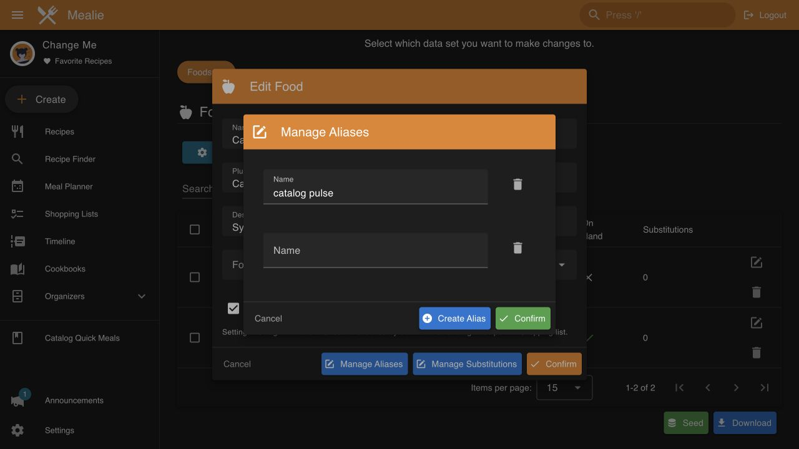
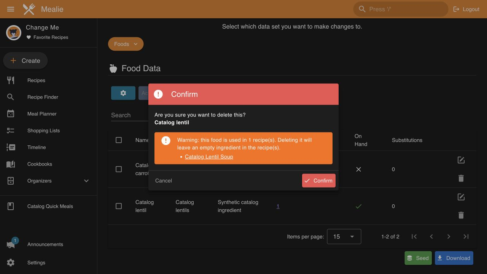
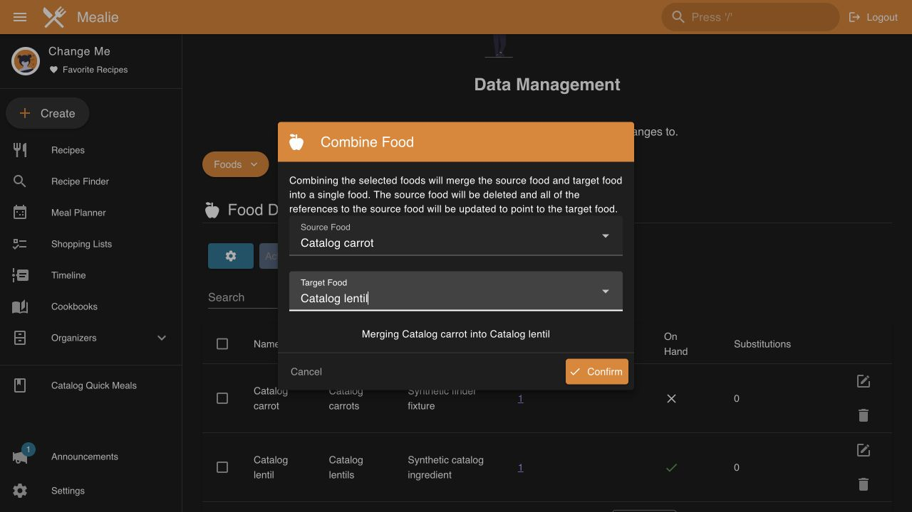

Nested edits and merge/deletion reviews end with Cancel.

## Migration validation

- [ ] Verify saved reverse relations, nested alias cancellation, and mobile row focus.
- [ ] Verify recipe-impact overflow above five results and unused-food preview overflow above ten names.
- [ ] Verify label/language menu keyboard access and empty-unused feedback.
- [ ] Verify outer Cancel does not persist staged substitutions or reverse writes, and household availability preserves other households.

## Shadcn Vue replacement checklist

- [ ] Apply the shared data table, form validation, export, selection, and dialog contracts.
- [ ] Compose searchable Combobox, Input, Checkbox, Badge, Dialog/Sheet, ScrollArea, and accessible icon buttons.
- [ ] Preserve nested draft boundaries, note-only substitutions, deduplication, reverse-change staging, and independent API error handling.
- [ ] Preserve household membership semantics, recipe impact warnings/links, cleanup counts, merge guards, and seeding of labels.
