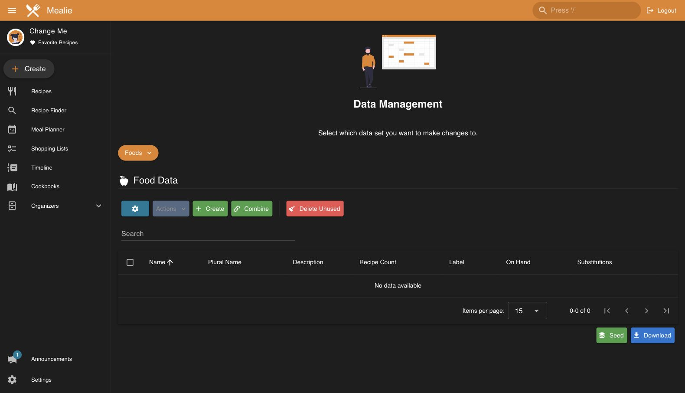

# Data-management entry redirect

Route: `/group/data`. Source: [data/index.vue](../../frontend/app/pages/group/data/index.vue).
Parent: [data management](group--data.md).
Status: source contract and visual references reviewed; runtime validation remains in the checklists below.

## Functions to preserve

- Render no independent page controls.
- On mount, push `/group/data/foods` as the default data-management destination.
- Keep the parent's authentication and `canOrganize` gate.
- Retain `/group/data` as the entry used by the shared Settings menu.
- Preserve the current history-push behavior unless the redesign records a deliberate navigation change.

## Destination screenshot

The capture session entered `/group/data` and reached the Foods manager.

## Shadcn Vue replacement checklist

- [ ] Retain the entry route and default destination.
- [ ] Verify organizer and non-organizer access.
- [ ] Preserve the Foods manager's functions in its own page contract.
