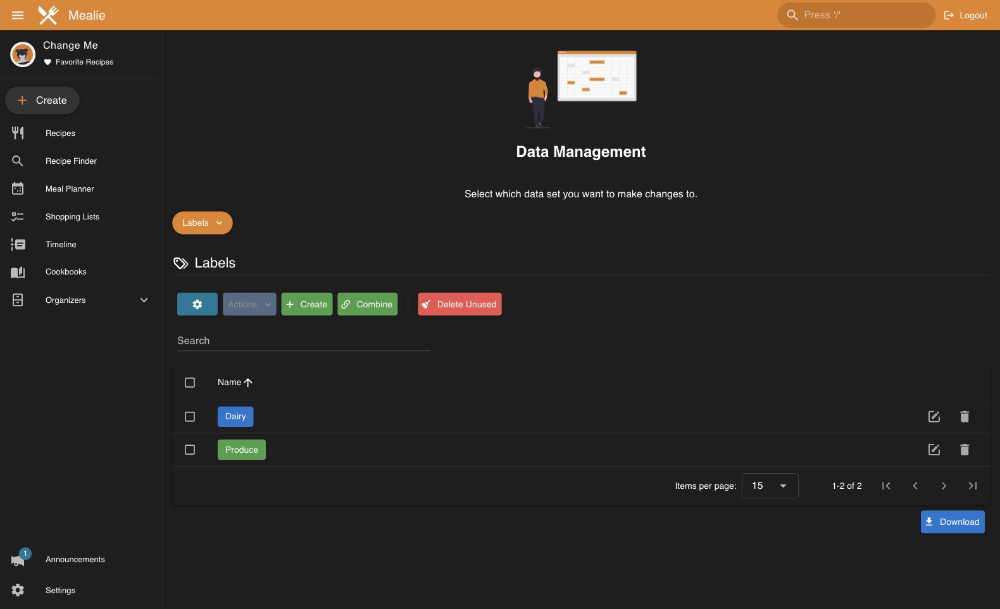
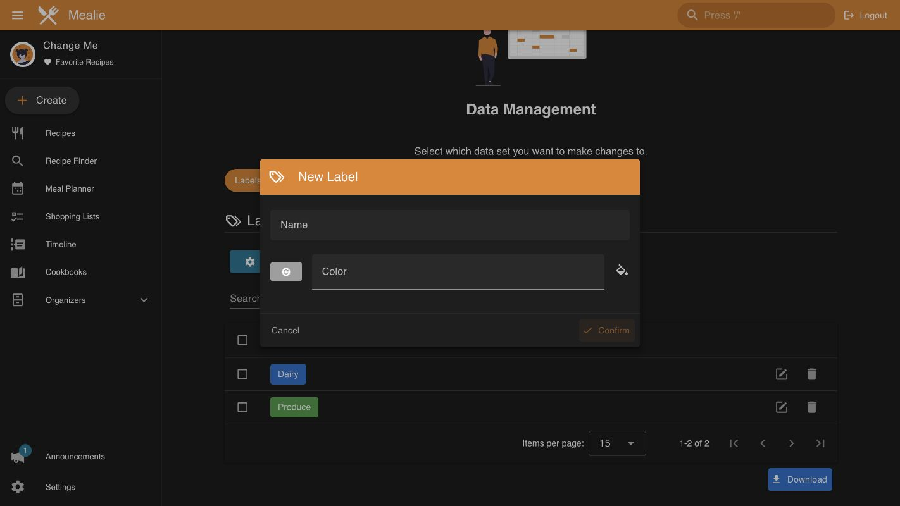
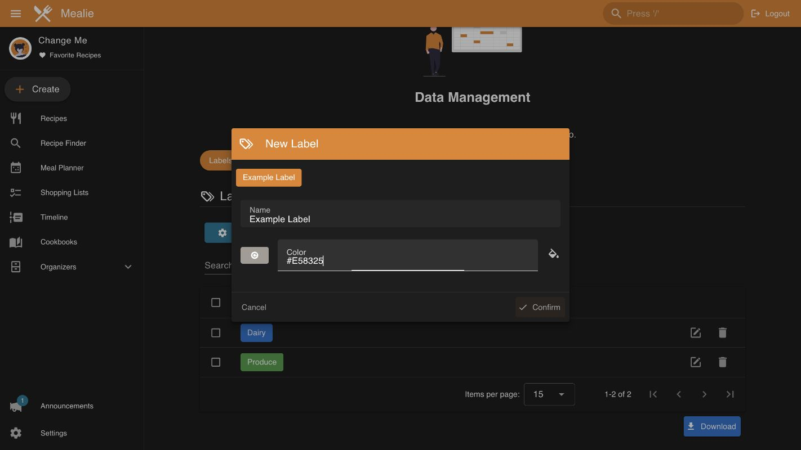
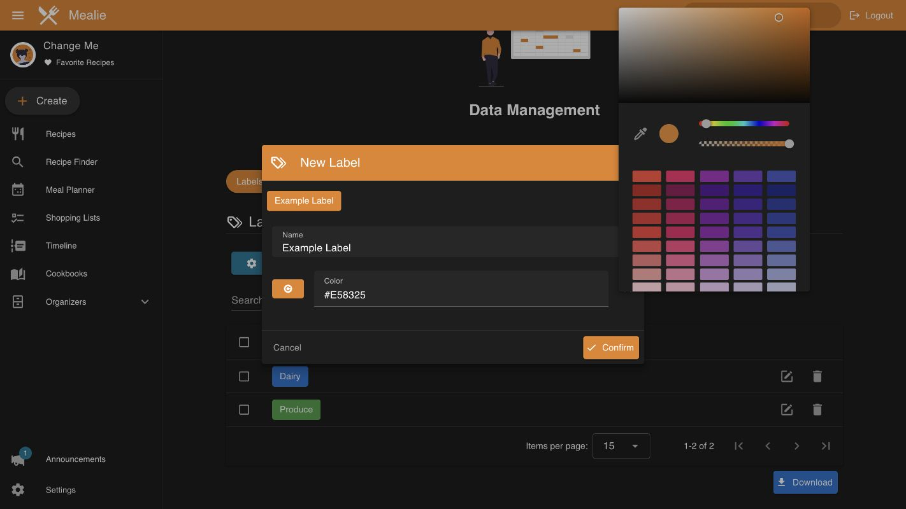
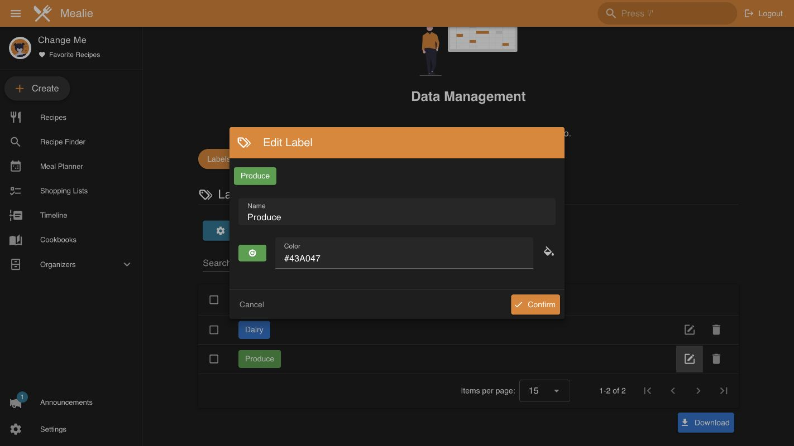
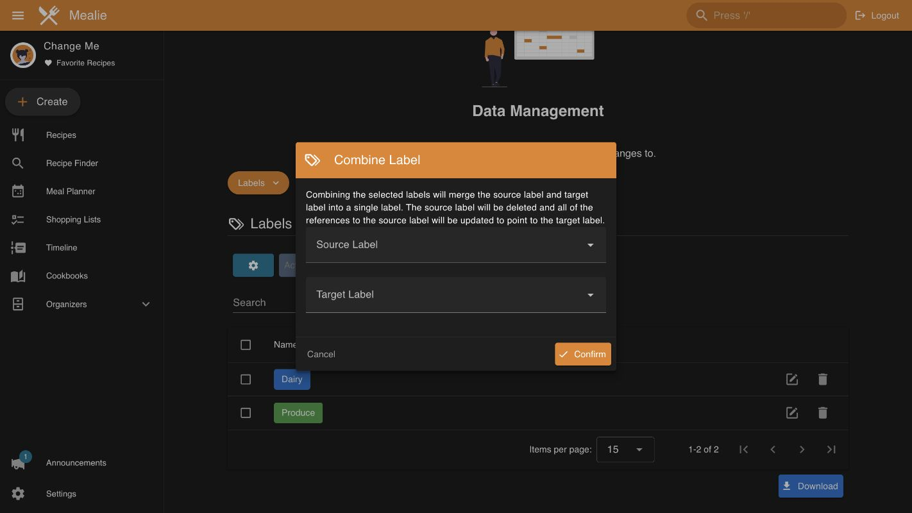
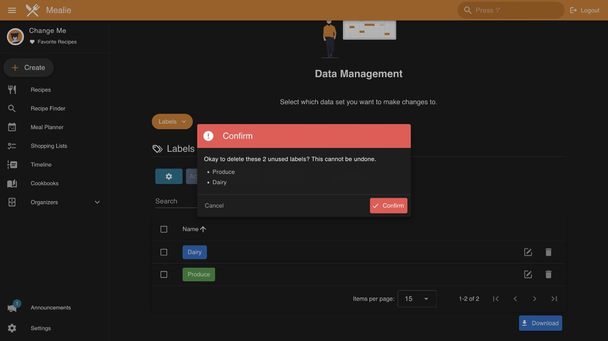

# Label data

Route: `/group/data/labels`. Source: [labels.vue](../../frontend/app/pages/group/data/labels.vue).
Access and navigation: [data-management parent](group--data.md).
Required shared behavior: [data tables and dialogs](../shared-data-management.md).
Status: source contract and visual references reviewed; runtime validation remains in the checklists below.

## Functions to preserve

- List labels by Name and render their configured color through the shared label chip.
- Offer the hidden ID column and sortable Name.
- Retain Search, selection, single/bulk actions, page size, pagination, and JSON Download.
- Create a label with required Name and editable Color.
- Show a live chip preview when a name exists in the create or edit form.
- Edit Name and Color together.
- Use ellipsis for a label name that exceeds the available chip width.
- After create, reset the form to an empty name and color `#7417BE`.
- After edit, clear the edit object.
- Review the target before single deletion and selected targets before bulk deletion.
- Exclude null IDs from bulk-deletion requests.

## Color input

Source: [InputColor.vue](../../frontend/app/components/global/InputColor.vue).

- Enter a color string directly.
- Use the color-filled random-color button to generate a new hexadecimal color.
- Open the color-picker popover from its appended icon.
- Preserve the picker canvas, hue, alpha, color swatches, and supported browser eyedropper action.
- Keep the popover open while the user adjusts colors.
- Update the chip preview immediately as the color value changes.
- Do not remove color entry because Shadcn Vue has no exact drop-in replacement for the current picker.

## Combine and delete unused

- Select distinct source and target labels with normalized autocomplete filtering.
- Explain the deletion of the source and reassignment of its references.
- Show the merge example for a valid selection pair.
- Guard the merge request against missing or identical IDs.
- On success, clear selections and refresh labels; also clear selections on dialog close.
- Fetch unused labels before the cleanup review.
- When none exist, show the no-unused-labels information toast instead of an empty confirmation.
- Otherwise show the count, warning, first ten names, and any remaining count.
- Confirm deletes only the captured unused IDs and clears the preview list.
- Cancel leaves the records unchanged.

These label-specific dialogs use fullscreen presentation on the smallest layout, rather than the category/tag bottom-sheet option.

## Screenshots

### Colored labels in the table

### Create form and live color preview

### Color-picker popover

### Edit existing label

### Combine and unused-label review

## Migration validation and optional evidence

These additional cases remain for replacement validation. See the [handoff evidence decisions](../HANDOFF.md#evidence-decisions) for shared references, preview fixtures, and unexecuted branches.

- [ ] Capture selected merge preview, null/default color, and a long label name.
- [ ] Capture the mobile fullscreen form and page-specific single/bulk target review.
- [ ] Verify color values survive create/update and appear consistently in shopping-list and food consumers.

## Shadcn Vue replacement checklist

- [ ] Replace table, dialogs, required Name field, label chip, and color controls.
- [ ] Compose Input, Button, Popover, sliders/swatches, and Badge as needed while preserving the color operations.
- [ ] Preserve live preview, default reset color, and long-name truncation.
- [ ] Preserve merge reference updates and all deletion review/count rules.
- [ ] Verify every shared table and form function as well as colored-label consumers.
