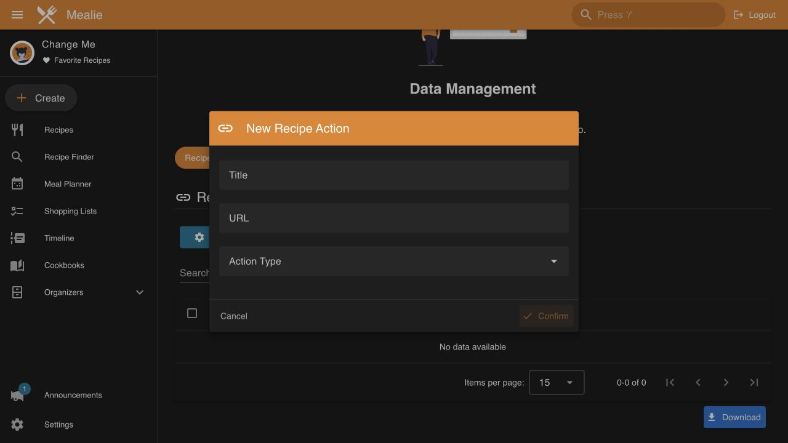
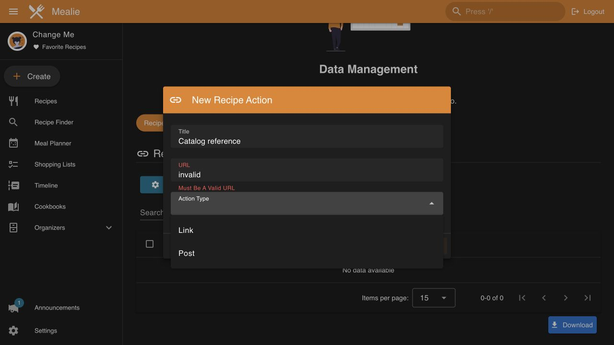
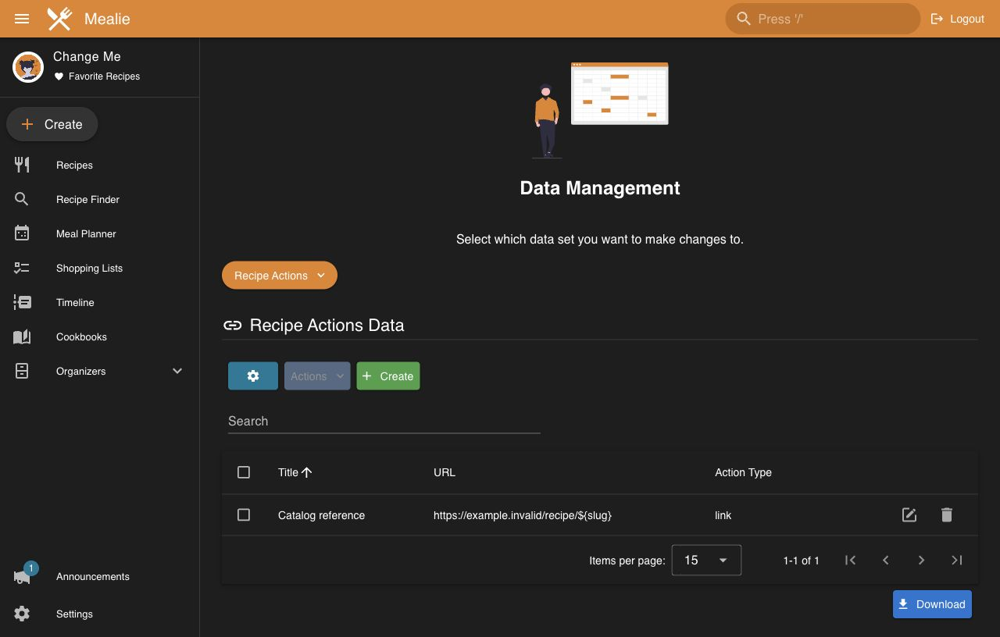
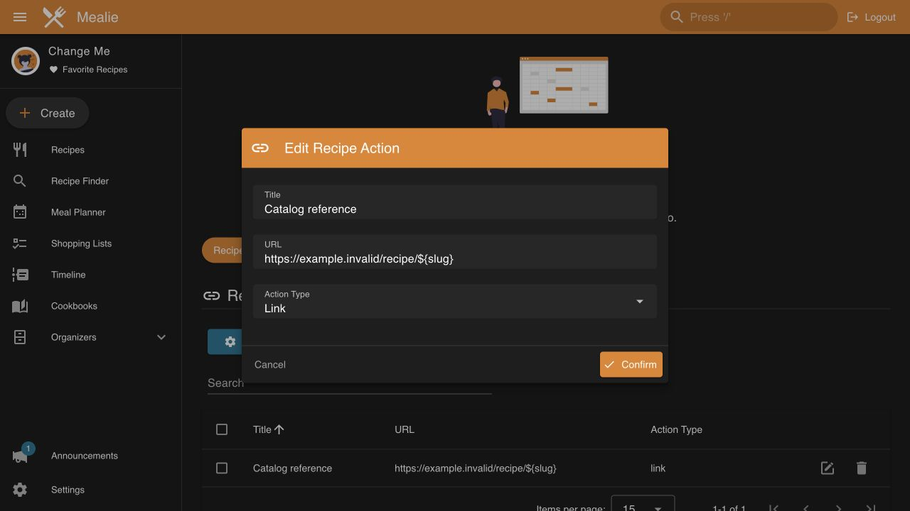

# Recipe actions data

Route: `/group/data/recipe-actions`. Source: [recipe-actions.vue](../../frontend/app/pages/group/data/recipe-actions.vue).
Access: [data parent](group--data.md). Shared contract: [data tables and dialogs](../shared-data-management.md).

## Functions to preserve

- List group recipe actions with Title, URL, and Action Type. ID starts hidden but is available through column visibility. Sort by Title initially; Title and Action Type are sortable.
- Preserve search, column menu, pagination, page size, selection, single deletion, selected-ID bulk deletion, JSON Download, and API feedback.
- Create and edit both require Title, a valid URL, and Action Type. Offer translated Link and Post choices while persisting `link` and `post`.
- Both create and edit await the store operation and reset their draft afterwards. The shared group action store initially fetches all records ordered by title ascending and refreshes through store mutations.
- Keep existing URLs and placeholder text intact when editing. This page configures actions; it does not execute them.

## Downstream execution contract

Source: [use-group-recipe-actions.ts](../../frontend/app/composables/use-group-recipe-actions.ts). Preserve this connection when redesigning the recipe action menu elsewhere.

- Link opens a new tab. Replace `${url}`, `${id}`, `${slug}`, `${servings}`, `${yieldQuantity}`, and `${yieldText}` using the current recipe/page and scale. Missing servings/yield quantity default to one before scaling; yield text defaults empty. Current string replacements replace the first occurrence of these fields.
- `${share-link-expires-seconds-N}` accepts positive integer seconds. Deduplicate identical fields, create an expiring recipe share link per distinct field, and replace all occurrences of that field.
- Open the tab before waiting for share creation to avoid popup blocking. Close it and show an error if share generation fails; otherwise navigate/focus it, with the existing fallback if the initial popup was blocked.
- Post calls the action-trigger API with action ID, recipe slug, and scale.
- Do not turn a configuration preview into an unsolicited external request. The captured fixture uses a reserved `.invalid` destination and was not executed.

## Screenshots

### Empty table and blank form

### Type choices and URL validation

### Saved synthetic action and edit form

## Migration validation and optional evidence

These additional cases remain for replacement validation. See the [handoff evidence decisions](../HANDOFF.md#evidence-decisions) for shared references, preview fixtures, and unexecuted branches.

- [ ] Capture selected bulk-delete and single-delete review, column menu, and mobile form.
- [ ] During recipe-page audit capture its action menu and validate Link/Post execution using local fixtures only.

## Shadcn Vue replacement checklist

- [ ] Apply the shared table, Dialog, Input, Select, validation, export, and deletion contracts.
- [ ] Preserve exact action types, URL placeholders, ordering, and refresh behavior.
- [ ] Verify downstream scaling, expiring-share placeholders, popup handling, and failure feedback.
