# Recipe bulk data management

Route: `/group/data/recipes`. Source: [recipes.vue](../../frontend/app/pages/group/data/recipes.vue).
Access: [data parent](group--data.md). This page uses its own recipe table and bulk-operation dialogs, not the generic GroupDataPage contract.

## Functions: recipe table and selection

Sources: [RecipeDataTable.vue](../../frontend/app/components/Domain/Recipe/RecipeDataTable.vue), [use-recipes.ts](../../frontend/app/composables/recipes/use-recipes.ts).

- Fetch all recipes using the current user's household ID filter, with `perPage=-1` and no ingredient-food loading. Preserve the household scope even though this is under group data navigation.
- Show Name plus initially visible Categories, Tags, and Tools. The Columns menu toggles ID, Owner, Tags, Tools, Categories, Recipe Servings, Recipe Yield quantity, Recipe Yield Text, and Date Added. Name remains present.
- Column checkboxes leave the menu open. Owner includes avatar and member name; resolve group members on mount. Dates use locale formatting.
- Name links to the recipe. Organizer chips navigate to the group explorer with the appropriate repeated-filter type and item ID.
- Search client-side, sort columns, select rows or all, display selected count, and paginate with an initial 15 rows. Initial sort is Date Added descending, even when that column is hidden.
- Disable Actions until at least one recipe is selected. Export All selects the whole fetched array, independent of the search/page, then opens export review.

## Bulk action dialogs

- Actions: Export, Tag, Categorize, Update Settings, Change Owner, and Delete. Keep their distinct titles, icons, and callbacks.
- All operation dialogs use the bottom-sheet variant, width 650px. Delete uses destructive color and Delete; others use Submit. Cancel closes without invoking the operation.
- Export and Delete list selected recipe names in a 400px virtual scroll. Export states the count; Delete explains irreversibility.
- Export sends selected slugs with `exportType: json`, resets selection/tag/category drafts/loading, and refreshes the export list.
- Tag and Categorize provide multi-select organizer selectors returning full objects, searchable with normalized matching, removable chips, auto-select-first, cleared search after selection, and inline organizer creation.
- Enter on a nonmatching name creates an organizer, with a case-insensitive exact-name guard. The append create button and nested organizer dialog are additional creation paths; created items join selection and update the relevant store. The nested dialog requires Name and clears it on close.
- Tag/Categorize send slugs plus selected organizers, await recipe refresh, then reset selection and organizer drafts. The [bulk service](../../mealie/services/recipe/recipe_bulk_service.py) appends organizers to existing lists rather than replacing them. The controller checks update permission for all selected slugs, and the service looks up every slug before starting writes so a missing recipe causes no partial write.
- Update Settings explains all chosen settings except Locked apply to selected recipes. Six switches exist: Public Recipe, Show Nutrition Values, Show Assets, Landscape View, Disable Comments, and Locked. All initialize false; the draft is retained between dialog openings rather than reset with selection.
- Public has an explanatory tooltip. Locked is disabled here because this page does not supply `isOwner` to RecipeSettingsSwitches. Keep that permission boundary and the server's exclusion of locking from bulk settings.
- Settings sends the complete settings object plus slugs, refreshes recipes, and resets selection.
- Change Owner offers group users by full name and ID, shows an avatar, and displays the selected user's household name. Guard empty selection or missing owner. Set each selected summary's user ID, patch the collection, refresh recipes, and reset selection. The owner choice itself persists between openings.
- Delete sends selected slugs, refreshes recipes, and resets selection. Preserve loading and API error feedback for all operations.

## Data exports

Source: [GroupExportData.vue](../../frontend/app/components/Domain/Group/GroupExportData.vue).

- Fetch export records on mount and after export/purge. Show Export name, File Name, Size, relative Link Expires, and Download, with a separate 15-row paginated table.
- Expiration uses date-fns distance without a suffix. Download points to `/api/recipes/bulk-actions/export/{id}/download`.
- Row click currently only logs; the Download button performs the download. Do not document the entire row as a working download affordance.
- Delete in this section opens Purge Exports, explicitly warning it removes all export data. Confirm calls purge then refreshes; Cancel keeps exports.
- Keep export purge separate from recipe deletion: these buttons have different target data and consequences.

## Screenshots

### Full page, column menu, and action menu

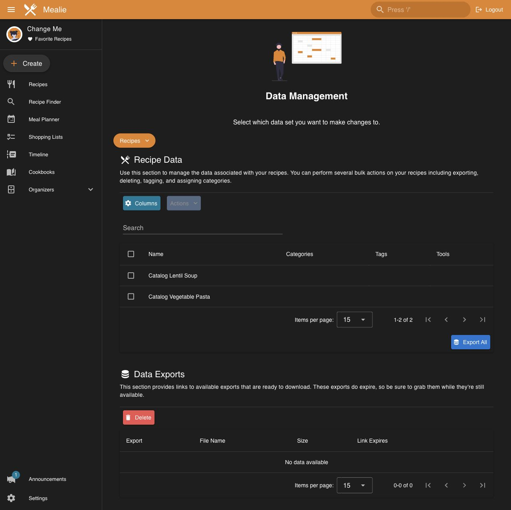
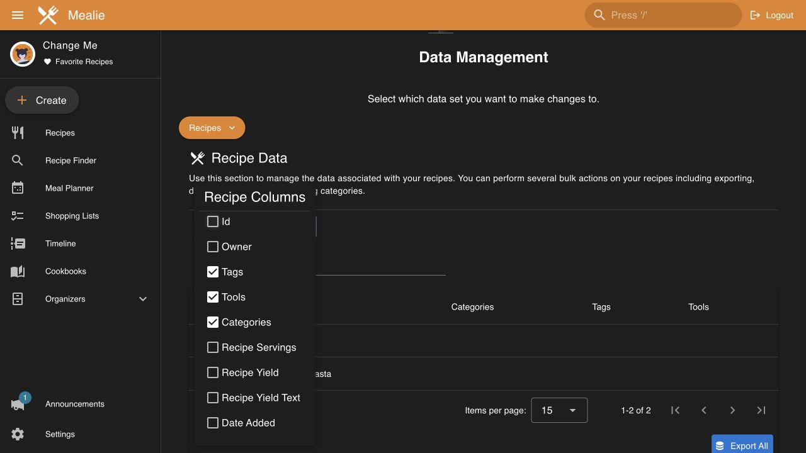
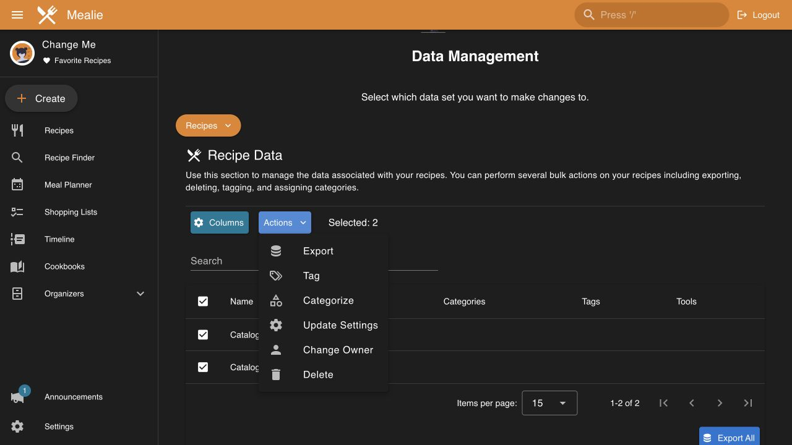

### Settings and owner changes

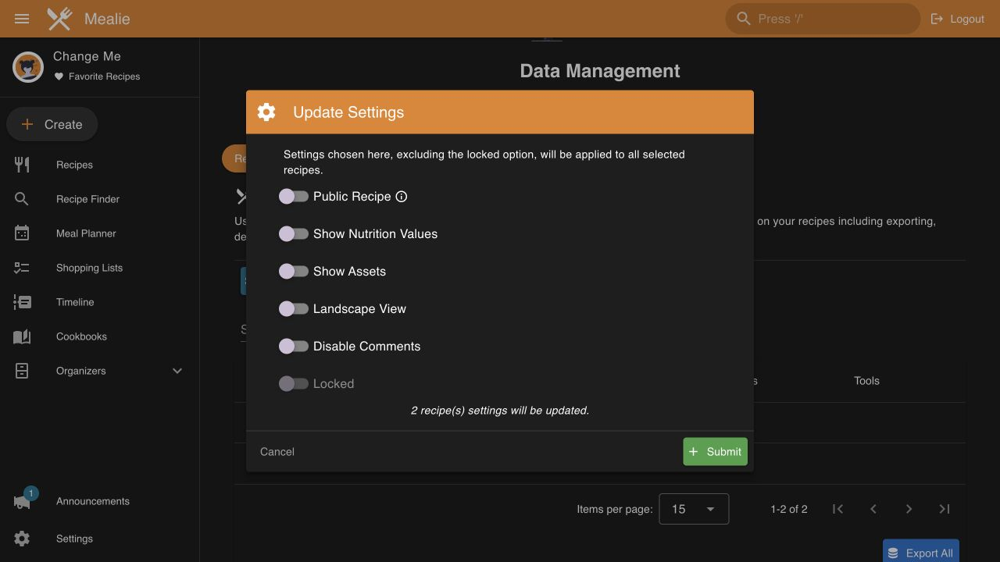
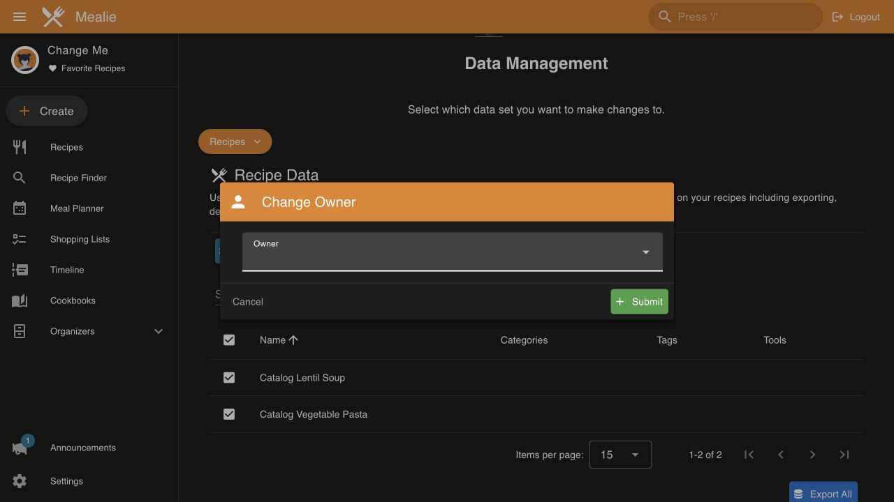
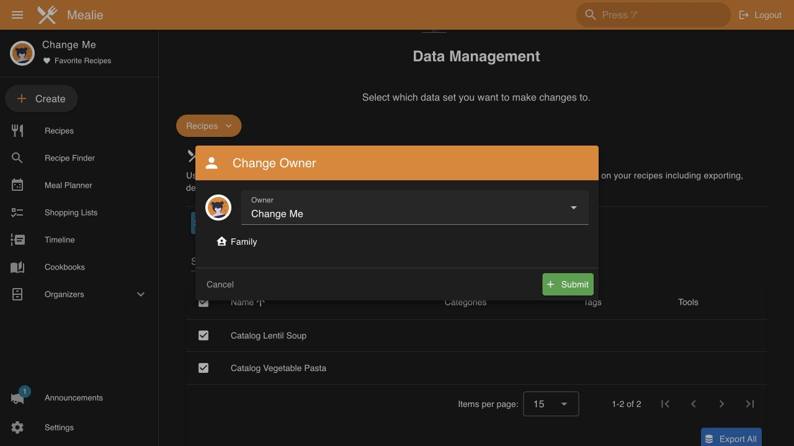

### Organizer assignment and destructive review

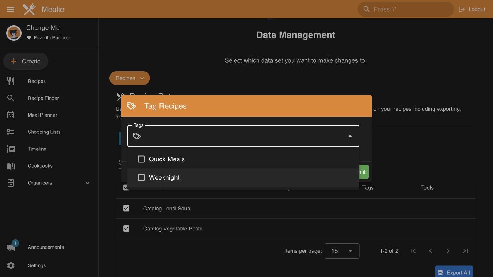
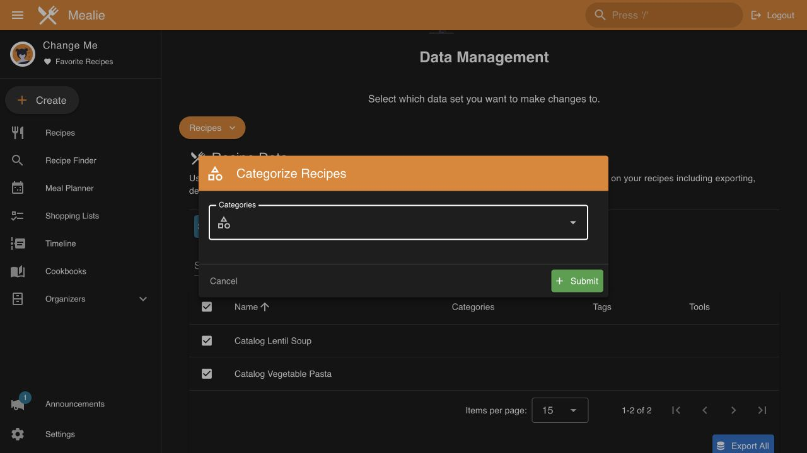
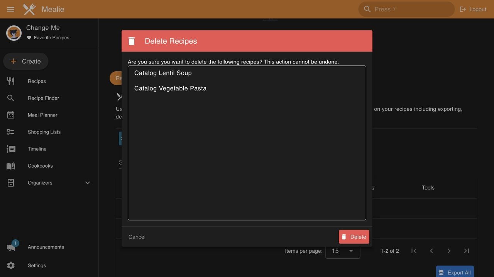

### Export review, completed export, and purge warning

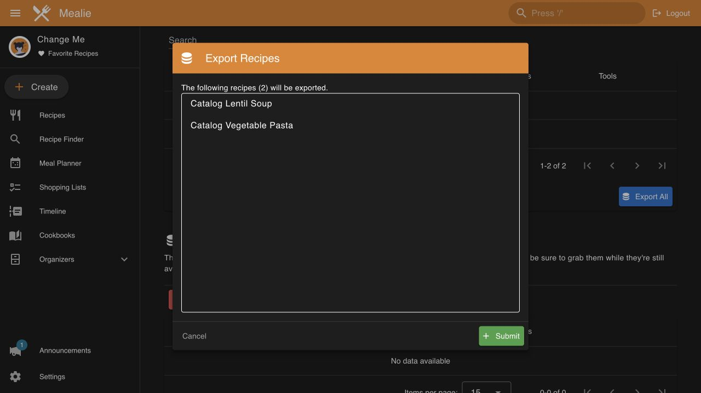
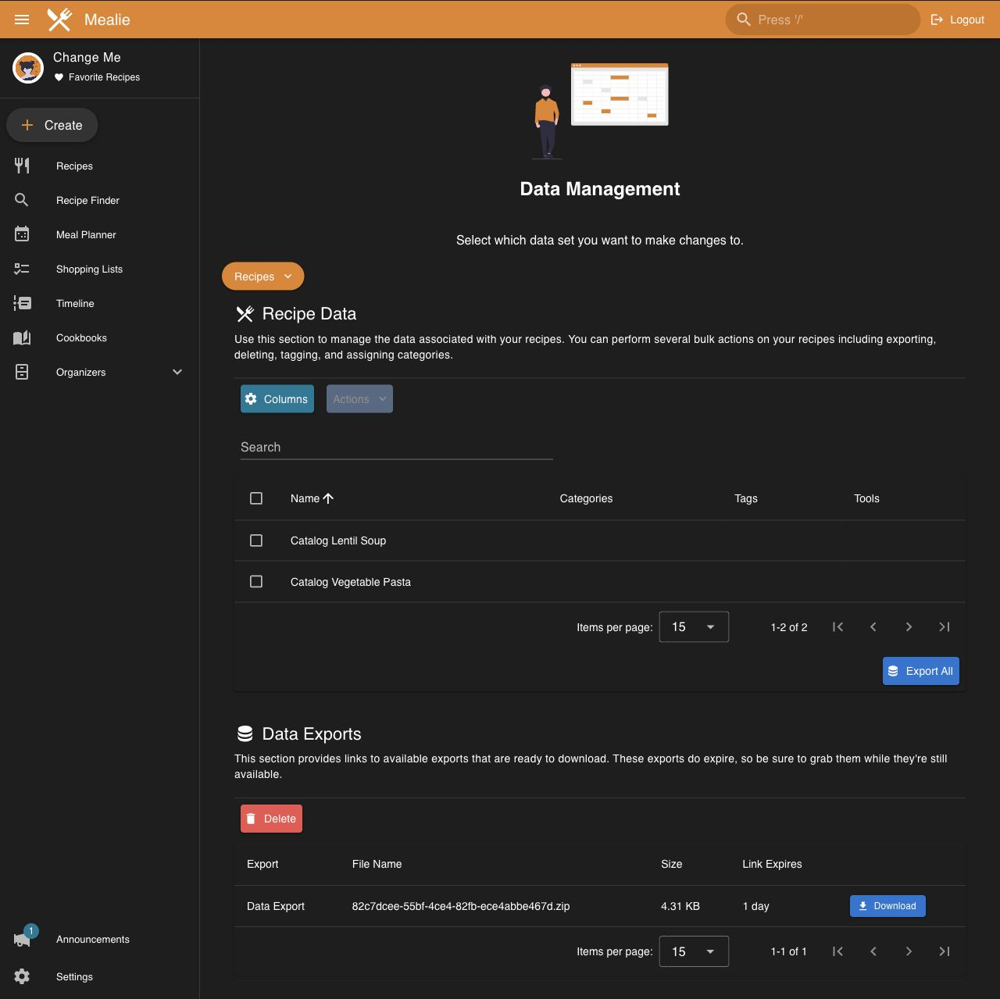
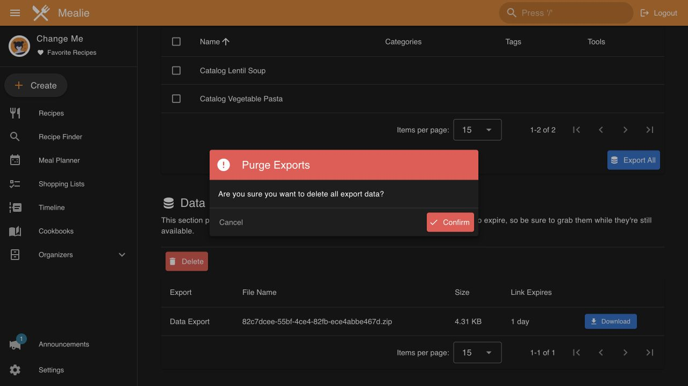

## Migration validation and optional evidence

These additional cases remain for replacement validation. See the [handoff evidence decisions](../HANDOFF.md#evidence-decisions) for shared references, preview fixtures, and unexecuted branches.

- [ ] Capture all optional columns, organizer chips/owner cells, inline organizer creation, and selected category chips.
- [ ] Capture mobile tables/dialogs, search-empty state, export download behavior, and public tooltip.
- [ ] Verify organizer append behavior and preservation of each recipe's Locked state with a representative bulk operation. Source review confirms both server rules.

## Shadcn Vue replacement checklist

- [ ] Compose DataTable, DropdownMenu with persistent checkbox choices, searchable multi-select Combobox with removable Badge chips, Dialog/Sheet, ScrollArea, Switch, Tooltip, Avatar, and download links.
- [ ] Preserve household scope, all column/selection/sort modes, whole-array Export All, and separate pagination for exports.
- [ ] Preserve each operation's payload, refresh/reset behavior, draft retention, permission boundaries, and destructive warnings.
- [ ] Keep nested organizer creation and its store update; verify every bulk action against representative records.
