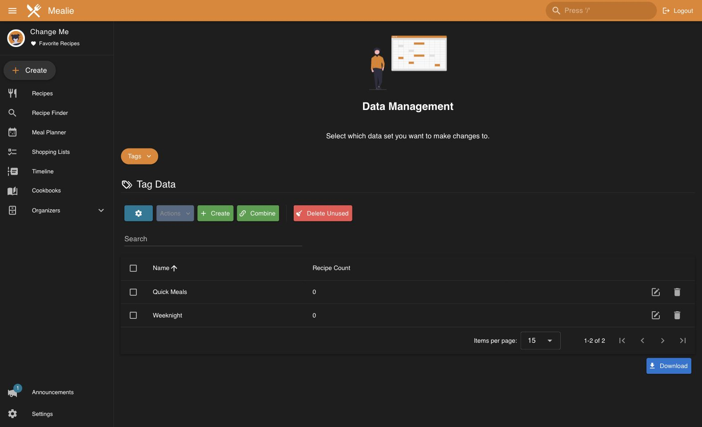
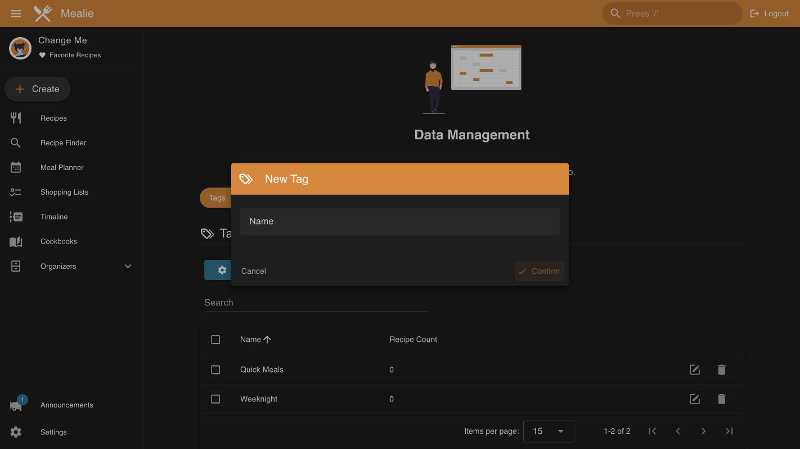
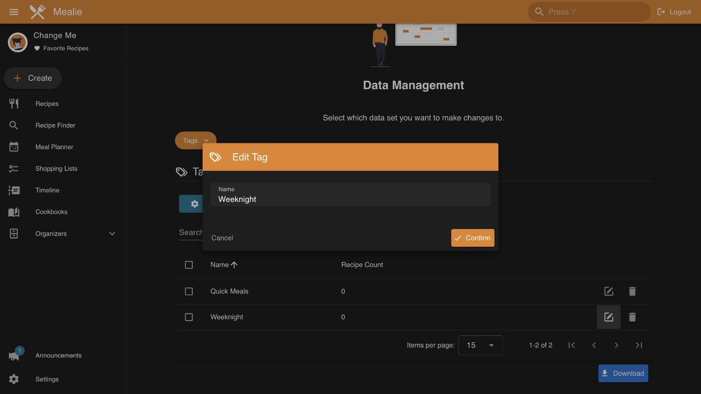
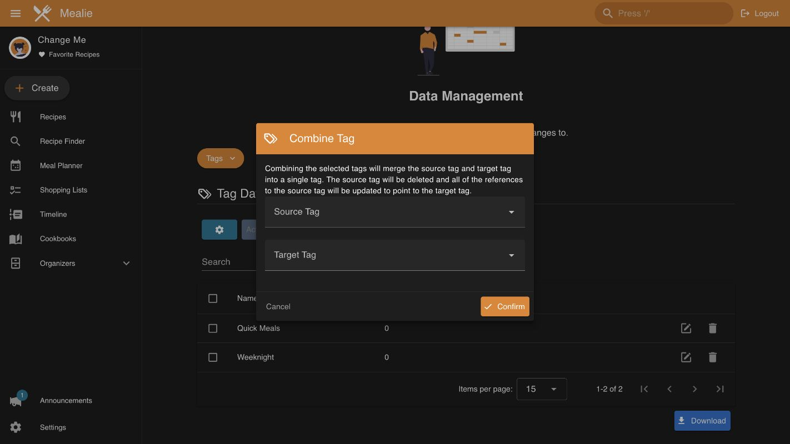
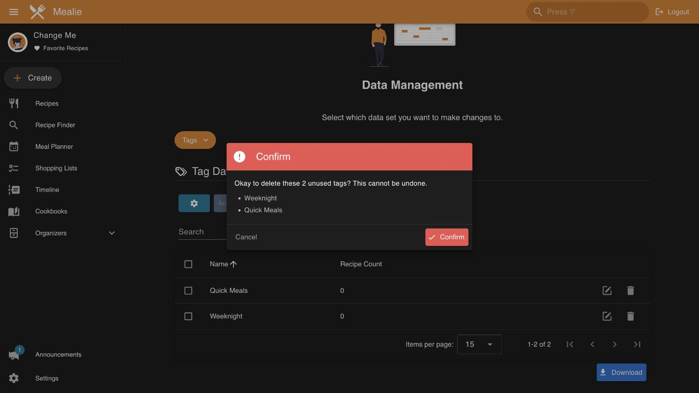

# Tag data

Route: `/group/data/tags`. Source: [tags.vue](../../frontend/app/pages/group/data/tags.vue).
Access and navigation: [data-management parent](group--data.md).
Required shared behavior: [data tables and dialogs](../shared-data-management.md).
Status: source contract and visual references reviewed; runtime validation remains in the checklists below.

## Functions to preserve

- Refresh the group tag store on page entry.
- Show sortable Name and Recipe Count; make ID available in the column menu but hidden initially.
- Retain Search, column selection, row selection, bulk Actions, pagination, page-size control, and JSON Download.
- Link positive counts to `/g/{groupSlug}?tags={id}`. Show zero as plain text.
- Create a tag with a required Name and clear the create name after creation.
- Edit Name and clear the edit object after the update.
- Delete one tag only after the shared target confirmation.
- Review selected tags before bulk deletion and send their IDs through the store.
- Keep API error feedback and refresh behavior.

## Combine tags

- Open a source and target autocomplete with normalized name filtering.
- Explain that the source disappears and its references move to the target.
- Send a merge request only for two different tag IDs.
- Show a source-to-target example when the pair is valid.
- Clear selections and refresh the tag store on success.
- Reset selections on close. Cancel sends no merge request.
- Preserve the distinct-ID guard even though the current Confirm button does not disable itself for an invalid pair.

## Delete unused

- Fetch unused tags and show action progress.
- If none exist, show the no-unused-tags information toast and retain the table.
- Otherwise show the count, irreversible-action warning, first ten names, and any remaining-name count.
- Confirm deletes the captured unused tag IDs and clears the local preview list.
- Cancel leaves the tags unchanged.

## Screenshots

### Populated table

### Create and edit

### Combine

### Unused-tag review

The shared [Categories captures](group--data--categories.md) also explain the reused column picker, empty search, and single/bulk target-review controls.

## Migration validation and optional evidence

These additional cases remain for replacement validation. See the [handoff evidence decisions](../HANDOFF.md#evidence-decisions) for shared references, preview fixtures, and unexecuted branches.

- [ ] Capture a positive recipe-count link, selected merge preview, and mobile dialog.
- [ ] Capture page-specific single/bulk target review and an empty table or no-unused result.

## Shadcn Vue replacement checklist

- [ ] Apply the shared table, form, and dialog contract.
- [ ] Preserve required Name, recipe-count navigation, one/selected/unused deletion, and JSON download.
- [ ] Preserve merge semantics, distinct IDs, preview text, and selection reset.
- [ ] Keep all requests within the current group and refresh the tag store after mutations.
