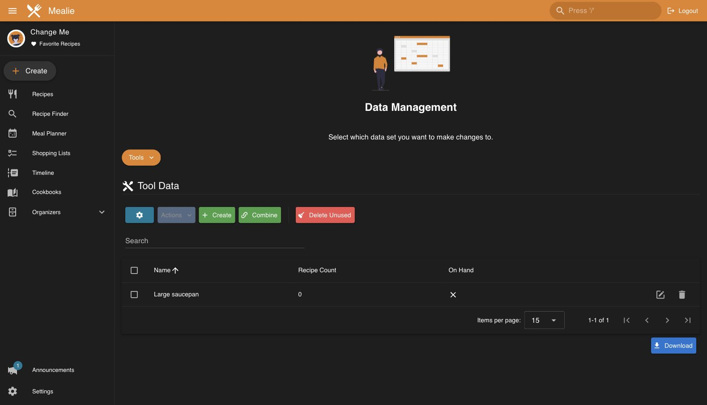
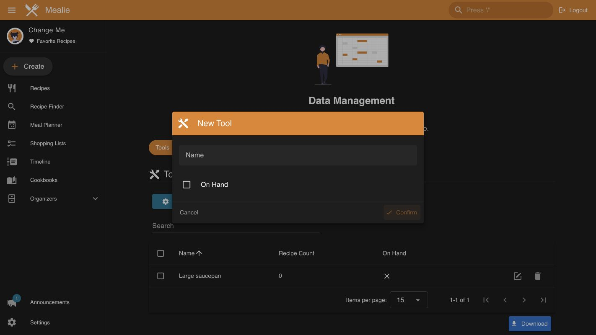
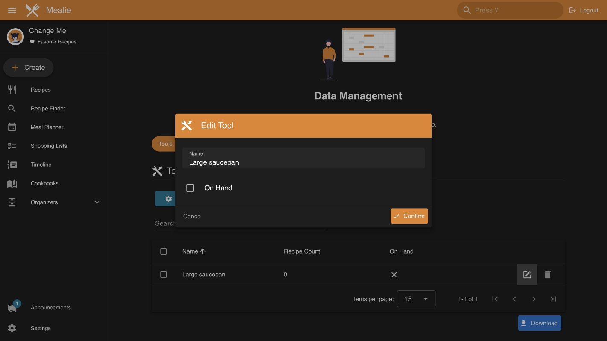
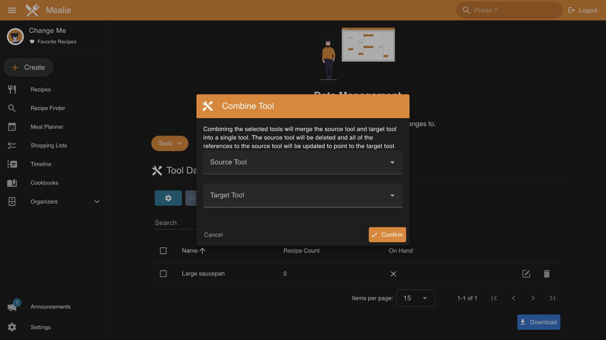
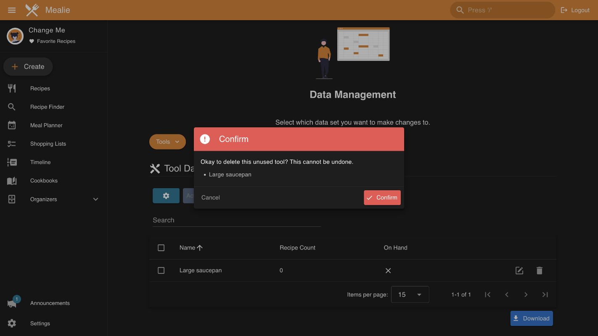

# Tool data

Route: `/group/data/tools`. Source: [tools.vue](../../frontend/app/pages/group/data/tools.vue).
Access and navigation: [data-management parent](group--data.md).
Required shared behavior: [data tables and dialogs](../shared-data-management.md).
Status: source contract and visual references reviewed; runtime validation remains in the checklists below.

## Functions to preserve

- Refresh the group tool store on entry.
- Show sortable Name, Recipe Count, and On Hand. Keep ID hidden initially but available in the column menu.
- Display On Hand with a positive or negative icon and preserve an accessible equivalent of that value.
- Link positive recipe counts to `/g/{groupSlug}?tools={id}`; show zero as plain text.
- Retain Search, row/select-all selection, bulk Actions, pagination, page size, and JSON Download.
- Create a tool with required Name and an On Hand checkbox, default false.
- Resolve On Hand from membership of the current household slug in `householdsWithTool`.
- When creating an on-hand tool, send the current household slug in `householdsWithTool`; otherwise send an empty list.
- When editing, add or remove only the current household's membership and preserve other households' tool availability.
- Reset create to empty Name/false On Hand and clear the edit object after their operations.
- Review the target before single deletion and all selected targets before bulk deletion.
- Keep store refresh and API error feedback.

## Combine tools

- Choose source and target from the tool list with normalized name search.
- Explain that merge deletes the source and transfers its references to the target.
- Show the selected merge example.
- Reject missing IDs or the same tool on both sides before a request.
- Clear selections and refresh the store after success. Clear selections on close.
- Preserve the merge guard even though the current Confirm action does not disable itself for an invalid pair.

## Delete unused

- Fetch unused tools and show action progress.
- If none exist, show the information toast instead of a confirmation.
- Otherwise show the count, warning, first ten names, and any remaining-name count.
- Confirm deletes the captured unused tool IDs and clears the preview list.
- Cancel leaves tools unchanged.
- Preserve the smallest-screen fullscreen dialog behavior used by this page.

## Screenshots

### Tool table and household availability

### Create and edit with On Hand

### Combine and unused-tool review

## Migration validation and optional evidence

These additional cases remain for replacement validation. See the [handoff evidence decisions](../HANDOFF.md#evidence-decisions) for shared references, preview fixtures, and unexecuted branches.

- [ ] Capture an on-hand tool and a positive recipe-count link.
- [ ] Capture selected merge preview, mobile dialogs, and page-specific deletion review.
- [ ] Verify an availability edit preserves other households' memberships.

## Shadcn Vue replacement checklist

- [ ] Apply the shared table, form, and dialog contract.
- [ ] Preserve the household-specific availability semantics and group-wide tool identity.
- [ ] Use Checkbox and an accessible status indicator for On Hand.
- [ ] Preserve recipe-count links, merge safety, cleanup previews, and single/bulk deletion review.
- [ ] Verify all mutations refresh the right tool store and keep other households' data intact.
