# Unit data

Route: `/group/data/units`. Source: [units.vue](../../frontend/app/pages/group/data/units.vue).
Access: [data-management parent](group--data.md). Required shared behavior: [tables, forms, and dialogs](../shared-data-management.md).
Status: source contract and visual references reviewed; runtime validation remains in the checklists below.

## Functions to preserve

- Read the group unit store. Keep search, sortable columns, column visibility, row/select-all selection, bulk Actions, pagination, page size, and JSON Download from the shared table contract.
- Initially show Name, Plural Name, Abbreviation, Plural Abbreviation, Use Abbv., and Fraction. ID, Description, Standard Quantity, Standard Unit, and Date Added start hidden. Date Added is localized; booleans use positive/negative icons with accessible equivalents.
- Name, plural name, abbreviations, boolean columns, and creation date support sorting.
- Create and edit require Name. Other fields are Abbreviation, Plural Name, Plural Abbreviation, Description, Standard Quantity, Standard Unit, Use Abbv., and Fraction.
- Standard quantity is numeric, minimum zero, unrestricted maximum and precision, with hidden increment controls. Explain conversion and shopping-list merging beside standardization fields.
- Standard Unit offers fluid ounce, cup, ounce, pound, milliliter, liter, gram, and kilogram; persist their API values, not translated labels.
- Create starts with empty Name, false Fraction and false Use Abbv.; reset to those values after the awaited store operation. Edit updates the selected unit and clears the edit object afterwards.
- Single deletion and selected-ID bulk deletion use the shared review dialogs and store actions.
- Keep error feedback and store refresh behavior from the shared store/API contract.

## Alias editor

Source: [RecipeDataAliasManagerDialog.vue](../../frontend/app/components/Domain/Recipe/RecipeDataAliasManagerDialog.vue).

- Manage Aliases is an edit-form action opening a nested dialog. Copy aliases on opening so Cancel discards the nested draft. Show one blank row when there are none.
- Add rows, edit names, and remove individual rows. Confirm filters empty names, exact duplicates, and aliases equal to the unit's name, plural name, abbreviation, or plural abbreviation.
- Filtering is case-sensitive and does not trim names; do not silently change normalization during the component replacement.
- Nested Confirm updates the parent edit draft and closes the alias dialog. The outer edit Confirm persists the unit; nested Confirm alone does not call the API.
- Preserve nested-overlay focus, keyboard dismissal, and returning to the outer form.

## Combine and seed

- Combine warns that the source will be deleted and references transferred to the target. Source and Target are normalized-search autocompletes returning complete unit objects.
- Show the selected-pair summary when both exist and differ. Guard missing units and identical IDs in the handler, even though the current Confirm button remains enabled.
- Call the merge endpoint and refresh on truthy returned data. The current unit page does not explicitly clear source/target on close or success; distinguish this from the food/tool page behavior.
- Seed opens a language selector initialized from the current locale. Offer only locales enabled by Nuxt i18n, showing translation progress in option subtitles.
- Warn when units already exist that same-name entries will not be added. Confirm calls the unit seeder with the locale and refreshes the unit store on returned data.
- Seed and Combine use the shared bottom-sheet dialog variant.

## Screenshots

### Empty and populated unit tables

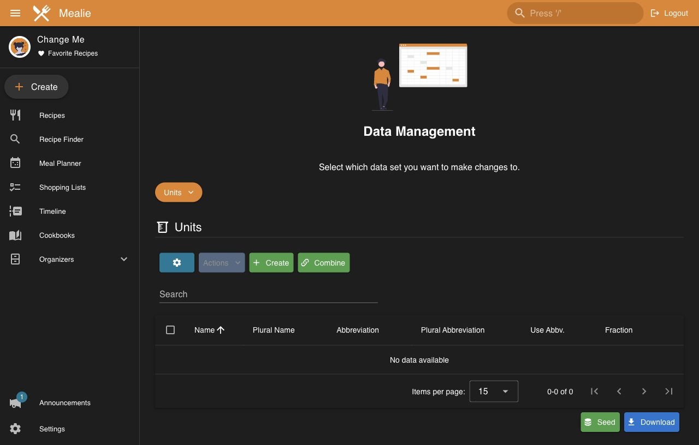

### Create, edit, and nested aliases

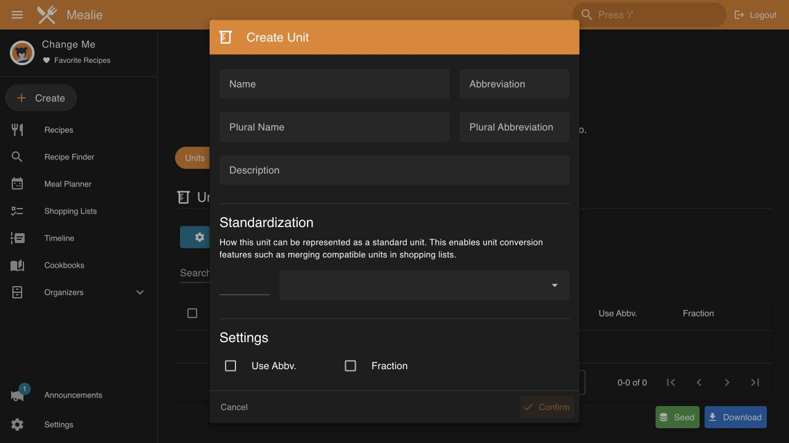
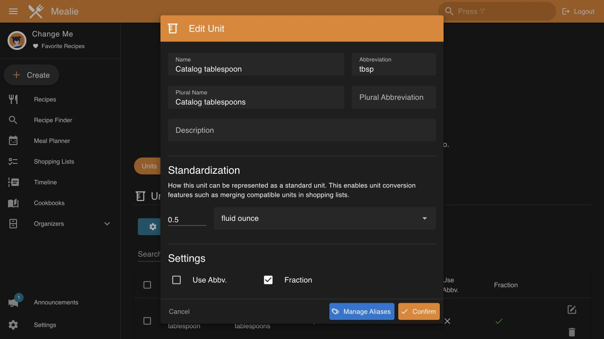

The edit capture shows backend defaults for standardization on the synthetic tablespoon. Preserve the backend contract rather than assuming the blank create display is the persisted default.

### Combine and seed warnings

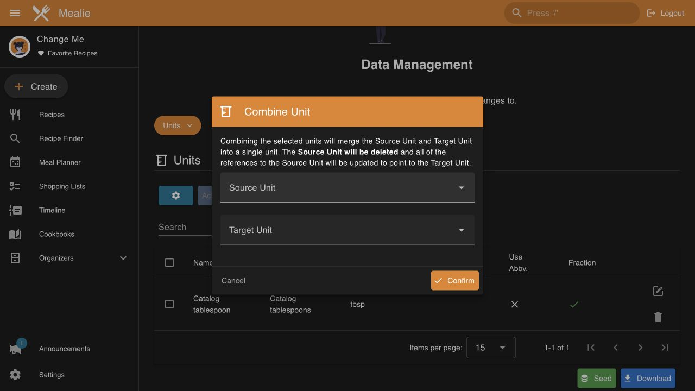
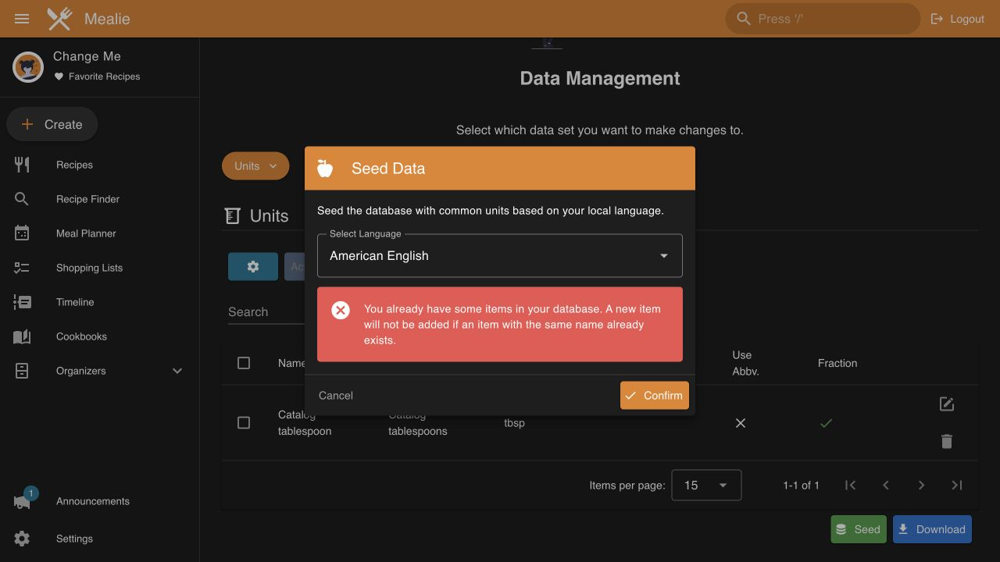

### Typed options and nested alias state

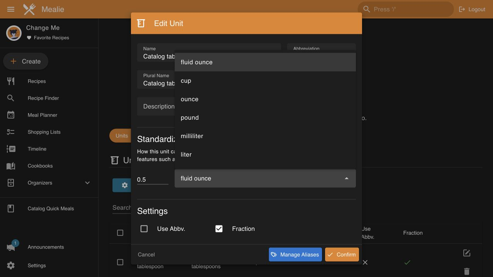
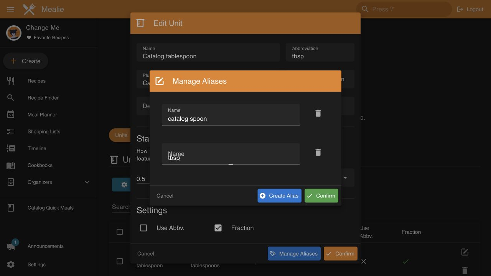
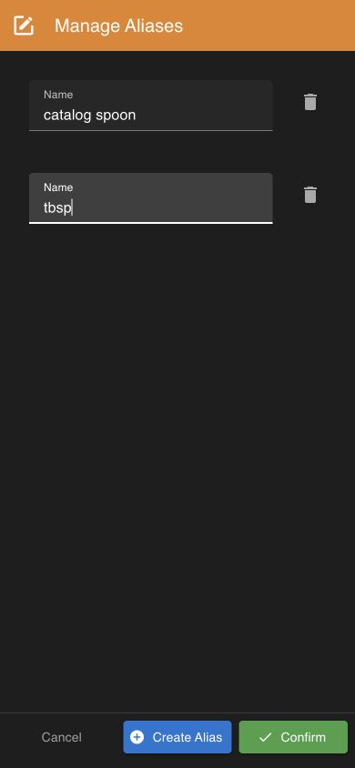
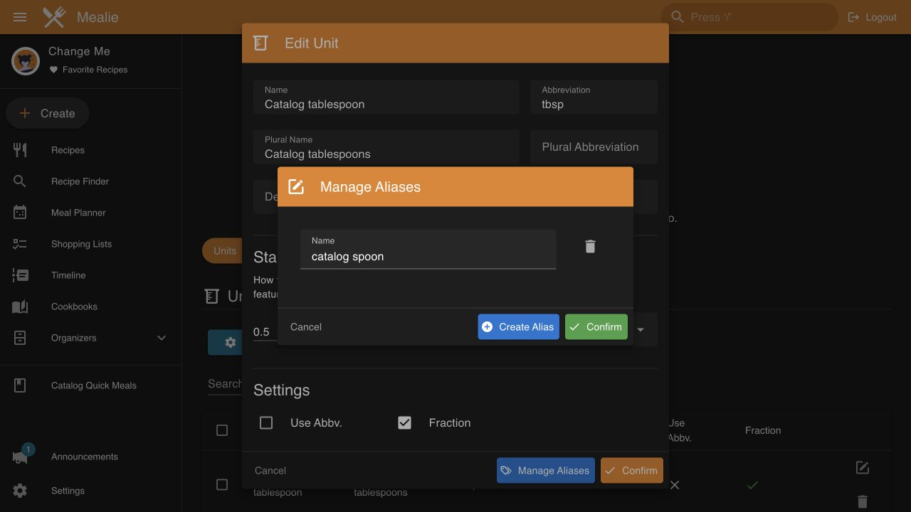

The alias example adds catalog spoon and the existing abbreviation tbsp.
Nested Confirm excludes tbsp. Reopening shows only catalog spoon in the unsaved outer draft.
Outer Cancel discards that draft; it does not update the stored unit.

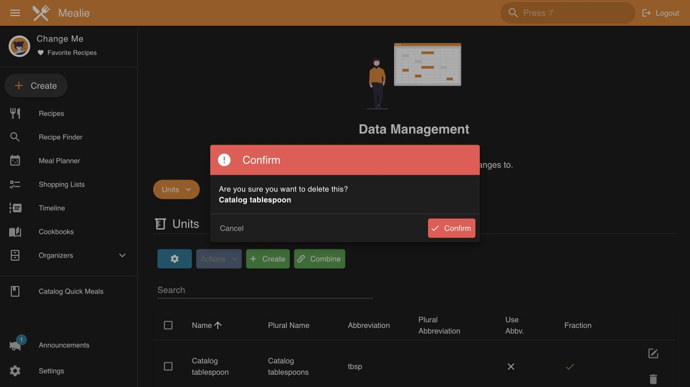
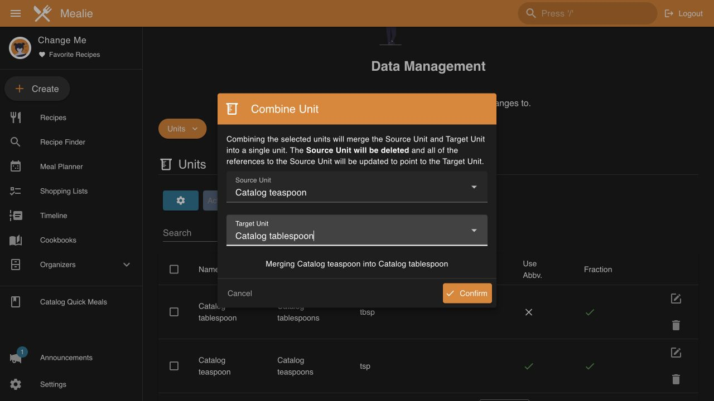

## Migration validation

- [ ] Verify mobile form focus, nested-dialog keyboard access, and focus return during replacement.
- [ ] Verify an alias edit only persists after the outer edit is confirmed.

## Shadcn Vue replacement checklist

- [ ] Apply the shared table, validation, export, and dialog contract.
- [ ] Use Input, Checkbox, searchable Combobox, Dialog/Sheet, and accessible boolean indicators without losing fields or API values.
- [ ] Preserve draft isolation and the two-stage alias save.
- [ ] Preserve standardization precision, merge guard, seeder locale filtering, and all store refreshes.
