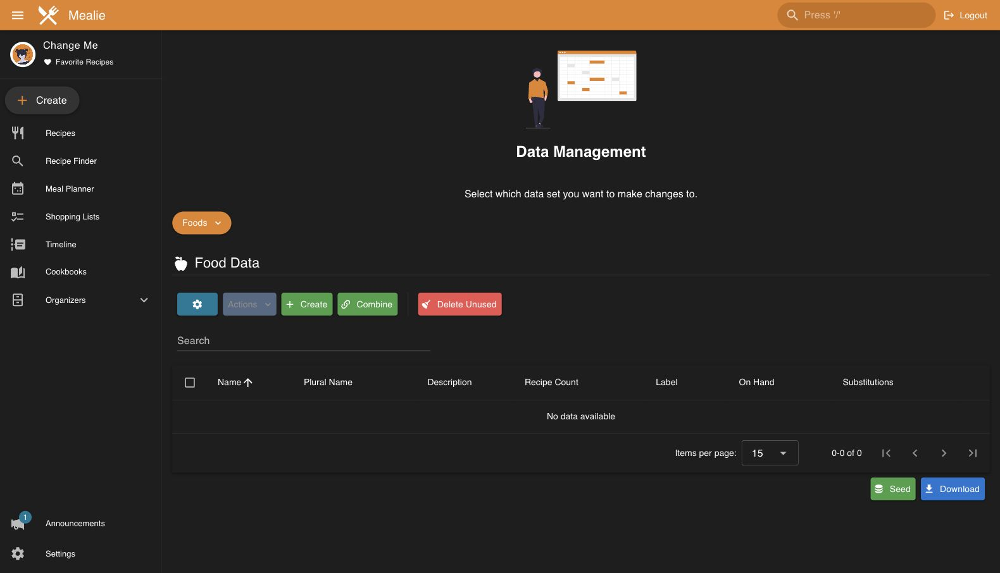
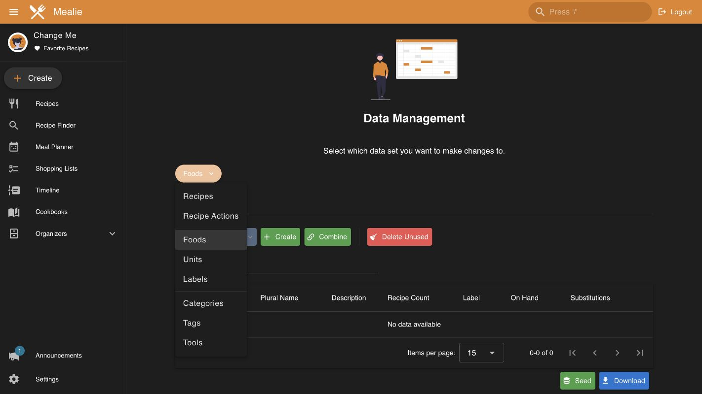

# Data-management parent

Route family: `/group/data/*`. Source: [data.vue](../../frontend/app/pages/group/data.vue).
Access: authenticated users with `canOrganize`, through the parent middleware.
Layout: [shared shell](../shared-shell.md).
Status: source contract and visual references reviewed; runtime validation remains in the checklists below.

## Functions to preserve

- Show the data-management illustration, title, and scope explanation.
- Render the selected data manager inside the parent page.
- Display the current data type in the shared selector.
- Resolve hyphenated suffixes such as `recipe-actions` to the translated current-type label.
- Navigate with the selector's links to Recipes, Recipe Actions, Foods, Units, Labels, Categories, Tags, or Tools.
- Preserve the menu's section separators and current selection.
- Apply the parent's authentication and organizer guards to every child page.
- Do not replace the separate managers with one generic table that loses their specialized controls.

Child page documents must cover each manager's CRUD, bulk actions, alias or substitution controls, seed/import/export functions, and data scope.
The static [route manifest](../route-manifest.json) lists every child source.

## Screenshots

### Default Foods destination inside the shared parent

### All data-type destinations

## Shadcn Vue replacement checklist

- [ ] Replace the page-title layout, illustration presentation, selector menu, and page transition.
- [ ] Preserve all eight destinations and their translated active labels.
- [ ] Keep the parent authorization gate and child route content.
- [ ] Verify keyboard selection and direct entry to every child route.
