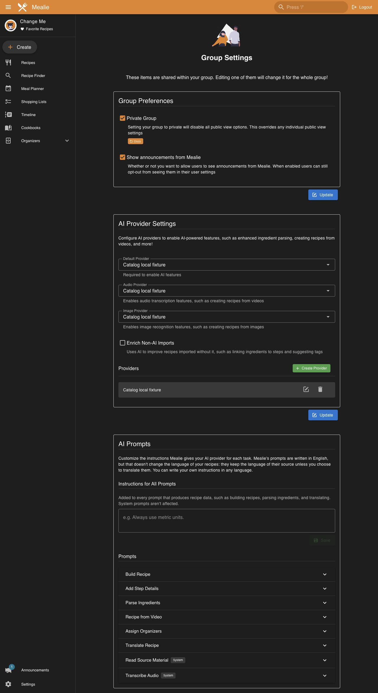
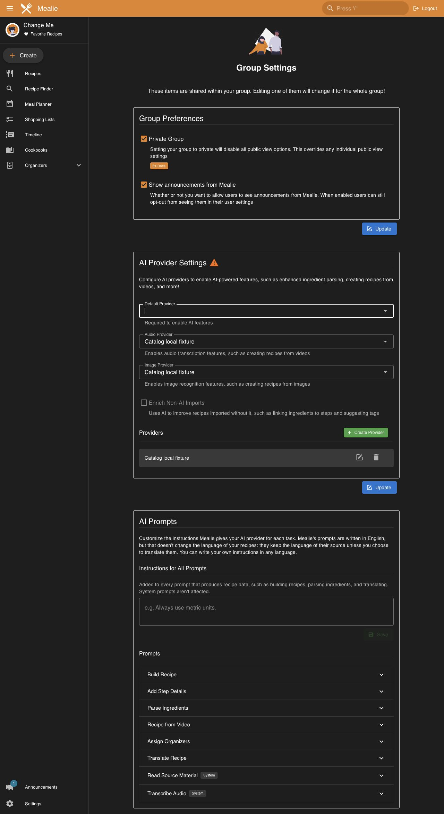
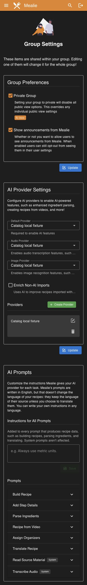

# Group manager settings

Route: `/group`. Source: [index.vue](../../frontend/app/pages/group/index.vue).

## Functions to preserve

- Require authentication and `canManage` through `can-manage-only`; unauthorized users redirect to `/`. Use the default application layout, not the admin navigation.
- Fetch current-user group through the cached self composable, then force refresh on every mount to avoid stale settings after visiting admin panels.
- Explain that changes affect the entire group. Render only when group data exists.
- Apply the full [shared group settings contract](../shared-group-settings.md): privacy, announcements, provider selection/enrichment, provider CRUD/test dialog with advanced rows and secret guards, and all prompt modes/task controls.
- Preferences and AI provider selections have two independent Update forms/buttons. Each checks that its relevant model exists, calls its matching self-update API, and shows Settings Updated/Update Failed.
- Current form validation calls are not awaited. Preserve actual form validity rather than relying on Promise truthiness during replacement.
- Provider create/update/delete are separate immediate API operations through current-group endpoints; refresh self group and show operation-specific success/failure.
- Prompt editor has no explicit admin group ID here, so it uses current-group prompt endpoints. Its global/per-task saves are independent of both Update buttons.
- Preserve model synchronization, refreshed provider choices, unsaved prompt drafts, and explicit permission boundaries.

## Redesign (implemented)

| Before | Now |
| --- | --- |
| Page title with an illustration; each section an outlined Vuetify card with an Update button below it. | Plain heading and description; each section is a panel with its title, fields and an Update button in its footer. |

## Screenshots

### Whole page with independent Update sections and prompt list

### Default provider cleared in an unsaved draft

The provider remains saved in the catalog database; this screenshot records only the draft warning/disabled state. Nested connection and prompt states are illustrated in [admin group detail](admin--manage--groups--id.md) using the same components.

## Migration validation and optional evidence

These additional cases remain for replacement validation. See the [handoff evidence decisions](../HANDOFF.md#evidence-decisions) for shared references, preview fixtures, and unexecuted branches.

- [ ] Verify warning tooltip, independent save feedback, and unauthorized redirect; the mobile page is captured above.
- [ ] Verify provider refresh does not accidentally save unrelated preferences or lose unsaved prompt drafts.

## Shadcn Vue replacement checklist

- [x] Apply every shared group-settings task.
- [ ] Preserve manager access, forced revalidation, four persistence boundaries (preferences, AI selections, provider CRUD, prompts), and current-group endpoint scope.
