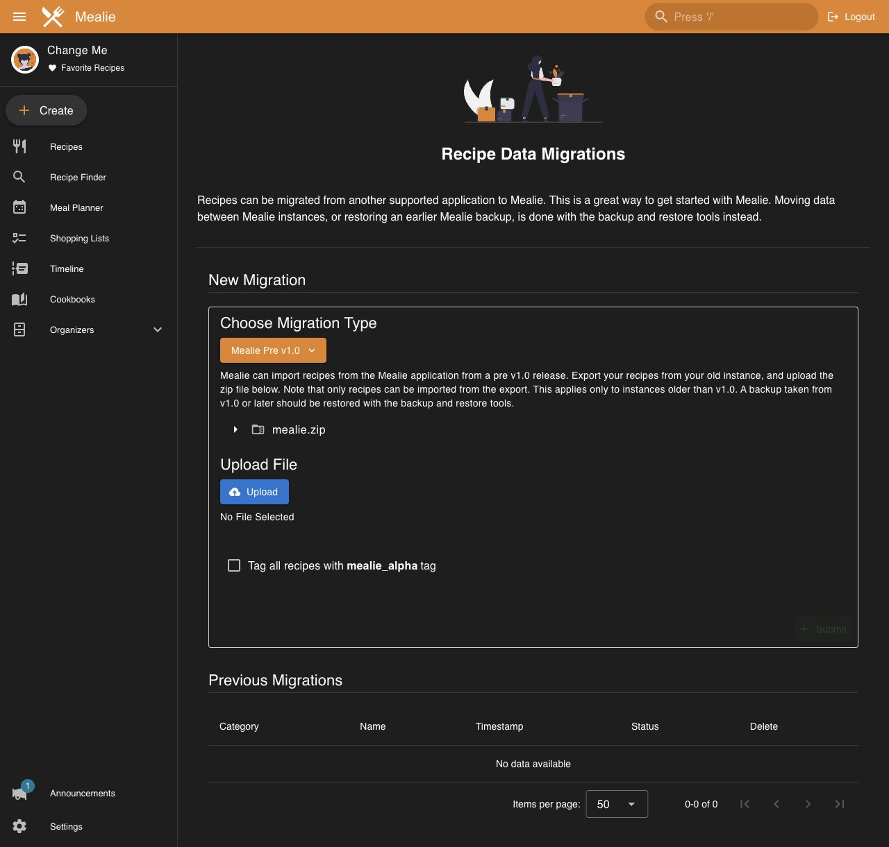
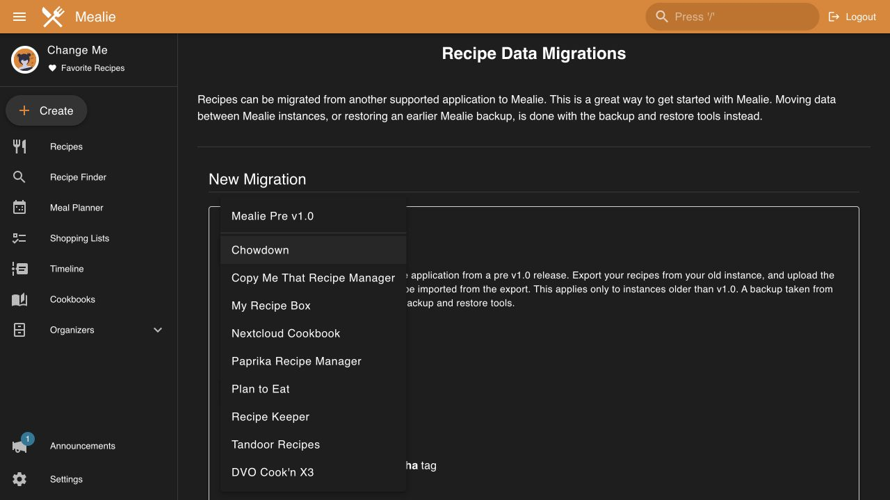
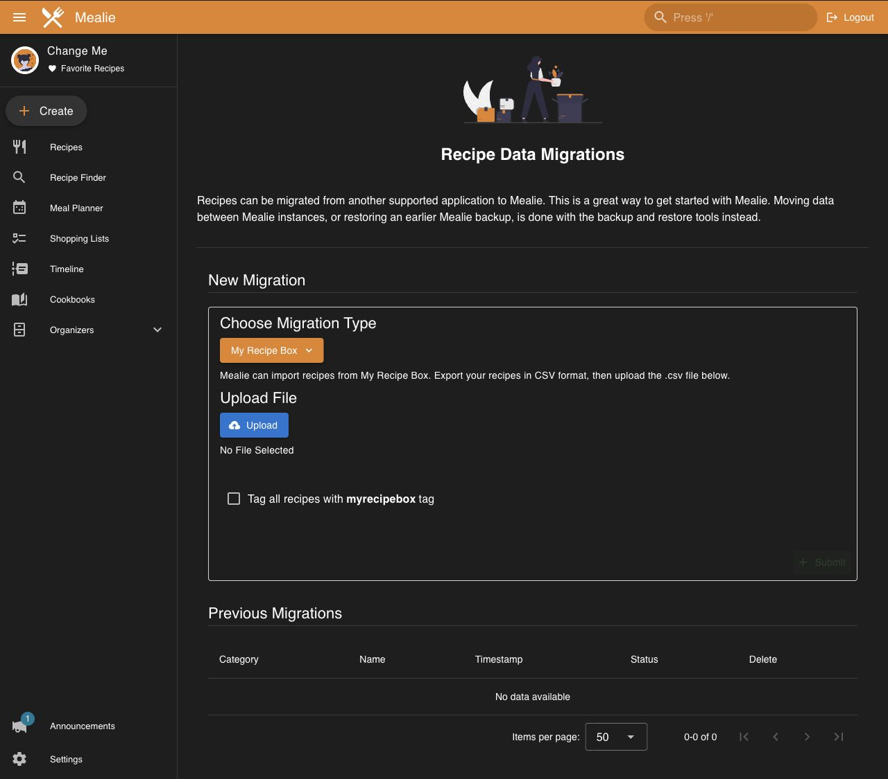
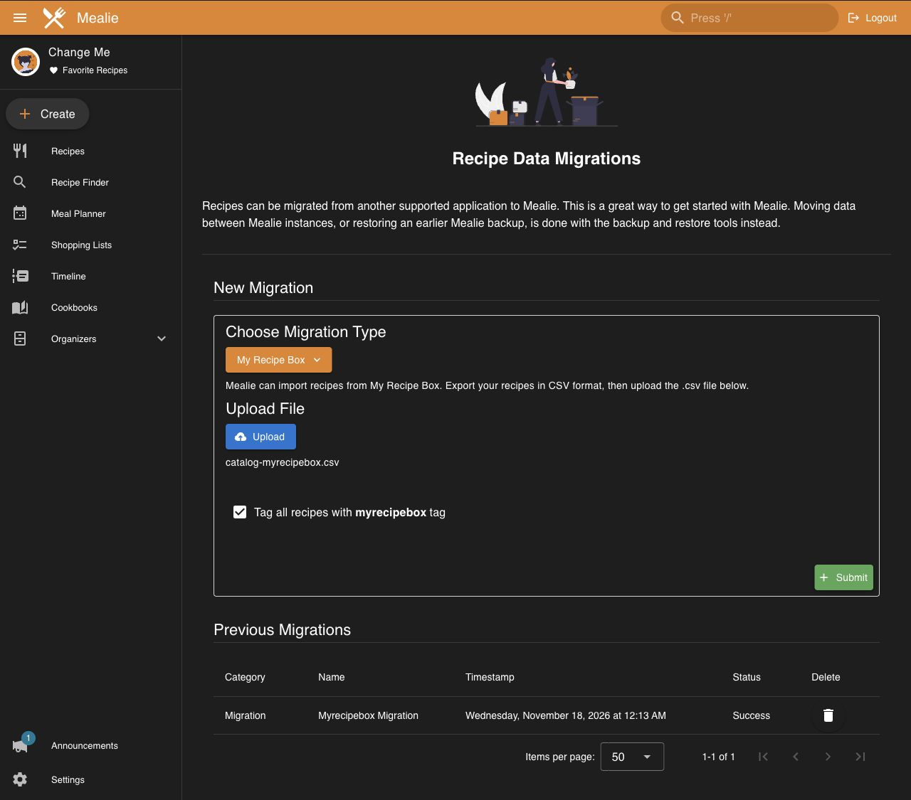
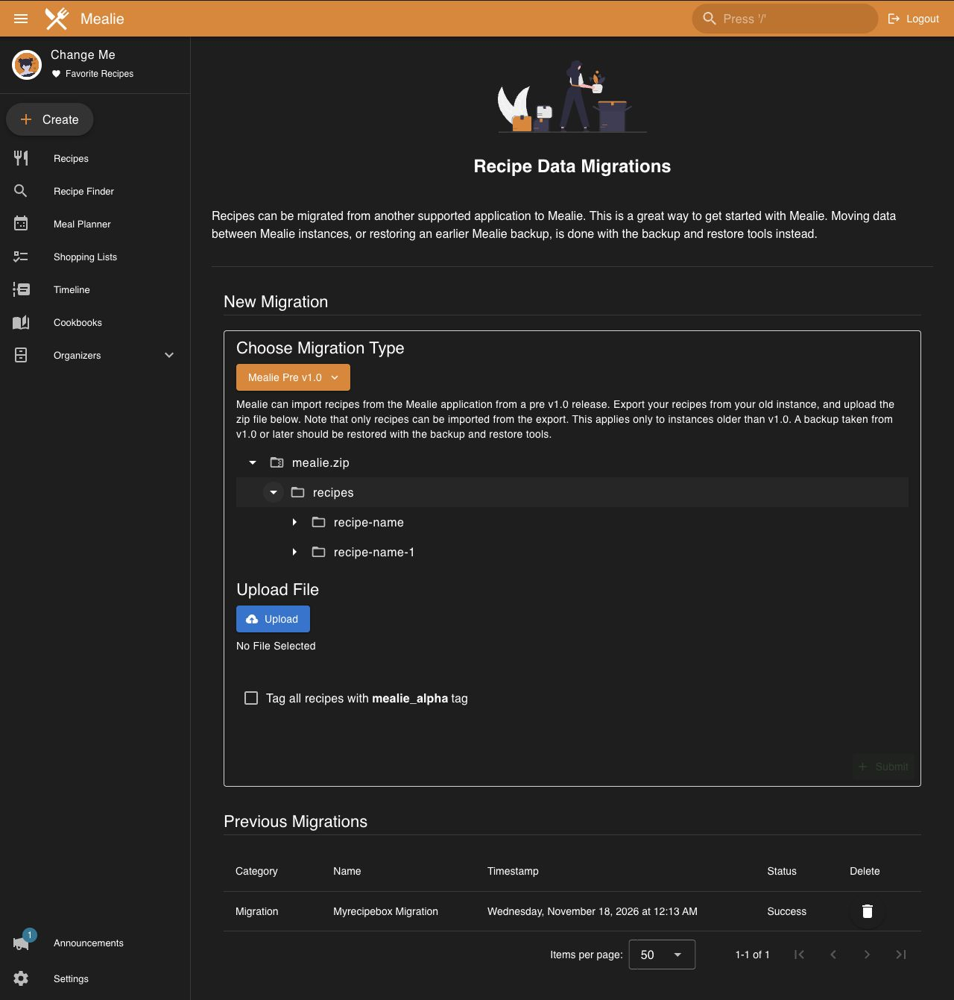
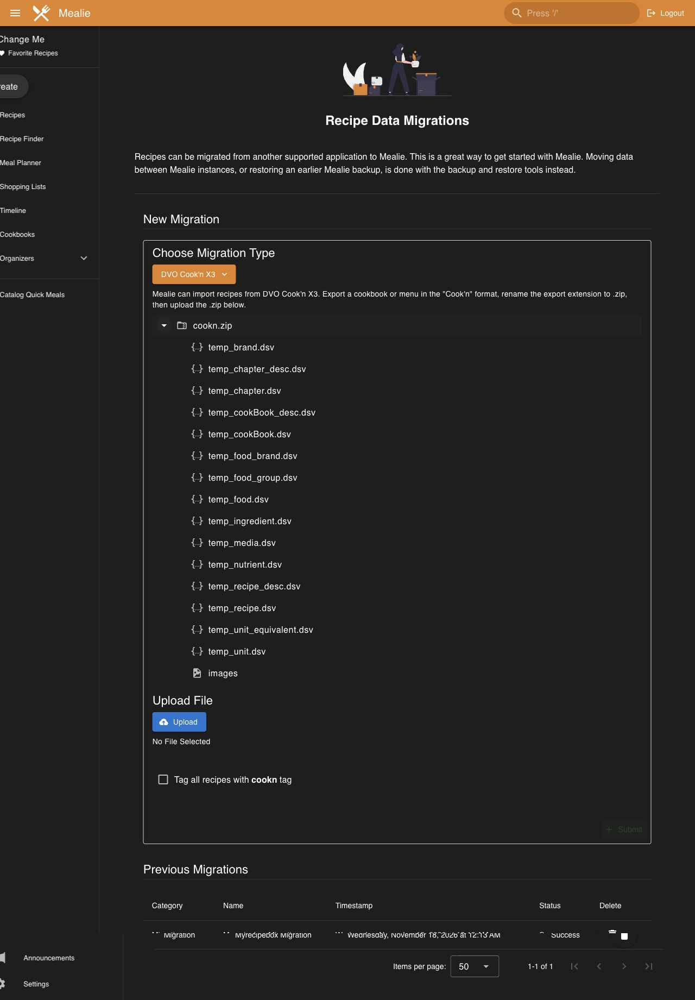
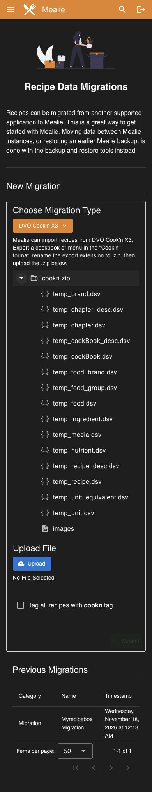

# Recipe data migrations

Route: `/group/migrations`. Source: [migrations.vue](../../frontend/app/pages/group/migrations.vue). Requires authentication and Advanced Features; uses the default shell.

## Functions to preserve

- Explain importing recipes from supported external applications. Distinguish pre-v1 Mealie recipe migration from restoring a modern full-instance backup; keep that distinction in guidance.
- Choose a migration type from the ten-item menu below. Change its localized explanation, accepted file extensions, optional archive tree, and migration-tag label together.
- Start with Mealie Pre v1.0, no selected file, tag option false, no request running. An unknown type falls back to blank explanation, `.zip`, and no tree.
- Upload is a single-file local chooser using `post=false`; retain the File until Submit and display its filename. Cancelled file selection must not submit a migration.
- Submit is disabled without a file name. Send `addMigrationTag`, API migration type, and archive file through the migration client; drive card loading during the awaited request.
- Tag All Recipes uses the API migration type as the tag name, dynamically reflecting the chosen format.
- On returned report, prepend it to Previous Migrations. The source does not clear the file/tag selection or poll the job after submission; preserve observable result handling and avoid accidentally resubmitting a retained file.
- Fetch existing reports with category `migration` on mount.
- Previous Migrations uses [ReportTable](../../frontend/app/components/global/ReportTable.vue): Category, Name, localized Timestamp, capitalized Status, Delete, initial 50-row pagination, page-size control, and column sorting.
- Completed rows open `/group/reports/{id}`; in-progress rows do not navigate. Delete stops row propagation, immediately deletes the report ID, and refreshes the list without a separate confirmation.
- Preserve report detail and exception behavior in the [report page contract](group--reports--id.md).

## Format-specific controls and guidance

Keep the localized export instructions for every format. Trees are expandable examples with file/folder/archive icons and stable unique node IDs; changing type recreates its tree.

| Display | API type | Accepted files | Archive guidance |
| --- | --- | --- | --- |
| Mealie Pre v1.0 | `mealie_alpha` | `.zip` | `mealie.zip/recipes/{recipe-name}/{recipe-name}.json`, plus images directory with original/full/thumb examples. Recipes only; modern backups use restore. |
| Chowdown | `chowdown` | `.zip` | GitHub pages archive with `_recipes/*.md` and `images/*.jpg`. |
| Copy Me That Recipe Manager | `copymethat` | `.zip` | `recipes.html` and images directory. |
| My Recipe Box | `myrecipebox` | `.csv` | CSV guidance; no archive tree. |
| Nextcloud Cookbook | `nextcloud` | `.zip` | Per-recipe directories with `recipe.json`, `full.jpg`, and `thumb.jpg`. |
| Paprika Recipe Manager | `paprika` | `.zip` | Format-specific export guidance; no tree. |
| Plan to Eat | `plantoeat` | `.zip,.csv,.txt` | Multiple accepted export formats; no tree. |
| Recipe Keeper | `recipekeeper` | `.zip` | HTML export containing `recipes.html` and `images/`. |
| Tandoor Recipes | `tandoor` | `.zip` | Full export with nested numbered zip archives, each containing `image.jpeg` and `recipe.json`. |
| DVO Cook'n X3 | `cookn` | `.zip` | DSV database files for brands, chapters, cookbooks, foods, ingredients, media, nutrients, recipes, units/equivalents, plus images. Preserve the complete sample tree from source. |

## Screenshots

### Initial page and all supported formats

### CSV guidance, chosen local fixture, and tag option

### Successful migration and expandable archive example

The [synthetic CSV](../fixtures/catalog-myrecipebox.csv) imports Catalog Migration Salad without external image/source URLs. Its [successful report](group--reports--id.md) confirms the imported record.

## Migration validation and optional evidence

These additional cases remain for replacement validation. See the [handoff evidence decisions](../HANDOFF.md#evidence-decisions) for shared references, preview fixtures, and unexecuted branches.

- [ ] Capture remaining distinct format guidance/tree branches and mobile layout where they inform design.
- [ ] Verify chooser extension switching, changing type after file selection, migration errors, and in-progress report behavior using local fixtures.

## Shadcn Vue replacement checklist

- [ ] Compose Select/DropdownMenu, file Input/Button, Checkbox, expandable semantic tree, DataTable, and loading/error feedback.
- [ ] Preserve all ten API types, accepted extensions, export instructions, sample trees, tagging, report navigation, and category filtering.
- [ ] Keep migration distinct from backup restoration and prevent misleading repeat submissions.
