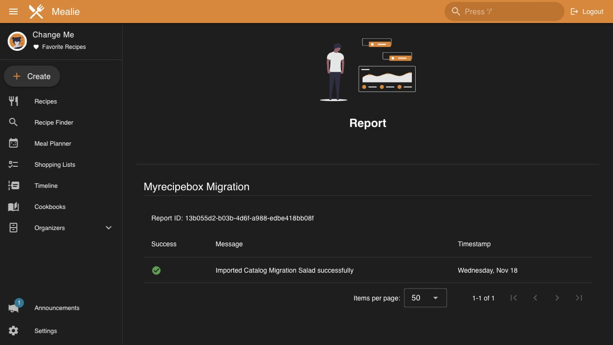
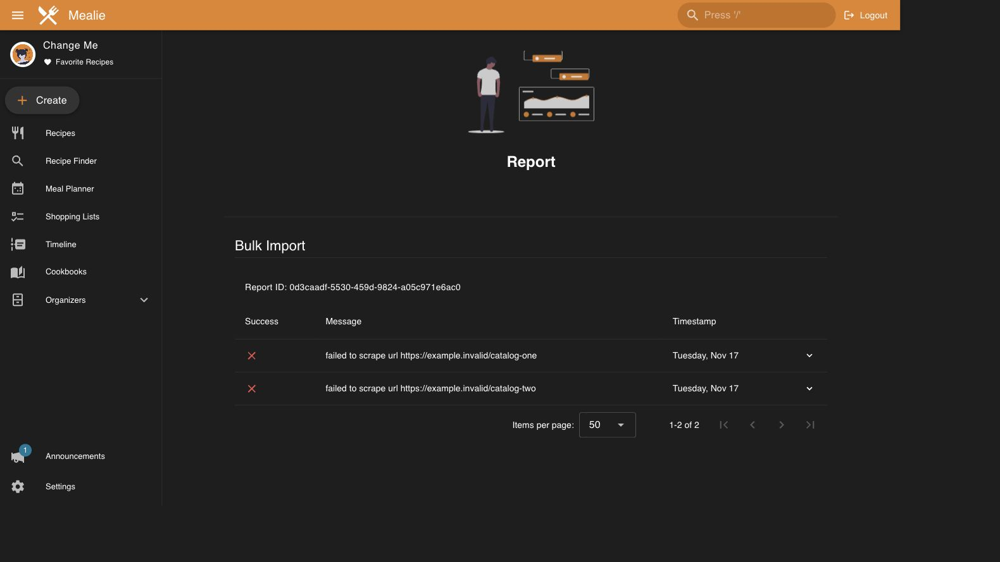
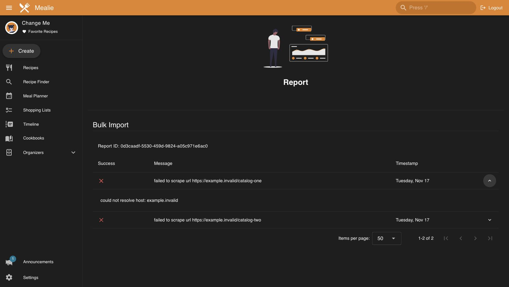

# Group report detail

Route: `/group/reports/:id`. Source: [reports/[id].vue](../../frontend/app/pages/group/reports/[id].vue).
Access: authenticated users; the group report API determines data scope.
Layout: [shared shell](../shared-shell.md).
Status: source contract and visual references reviewed; runtime validation remains in the checklists below.

## Functions to preserve

- Read the report ID from the route and fetch that report on mount.
- Show the report illustration/title and, once loaded, the report name and ID.
- Display entries with Success, Message, and localized Timestamp columns.
- Distinguish success and failure with the appropriate status icon/color and an accessible equivalent.
- Keep table pagination and page-size selection, with 50 entries per page initially.
- Show an expansion control only when an entry has exception detail.
- Expand the exception text across the full table width.
- Preserve collapse/expand for individual entries.
- If the report data is null, retain the page heading without inventing report contents.
- Preserve entry from completed report rows in bulk imports and migration reports.

Current-source notes: the three table headers are literal English strings.
The page has no independent retry, refresh, report-delete action, or explicit missing-report error panel.
Do not invent those as current functions, and do not move report deletion away from its list consumers without a deliberate design decision.

## Redesign (implemented)

| Before | Now |
| --- | --- |
| Illustration title, report name and a data table with expandable rows for errors. | A back link to migrations, the report name as the title, a succeeded/failed count, and one row per entry with a tick or cross, the message and time. Entries with an error get a "Show error" disclosure with the exception in a code block. |

## Screenshots

### Successful synthetic migration

The migration imported Catalog Migration Salad from the planning CSV fixture. This complements the failure/exception states below.

### Report identity, entry messages, status, dates, and pagination

### Exception detail expanded for one failed entry

## Migration validation and optional evidence

These additional cases remain for replacement validation. See the [handoff evidence decisions](../HANDOFF.md#evidence-decisions) for shared references, preview fixtures, and unexecuted branches.

- [ ] Verify mixed statuses, a report with no entries, and narrow-screen behavior; a successful migration entry is captured above.
- [ ] Verify a long exception and more than 50 entries remain accessible.

## Shadcn Vue replacement checklist

- [ ] Replace page/card sections, status icons, table, expansion buttons, and pagination.
- [ ] Preserve report identity, full message/exception text, localized timestamps, and conditional expansion.
- [ ] Give exception controls and success/failure icons accessible names.
- [ ] Verify report links from every list consumer and keep group authorization intact.
