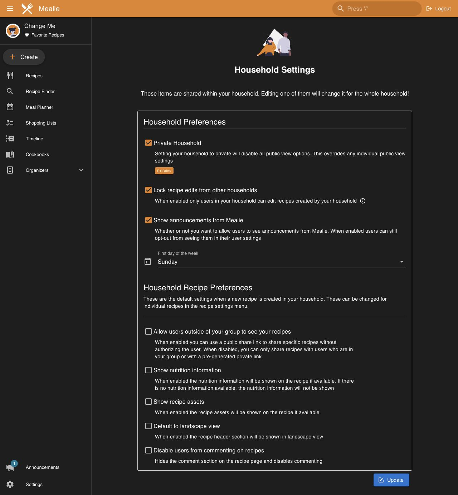
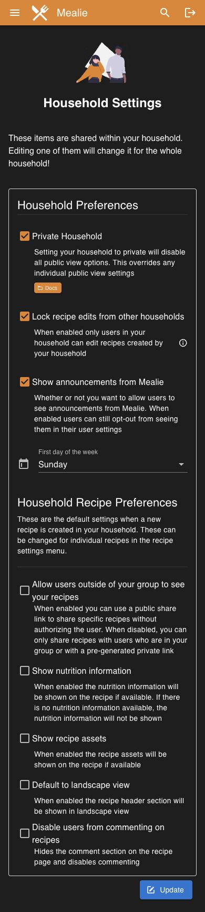

# Household manager settings

Route: `/household`. Source: [index.vue](../../frontend/app/pages/household/index.vue).

## Functions to preserve

- Require authentication and `canManageHousehold`; unauthorized users redirect to `/`. Use the default shell.
- Load the current household through its self composable and force revalidation on mount to refresh changes made in admin views during the same session.
- Display illustration/title and the whole-household impact explanation. Render only once household data exists.
- Edit the complete [household preferences contract](../shared-household-preferences.md), including privacy, edit restriction, announcements, week start, and five default recipe options. This manager page does not expose household name or group reassignment.
- Update persists only household preferences through the self API and shows Settings Updated/Update Failed according to returned data. The shared editor itself does not call the API.
- Current form validation is invoked without awaiting its result; preserve intended validity checks when replacing the form.
- Keep settings synchronization, descriptions, documentation, admin-exception tooltip, and the week-start relationship to meal planning.

## Screenshots

### All household manager preferences

The shared day menu and readable recipe-default section are also captured in [admin household detail](admin--manage--households--id.md), which uses the same editor.

## Migration validation and optional evidence

These additional cases remain for replacement validation. See the [handoff evidence decisions](../HANDOFF.md#evidence-decisions) for shared references, preview fixtures, and unexecuted branches.

- [ ] Verify administrator tooltip, save feedback, and unauthorized redirect; mobile layout is captured above.
- [ ] Verify planner refresh after changing week start and re-entry refresh after admin edits.

## Shadcn Vue replacement checklist

- [ ] Apply every shared household-preference task.
- [ ] Preserve manager permission, self API, refresh on entry, draft save boundary, and feedback.
