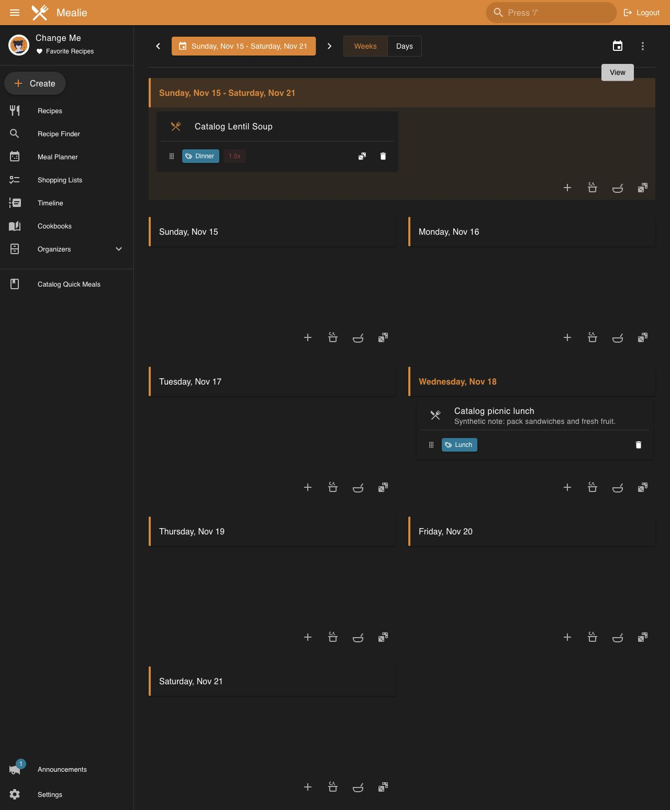
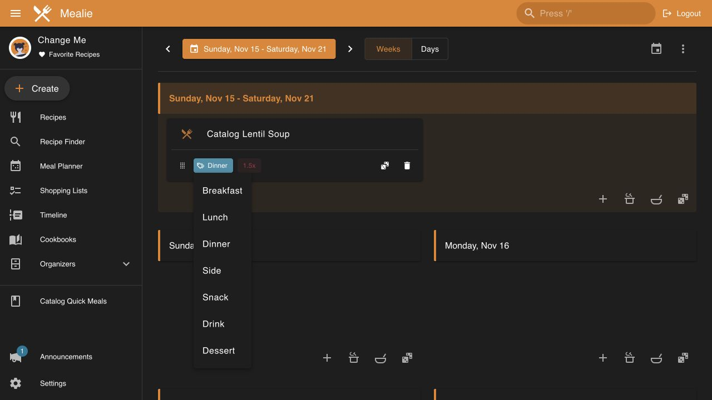
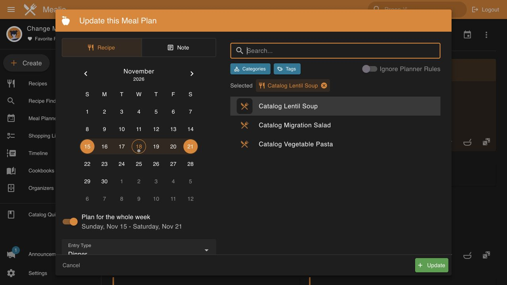
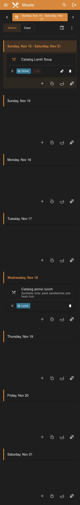

# Meal planner edit

Route: `/household/mealplan/planner/edit`. Source: [edit.vue](../../frontend/app/pages/household/mealplan/planner/edit.vue).

## Functions

- Share [parent toolbar](household--mealplan--planner.md) and [meal-plan contracts](../shared-meal-plan.md).
- Copy parent plan arrays into local sortable arrays. Key weeks separately from the day that shares their start date.
- Clear local arrays for dates outside the visible range. Preserve populated empty drop targets for days and weeks.
- Drag entries between days and weeks with a 250ms touch delay. Desktop cards act as handles; small screens use a separate drag button.
- After a drop, resolve source/destination indices, take the moved entry, set destination date/endDate, and update through parent actions.
- Moving to a day clears endDate. Moving to a week sets its stored end date. Same-day order does not have a separate persisted position field here.
- Recipe line items disable navigation and open Edit. Note title/text items open the same dialog.
- Show a meal-type chip with all seven options. Selecting one updates the entry type immediately.
- Show a scale badge when the recipe multiplier differs from one.
- Randomize Recipe first creates the replacement with the same dates and type. Only after success does it delete the old entry and refresh.
- Retain the old entry when random creation fails. Verify delete failure after creation to prevent silent duplicate entries.
- Delete directly calls parent delete with no confirmation. Keep New and random day/week actions inline.
- Preserve existing entry update fields, recipe selector, mode switch, scale, date, and rule bypass behavior.

## Screenshots

## Migration validation and optional evidence

These additional cases remain for replacement validation. See the [handoff evidence decisions](../HANDOFF.md#evidence-decisions) for shared references, preview fixtures, and unexecuted branches.

- [ ] Verify mouse, touch, and keyboard moves across day/week boundaries and failed updates during replacement.
- [ ] Verify randomize creation and deletion failures without losing the original entry.

## Redesign (implemented)

See the redesign table in [the planner page](household--mealplan--planner.md#redesign-implemented): View and Edit are now the same board.

## Shadcn Vue replacement checklist

- [ ] Use sortable semantic lists, accessible move controls, Cards, DropdownMenu, Badge, shared entry Dialog, and Buttons.
- [ ] Preserve week/day keys, local arrays, responsive handles, immediate type changes, scaled entries, and safe random replacement order.
